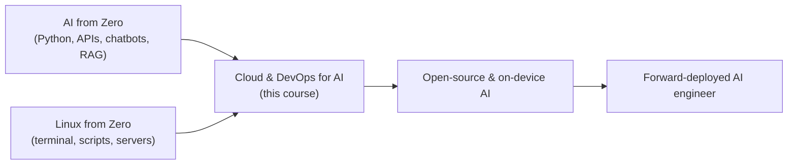

# Cloud & DevOps for AI ☁️

**From "it works on my laptop" to "it runs for everyone".** 28 hands-on lessons that teach you to save and share code with Git and GitHub, test it automatically, pack AI apps into Docker containers, split them into services, run them on Kubernetes, and operate them in the cloud with monitoring and good security.

Like you're 5: you have built a great toy (your AI app). This course teaches you to keep a diary of every change (Git), share it with friends (GitHub), put it in a lunch box that works in any kitchen (Docker), and run a whole restaurant of lunch boxes that never closes (Kubernetes and the cloud).

Every lesson follows the same pattern, so you never get stuck on your own: what you'll build → why it matters → what you'll learn → install → run it (with the real output you should see) → how it works, with every command, flag and YAML key explained piece by piece → fixes for common problems → three exercises with hints and solutions → a short self-check quiz → official docs and videos → the next lesson.

## The parts

| Part | You'll be able to | Time |
|------|-------------------|------|
| [1 · Git & GitHub](part-1-git-and-github) | save every version of your code, work on branches, fix merge conflicts, open pull requests, run tests automatically on every push | 1 week |
| [2 · Docker](part-2-docker) | run any software in a container, write a Dockerfile for a FastAPI AI API, make images small and safe, run an API + database + cache + local LLM together | 1–2 weeks |
| [3 · Microservices](part-3-microservices) | split an AI app into small services that talk over HTTP, add a queue for slow LLM jobs, a gateway, and timeouts/retries | 1–2 weeks |
| [4 · Kubernetes](part-4-kubernetes) | run your containers on a cluster that heals itself, scales, updates without downtime, and serves models (with GPUs) | 2 weeks |
| [5 · Cloud & operations](part-5-cloud-and-operations) | understand the cloud's building blocks, create infrastructure with Terraform, watch your app with logs/metrics/traces, keep secrets safe, and ship everything end to end | 1–2 weeks |

**Total: about 6–8 weeks at 1 hour a day.**

## All 28 lessons

**Part 1 · Git & GitHub**

- [01 · Git basics: save points](part-1-git-and-github/01-git-basics-save-points)
- [02 · Branches and merge conflicts](part-1-git-and-github/02-branches-and-merge-conflicts)
- [03 · GitHub and pull requests](part-1-git-and-github/03-github-and-pull-requests)
- [04 · CI with GitHub Actions](part-1-git-and-github/04-ci-with-github-actions)

**Part 2 · Docker**

- [05 · What is a container?](part-2-docker/05-what-is-a-container)
- [06 · Running containers: ports, volumes, env](part-2-docker/06-running-containers-ports-volumes-env)
- [07 · A Dockerfile for an AI API](part-2-docker/07-dockerfile-for-an-ai-api)
- [08 · Smaller, safer images](part-2-docker/08-smaller-safer-images)
- [09 · Docker Compose: multi-container apps](part-2-docker/09-docker-compose-multi-container-apps)
- [10 · Local LLMs in Docker](part-2-docker/10-local-llms-in-docker)

**Part 3 · Microservices**

- [11 · Monolith vs microservices](part-3-microservices/11-monolith-vs-microservices)
- [12 · Split an AI app into services](part-3-microservices/12-split-an-ai-app-into-services)
- [13 · Queues and background workers](part-3-microservices/13-queues-and-background-workers)
- [14 · Reverse proxy and API gateway](part-3-microservices/14-reverse-proxy-and-api-gateway)
- [15 · Resilience: timeouts, retries, circuit breakers](part-3-microservices/15-resilience-timeouts-retries-circuit-breakers)

**Part 4 · Kubernetes**

- [16 · Why Kubernetes, and your first cluster](part-4-kubernetes/16-why-kubernetes-and-your-first-cluster)
- [17 · Pods and Deployments](part-4-kubernetes/17-pods-and-deployments)
- [18 · Services and Ingress](part-4-kubernetes/18-services-and-ingress)
- [19 · ConfigMaps and Secrets](part-4-kubernetes/19-configmaps-and-secrets)
- [20 · Scaling, rolling updates, rollbacks](part-4-kubernetes/20-scaling-rolling-updates-rollbacks)
- [21 · Helm charts](part-4-kubernetes/21-helm-charts)
- [22 · Deploy the AI microservices to Kubernetes](part-4-kubernetes/22-deploy-the-ai-microservices-to-kubernetes)
- [23 · Serving models on Kubernetes with GPUs](part-4-kubernetes/23-serving-models-on-kubernetes-with-gpus)

**Part 5 · Cloud & operations**

- [24 · Cloud basics: compute, storage, IAM, networks](part-5-cloud-and-operations/24-cloud-basics-compute-storage-iam-networks)
- [25 · Infrastructure as code with Terraform](part-5-cloud-and-operations/25-infrastructure-as-code-with-terraform)
- [26 · Observability: logs, metrics, traces](part-5-cloud-and-operations/26-observability-logs-metrics-traces)
- [27 · Security and secrets in production](part-5-cloud-and-operations/27-security-and-secrets-in-production)
- [28 · Capstone: ship an AI platform end to end](part-5-cloud-and-operations/28-capstone-ship-an-ai-platform-end-to-end)

## Before you start (prerequisites)
- **Linux terminal basics:** [Linux from Zero](../linux-from-zero), Parts 1–3 (moving around folders, editing files, running scripts). Every command here is still explained, but you should feel at home in a terminal.
- **A little Python and FastAPI:** [AI from Zero, Part 1 · APIs](../ai-from-zero/part-1-apis). The apps we deploy are small FastAPI services.

## Set up once
You install tools part by part; each part's README has the exact steps. In short:

| Tool | Needed from | What it is for |
|------|-------------|----------------|
| Git 2.28 or newer | Part 1 | saving versions of your code |
| A free GitHub account | Lesson 03 | sharing code, pull requests, automatic tests |
| Python 3.12 + a venv | Lesson 04 | running the small FastAPI apps and their tests |
| Docker (Docker Desktop on Windows/Mac, Docker Engine on Linux) | Part 2 | containers |
| kind, kubectl, Helm | Part 4 | a Kubernetes cluster on your own laptop |
| Terraform | Lesson 25 | infrastructure as code |

**Windows users:** do everything inside **WSL2 Ubuntu** (see [Linux from Zero, lesson 01](../linux-from-zero/part-1-first-steps/01-what-is-linux-and-the-terminal)). Docker Desktop plugs into WSL2 automatically.

**Costs:** everything runs free on your own computer. GitHub and GitHub Actions are free for public repositories. The cloud lessons (Part 5) show free-tier options and include a runnable local version, so you never need a credit card to finish the course.

**Practice folders:** some lessons ship a `setup.sh` that creates practice files in `~/devops-practice/NN` (in your home folder), never anywhere else.

## How each lesson works
1. Open the lesson folder and read its README from the top.
2. `cd` into the folder (from this course folder), run the commands in **Run it** one step at a time, and compare with **What you should see**.
3. Read **How it works** with the files open next to it. Every command, symbol, flag, Dockerfile line and YAML key is explained in a "piece by piece" table the first time it appears.
4. Do the three **Try this** exercises, then answer **Check yourself** without peeking.

## Where this sits in the roadmap

When you finish lesson 28, go on to → [Open-source & on-device AI](../open-source-and-on-device-ai).

**Start here:** → [Part 1 · Git & GitHub](part-1-git-and-github), lesson [01 · Git basics: save points](part-1-git-and-github/01-git-basics-save-points).
