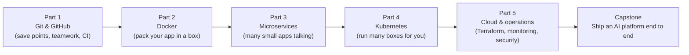

# Cloud & DevOps for AI ☁️

**A guided path through the best free material** on Git, Docker, microservices, Kubernetes, the cloud, infrastructure as code, monitoring and security, in the order an AI engineer needs them.

The DevOps world already has world-class free courses, books and hands-on labs. This guide picks the best one for each topic and tells you **what to learn, where, what to build, and how you know you're done**. Everything you practise uses an AI app you already built (for example the chatbot API from [AI from Zero Part 4](../ai-from-zero/part-4-chatbots)).

**Time:** about 6–8 weeks at 1 hour a day · **Before this:** [Linux from Zero](../linux-from-zero) Parts 1–3 and [AI from Zero Part 1](../ai-from-zero/part-1-apis) (FastAPI) · **Cost:** free (cloud free tiers; set a billing alarm on day 1)

## How to use this guide
Each topic has:
- **Like you're 5:** the idea in one line.
- **Learn:** the best free course, book or lab for it.
- **Watch:** a YouTube search (pick the top result from the named channel).
- **Build:** a concrete task on your own AI app.
- **Done when:** a check you can do without looking anything up.

Keep open the whole time: [roadmap.sh/devops](https://roadmap.sh/devops) (the big map), [90 Days of DevOps](https://github.com/MichaelCade/90DaysOfDevOps) (a free day-by-day community course) and [DevOps exercises](https://github.com/bregman-arie/devops-exercises) (thousands of interview-style questions with answers, perfect for testing yourself).

## The big map

---

## Part 1 · Git and GitHub (week 1)
**Main course:** the free book **[Pro Git](https://git-scm.com/book/en/v2)** (chapters 1–3, 6) and the game **[Learn Git Branching](https://learngitbranching.js.org)**.

| # | Topic | Like you're 5 | Learn | Build | Done when you can... |
|---|-------|---------------|-------|-------|----------------------|
| 1 | Git basics | Save points for your code, like in a video game | [Pro Git ch. 1–2](https://git-scm.com/book/en/v2) | Put your chatbot app in a repo: `init`, `add`, `commit`, `log`, `diff`, `.gitignore` | undo a bad change with `git restore` |
| 2 | Branches and merge conflicts | A branch is a parallel universe; merging joins them back | [Learn Git Branching](https://learngitbranching.js.org) (levels 1–4) | Make two branches edit the same line, merge, fix the conflict by hand | resolve a conflict without fear |
| 3 | GitHub and pull requests | GitHub is a shared home for repos; a PR says "please check my change" | [GitHub Skills](https://skills.github.com) · [First Contributions](https://github.com/firstcontributions/first-contributions) | Push to GitHub with SSH keys; open a PR; review it; merge | make your first contribution to someone else's repo |
| 4 | CI with GitHub Actions | A robot that runs your tests every time you push | [GitHub Actions quickstart](https://docs.github.com/en/actions/writing-workflows/quickstart) | Add a workflow that runs `ruff` and `pytest` on every push | explain every line of your workflow YAML |

**Rescue kit:** [Git Flight Rules](https://github.com/k88hudson/git-flight-rules) ("I did X by mistake, how do I fix it?").
**Watch:** [freeCodeCamp Git and GitHub for beginners](https://www.youtube.com/results?search_query=freecodecamp+git+and+github+for+beginners+crash+course) · [Fireship Git in 100 seconds](https://www.youtube.com/results?search_query=fireship+git+explained+in+100+seconds) · [TechWorld with Nana GitHub Actions](https://www.youtube.com/results?search_query=techworld+with+nana+github+actions+tutorial)

---

## Part 2 · Docker (weeks 2–3)
**Main course:** **[Docker's official Get Started guide](https://docs.docker.com/get-started/)** plus the hands-on labs in **[dockerlabs](https://github.com/collabnix/dockerlabs)**. Try commands online at [Play with Docker](https://labs.play-with-docker.com).

| # | Topic | Like you're 5 | Learn | Build | Done when you can... |
|---|-------|---------------|-------|-------|----------------------|
| 5 | What a container is | A lunchbox with your app and everything it needs, so it runs the same everywhere | [Docker: What is a container?](https://docs.docker.com/get-started/docker-concepts/the-basics/what-is-a-container/) | Run `hello-world`, `ubuntu`, `python:3.12` | explain image vs container |
| 6 | Running containers | Start, stop, peek inside, share folders and ports | [Docker cheat sheet](https://github.com/wsargent/docker-cheat-sheet) | `docker run -d -p 8080:80 -v ... -e ... --name --rm`, `logs`, `exec`, `ps` | explain every flag in your `docker run` line |
| 7 | A Dockerfile for your AI API | A recipe that builds the lunchbox | [Dockerfile reference](https://docs.docker.com/reference/dockerfile/) | Write a Dockerfile for your FastAPI chatbot; build and run it | explain layer caching and why `COPY requirements.txt` comes first |
| 8 | Smaller, safer images | Pack only what you need, and don't run as the boss | [Docker build best practices](https://docs.docker.com/build/building/best-practices/) | Multi-stage build, `python:3.12-slim`, non-root user, `.dockerignore`, `HEALTHCHECK`; compare sizes | shrink your image by more than half |
| 9 | Docker Compose | One file that starts your API, database and cache together | [Compose docs](https://docs.docker.com/compose/) · [awesome-compose examples](https://github.com/docker/awesome-compose) | API + Postgres + Redis in one `compose.yaml` with health checks and a volume | start and stop the whole stack with one command |
| 10 | Local LLMs in Docker | Run the AI model itself in a box | [Ollama Docker guide](https://github.com/ollama/ollama/blob/main/docs/docker.mdx) | Add `ollama/ollama` to your compose file and call it from your API | your API answers using a model running in Docker |

**More:** [awesome-docker](https://github.com/veggiemonk/awesome-docker) · [Docker Zero to Hero (Abhishek Veeramalla)](https://github.com/iam-veeramalla/Docker-Zero-to-Hero) · [roadmap.sh/docker](https://roadmap.sh/docker)
**Watch:** [TechWorld with Nana Docker tutorial for beginners](https://www.youtube.com/results?search_query=techworld+with+nana+docker+tutorial+for+beginners) · [freeCodeCamp Docker course](https://www.youtube.com/results?search_query=freecodecamp+docker+containers+full+course) · [Fireship Docker in 100 seconds](https://www.youtube.com/results?search_query=fireship+docker+in+100+seconds)

---

## Part 3 · Microservices (week 4)
**Main course:** **[microservices.io patterns](https://microservices.io/patterns/)** (Chris Richardson), **[The Twelve-Factor App](https://12factor.net)**, and the **[System Design Primer](https://github.com/donnemartin/system-design-primer)**. See a real example in Google's **[microservices demo](https://github.com/GoogleCloudPlatform/microservices-demo)** (11 services).

| # | Topic | Like you're 5 | Learn | Build | Done when you can... |
|---|-------|---------------|-------|-------|----------------------|
| 11 | Monolith vs microservices | One big restaurant kitchen vs a food court of small stalls | [microservices.io: Monolith vs microservices](https://microservices.io/patterns/microservices.html) · [System Design 101](https://github.com/ByteByteGoHq/system-design-101) | Write one page: should your AI app be split? Why or why not? | list 3 good reasons NOT to use microservices |
| 12 | Split an AI app into services | Gateway takes orders; RAG service finds facts; LLM service writes answers | [12factor.net](https://12factor.net) | Split your RAG chatbot into `gateway`, `rag-service`, `llm-service` talking over HTTP, in compose | each service starts, stops and scales on its own |
| 13 | Queues and background workers | A ticket queue so slow jobs don't block the counter | [Redis queues (RQ docs)](https://python-rq.org) | Long LLM jobs go to a Redis queue; a worker processes them; the API returns a job ID to poll | the API stays fast while 10 long jobs run |
| 14 | Reverse proxy and API gateway | One front door that sends each visitor to the right room | [nginx beginner's guide](https://nginx.org/en/docs/beginners_guide.html) | Put nginx in front: path routing and rate limiting | explain each line of your `nginx.conf` |
| 15 | Resilience | Plan for a friend not answering the phone: wait, retry, then stop calling for a while | [microservices.io: Circuit breaker](https://microservices.io/patterns/reliability/circuit-breaker.html) · [Tenacity (Python retries)](https://tenacity.readthedocs.io) | Add timeouts, retries with backoff and jitter, and a circuit breaker; kill a service and watch it recover | explain idempotency keys |

**Watch:** [ByteByteGo microservices](https://www.youtube.com/results?search_query=bytebytego+microservices+architecture) · [Hussein Nasser: API gateway](https://www.youtube.com/results?search_query=hussein+nasser+api+gateway) · [TechWorld with Nana: microservices explained](https://www.youtube.com/results?search_query=techworld+with+nana+microservices+explained)

---

## Part 4 · Kubernetes (weeks 5–6)
**Main course:** **[Kubernetes official tutorials](https://kubernetes.io/docs/tutorials/)**, the **[Kubernetes learning path](https://github.com/techiescamp/kubernetes-learning-path)**, and free browser labs on **[Killercoda](https://killercoda.com/playgrounds)**. Run a cluster on your laptop with **[kind](https://kind.sigs.k8s.io)**.

| # | Topic | Like you're 5 | Learn | Build | Done when you can... |
|---|-------|---------------|-------|-------|----------------------|
| 16 | Why Kubernetes; first cluster | A robot manager that keeps your lunchboxes running, restarts crashed ones, and adds more when busy | [Kubernetes basics tutorial](https://kubernetes.io/docs/tutorials/kubernetes-basics/) · [kind quick start](https://kind.sigs.k8s.io/docs/user/quick-start/) | Create a kind cluster; `kubectl get nodes` | draw control plane, nodes and pods |
| 17 | Pods and Deployments | A Deployment says "always keep 3 copies of my app running" | [Deployments](https://kubernetes.io/docs/concepts/workloads/controllers/deployment/) | Deploy your API image with 3 replicas; delete a pod and watch it come back | explain every key in your Deployment YAML |
| 18 | Services and Ingress | A stable phone number for pods that keep changing | [Service](https://kubernetes.io/docs/concepts/services-networking/service/) · [Ingress](https://kubernetes.io/docs/concepts/services-networking/ingress/) | ClusterIP service + ingress-nginx on kind; reach your API at a hostname | explain ClusterIP vs NodePort vs LoadBalancer |
| 19 | ConfigMaps and Secrets | Settings and passwords kept outside the image | [ConfigMaps](https://kubernetes.io/docs/concepts/configuration/configmap/) · [Secrets](https://kubernetes.io/docs/concepts/configuration/secret/) | Move `CLAUDE_MODEL` to a ConfigMap and the API key to a Secret | explain why base64 is not encryption |
| 20 | Scaling, rolling updates, rollbacks | Add more workers when busy; swap versions with no downtime; undo if bad | [Horizontal Pod Autoscaling walkthrough](https://kubernetes.io/docs/tasks/run-application/horizontal-pod-autoscale-walkthrough/) | Add readiness/liveness probes and an HPA; do a rolling update, then `kubectl rollout undo` | roll back a bad release in under a minute |
| 21 | Helm charts | A package of all your YAML with settings you can change | [Helm docs: quickstart](https://helm.sh/docs/intro/quickstart/) | Turn your manifests into a chart with `values.yaml`; install, upgrade, rollback | explain `templates/` and `values.yaml` |
| 22 | Deploy the AI microservices | Everything from Part 3, now on Kubernetes | [Kubernetes learning path](https://github.com/techiescamp/kubernetes-learning-path) | Deploy gateway + rag + llm + worker + Redis with your Helm chart | the whole app runs on kind and survives pod deletions |
| 23 | Serving models on Kubernetes with GPUs | Give the model its own box with a graphics card | [Schedule GPUs](https://kubernetes.io/docs/tasks/manage-gpus/scheduling-gpus/) · [vLLM docs (deployment section)](https://docs.vllm.ai) · [KServe](https://kserve.github.io/website/) | Deploy Ollama with a small model on CPU; read how GPU requests work | explain `resources.limits: nvidia.com/gpu: 1` |

**Deep dive (optional):** [Kubernetes the Hard Way](https://github.com/kelseyhightower/kubernetes-the-hard-way) builds a cluster by hand. **Reference list:** [awesome-kubernetes](https://github.com/ramitsurana/awesome-kubernetes) · [roadmap.sh/kubernetes](https://roadmap.sh/kubernetes)
**Watch:** [TechWorld with Nana Kubernetes full course](https://www.youtube.com/results?search_query=techworld+with+nana+kubernetes+tutorial+for+beginners) · [freeCodeCamp Kubernetes course](https://www.youtube.com/results?search_query=freecodecamp+kubernetes+course+beginners) · [Fireship Kubernetes explained](https://www.youtube.com/results?search_query=fireship+kubernetes+explained+in+100+seconds)

---

## Part 5 · Cloud and operations (weeks 7–8)
**Main course:** the cloud provider's own free training (pick **one** cloud to start), **[Terraform tutorials](https://developer.hashicorp.com/terraform/tutorials)**, the **[OpenTelemetry demo](https://github.com/open-telemetry/opentelemetry-demo)**, and Google's free **[SRE books](https://sre.google/books/)**.

| # | Topic | Like you're 5 | Learn | Build | Done when you can... |
|---|-------|---------------|-------|-------|----------------------|
| 24 | Cloud basics | Renting computers, disks and networks by the minute | [AWS Skill Builder: Cloud Practitioner Essentials](https://skillbuilder.aws) · [Google Cloud Skills Boost](https://www.cloudskillsboost.google) · [Microsoft Learn: Azure Fundamentals](https://learn.microsoft.com/en-us/training/azure/) | Create a free-tier account, set a **billing alarm**, launch and delete one small VM | explain IAM, VPC, subnet and security group with a building analogy |
| 25 | Infrastructure as code (Terraform) | Write down the whole building plan so you can rebuild it any time | [Terraform tutorials: Get started](https://developer.hashicorp.com/terraform/tutorials) · [awesome-terraform](https://github.com/shuaibiyy/awesome-tf) | Use Terraform's docker provider to create your containers; then read an AWS example | `plan`, `apply` and `destroy` without surprises |
| 26 | Observability: logs, metrics, traces | The app's diary, heartbeat monitor and GPS tracker | [Prometheus getting started](https://prometheus.io/docs/prometheus/latest/getting_started/) · [OpenTelemetry docs](https://opentelemetry.io/docs/) · [kube-prometheus](https://github.com/prometheus-operator/kube-prometheus) | Structured JSON logs, a `/metrics` endpoint, a Grafana dashboard, a trace of one LLM call | find the slow step in a request from a trace |
| 27 | Security and secrets in production | Locks, keys and alarms for your app | [OWASP Top 10](https://owasp.org/www-project-top-ten/) · [OWASP Top 10 for LLM apps](https://genai.owasp.org) · [Trivy](https://github.com/aquasecurity/trivy) | Scan your image with Trivy, fix the findings, move secrets to a secret manager, add a network policy | explain least privilege and show it in your setup |
| 28 | **Capstone:** ship an AI platform end to end | Everything together, the way a real team does it | [90 Days of DevOps](https://github.com/MichaelCade/90DaysOfDevOps) · [How they SRE](https://github.com/upgundecha/howtheysre) | git → GitHub Actions CI → images → kind cluster via Helm → Prometheus/Grafana → a one-page runbook | a friend can follow your README and get it running |

**More practice:** [DevOps exercises](https://github.com/bregman-arie/devops-exercises) · [DevOps roadmap (milanm)](https://github.com/milanm/DevOps-Roadmap) · [awesome-sre](https://github.com/dastergon/awesome-sre)
**Watch:** [freeCodeCamp Terraform course](https://www.youtube.com/results?search_query=freecodecamp+terraform+course+for+beginners) · [TechWorld with Nana Prometheus](https://www.youtube.com/results?search_query=techworld+with+nana+prometheus+monitoring) · [freeCodeCamp AWS Cloud Practitioner](https://www.youtube.com/results?search_query=freecodecamp+aws+certified+cloud+practitioner+full+course) · [ByteByteGo system design](https://www.youtube.com/results?search_query=bytebytego+system+design+interview)

---

## Bookmark these
| What | Why |
|------|-----|
| [roadmap.sh/devops](https://roadmap.sh/devops) and the [developer-roadmap repo](https://github.com/kamranahmedse/developer-roadmap) | the big picture, to see what's left |
| [90 Days of DevOps](https://github.com/MichaelCade/90DaysOfDevOps) | a complete free course, one topic per day |
| [DevOps exercises](https://github.com/bregman-arie/devops-exercises) | test yourself, and prepare for interviews |
| [System Design Primer](https://github.com/donnemartin/system-design-primer) and [System Design 101](https://github.com/ByteByteGoHq/system-design-101) | how big systems are designed, with pictures |
| [Killercoda](https://killercoda.com) | free browser labs for Linux, Docker and Kubernetes |

## Next
→ [Open-Source & On-Device AI](../open-source-and-on-device-ai): run and serve AI models on your own hardware.
