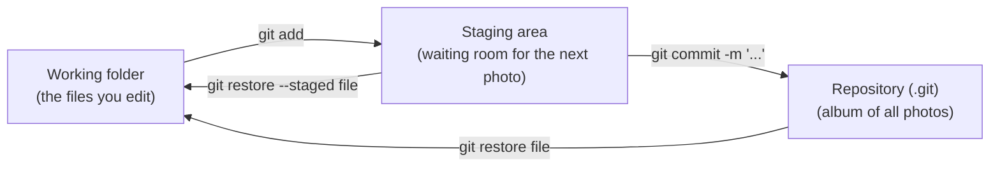

# 01 · Git basics: save points

**What you'll build:** a small Python project with a real Git history: two saved versions you can read, compare and rewind, with a secret API key and junk files kept out of it.
**Like you're 5:** Git is the "save game" button of a video game. Each save point (a **commit**) is a photo of your whole project, and you can always go back to an old photo.
**Time:** ~60 min · **Builds on:** [Linux from Zero, Parts 1–3](../../../linux-from-zero) · **Needs:** Git 2.28+ (see [Part 1 README](../README.md))

## Why this matters
Every software and AI team keeps its code in Git: the code behind ChatGPT, Claude's SDKs, PyTorch and FastAPI all live in Git repositories. Without it, people email `app_final_v3_REALLY_final.py` around and lose work. With it, you can see exactly who changed what and when, undo a bad change in seconds, and (in the next lessons) work with a whole team and robots that test your code.

## What you'll learn
- **Repository (repo):** a project folder that Git watches. Git keeps its notes in a hidden `.git` folder inside it.
- **Commit:** one save point: a photo of the files you chose, with a message saying what changed and why.
- **Staging area:** the "waiting room" where you put changes you want in the next photo (`git add`), before you take it (`git commit`).
- **Diff:** a list of exactly which lines changed (`-` removed, `+` added).
- **.gitignore:** a list of files Git must pretend not to see, like secrets (`.env`) and junk (`__pycache__/`).

## Before you start
- Git is installed: `git --version` prints `git version 2.28` or newer. If not, follow [Part 1 → Install once](../README.md#install-once-for-this-part).
- Python 3 is installed (`python3 --version`), only to run the tiny practice program.
- No API key needed. No GitHub account needed yet.

## Run it
Do every step in order, in one terminal. On Windows use your WSL2 Ubuntu terminal.

### Step 1 · Tell Git who you are (once per computer)
Every save point is signed with a name and email. Use your real name and the email you will use on GitHub.
```bash
git config --global user.name "Sam Rivera"
git config --global user.email "sam@example.com"
git config --global init.defaultBranch main
git config --global core.editor nano
```
**Command, piece by piece** (first line):

| Piece | Meaning |
|-------|---------|
| `git` | the Git program. Everything you ask Git starts with this word. |
| `config` | the sub-command: "change a setting". |
| `--global` | save it for **every** project of your user (in the file `~/.gitconfig`), not just one. |
| `user.name` | the setting's name: who you are. |
| `"Sam Rivera"` | the value. The quotes keep the two words together as one value. |

The other lines: `user.email` is your email; `init.defaultBranch main` names the first branch of new projects `main` (older Git calls it `master`); `core.editor nano` makes Git open the easy `nano` editor if it ever needs you to type a message.

Check your settings:
```bash
git config --global --list
```
You should see:
```
user.name=Sam Rivera
user.email=sam@example.com
init.defaultbranch=main
core.editor=nano
```
(`--list` = show all settings. Git prints setting names in lower case.)

### Step 2 · Create the practice project
From the course folder (`cloud-and-devops-for-ai`):
```bash
bash part-1-git-and-github/01-git-basics-save-points/setup.sh
```
| Piece | Meaning |
|-------|---------|
| `bash` | run a shell script with the Bash program |
| `part-1-git-and-github/01-git-basics-save-points/setup.sh` | the path to the script; each `/` goes one folder deeper |

You should see:
```
Practice project created in: /home/sam/devops-practice/01/mood-app
Next:  cd ~/devops-practice/01/mood-app
```

### Step 3 · Go into the project and look around
```bash
cd ~/devops-practice/01/mood-app
ls -a
python3 mood.py
```
(`cd` = change directory, `~` = your home folder, `ls -a` = list **a**ll files including hidden ones that start with a dot.)

You should see:
```
.  ..  .env  README.md  __pycache__  debug.log  mood.py
I love this great course -> happy
```
- `mood.py` is the program and `README.md` describes it: **worth saving**.
- `.env` holds a (pretend) API key: a **secret**, must never be saved in Git.
- `__pycache__/` and `debug.log` are junk that programs create by themselves: **not worth saving**.

### Step 4 · Turn the folder into a Git repository
```bash
git status
git init
```
| Piece | Meaning |
|-------|---------|
| `git status` | "what is going on here?" Your best friend: run it all the time. |
| `git init` | **init**ialise: start watching this folder. Creates the hidden `.git` folder where Git keeps every save. |

You should see:
```
fatal: not a git repository (or any of the parent directories): .git
Initialized empty Git repository in /home/sam/devops-practice/01/mood-app/.git/
```
The first line is normal: before `git init`, this folder is not a repository yet.

### Step 5 · Ask Git what it sees
```bash
git status
```
You should see:
```
On branch main

No commits yet

Untracked files:
  (use "git add <file>..." to include in what will be committed)
	.env
	README.md
	__pycache__/
	debug.log
	mood.py

nothing added to commit but untracked files present (use "git add" to track)
```
**Untracked** = "I can see these files, but I am not saving them." Notice `.env` is there: if you saved everything now, your secret would be in the history forever.

### Step 6 · Make a .gitignore so secrets and junk stay out
Open a new file in nano:
```bash
nano .gitignore
```
Type these lines, then save with **Ctrl + O**, **Enter**, and exit with **Ctrl + X**:
```gitignore
# Secrets: never save these
.env

# Junk that programs create on their own
__pycache__/
*.log
```
**.gitignore, line by line:**

| Line | Meaning |
|------|---------|
| `# Secrets: ...` | a comment for humans. Lines starting with `#` are ignored. |
| `.env` | ignore any file called exactly `.env`. |
| `__pycache__/` | the `/` at the end means "a folder": ignore that folder and everything inside it. |
| `*.log` | `*` means "any characters", so this ignores every file ending in `.log`. |

Now check:
```bash
git status
```
You should see only three files left:
```
Untracked files:
  (use "git add <file>..." to include in what will be committed)
	.gitignore
	README.md
	mood.py
```

### Step 7 · Put files in the waiting room (stage them)
```bash
git add mood.py README.md .gitignore
git status
```
| Piece | Meaning |
|-------|---------|
| `git add` | put these files' current content into the **staging area** (the waiting room for the next save) |
| `mood.py README.md .gitignore` | which files. Separate names with spaces. (`git add .` would add everything not ignored; `.` means "this folder".) |

You should see:
```
Changes to be committed:
  (use "git rm --cached <file>..." to unstage)
	new file:   .gitignore
	new file:   README.md
	new file:   mood.py
```

### Step 8 · Take the photo: your first commit
```bash
git commit -m "First save: mood app with README"
```
| Piece | Meaning |
|-------|---------|
| `git commit` | save everything in the waiting room as a new save point |
| `-m` | **m**essage: the text that follows describes this save |
| `"First save: ..."` | the message. Write what changed and why, like a short note to future you. |

You should see:
```
[main (root-commit) 31b9b72] First save: mood app with README
 3 files changed, 35 insertions(+)
 create mode 100644 .gitignore
 create mode 100644 README.md
 create mode 100644 mood.py
```
`31b9b72` is the start of this commit's **ID** (a "hash"). Yours will be different: it is calculated from the content, your name and the time. `root-commit` means "the very first one". `100644` is Git's code for "a normal file".

### Step 9 · Read the history
```bash
git log
```
You should see:
```
commit 31b9b72c2e98a4302f34734218b9e3a12f6e5d66
Author: Sam Rivera <sam@example.com>
Date:   Thu Oct 22 09:00:22 2026 +0000

    First save: mood app with README
```
If the output fills the screen and shows `:` or `(END)` at the bottom, press **q** to quit the viewer.

### Step 10 · Change something and see the difference
Open `mood.py` with `nano mood.py` and change the line
```python
HAPPY_WORDS = ["good", "great", "love", "happy"]
```
to
```python
HAPPY_WORDS = ["good", "great", "love", "happy", "amazing"]
```
Save and exit (**Ctrl + O**, **Enter**, **Ctrl + X**). Then:
```bash
python3 mood.py this is amazing
git status
git diff
```
You should see:
```
this is amazing -> happy
On branch main
Changes not staged for commit:
  (use "git add <file>..." to update what will be committed)
  (use "git restore <file>..." to discard changes in working directory)
	modified:   mood.py

no changes added to commit (use "git add" and/or "git commit -a")
diff --git a/mood.py b/mood.py
index 0158ed9..e83485f 100644
--- a/mood.py
+++ b/mood.py
@@ -1,7 +1,7 @@
 # mood.py - guesses if a sentence sounds happy or sad.
 import sys
 
-HAPPY_WORDS = ["good", "great", "love", "happy"]
+HAPPY_WORDS = ["good", "great", "love", "happy", "amazing"]
 SAD_WORDS = ["bad", "awful", "hate", "sad"]
```
**Reading a diff, piece by piece:**

| Piece | Meaning |
|-------|---------|
| `--- a/mood.py` | the **old** version (the last save) |
| `+++ b/mood.py` | the **new** version (your folder right now) |
| `@@ -1,7 +1,7 @@` | "this chunk starts at line 1 and shows 7 lines, in both old and new" |
| line starting with `-` | removed (or the old version of a changed line) |
| line starting with `+` | added (or the new version of a changed line) |
| line starting with a space | unchanged, shown for context |

### Step 11 · Stage and save the change
```bash
git add mood.py
git diff
git diff --staged
git commit -m "Add 'amazing' to the happy words"
git log --oneline
```
`git diff` now prints **nothing**: it compares your folder with the waiting room, and they are the same. `git diff --staged` compares the waiting room with the last save, so it shows the change you are about to commit.

You should see (last part):
```
[main 3c4914f] Add 'amazing' to the happy words
 1 file changed, 1 insertion(+), 1 deletion(-)
3c4914f Add 'amazing' to the happy words
31b9b72 First save: mood app with README
```
`--oneline` = one short line per commit, newest first.

### Step 12 · Oops! Undo a mistake with git restore
Pretend you broke the file: empty it completely.
```bash
: > mood.py
python3 mood.py
git status
```
(`:` is a command that does nothing; `>` writes its empty output into `mood.py`, which empties the file.) The program now prints nothing, and `git status` says `modified: mood.py`. Bring the last saved version back:
```bash
git restore mood.py
python3 mood.py
git status
```
You should see:
```
I love this great course -> happy
On branch main
nothing to commit, working tree clean
```
| Piece | Meaning |
|-------|---------|
| `git restore` | put a file back the way it was in the last save (or the waiting room) |
| `mood.py` | which file |

**Careful:** `git restore` throws away your unsaved changes to that file. That is what you want here, but there is no undo for it.

### Step 13 · Load an older save point
```bash
git restore --source=HEAD~1 mood.py
grep HAPPY_WORDS mood.py
```
You should see the old list, without "amazing":
```
HAPPY_WORDS = ["good", "great", "love", "happy"]
```
| Piece | Meaning |
|-------|---------|
| `--source=` | "take the file from this save point instead of the latest one" |
| `HEAD` | a nickname for "the commit I am on right now" (the latest save) |
| `~1` | "one step back". `HEAD~1` = the save before the latest, `HEAD~2` = two back. You can also paste a commit ID like `31b9b72`. |
| `grep HAPPY_WORDS mood.py` | print the lines of `mood.py` that contain `HAPPY_WORDS` |

Your history did not change: you only copied an old version of one file into your folder. To go back to the latest version: `git restore mood.py`.

### What you should see
At the end, `git log --oneline` shows your two save points and `git status` says the folder is clean:
```
3c4914f Add 'amazing' to the happy words
31b9b72 First save: mood app with README
On branch main
nothing to commit, working tree clean
```
Your commit IDs and dates will differ. What matters: 2 commits, newest first, and `.env`, `debug.log` and `__pycache__/` never appear in `git status`. You can double-check that Git is ignoring them, and see which `.gitignore` line does it:
```bash
git check-ignore -v .env debug.log __pycache__/mood.cpython-312.pyc
```
```
.gitignore:2:.env	.env
.gitignore:6:*.log	debug.log
.gitignore:5:__pycache__/	__pycache__/mood.cpython-312.pyc
```

## How it works
Git has three places for your files. Think of a photo studio:



1. **Working folder:** the normal files you see and edit (`mood.py`).
2. **Staging area:** a list of "what goes into the next photo". `git add mood.py` copies the file's current content there. This lets you save only some changes, for example two files out of five, so each commit is about one thing.
3. **Repository:** the hidden `.git` folder. `git commit` turns the staging area into a permanent save point and adds it to the album. Each commit remembers its **parent** (the one before it), which is how `git log` can walk back through time and how `HEAD~1` works.
4. **`git status`** compares the three places and tells you what is new (untracked), changed but not staged ("not staged for commit"), and staged ("to be committed").
5. **`git diff`** compares the working folder with the staging area; **`git diff --staged`** compares the staging area with the last commit.
6. **`git restore`** goes the other way: it copies a saved version back over your file. `--staged` takes a file out of the waiting room without touching your edits; `--source=<commit>` takes the file from any older save.
7. **`.gitignore`** is read by `git status` and `git add`, so ignored files never get staged by accident. It only works for files that were never committed. If you already committed a secret, see "If something goes wrong".

**Good commit habits:** one idea per commit; a message that says what and why ("Add 'amazing' to the happy words", not "stuff"); commit often, like saving a game before a boss fight.

## If something goes wrong
- **`fatal: not a git repository`** → you are in the wrong folder, or forgot `git init`. Run `pwd` to see where you are, then `cd ~/devops-practice/01/mood-app`.
- **`Author identity unknown ... Please tell me who you are`** → you skipped Step 1. Run the two `git config --global user.name/user.email` lines, then commit again.
- **You typed `git commit` without `-m` and a strange editor opened** → if it is nano: type your message on the first line, then **Ctrl + O**, **Enter**, **Ctrl + X**. If it is vim (the screen shows `~` down the side): press **Esc**, type `:q!` and **Enter** to cancel, then run Step 1's `core.editor nano` line and commit again with `-m`.
- **`git log` "froze" and shows `(END)` or `:`** → it is a scrolling viewer. Press **q** to quit.
- **You committed a secret by accident** → if it was the last commit and you have not shared it: `git rm --cached .env`, add `.env` to `.gitignore`, then `git commit --amend -m "..."`. If you already pushed it anywhere, treat the key as stolen: **revoke it and create a new one** in the provider's console, because the old one stays in the history.

## Try this
1. Add the word `"fantastic"` to `HAPPY_WORDS`, check it with `git diff`, and commit it with a good message.
2. Change `README.md` and run `git add README.md`, then change your mind: take it out of the waiting room without losing your edit, and check `git status`.
3. Add `"terrible"` to `SAD_WORDS`, commit it, then make `mood.py` look exactly like it did two commits ago **in your folder only**, and look at `git status`. Finally go back to the latest version.

<details><summary>Hints and solutions</summary>

1. Edit with `nano mood.py`, then:
   ```bash
   git diff
   git add mood.py
   git commit -m "Add 'fantastic' to the happy words"
   git log --oneline
   ```
2. ```bash
   echo "- Try: python3 mood.py what a great day" >> README.md
   git add README.md
   git restore --staged README.md
   git status
   ```
   `>>` adds a line to the end of the file. After `restore --staged`, status shows `modified: README.md` under "Changes not staged": your edit is still in the file, just not in the waiting room. Use `git restore README.md` if you want to throw the edit away too.
3. After the commit:
   ```bash
   git restore --source=HEAD~2 mood.py
   git status          # modified: mood.py (an older version is in your folder)
   git restore mood.py # back to the latest saved version
   ```
</details>

## Check yourself
1. What is the difference between `git add` and `git commit`?
2. Why must `.env` be in `.gitignore` **before** your first commit?
3. After `git add mood.py`, why does `git diff` print nothing, while `git diff --staged` shows the change?
4. What does `HEAD~1` mean?

<details><summary>Answers</summary>

1. `git add` puts the current content of a file in the waiting room (staging area); `git commit` turns everything in the waiting room into a permanent save point with a message.
2. Once a file is committed, it lives in the history forever (even if you delete it later), and anyone who gets a copy of the repo can read it. `.gitignore` stops it from being added in the first place.
3. `git diff` compares your folder with the waiting room, and they are now the same. `git diff --staged` compares the waiting room with the last commit, where the change is still new.
4. The commit one step before `HEAD` (the commit you are on now), so "the previous save point".
</details>

## Learn more (optional)
**Read the official docs**
- Pro Git book (free, official), chapters 1–2: https://git-scm.com/book/en/v2
- Git reference for every command: https://git-scm.com/docs
- `git status`: https://git-scm.com/docs/git-status · `git add`: https://git-scm.com/docs/git-add · `git commit`: https://git-scm.com/docs/git-commit
- `git log`: https://git-scm.com/docs/git-log · `git diff`: https://git-scm.com/docs/git-diff · `git restore`: https://git-scm.com/docs/git-restore
- `.gitignore` patterns: https://git-scm.com/docs/gitignore
- GitHub's collection of ready-made `.gitignore` files (see `Python.gitignore`): https://github.com/github/gitignore

**Watch**
- Fireship, Git in 100 seconds: https://www.youtube.com/results?search_query=fireship+git+in+100+seconds
- freeCodeCamp, Git and GitHub for beginners (full course): https://www.youtube.com/results?search_query=freecodecamp+git+and+github+for+beginners+crash+course
- TechWorld with Nana, Git tutorial for beginners: https://www.youtube.com/results?search_query=techworld+with+nana+git+tutorial+for+beginners

## Next
→ [02 · Branches and merge conflicts](../02-branches-and-merge-conflicts)
