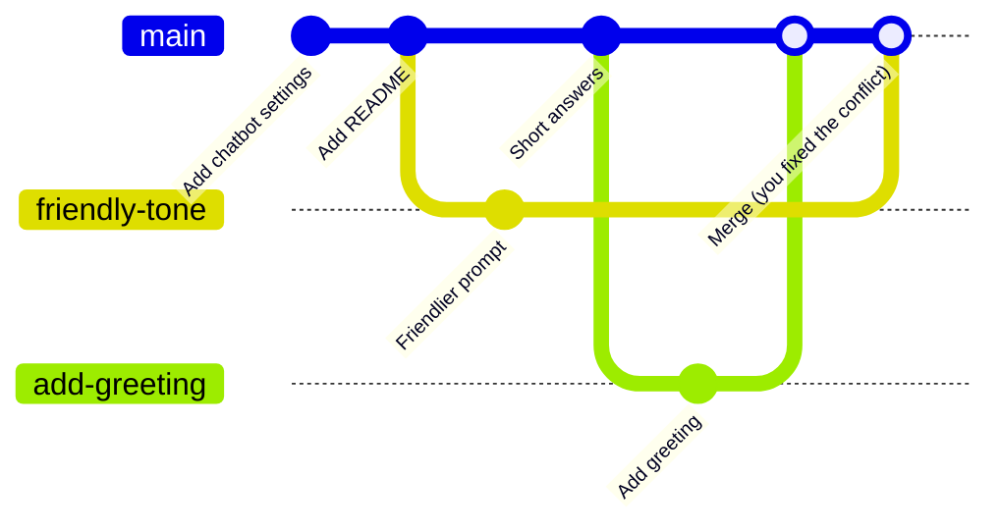

# 02 · Branches and merge conflicts

**What you'll build:** you will make a branch, merge it back, then hit a **real merge conflict** in a chatbot's settings file and fix it by hand, the same way you would at work.
**Like you're 5:** a branch is a copy of your drawing on tracing paper. You try ideas on the tracing paper without spoiling the original. Merging = putting the good lines back on the original. A conflict = two people drew on the same spot, and someone has to decide which line stays.
**Time:** ~60 min · **Builds on:** [01 · Git basics: save points](../01-git-basics-save-points) · **Needs:** Git 2.28+

## Why this matters
On a real team, five people change the same project on the same day. Branches let each person work on one feature (a new prompt, a bug fix) without breaking `main`, the version everyone relies on. When two people edit the same line, Git cannot guess who is right and stops with a **merge conflict**. Every engineer meets these weekly; fixing them calmly is a basic job skill.

## What you'll learn
- **Branch:** a named line of work. `main` is the main one; you make others for each feature or fix.
- **Switching:** moving your folder to another branch (`git switch`). Git swaps the files for you.
- **Merge:** bringing the commits from one branch into another (`git merge`).
- **Fast-forward:** the easy merge: `main` had no new commits, so Git just moves `main` forward.
- **Merge conflict:** both branches changed the same lines. Git marks the clash in the file with `<<<<<<<`, `=======` and `>>>>>>>`, and you pick the final version.

## Before you start
- Finish [lesson 01](../01-git-basics-save-points) (your name and email are set with `git config`).
- No install, no API key. The `setup.sh` script builds a practice repository with a history for you.

## Run it

### Step 1 · Build the practice repository
From the course folder (`cloud-and-devops-for-ai`):
```bash
bash part-1-git-and-github/02-branches-and-merge-conflicts/setup.sh
cd ~/devops-practice/02/chatbot
```
You should see:
```
Practice repository created in: /home/sam/devops-practice/02/chatbot
Branches: main (you are here) and friendly-tone.
Next:  cd ~/devops-practice/02/chatbot
```
The script made 4 commits. A teammate made the `friendly-tone` branch and changed the chatbot's `SYSTEM_PROMPT` line. Meanwhile someone changed **the same line** on `main` in a different way. That is a conflict waiting to happen.

### Step 2 · See the branches and the history as a picture
```bash
git branch
git log --oneline --graph --all
```
| Piece | Meaning |
|-------|---------|
| `git branch` | list the branches. `*` marks the one you are on. |
| `git log` | show the history (lesson 01) |
| `--oneline` | one short line per commit |
| `--graph` | draw the branches with `*`, `|`, `/` and `\` |
| `--all` | show every branch, not just the one you are on |

You should see (your IDs differ):
```
  friendly-tone
* main
* be85ab5 Make the assistant sound friendlier
| * 807b08a Ask for short answers
|/  
* 9abae02 Add README
* acb6fbc Add chatbot settings
```
Read the graph from the bottom up: two shared commits, then the history splits (`|/`) into two lines: one with "Ask for short answers" (`main`), one with "Make the assistant sound friendlier" (`friendly-tone`).

### Step 3 · Make your own branch and switch to it
```bash
git switch -c add-greeting
git branch
```
| Piece | Meaning |
|-------|---------|
| `git switch` | move to another branch |
| `-c` | **c**reate it first (a new branch starting from where you are now) |
| `add-greeting` | the new branch's name. Use short names with dashes, no spaces. |

You should see:
```
Switched to a new branch 'add-greeting'
* add-greeting
  friendly-tone
  main
```

### Step 4 · Commit on your branch
Add a greeting line at the end of `settings.py` (with `nano settings.py`, or with this command):
```bash
echo 'GREETING = "Hi! How can I help you today?"' >> settings.py
git add settings.py
git commit -m "Add a greeting message"
```
(`echo '...'` prints the text; `>>` adds it to the **end** of the file. One `>` would replace the whole file.)

You should see:
```
[add-greeting 4a4d349] Add a greeting message
 1 file changed, 1 insertion(+)
```

### Step 5 · Go back to main and see that it does not have your change
```bash
git switch main
cat settings.py
```
There is no `GREETING` line: `main` is untouched. Your work is safe on its own branch.

### Step 6 · Merge your branch into main (fast-forward)
You merge **into** the branch you are on, so stay on `main`:
```bash
git merge add-greeting
```
| Piece | Meaning |
|-------|---------|
| `git merge` | bring the commits of another branch into the current branch |
| `add-greeting` | the branch to bring in |

You should see:
```
Updating 807b08a..4a4d349
Fast-forward
 settings.py | 1 +
 1 file changed, 1 insertion(+)
```
**Fast-forward**: `main` had no new commits since `add-greeting` started, so Git simply slid the `main` label forward. No new commit was needed.

### Step 7 · Merge the teammate's branch: a conflict!
```bash
git merge friendly-tone
```
You should see:
```
Auto-merging settings.py
CONFLICT (content): Merge conflict in settings.py
Automatic merge failed; fix conflicts and then commit the result.
```
Don't panic. Nothing is lost. Git paused the merge halfway and is waiting for you.

### Step 8 · Look at the conflict
```bash
git status
cat settings.py
```
You should see:
```
On branch main
You have unmerged paths.
  (fix conflicts and run "git commit")
  (use "git merge --abort" to abort the merge)

Unmerged paths:
  (use "git add <file>..." to mark resolution)
	both modified:   settings.py
```
and inside the file:
```
# settings.py - how our chatbot behaves.
MODEL = "claude-haiku-5-5"
<<<<<<< HEAD
SYSTEM_PROMPT = "You are a helpful assistant. Keep answers short."
=======
SYSTEM_PROMPT = "You are a warm, friendly assistant who loves to help."
>>>>>>> friendly-tone
MAX_TOKENS = 300
GREETING = "Hi! How can I help you today?"
```
**Conflict markers, piece by piece:**

| Marker | Meaning |
|--------|---------|
| `<<<<<<< HEAD` | start of the clash. Below it: **your** version (the branch you are on, `main`). |
| `=======` | the dividing line between the two versions |
| `>>>>>>> friendly-tone` | end of the clash. Above it (after `=======`): **their** version, from `friendly-tone`. |

Everything outside the markers merged fine on its own (see, your `GREETING` line is still there).

### Step 9 · Fix it: decide the final text
Open the file:
```bash
nano settings.py
```
Delete the three marker lines and keep what you really want. Often the best answer **combines** both ideas. Make the file look exactly like this:
```python
# settings.py - how our chatbot behaves.
MODEL = "claude-haiku-5-5"
SYSTEM_PROMPT = "You are a warm, friendly assistant. Keep answers short."
MAX_TOKENS = 300
GREETING = "Hi! How can I help you today?"
```
Save (**Ctrl + O**, **Enter**) and exit (**Ctrl + X**). Check that no markers are left:
```bash
grep -nE "<<<<<<<|=======|>>>>>>>" settings.py
```
It should print **nothing**. (`grep` prints matching lines; `-n` adds line numbers; `-E` allows "extended" patterns, where `|` means "or".)

### Step 10 · Tell Git it is fixed, and finish the merge
```bash
git add settings.py
git status
git commit --no-edit
```
| Piece | Meaning |
|-------|---------|
| `git add settings.py` | during a merge, `add` means "this file's conflict is solved" |
| `git commit` | create the **merge commit** that joins the two branches |
| `--no-edit` | keep the message Git prepared ("Merge branch 'friendly-tone'") instead of opening the editor |

You should see:
```
On branch main
All conflicts fixed but you are still merging.
  (use "git commit" to conclude merge)

Changes to be committed:
	modified:   settings.py

[main 9cf4d06] Merge branch 'friendly-tone'
```

### Step 11 · Admire the history, then tidy up
```bash
git log --oneline --graph --all
git branch -d add-greeting friendly-tone
git branch
```
(`git branch -d` = **d**elete these branches. Safe: Git refuses if a branch has commits that were never merged.)

### What you should see
```
*   9cf4d06 Merge branch 'friendly-tone'
|\  
| * be85ab5 Make the assistant sound friendlier
* | 4a4d349 Add a greeting message
* | 807b08a Ask for short answers
|/  
* 9abae02 Add README
* acb6fbc Add chatbot settings
Deleted branch add-greeting (was 4a4d349).
Deleted branch friendly-tone (was be85ab5).
* main
```
The top line is the **merge commit**: it has two parents (`|\`), one from each line of work. The branch labels are gone, but every commit stays in the history.

## How it works
Here is the whole lesson as a picture (GitHub draws this from the `gitGraph` text below):



1. **A branch is just a label** that points at one commit. `main` points at the newest commit on main; `add-greeting` points at yours. Making a branch is instant and costs nothing.
2. **`HEAD` is "you are here"**: it points at the branch you are on. `git switch` moves `HEAD` and swaps the files in your folder to match that branch.
3. **When you commit**, the branch you are on moves forward to the new commit. The other branches stay where they were.
4. **Fast-forward merge:** if the branch you merge **into** has no commits of its own since the other branch started, Git just moves the label forward. History stays a straight line.
5. **Three-way merge:** if both branches have new commits, Git looks at three versions of each file: the **common ancestor** (where they split), yours, and theirs. Lines changed on only one side are taken automatically. Lines changed differently on **both** sides are a **conflict**: Git writes both versions into the file between markers and lets a human decide.
6. **Finishing:** `git add` marks each file as solved and `git commit` makes a **merge commit** with two parents. If you ever want to give up halfway, `git merge --abort` puts everything back to how it was before `git merge`.

## If something goes wrong
- **`error: Your local changes to the following files would be overwritten by checkout/merge`** → you have unsaved edits. Commit them (`git add` + `git commit`) first, or throw them away with `git restore <file>`.
- **You are lost in the middle of a conflict** → `git merge --abort` takes you back to just before the merge. Then try again.
- **`git commit` says `Committing is not possible because you have unmerged files`** → you fixed the file but did not `git add` it. Run `git add settings.py`, then commit.
- **You committed with markers still in the file** → the program breaks with a `SyntaxError` on `<<<<<<<`. Remove the marker lines, then `git add settings.py` and `git commit -m "Remove leftover conflict markers"`.
- **`fatal: a branch named 'add-greeting' already exists`** → pick another name, or switch to it with `git switch add-greeting` (no `-c`).

## Try this
1. Make a branch `bigger-answers`, change `MAX_TOKENS = 300` to `MAX_TOKENS = 500`, commit, switch to `main` and merge it. Was it a fast-forward?
2. Create your own conflict: from `main`, make branch `model-a` that changes `MODEL` to `"claude-opus-5-5"` and commit. Switch back to `main`, change `MODEL` to `"claude-sonnet-5"` and commit. Merge `model-a` into `main`, then **abort** the merge.
3. Repeat the merge from exercise 2 and this time resolve it by keeping **their** version (`model-a`) completely.

<details><summary>Hints and solutions</summary>

1. ```bash
   git switch -c bigger-answers
   sed -i 's/MAX_TOKENS = 300/MAX_TOKENS = 500/' settings.py   # Mac: sed -i '' 's/.../.../' settings.py
   git commit -am "Allow longer answers"
   git switch main
   git merge bigger-answers
   ```
   Yes: `main` had no new commits, so Git prints `Fast-forward`. (`commit -am` = **a**dd all already-tracked changed files, then commit with a **m**essage. `sed -i 's/old/new/'` replaces text inside the file.)
2. ```bash
   git switch -c model-a
   sed -i 's/^MODEL = .*/MODEL = "claude-opus-5-5"/' settings.py
   git commit -am "Use Opus"
   git switch main
   sed -i 's/^MODEL = .*/MODEL = "claude-sonnet-5"/' settings.py
   git commit -am "Use Sonnet"
   git merge model-a          # CONFLICT
   git merge --abort
   git status                 # clean again
   ```
   In the `sed` pattern, `^` means "start of the line" and `.*` means "anything after it".
3. ```bash
   git merge model-a
   git checkout --theirs settings.py   # take their whole file
   git add settings.py
   git commit --no-edit
   ```
   `--theirs` = the branch being merged in; `--ours` = the branch you are on. Careful: `--theirs` takes their **whole file**, so check it still has everything you need (`cat settings.py`). Editing by hand, like in Step 9, is always fine too.
</details>

## Check yourself
1. You are on `main` and run `git merge add-greeting`. Which branch changes?
2. Why did Step 6 say "Fast-forward" but Step 7 made a conflict?
3. In a conflict, which version is between `<<<<<<< HEAD` and `=======`?
4. What two commands finish a merge after you fixed the file?

<details><summary>Answers</summary>

1. `main` (the branch you are on) gets the new commits. `add-greeting` does not change.
2. In Step 6, `main` had no commits of its own since `add-greeting` split off, so Git could just move `main` forward. In Step 7, both branches had changed the same line (`SYSTEM_PROMPT`) in different ways, so Git could not decide alone.
3. Your version: the branch you are on (`HEAD`, here `main`).
4. `git add <file>` (mark it solved) and `git commit` (create the merge commit).
</details>

## Learn more (optional)
**Read the official docs**
- Pro Git, "Basic Branching and Merging" (with conflict examples): https://git-scm.com/book/en/v2/Git-Branching-Basic-Branching-and-Merging
- `git branch`: https://git-scm.com/docs/git-branch · `git switch`: https://git-scm.com/docs/git-switch · `git merge`: https://git-scm.com/docs/git-merge
- Mermaid git graphs (the diagram above): https://mermaid.js.org/syntax/gitgraph.html
- Interactive practice in the browser: https://learngitbranching.js.org

**Watch**
- freeCodeCamp, Git branching and merging: https://www.youtube.com/results?search_query=freecodecamp+git+branching+and+merging
- How to resolve merge conflicts (any of the popular ones): https://www.youtube.com/results?search_query=git+merge+conflict+tutorial+for+beginners
- TechWorld with Nana, Git branches explained: https://www.youtube.com/results?search_query=techworld+with+nana+git+branches

## Next
→ [03 · GitHub and pull requests](../03-github-and-pull-requests)
