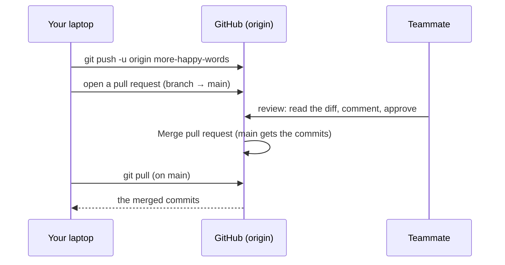

# 03 · GitHub and pull requests

**What you'll build:** first a "pretend GitHub" on your own computer to practise push, clone and pull safely; then your real `mood-app` repository on GitHub, connected with an SSH key, with a pull request that you review and merge, and a fork of someone else's project.
**Like you're 5:** Git is your own diary. GitHub is the school library that keeps a copy of everyone's diary. A **pull request** is putting your homework on the teacher's desk and saying "please check this before it goes in the class book".
**Time:** ~90 min · **Builds on:** [02 · Branches and merge conflicts](../02-branches-and-merge-conflicts) · **Needs:** a free GitHub account for Part B (Part A needs nothing)

## Why this matters
GitHub is where most companies and open-source AI projects (PyTorch, Hugging Face Transformers, llama.cpp, Ollama) keep their code. Nearly every change in those projects arrives as a **pull request (PR)**: someone pushes a branch, teammates read the diff, leave comments, and only then is it merged into `main`. Automatic tests (lesson 04) and deployments (later in this course) hang off these PRs, so this flow is the heart of team work.

## What you'll learn
- **Remote:** a copy of your repository somewhere else (GitHub, or a folder). `origin` is the usual nickname for it.
- **Push / pull:** `git push` uploads your new commits to the remote; `git pull` downloads other people's new commits and merges them into yours.
- **Clone:** download a whole repository, with all its history, to a new folder.
- **Pull request (PR):** a request to merge one branch into another, with a page for reviewing the diff and discussing it.
- **SSH vs HTTPS and forks:** the two ways your computer proves who you are to GitHub; and a fork, your own copy of someone else's repository on GitHub.

## Before you start
- Finish [lesson 01](../01-git-basics-save-points) (Git installed, name and email set).
- **Part A:** nothing else.
- **Part B and C:** a free GitHub account. Sign up at https://github.com/signup, verify your email, and use the **same email** as `git config --global user.email` so GitHub links your commits to you.
- No API key needed.

## Run it

### Part A · Practise with a pretend GitHub (no account needed)

#### Step A1 · Create the practice folders
From the course folder (`cloud-and-devops-for-ai`):
```bash
bash part-1-git-and-github/03-github-and-pull-requests/setup.sh
cd ~/devops-practice/03/you/mood-app
```
You should see:
```
Created:
  pretend GitHub : /home/sam/devops-practice/03/pretend-github/mood-app.git
  your project   : /home/sam/devops-practice/03/you/mood-app
Next:  cd ~/devops-practice/03/you/mood-app
```
The "pretend GitHub" is a **bare repository**: only the history, no working files. GitHub stores your repositories in exactly this form.

#### Step A2 · Connect your project to the remote
```bash
git remote -v
git remote add origin ~/devops-practice/03/pretend-github/mood-app.git
git remote -v
```
| Piece | Meaning |
|-------|---------|
| `git remote` | manage the list of remotes (other copies of this repo) |
| `-v` | **v**erbose: show each remote's address |
| `add` | add a new remote |
| `origin` | the nickname. `origin` is the convention for "the main copy online". |
| `~/devops-practice/03/pretend-github/mood-app.git` | its address. Here it is a folder; on GitHub it is a web or SSH address. |

The first `git remote -v` prints nothing (no remotes yet). The second prints:
```
origin	/home/sam/devops-practice/03/pretend-github/mood-app.git (fetch)
origin	/home/sam/devops-practice/03/pretend-github/mood-app.git (push)
```

#### Step A3 · Push your commits to the remote
```bash
git push -u origin main
```
| Piece | Meaning |
|-------|---------|
| `git push` | upload my new commits |
| `-u` | short for `--set-upstream`: remember that my `main` goes with `origin`'s `main`, so next time a plain `git push` or `git pull` is enough |
| `origin` | to which remote |
| `main` | which branch |

You should see:
```
To /home/sam/devops-practice/03/pretend-github/mood-app.git
 * [new branch]      main -> main
branch 'main' set up to track 'origin/main'.
```

#### Step A4 · Be your own teammate: clone, change, push
```bash
cd ~/devops-practice/03
git clone pretend-github/mood-app.git teammate-mood-app
cd teammate-mood-app
```
(`git clone <address> <folder>` = download the whole repository into a new folder. It also sets up `origin` for you.)

You should see `Cloning into 'teammate-mood-app'... done.` Now, as the teammate, open `mood.py` with `nano mood.py`, add `"terrible"` to `SAD_WORDS`, save, and:
```bash
git commit -am "Add 'terrible' to the sad words"
git push
```
(`-a` = stage every already-tracked file that changed, `-m` = message. A plain `git push` works because `clone` already linked `main` to `origin/main`.)

You should see:
```
[main dd819d7] Add 'terrible' to the sad words
 1 file changed, 1 insertion(+), 1 deletion(-)
To /home/sam/devops-practice/03/pretend-github/mood-app.git
   9d20f40..dd819d7  main -> main
```

#### Step A5 · Back as you: fetch and pull the teammate's work
```bash
cd ~/devops-practice/03/you/mood-app
git fetch
git status -sb
git pull
git log --oneline
```
| Piece | Meaning |
|-------|---------|
| `git fetch` | download new commits from the remote, but **don't** change my files yet |
| `git status -sb` | **s**hort status with **b**ranch info: shows if you are ahead or behind |
| `git pull` | `fetch` + merge the downloaded commits into my branch |

You should see:
```
From /home/sam/devops-practice/03/pretend-github/mood-app
   9d20f40..dd819d7  main       -> origin/main
## main...origin/main [behind 1]
Updating 9d20f40..dd819d7
Fast-forward
 mood.py | 2 +-
 1 file changed, 1 insertion(+), 1 deletion(-)
dd819d7 Add 'terrible' to the sad words
9d20f40 First version of the mood app
```
`[behind 1]` = "the remote has 1 commit you don't have yet". After `git pull` you have it.

### Part B · The real GitHub

#### Step B1 · Choose how your computer logs in: SSH or HTTPS
GitHub needs to know it is really you before it accepts a push. There are two ways:

| | **SSH** (we use this) | **HTTPS** |
|---|---|---|
| Address looks like | `git@github.com:sam-rivera/mood-app.git` | `https://github.com/sam-rivera/mood-app.git` |
| How you prove who you are | a key pair on your computer; GitHub keeps the public half | a login stored by a helper (Git Credential Manager, `gh auth login`) or a personal access token |
| Set-up effort | once per computer (Steps B2–B3) | sign in through a browser pop-up or paste a token |
| Your GitHub password works? | not used | **no**: GitHub stopped accepting account passwords for Git in 2021 |

Both are fine and secure. SSH is popular because once set up, it never asks again. If you prefer HTTPS: install the GitHub CLI (https://cli.github.com), run `gh auth login`, choose **HTTPS** and follow the browser prompts, then use the `https://` address in Step B5.

#### Step B2 · Make an SSH key pair
```bash
ssh-keygen -t ed25519 -C "sam@example.com"
```
| Piece | Meaning |
|-------|---------|
| `ssh-keygen` | the program that makes SSH keys (comes with Git / your OS) |
| `-t ed25519` | the **t**ype of key: Ed25519, modern, short and safe |
| `-C "sam@example.com"` | a **c**omment stored in the key, so you recognise it later. Use your email. |

Press **Enter** to accept the file name, then type a passphrase (recommended, it protects the key if your laptop is stolen) twice. You should see:
```
Generating public/private ed25519 key pair.
Your identification has been saved in /home/sam/.ssh/id_ed25519
Your public key has been saved in /home/sam/.ssh/id_ed25519.pub
The key fingerprint is:
SHA256:w7CNEKlBbyNRqaBFA3jM9iEwOiDAH+1a0wUvtByIstA sam@example.com
```
You now have two files: `id_ed25519` (the **private** key: never share it, like your house key) and `id_ed25519.pub` (the **public** key: safe to give out, like a padlock that only your key opens).

If you set a passphrase, let the **ssh-agent** remember it so you type it once per session:
```bash
eval "$(ssh-agent -s)"
ssh-add ~/.ssh/id_ed25519
```
(`ssh-agent -s` starts the helper and prints settings; `eval "$(...)"` runs that printed text in your shell; `ssh-add` hands it your key. On a Mac you can use `ssh-add --apple-use-keychain ~/.ssh/id_ed25519` to store the passphrase in Keychain.)

#### Step B3 · Give GitHub your public key, and test it
1. Print the public key and copy the whole line (it starts with `ssh-ed25519`):
   ```bash
   cat ~/.ssh/id_ed25519.pub
   ```
2. On GitHub: click your profile picture (top right) → **Settings** → **SSH and GPG keys** → **New SSH key**. Title: the name of this computer. Key type: **Authentication Key**. Paste the line, click **Add SSH key**.
3. Test the connection:
   ```bash
   ssh -T git@github.com
   ```
   (`-T` = don't open a terminal on the other side; `git@github.com` = the user `git` on the computer `github.com`.)

The first time, SSH asks whether you trust GitHub's server:
```
The authenticity of host 'github.com (140.82.121.4)' can't be established.
ED25519 key fingerprint is SHA256:+DiY3wvvV6TuJJhbpZisF/zLDA0zPMSvHdkr4UvCOqU.
Are you sure you want to continue connecting (yes/no/[fingerprint])?
```
Check that the fingerprint matches the one GitHub publishes (search the GitHub docs for "GitHub's SSH key fingerprints"), type `yes` and press **Enter**. You should see:
```
Hi sam-rivera! You've successfully authenticated, but GitHub does not provide shell access.
```
That message means success.

#### Step B4 · Create an empty repository on GitHub
1. Click **+** (top right) → **New repository**.
2. Repository name: `mood-app`. Choose **Public** (needed for free Actions minutes in lesson 04, and fine for practice code).
3. **Do not** tick "Add a README", ".gitignore" or "license": your project already has commits, and an empty repo avoids a first-push clash.
4. Click **Create repository**. GitHub shows a page with set-up commands; keep it open.

#### Step B5 · Point your project at GitHub and push
Your project's `origin` is still the pretend GitHub. Change its address to the real one (replace `sam-rivera` with your GitHub username):
```bash
cd ~/devops-practice/03/you/mood-app
git remote set-url origin git@github.com:sam-rivera/mood-app.git
git remote -v
git push -u origin main
```
(`git remote set-url origin <address>` = change the address of the remote called `origin`.)

You should see something like:
```
origin	git@github.com:sam-rivera/mood-app.git (fetch)
origin	git@github.com:sam-rivera/mood-app.git (push)
Enumerating objects: 8, done.
Counting objects: 100% (8/8), done.
Delta compression using up to 8 threads
Compressing objects: 100% (6/6), done.
Writing objects: 100% (8/8), 1.02 KiB | 1.02 MiB/s, done.
Total 8 (delta 1), reused 0 (delta 0), pack-reused 0
To github.com:sam-rivera/mood-app.git
 * [new branch]      main -> main
branch 'main' set up to track 'origin/main'.
```
Refresh the GitHub page: your files, README and both commits are there.

#### Step B6 · Make a branch and push it
```bash
git switch -c more-happy-words
```
Open `mood.py` with nano, add `"wonderful"` to `HAPPY_WORDS`, save, then:
```bash
git commit -am "Add 'wonderful' to the happy words"
git push -u origin more-happy-words
```
GitHub answers with a handy link:
```
remote: Create a pull request for 'more-happy-words' on GitHub by visiting:
remote:      https://github.com/sam-rivera/mood-app/pull/new/more-happy-words
To github.com:sam-rivera/mood-app.git
 * [new branch]      more-happy-words -> more-happy-words
branch 'more-happy-words' set up to track 'origin/more-happy-words'.
```

#### Step B7 · Open a pull request
1. Open that link (or, on the repo page, click the yellow **Compare & pull request** button).
2. Check the top line says **base: main ← compare: more-happy-words** (merge *into* `main`, *from* your branch).
3. Title: `Add 'wonderful' to the happy words`. Description: what and why, for example "Users often say 'wonderful'; it was scored as neutral."
4. Click **Create pull request**.

#### Step B8 · Review it
1. Click the **Files changed** tab. You see the same red/green diff as `git diff`.
2. Hover over the changed line, click the blue **+**, write a comment such as "Nice. Maybe add 'brilliant' too?", and click **Start a review**.
3. Click **Review changes** (top right), choose **Comment**, and **Submit review**. On a team, a teammate would choose **Approve** or **Request changes**. GitHub does not let you approve your own PR.
4. To answer a review, just make more commits on the same branch and `git push`: the PR updates itself.

#### Step B9 · Merge it, then update your computer
1. On the **Conversation** tab click **Merge pull request** → **Confirm merge**, then **Delete branch** (deletes it on GitHub only).
2. Back in the terminal:
   ```bash
   git switch main
   git pull
   git branch -d more-happy-words
   git log --oneline
   ```
You should see your branch's commit and a merge commit at the top of `main`:
```
4e1c2a7 Merge pull request #1 from sam-rivera/more-happy-words
fe20ee8 Add 'wonderful' to the happy words
dd819d7 Add 'terrible' to the sad words
9d20f40 First version of the mood app
```

### Part C · Forks: contributing to someone else's project
You cannot push to other people's repositories. Instead you **fork** (make your own copy on GitHub), change your copy, and open a PR from it to the original.

1. Open https://github.com/firstcontributions/first-contributions (a real project made for practising exactly this) and click **Fork** → **Create fork**.
2. Clone **your** fork (replace `sam-rivera`):
   ```bash
   cd ~/devops-practice/03
   git clone git@github.com:sam-rivera/first-contributions.git
   cd first-contributions
   ```
3. Add the original project as a second remote called `upstream`, so you can get its updates:
   ```bash
   git remote add upstream https://github.com/firstcontributions/first-contributions.git
   git remote -v
   ```
4. Follow the project's README: make a branch, add your name to `Contributors.md`, commit, and `git push -u origin <your-branch>`.
5. On GitHub, open your fork and click **Contribute** → **Open pull request**. The PR goes from your fork to the original.
6. Later, to bring your fork up to date with the original:
   ```bash
   git switch main
   git fetch upstream
   git merge upstream/main
   git push
   ```

### What you should see
- On your computer: `git remote -v` shows `origin` pointing at `git@github.com:<you>/mood-app.git`, and `git log --oneline` ends with the merged PR.
- On GitHub: your `mood-app` repo with the files, a **Pull requests → Closed** tab containing PR #1 with your review comment, and (Part C) your fork with an open or merged PR to `firstcontributions`.

## How it works

1. **A remote is just an address with a nickname.** `git remote add origin <address>` writes it into `.git/config`. Push and pull talk to that address. A folder, an SSH address and an HTTPS address all work the same way.
2. **Push only sends commits.** Uncommitted edits stay on your laptop. Git refuses a push if the remote has commits you don't have (`rejected ... fetch first`): you `git pull` first, fix any conflict, then push.
3. **`origin/main`** is your laptop's memory of where `main` was on the remote at the last fetch. `git fetch` updates it; `git status` compares your `main` with it ("ahead 2", "behind 1").
4. **A pull request is a GitHub feature, not a Git command.** It is a page that says "merge branch X into main" with the diff, comments, reviews and (lesson 04) test results. Merging the PR on GitHub makes a merge commit on GitHub's `main`; you `git pull` to get it.
5. **SSH keys** work like a padlock and key: GitHub holds the padlock (public key), only your laptop holds the key (private key). Nothing secret is ever sent; your laptop proves it has the key by solving a puzzle that only that key can solve.
6. **A fork** is a full copy of a repo under your account. `origin` = your fork (you can push), `upstream` = the original (you only pull from it). PRs go from your fork's branch to the original's `main`.
7. **Protecting main** (for later): in a team repo, **Settings → Rules → Rulesets** (or **Branches**) can require a pull request and an approving review before anything reaches `main`, and (after lesson 04) passing tests.

## If something goes wrong
- **`git@github.com: Permission denied (publickey).`** → GitHub does not know your key. Check `ls ~/.ssh` shows `id_ed25519.pub`, that you pasted **that** file's content into GitHub, and run `ssh-add ~/.ssh/id_ed25519`. Test again with `ssh -T git@github.com`.
- **`remote: Support for password authentication was removed`** → you used an `https://` address and typed your GitHub password. Use SSH (Steps B2–B5), or run `gh auth login` and choose HTTPS.
- **`! [rejected] main -> main (fetch first)`** → the remote has commits you don't have (maybe you ticked "Add a README" when creating the repo). Run `git pull`, fix any conflict, then `git push`. If it says `refusing to merge unrelated histories` because of that README, run `git pull --allow-unrelated-histories origin main` once.
- **`fatal: remote origin already exists`** → you already added `origin`. Change its address with `git remote set-url origin <new-address>` instead of `add`.
- **`ERROR: Repository not found.`** → a typo in the username or repo name, or the repo is private and your key belongs to another account. Copy the exact address from the green **Code** button on GitHub.

## Try this
1. In Part A, make the teammate and you both change `README.md` on the same line, push from the teammate, then try to push from you. Read the rejection and fix it.
2. On GitHub, open a second PR that adds `"brilliant"` to `HAPPY_WORDS`, and after creating it, push one more commit to the same branch. Watch the PR update.
3. Install the GitHub CLI (https://cli.github.com), run `gh auth login`, and create, list and merge a PR without opening the browser.

<details><summary>Hints and solutions</summary>

1. ```bash
   # teammate
   cd ~/devops-practice/03/teammate-mood-app
   git pull
   echo "Made by the teammate." >> README.md
   git commit -am "Teammate note"
   git push
   # you
   cd ~/devops-practice/03/you/mood-app
   git remote set-url origin ~/devops-practice/03/pretend-github/mood-app.git   # only if you changed it in Part B
   echo "Made by me." >> README.md
   git commit -am "My note"
   git push            # rejected (fetch first)
   git pull            # CONFLICT in README.md: fix it like lesson 02
   git add README.md
   git commit --no-edit
   git push            # works now
   ```
2. ```bash
   git switch main && git pull
   git switch -c brilliant
   # edit mood.py, then:
   git commit -am "Add 'brilliant'"
   git push -u origin brilliant
   # open the PR, then make another small change:
   git commit -am "Also add 'superb'"
   git push
   ```
   The **Commits** tab of the PR now shows 2 commits.
3. ```bash
   gh auth login                     # follow the prompts (GitHub.com → SSH or HTTPS → browser)
   git switch -c via-cli
   # edit and commit something, then:
   git push -u origin via-cli
   gh pr create --fill               # --fill = use the commit message as title/description
   gh pr list
   gh pr merge --merge --delete-branch
   ```
</details>

## Check yourself
1. What is the difference between `git fetch` and `git pull`?
2. Why does GitHub only ever get your **public** SSH key?
3. Why open a pull request instead of pushing straight to `main`?
4. In a fork setup, what are `origin` and `upstream`?

<details><summary>Answers</summary>

1. `fetch` only downloads new commits and updates `origin/main`; your files and your `main` don't change. `pull` does a fetch and then merges those commits into your current branch.
2. The public key is the padlock: anyone may have it. The private key is the only thing that can open it, so it never leaves your computer. If GitHub were hacked, nobody could log in as you with your public key.
3. So others can read, comment on and test the change before it reaches the code everyone depends on, and so there is a record of why it was made.
4. `origin` is your own fork (you push there); `upstream` is the original project (you fetch its updates; you contribute to it through PRs).
</details>

## Learn more (optional)
**Read the official docs**
- GitHub docs, getting started: https://docs.github.com/en/get-started
- Connecting to GitHub with SSH: https://docs.github.com/en/authentication/connecting-to-github-with-ssh
- Pull requests (creating, reviewing, merging): https://docs.github.com/en/pull-requests
- GitHub CLI manual: https://cli.github.com/manual/
- Pro Git, "Working with Remotes": https://git-scm.com/book/en/v2/Git-Basics-Working-with-Remotes
- `git push`: https://git-scm.com/docs/git-push · `git pull`: https://git-scm.com/docs/git-pull · `git clone`: https://git-scm.com/docs/git-clone

**Watch**
- freeCodeCamp, Git and GitHub for beginners: https://www.youtube.com/results?search_query=freecodecamp+git+and+github+for+beginners
- How to make a pull request: https://www.youtube.com/results?search_query=github+pull+request+tutorial+for+beginners
- Fireship, GitHub in 100 seconds / SSH explained: https://www.youtube.com/results?search_query=fireship+ssh+in+100+seconds

## Next
→ [04 · CI with GitHub Actions](../04-ci-with-github-actions)
