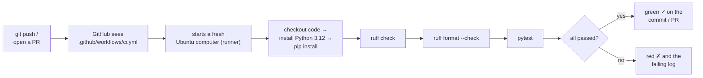

# 04 · CI with GitHub Actions

**What you'll build:** a small FastAPI "Mood API" (it guesses if a sentence is positive or negative) with automatic tests, plus a GitHub Actions workflow that runs a linter (ruff) and the tests (pytest) on GitHub's computers every time you push or open a pull request.
**Like you're 5:** CI is a robot teacher who checks your homework every single time you hand it in, and puts a green tick or a red cross on it before anyone else reads it.
**Time:** ~75 min · **Builds on:** [03 · GitHub and pull requests](../03-github-and-pull-requests) · **Needs:** Python 3.12 + venv, a GitHub account

## Why this matters
In real AI teams, nobody merges code just because "it worked on my laptop". Every pull request automatically runs checks: lint, unit tests, and for AI apps often evaluation tests on prompts and model answers. This is **CI (Continuous Integration)**. It catches mistakes in minutes, before users see them, and it is the first step of the deploy pipeline you will build in the capstone (lesson 28). GitHub Actions is one of the most widely used CI systems, and it is free for public repositories.

## What you'll learn
- **CI:** automatically checking every change (lint + tests) on a clean computer, not yours.
- **Linter and formatter:** a tool that finds likely bugs and style problems (**ruff check**) and one that lays code out the same way every time (**ruff format**).
- **Unit tests with pytest:** small functions that call your code and `assert` the answer is right; FastAPI's **TestClient** calls your API without starting a server.
- **Workflow file:** a YAML file in `.github/workflows/` that tells GitHub **when** to run (`on:`), **where** (`runs-on:`) and **what** (`steps:`).
- **Status checks:** the green tick / red cross that appears on commits and pull requests.

## Before you start
- Finish [lesson 03](../03-github-and-pull-requests): you can push to GitHub over SSH (or HTTPS).
- Python 3.12 (3.10+ works) and the venv routine from [AI from Zero · Start here](../../../ai-from-zero/00-start-here).
- The packages (you install them in Step 2, inside a venv):
  ```bash
  pip install -r requirements.txt -r requirements-dev.txt
  ```
  - `requirements.txt` (what the app needs to **run**): `fastapi` turns Python functions into web addresses; `uvicorn` is the web server.
  - `requirements-dev.txt` (only for **developing**): `pytest` runs tests; `httpx2` is the HTTP library FastAPI's TestClient uses; `ruff` lints and formats.
- No API key needed: the "model" is two word lists, so tests are free, fast and always give the same answer.

**Files in this folder**

| File | What it is |
|------|------------|
| `main.py` | the Mood API: `/health` and `/predict` |
| `test_main.py` | 6 automatic tests for it |
| `requirements.txt`, `requirements-dev.txt` | exact package versions (`==` pins them, so CI installs the same versions as you) |
| `.github/workflows/ci.yml` | the CI recipe GitHub runs |
| `.gitignore` | keeps `.venv/`, caches and `.env` out of Git |

## Run it

### Step 1 · Copy the lesson into its own project folder
GitHub only runs workflows found in `.github/workflows/` at the **top** of a repository. This lesson lives deep inside the course, so give it a repository of its own. From the course folder (`cloud-and-devops-for-ai`):
```bash
mkdir -p ~/devops-practice/04
cp -r part-1-git-and-github/04-ci-with-github-actions ~/devops-practice/04/mood-api
cd ~/devops-practice/04/mood-api
ls -a
```
| Piece | Meaning |
|-------|---------|
| `mkdir -p ~/devops-practice/04` | make the folder; `-p` = also make missing parent folders, and don't complain if it exists |
| `cp -r <from> <to>` | copy; `-r` = **r**ecursively (the folder and everything inside, hidden files too) |

You should see `.github`, `.gitignore`, `README.md`, `main.py`, `requirements-dev.txt`, `requirements.txt`, `test_main.py`.

### Step 2 · Make a venv and install the packages
```bash
python3 -m venv .venv
source .venv/bin/activate
pip install -r requirements.txt -r requirements-dev.txt
```
| Piece | Meaning |
|-------|---------|
| `python3 -m venv .venv` | run Python's built-in `venv` module (`-m` = module) to make a private package folder called `.venv` |
| `source .venv/bin/activate` | switch the venv on in this terminal (Windows without WSL: `.venv\Scripts\activate`) |
| `pip install -r <file>` | install every package listed in the file; `-r` = read from a **r**equirements file. You can give two. |

### Step 3 · Try the API by hand
```bash
uvicorn main:app --reload
```
Open http://127.0.0.1:8000/docs, click **POST /predict** → **Try it out**, send `{"text": "I love this, it is great!"}` and you get `{"text": "I love this, it is great!", "label": "positive", "score": 2}`. Stop the server with **Ctrl + C**.

### Step 4 · Run the three checks locally (exactly what CI will run)
```bash
ruff check .
ruff format --check .
pytest -v
```
| Piece | Meaning |
|-------|---------|
| `ruff check .` | lint every Python file in `.` (this folder): unused imports, undefined names, likely bugs |
| `ruff format --check .` | check the layout (spaces, line length, quotes) **without** changing files. Without `--check`, it rewrites them neatly. |
| `pytest` | find files named `test_*.py`, run every function named `test_*`, report pass/fail |
| `-v` | **v**erbose: one line per test |

### What you should see
```
All checks passed!
3 files already formatted
============================= test session starts ==============================
platform linux -- Python 3.12.15, pytest-9.1.1, pluggy-1.7.0
rootdir: /home/sam/devops-practice/04/mood-api
plugins: anyio-4.15.1
collected 6 items

test_main.py::test_health_says_ok PASSED                                 [ 16%]
test_main.py::test_happy_sentence_is_positive PASSED                     [ 33%]
test_main.py::test_sad_sentence_is_negative PASSED                       [ 50%]
test_main.py::test_plain_sentence_is_neutral PASSED                      [ 66%]
test_main.py::test_predict_endpoint_returns_label_and_score PASSED       [ 83%]
test_main.py::test_empty_text_is_rejected PASSED                         [100%]

============================== 6 passed in 0.62s ===============================
```
"3 files" = `main.py`, `test_main.py` and `README.md`: recent ruff versions also tidy the Python examples inside Markdown files. All three checks must be clean before you push. That is the deal with CI: if it passes on your laptop, it should pass on GitHub.

### Step 5 · Put it on GitHub
1. On GitHub create a new **empty, public** repository called `mood-api` (no README, like lesson 03).
2. In the terminal (replace `sam-rivera` with your username):
   ```bash
   git init
   git add .
   git status
   git commit -m "Mood API with tests and CI workflow"
   git remote add origin git@github.com:sam-rivera/mood-api.git
   git push -u origin main
   ```
   `git status` should list `.github/workflows/ci.yml`, `.gitignore`, the Python files and requirements files, and **not** `.venv/` (the `.gitignore` keeps it out).

### Step 6 · Watch the robot work
1. On your repo page, click the **Actions** tab. A run called "Mood API with tests and CI workflow" appears with a yellow dot (running).
2. Click it → click the **test** job. Each step opens to show its log. After about 30 seconds, every step has a green tick:
```
✓ Set up job
✓ Get the code
✓ Install Python
✓ Install packages
✓ Lint (look for mistakes)
✓ Check formatting
✓ Run tests
✓ Post Install Python
✓ Post Get the code
✓ Complete job
```
Inside **Run tests** you see the same pytest output as on your laptop, ending in `6 passed`. Back on the **Code** tab, a green tick ✓ appears next to your latest commit.

### Step 7 · Let CI catch a mistake in a pull request
```bash
git switch -c unused-import
```
Open `main.py` and add the line `import os` just above `from fastapi import FastAPI` (with an empty line between them). Save, then:
```bash
ruff check .
```
You should see:
```
F401 [*] `os` imported but unused
  --> main.py:8:8
   |
 6 | """
 7 |
 8 | import os
   |        ^^
 9 |
10 | from fastapi import FastAPI
   |
help: Remove unused import: `os`

Found 1 error.
[*] 1 fixable with `--fix`.
```
Push it anyway, to watch CI stop it:
```bash
git commit -am "Import os (oops)"
git push -u origin unused-import
```
Open a pull request for the branch (lesson 03, Step B7). At the bottom of the PR you see **Some checks were not successful**, with a red ✗ next to **CI / test (pull_request)**. Click **Details**: the **Lint (look for mistakes)** step failed with the same F401 message, and the later steps were skipped.

Fix it and push again:
```bash
ruff check --fix .
ruff format .
git commit -am "Remove unused import"
git push
```
(`--fix` lets ruff repair what it safely can; `ruff format .` tidies the blank lines left behind.) The PR re-runs CI by itself and turns green: **All checks have passed**. Now merge it.

## How it works


### The app and its tests
1. `main.py`: `predict_mood(text)` splits the text into words, strips punctuation (`word.strip(".,!?...")`), lower-cases them, and scores +1 for every word in `POSITIVE_WORDS` and -1 for every word in `NEGATIVE_WORDS`. `sum(word in POSITIVE_WORDS for word in words)` works because `True` counts as 1 and `False` as 0.
2. `TextIn` is a Pydantic model: `Field(min_length=1, max_length=1000)` makes FastAPI reject empty or huge text with a **422** error before your code runs.
3. `test_main.py`: `client = TestClient(app)` is a pretend browser that calls the API directly in memory. Each `test_...` function does one thing and `assert`s the result. If an `assert` is false, pytest marks that test **FAILED** and shows both values.
4. Two kinds of tests: three call `predict_mood()` directly (fast **unit tests** of the logic); three go through HTTP with `client.get/post` (they also check the status codes and JSON shape).

### YAML in 30 seconds
The workflow is written in **YAML**, a format for settings: `key: value` pairs; **indentation with spaces** (never tabs) shows what belongs inside what; a line starting with `- ` is one item in a list; `[main]` is a short list on one line; `#` starts a comment. Quote values that look like numbers but aren't: `"3.12"` (without quotes, `3.10` would become the number `3.1`).

### The workflow, key by key (`.github/workflows/ci.yml`)
| Key | Meaning |
|-----|---------|
| `name: CI` | the workflow's name, shown in the Actions tab and on PR checks |
| `on:` | **when** to run (the "triggers") |
| `push:` / `branches: [main]` | run on every push to `main` (not on pushes to other branches, so you don't run twice for a PR) |
| `pull_request:` | run on every pull request (opened, or new commits pushed to it). Empty value = all target branches. |
| `permissions:` / `contents: read` | the robot may only **read** the repo. Safe default: a broken or malicious step can't push code. |
| `jobs:` | the list of jobs. Jobs run in parallel on separate computers unless you link them. |
| `test:` | this job's ID (you choose it). It appears as "CI / test". |
| `runs-on: ubuntu-latest` | which computer: a fresh Ubuntu Linux virtual machine run by GitHub (a **runner**), thrown away afterwards |
| `timeout-minutes: 10` | stop the job if it hangs for 10 minutes (the default is 360!) |
| `steps:` | the list of steps, run top to bottom. If one fails, the rest are skipped and the job is red. |
| `- name: Get the code` | a step's label in the log |
| `uses: actions/checkout@v6` | run a ready-made **action** from GitHub: `owner/repo@version`. `checkout` downloads your repository onto the runner (it starts empty!). |
| `uses: actions/setup-python@v6` | an action that installs Python |
| `with:` | inputs for that action |
| `python-version: "3.12"` | which Python to install |
| `cache: pip` | remember downloaded packages between runs (keyed on your requirements files), so later runs install faster |
| `run: pip install -r ...` | run a shell command on the runner, exactly like in your terminal |
| `run: ruff check .` / `ruff format --check .` / `pytest -v` | the same three checks as Step 4. A command that ends with an error (non-zero **exit code**) fails the step. |

The `@v6` after an action name is its version. Newer versions appear over time; GitHub's docs and the action's page (`github.com/actions/checkout`) show the latest.

### Why CI catches what your laptop misses
The runner starts from nothing every time: no leftover files, no packages you installed by hand months ago, no `.env`. If you forget to add a package to `requirements.txt` or to commit a file, CI fails even though your laptop works. That is the point.

## If something goes wrong
- **The Actions tab shows nothing after a push** → the workflow must be at exactly `.github/workflows/ci.yml` at the **top** of the repo. Check with `ls -a` and `ls .github/workflows`. A typo like `.github/workflow/` (no `s`) is silently ignored.
- **`Invalid workflow file` / `You have an error in your yaml syntax`** → usually indentation. Use spaces only, keep the same indentation as the file in this lesson, and make sure every `- name:` lines up under `steps:`.
- **`ModuleNotFoundError: No module named 'main'` in pytest** → run `pytest` from the folder that contains `main.py`. In CI that is the repo root, which is why the files are not in a sub-folder.
- **`Would reformat: main.py` in Check formatting** → run `ruff format .` locally, commit and push. (Tip: many editors can run ruff format when you save.)
- **`The starlette.testclient module requires the httpx2 package`** → you skipped `requirements-dev.txt`. Run `pip install -r requirements-dev.txt`.

## Try this
1. Add a word to `NEGATIVE_WORDS` and a new test `test_slow_is_negative` that checks `predict_mood("the app is slow")` is `"negative"`. Run `pytest -v` locally first, then push and watch CI.
2. Make CI test on **two** Python versions at once (3.11 and 3.12) using a **matrix**.
3. Protect `main`: make GitHub refuse to merge a PR unless the **CI / test** check is green.

<details><summary>Hints and solutions</summary>

1. In `main.py` add `"slow",` to `NEGATIVE_WORDS`. In `test_main.py`:
   ```python
   def test_slow_is_negative():
       assert predict_mood("the app is slow")["label"] == "negative"
   ```
   Then `ruff format . && ruff check . && pytest -v`, commit, push. (`&&` = run the next command only if the previous one succeeded.)
2. Change the job like this:
   ```yaml
   jobs:
     test:
       runs-on: ubuntu-latest
       timeout-minutes: 10
       strategy:
         matrix:
           python-version: ["3.11", "3.12"]
       steps:
         - name: Get the code
           uses: actions/checkout@v6
         - name: Install Python
           uses: actions/setup-python@v6
           with:
             python-version: ${{ matrix.python-version }}
             cache: pip
         # ... the other steps stay the same
   ```
   `strategy.matrix` runs the job once per value. `${{ matrix.python-version }}` is an **expression**: GitHub replaces it with the value for each copy. The Actions tab shows two jobs: `test (3.11)` and `test (3.12)`.
3. Repo **Settings** → **Rules** → **Rulesets** → **New ruleset** → **New branch ruleset**. Name it "protect main", set **Enforcement status: Active**, **Target branches → Add target → Include default branch**, tick **Require a pull request before merging** and **Require status checks to pass**, click **Add checks** and choose **test**, then **Create**. Now the merge button stays grey until CI is green.
</details>

## Check yourself
1. Why does CI run on a fresh computer instead of trusting your laptop?
2. Which line in `ci.yml` makes it run for pull requests, and which makes the runner get your code?
3. What is the difference between `ruff check` and `ruff format --check`?
4. A test fails in CI but passes on your laptop. Name two likely reasons.

<details><summary>Answers</summary>

1. A fresh computer only has what is in your repository and your requirements files, so it proves the project works for anyone, not just on your set-up with its hidden extras.
2. `pull_request:` under `on:` triggers it for PRs. `uses: actions/checkout@v6` downloads the repository onto the runner.
3. `ruff check` looks for mistakes (unused imports, undefined names...). `ruff format --check` only checks the layout (spacing, line breaks) and reports files it would rewrite.
4. A package installed on your laptop but missing from `requirements*.txt`; a file you forgot to `git add`; a different Python version; a test that depends on something only on your laptop (a `.env` file, a local database).
</details>

## Learn more (optional)
**Read the official docs**
- GitHub Actions documentation (quickstart, workflow syntax, events): https://docs.github.com/en/actions
- The `checkout` action: https://github.com/actions/checkout · the `setup-python` action: https://github.com/actions/setup-python
- Rulesets (protecting branches): https://docs.github.com/en/repositories/configuring-branches-and-merges-in-your-repository/managing-rulesets/about-rulesets
- pytest: https://docs.pytest.org/ · ruff: https://docs.astral.sh/ruff/
- Testing FastAPI apps: https://fastapi.tiangolo.com/tutorial/testing/
- `actionlint`, a checker for workflow files: https://github.com/rhysd/actionlint

**Watch**
- TechWorld with Nana, GitHub Actions tutorial: https://www.youtube.com/results?search_query=techworld+with+nana+github+actions+tutorial
- Fireship, GitHub Actions in 100 seconds: https://www.youtube.com/results?search_query=fireship+github+actions
- freeCodeCamp, GitHub Actions full course: https://www.youtube.com/results?search_query=freecodecamp+github+actions+course

## Next
→ [Part 2 · Docker](../../part-2-docker), starting with [05 · What is a container?](../../part-2-docker/05-what-is-a-container)
