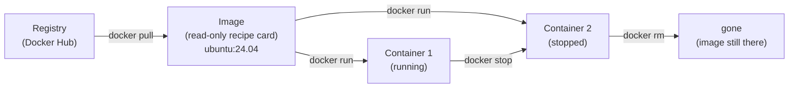

# 05 · What is a container?

**What you'll build:** your first containers: Docker's "hello world", a whole Ubuntu Linux you can poke around in and throw away, and Python 3.12 running without installing it on your computer.
**Like you're 5:** an **image** is a frozen recipe card for a lunch box. A **container** is a real lunch box made from that card. You can make many lunch boxes from one card, eat from them, throw them away, and the card is still there.
**Time:** ~45 min · **Builds on:** [04 · CI with GitHub Actions](../../part-1-git-and-github/04-ci-with-github-actions) · **Needs:** Docker installed ([Part 2 README](../README.md#install-once-for-this-part))

## Why this matters
"It works on my machine" is the oldest problem in software: your app needs Python 3.12, these 30 packages, these settings, and the server has something different. AI makes it worse (CUDA versions, model files, system libraries). Containers solve it by shipping the app **together with** everything it needs. Hugging Face Spaces, Ollama, vLLM, and almost every company's AI API are delivered as container images, and Kubernetes (Part 4) only runs containers.

## What you'll learn
- **Image:** a read-only package with a mini filesystem (Linux files, Python, your app) and a default command. Like a recipe card, or a class in Python.
- **Container:** a running (or stopped) copy of an image, with its own writable layer on top. Like a lunch box made from the card, or an object made from a class.
- **Registry:** an online library of images. **Docker Hub** (hub.docker.com) is the default one.
- **Docker client and Docker daemon (engine):** the `docker` command you type, and the background program that actually pulls images and runs containers.
- **Container vs virtual machine:** a VM pretends to be a whole computer with its own operating system kernel; a container shares your computer's Linux kernel and only packs the files it needs, so it starts in a second and is much smaller.

## Before you start
- Install Docker and check it with `docker version` (see the [Part 2 README](../README.md#install-once-for-this-part)). On Windows and Mac, Docker Desktop must be **running** (whale icon in the menu/task bar).
- No Python packages, no API key. Everything comes from Docker Hub.

## Run it

### Step 1 · Check Docker is ready
```bash
docker version
```
| Piece | Meaning |
|-------|---------|
| `docker` | the Docker **client**: the program that takes your orders |
| `version` | show the versions of the client and of the **server** (the Docker engine / daemon) |

You should see two parts, for example:
```
Client: Docker Engine - Community
 Version:           29.8.2
 ...
Server: Docker Engine - Community
 Engine:
  Version:          29.8.2
 ...
```
If you only see `Client` and then `Cannot connect to the Docker daemon`, the engine is not running: start Docker Desktop (or `sudo systemctl start docker` on Linux).

### Step 2 · Run your first container
```bash
docker run hello-world
```
| Piece | Meaning |
|-------|---------|
| `docker run` | make a container from an image and start it (downloads the image first if needed) |
| `hello-world` | the image name. With no `:tag`, Docker uses `:latest` and looks on Docker Hub. |

You should see:
```
Unable to find image 'hello-world:latest' locally
latest: Pulling from library/hello-world
17eec7bbc9d7: Pull complete
Digest: sha256:...
Status: Downloaded newer image for hello-world:latest

Hello from Docker!
This message shows that your installation appears to be working correctly.

To generate this message, Docker took the following steps:
 1. The Docker client contacted the Docker daemon.
 2. The Docker daemon pulled the "hello-world" image from the Docker Hub.
    (amd64)
 3. The Docker daemon created a new container from that image which runs the
    executable that produces the output you are currently reading.
 4. The Docker daemon streamed that output to the Docker client, which sent it
    to your terminal.
...
```
The four numbered lines are the whole story of Docker in miniature. Read them twice. (On an Apple silicon Mac it says `(arm64)`.)

### Step 3 · See images and containers
```bash
docker images
docker ps
docker ps -a
```
| Piece | Meaning |
|-------|---------|
| `docker images` | list the images (recipe cards) on your computer. Same as `docker image ls`. |
| `docker ps` | list **running** containers ("ps" comes from the Linux "process status" command) |
| `-a` | **a**ll containers, including stopped ones |

You should see:
```
IMAGE                ID             DISK USAGE   CONTENT SIZE   EXTRA
hello-world:latest   11a3eb1597e8       25.9kB         9.49kB
CONTAINER ID   IMAGE     COMMAND   CREATED   STATUS    PORTS     NAMES
CONTAINER ID   IMAGE         COMMAND    CREATED          STATUS                      PORTS     NAMES
afd4ff8f4a37   hello-world   "/hello"   10 seconds ago   Exited (0) 9 seconds ago              eager_turing
```
- `docker ps` is empty: the hello-world container already finished its job.
- `docker ps -a` shows it with `Exited (0)`: stopped, and `0` means "finished without errors". It still exists, like a used lunch box.
- `eager_turing` is a random name Docker invented because you didn't give one. Yours will be different.
- Older Docker versions show a single `SIZE` column instead of `DISK USAGE` / `CONTENT SIZE`. Either is fine.

### Step 4 · Step inside a whole Ubuntu Linux
```bash
docker run -it --rm ubuntu:24.04 bash
```
| Piece | Meaning |
|-------|---------|
| `-i` | **i**nteractive: keep the keyboard connected so you can type |
| `-t` | give it a **t**erminal (a "TTY") so the prompt and colours work. People write `-it` together. |
| `--rm` | **r**e**m**ove the container automatically when it stops (no leftover lunch boxes) |
| `ubuntu:24.04` | image `ubuntu`, **tag** `24.04` (the version). Always prefer a specific tag over `latest`. |
| `bash` | the command to run inside, instead of the image's default: a Bash shell |

Your prompt changes to something like `root@664bf350c292:/#`. You are inside the container: user `root`, and the container's ID as the computer name. Type these one by one:
```bash
cat /etc/os-release | head -2
ls /
touch /tmp/i-was-here
ls /tmp
exit
```
You should see:
```
PRETTY_NAME="Ubuntu 24.04.5 LTS"
NAME="Ubuntu"
bin  boot  dev  etc  home  lib  lib64  media  mnt  opt  proc  root  run  sbin  srv  sys  tmp  usr  var
i-was-here
```
A whole Linux filesystem, downloaded in seconds (the image is about 30 MB compressed). `exit` leaves the shell, the container stops, and `--rm` deletes it.

### Step 5 · Prove that containers are thrown away
```bash
docker run --rm ubuntu:24.04 ls /tmp
```
It prints **nothing**. The file `i-was-here` is gone: it lived in the old container's writable layer, which was deleted. This container started fresh from the same untouched image. (Lesson 06 shows how to keep data, with volumes.)

### Step 6 · Use Python without installing it
```bash
docker run --rm python:3.12-slim python -c "import sys; print('Python', sys.version.split()[0], 'says hi from a container')"
```
| Piece | Meaning |
|-------|---------|
| `python:3.12-slim` | the official Python image, tag `3.12-slim` (Python 3.12 on a small Debian Linux) |
| `python -c "..."` | the command to run inside: Python, running the code in quotes (`-c` = **c**ommand) |

You should see (after the download):
```
Python 3.12.15 says hi from a container
```
Your computer might have a different Python, or none. It doesn't matter: the container brings its own.

### Step 7 · Clean up
```bash
docker ps -a
docker rm eager_turing
docker rmi hello-world
```
(Use the hello-world container's name or ID from your own `docker ps -a`.) `docker rm` = remove a stopped **container**; `docker rmi` = remove an **i**mage. Keep `ubuntu:24.04` and `python:3.12-slim`: you use them again.

### What you should see
After clean-up, `docker ps -a` lists no hello-world container, and `docker images` shows `ubuntu:24.04` (about 119 MB on disk) and `python:3.12-slim` (about 179 MB on disk).

## How it works

1. **You type a command; the client sends it to the daemon.** The `docker` program is only a messenger. The Docker **daemon** (`dockerd`, inside Docker Desktop's hidden Linux VM on Windows/Mac) does the work.
2. **Pull.** If the image isn't on your computer, the daemon downloads it from a **registry**. Image names have parts: `docker.io/library/python:3.12-slim` = registry `docker.io` (Docker Hub, the default), owner `library` (official images), name `python`, tag `3.12-slim`. You only type the short form.
3. **Layers.** An image is a stack of read-only **layers** (one for the base Linux, one for Python, ...). Images that share layers share them on disk too, so ten Python images don't cost ten times the space.
4. **Run.** A container = the image's layers + one thin **writable layer** on top + a running process. Everything the container writes goes into that writable layer, which is deleted with the container. That is why `/tmp/i-was-here` disappeared.
5. **Isolation.** The Linux kernel gives each container its own view of files, processes, network and users (**namespaces**) and limits on CPU and memory (**cgroups**). It looks like a separate computer, but it's just a well-fenced process sharing your kernel. That's why it starts in under a second, unlike a virtual machine that boots a whole OS.
6. **On Windows and Mac**, containers need a Linux kernel, so Docker Desktop runs a small hidden Linux virtual machine and puts the containers inside it. You don't have to manage it.

| | Virtual machine | Container |
|---|---|---|
| Contains | a whole OS with its own kernel | only the app's files; shares the host's kernel |
| Size | gigabytes | megabytes |
| Starts in | tens of seconds to minutes | under a second |
| Typical use | run Windows on a Mac, strong isolation | ship and scale apps |

## If something goes wrong
- **`Cannot connect to the Docker daemon at unix:///var/run/docker.sock`** → the engine is not running. Start Docker Desktop and wait for "Engine running"; on Linux run `sudo systemctl start docker`.
- **`permission denied while trying to connect to the Docker daemon socket`** (Linux) → your user is not in the `docker` group. Run `sudo usermod -aG docker $USER`, then log out and back in (or reboot).
- **`docker: command not found` in WSL2** → in Docker Desktop → **Settings** → **Resources** → **WSL integration**, switch on your Ubuntu distro, then open a new terminal.
- **`toomanyrequests: You have reached your pull rate limit`** → Docker Hub limits anonymous downloads. Wait a while, or create a free Docker Hub account and run `docker login`.
- **`no matching manifest for linux/arm64`** on an Apple silicon Mac → that image has no ARM version. Try a different tag, or add `--platform linux/amd64` to `docker run` (it works, more slowly).

## Try this
1. Run `alpine:3.20` (a 4 MB Linux) interactively with `sh` (Alpine has no bash), and find out its version with `cat /etc/os-release`.
2. Start an Ubuntu container **without** `--rm`, create a file inside, exit, and find the stopped container with `docker ps -a`. Then delete it.
3. Run `docker run --rm python:3.12-slim python -c "import platform; print(platform.platform())"`, compare it with your own computer's `uname -a`, and explain why the kernel version is the same (on Linux) even though the "computer" looks different.

<details><summary>Hints and solutions</summary>

1. ```bash
   docker run -it --rm alpine:3.20 sh
   cat /etc/os-release
   exit
   ```
   You should see `NAME="Alpine Linux"` and `VERSION_ID=3.20.x`.
2. ```bash
   docker run -it --name my-box ubuntu:24.04 bash
   echo hello > /root/note.txt
   exit
   docker ps -a            # my-box  Exited (0)
   docker rm my-box
   ```
   `--name my-box` gives the container a name you choose, so you don't need the random one. You could restart it with `docker start -ai my-box` and the note would still be there: the writable layer lives until the container is removed.
3. Both show the same kernel version (for example `6.8.0-...`) because a container is a process running on **your** kernel. Only the files (Debian instead of your distro) are different. On Windows/Mac you see Docker Desktop's VM kernel instead.
</details>

## Check yourself
1. In one sentence each: what is an image, and what is a container?
2. Why did `/tmp/i-was-here` vanish in Step 5?
3. What do `-it` and `--rm` do?
4. Why does a container start much faster than a virtual machine?

<details><summary>Answers</summary>

1. An image is a read-only package (files + default command) that containers are made from. A container is a running or stopped instance of an image, with its own writable layer.
2. The file was written into the first container's writable layer, which `--rm` deleted. A new container starts from the clean image.
3. `-it` connects your keyboard and a terminal so you can type inside; `--rm` deletes the container automatically when it stops.
4. A container is just an isolated process on the already-running kernel. A VM must boot a whole operating system with its own kernel.
</details>

## Learn more (optional)
**Read the official docs**
- Docker overview (images, containers, registries, the client and daemon): https://docs.docker.com/get-started/docker-overview/
- Docker's getting-started guide: https://docs.docker.com/get-started/
- `docker run` reference: https://docs.docker.com/reference/cli/docker/container/run/
- Official images on Docker Hub: https://hub.docker.com/_/python · https://hub.docker.com/_/ubuntu
- Linux namespaces (the isolation trick), man page: https://man7.org/linux/man-pages/man7/namespaces.7.html

**Watch**
- Fireship, Docker in 100 seconds: https://www.youtube.com/results?search_query=fireship+docker+in+100+seconds
- TechWorld with Nana, Docker tutorial for beginners: https://www.youtube.com/results?search_query=techworld+with+nana+docker+tutorial+for+beginners
- freeCodeCamp, Docker course for beginners: https://www.youtube.com/results?search_query=freecodecamp+docker+course+for+beginners

## Next
→ [06 · Running containers: ports, volumes, env](../06-running-containers-ports-volumes-env)
