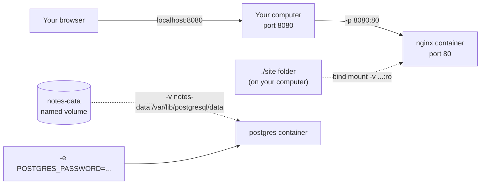

# 06 · Running containers: ports, volumes, env

**What you'll build:** a web server in a container showing **your own** web page, and a Postgres database in a container whose data survives even when you delete the container. On the way you learn every `docker run` flag you will use daily, and how to look inside running containers.
**Like you're 5:** a container is a closed house. **Ports** are doors you open so visitors can come in, **volumes** are a garden shed outside the house where you keep things safe when the house is knocked down, and **environment variables** are notes you slip under the door when the house is built.
**Time:** ~60 min · **Builds on:** [05 · What is a container?](../05-what-is-a-container) · **Needs:** Docker

## Why this matters
Real AI systems are made of containers that must be **reachable** (your API on port 8000, a vector database on 5432), **keep data** (databases, downloaded model files that are gigabytes big), and **get settings and secrets** (API keys, passwords, which model to use) without rebuilding the image. `-p`, `-v` and `-e` do exactly that. Later, Docker Compose and Kubernetes describe the same three ideas in YAML, so understanding them here pays off for the rest of the course.

## What you'll learn
- **Port publishing (`-p 8080:80`):** connect a door on your computer (8080) to a door in the container (80).
- **Bind mount (`-v "$(pwd)/site":/usr/share/nginx/html`):** show a folder from your computer inside the container. Edit on your computer, the container sees it instantly.
- **Named volume (`-v notes-data:/var/lib/postgresql/data`):** storage that Docker manages and that outlives containers. The right place for database files and models.
- **Environment variables (`-e NAME=value`):** settings passed into the container at start, read by the app inside.
- **Day-to-day commands:** `ps`, `logs`, `exec`, `stop`, `start`, `rm`, plus `--name`, `-d`, `--rm` and `-it`.

## Before you start
- Docker running (`docker version` shows a `Server` part).
- Free ports: this lesson uses port **8080** on your computer. If something else uses it, pick another (for example `-p 8081:80`) and use that number in the browser.
- No Python packages and no API key. The images (`nginx:alpine`, `alpine:3.20`, `postgres:16`) download from Docker Hub.
- The folder `site/` in this lesson holds `index.html`, the page you will serve.

## Run it
From the course folder (`cloud-and-devops-for-ai`):
```bash
cd part-2-docker/06-running-containers-ports-volumes-env
```

### Step 1 · Start a web server in the background, with a door open
```bash
docker run -d --name web -p 8080:80 nginx:alpine
```
| Piece | Meaning |
|-------|---------|
| `docker run` | make a container from an image and start it |
| `-d` | **d**etached: run in the background and give your terminal back. Docker prints the new container's long ID. |
| `--name web` | call the container `web`, so later commands can say `web` instead of an ID |
| `-p 8080:80` | **p**ublish a port: `HOST:CONTAINER`. Visitors to port 8080 on your computer are passed to port 80 inside the container, where nginx listens. |
| `nginx:alpine` | the image: nginx (a very popular web server) on tiny Alpine Linux |

Open http://localhost:8080 in your browser. You should see **"Welcome to nginx!"**. Or from the terminal:
```bash
curl -s localhost:8080 | grep "<h1>"
```
(`curl` fetches a web address, `-s` = **s**ilent (no progress bar), `| grep "<h1>"` keeps only the heading line.) You should see `<h1>Welcome to nginx!</h1>`.

### Step 2 · Look at it: ps and logs
```bash
docker ps
docker logs web
```
| Piece | Meaning |
|-------|---------|
| `docker ps` | list running containers |
| `docker logs web` | show everything the container printed (its "standard output"). Add `-f` to **f**ollow new lines live (stop with Ctrl + C). |

You should see:
```
CONTAINER ID   IMAGE          COMMAND                  CREATED         STATUS        PORTS                   NAMES
20b1928eb8e6   nginx:alpine   "/docker-entrypoint.…"   2 seconds ago   Up 1 second   0.0.0.0:8080->80/tcp    web
...
2026/10/22 08:58:20 [notice] 1#1: start worker process 22
172.17.0.1 - - [22/Oct/2026:08:58:21 +0000] "GET / HTTP/1.1" 200 896 "-" "curl/8.5.0" "-"
```
`0.0.0.0:8080->80/tcp` is the open door: port 8080 on all your computer's network addresses goes to port 80 in the container. The last log line is your visit: `GET /` answered with `200` (OK).

### Step 3 · Stop it and remove it
```bash
docker stop web
docker ps -a --filter name=web
docker rm web
```
| Piece | Meaning |
|-------|---------|
| `docker stop web` | ask the container to shut down politely (after 10 seconds Docker forces it) |
| `docker ps -a --filter name=web` | list all containers, but only those whose name contains `web` |
| `docker rm web` | delete the stopped container (`docker rm -f web` stops and deletes in one go) |

You should see `web` with status `Exited (0) ...` before it is removed. (`docker start web` would have started the same container again.)

### Step 4 · Serve YOUR page with a bind mount
```bash
docker run -d --name web -p 8080:80 -v "$(pwd)/site":/usr/share/nginx/html:ro nginx:alpine
```
| Piece | Meaning |
|-------|---------|
| `-v` | mount storage into the container: `SOURCE:TARGET[:OPTIONS]` |
| `"$(pwd)/site"` | the source: `$(pwd)` is replaced by the current folder's full path (**p**rint **w**orking **d**irectory), then `/site`. A source that starts with `/` is a folder on your computer, so this is a **bind mount**. The quotes protect paths with spaces. |
| `:` | separates the parts |
| `/usr/share/nginx/html` | the target: where the folder appears inside the container. nginx serves files from here. |
| `:ro` | **r**ead-**o**nly: the container may read the files but not change them |

Refresh http://localhost:8080. You should see **"Hello from inside a container!"**. Now open `site/index.html` in your editor, change the heading text, save, and refresh the browser: the change is there immediately, no restart. The container reads the folder straight from your computer.

On Windows PowerShell (not WSL) write `${PWD}/site` instead of `$(pwd)/site`.

### Step 5 · Go inside a running container with exec
```bash
docker exec -it web sh
```
| Piece | Meaning |
|-------|---------|
| `docker exec` | run an extra command **inside an already running** container |
| `-it` | interactive + terminal, so you can type (lesson 05) |
| `web` | which container |
| `sh` | the command: a shell (Alpine images have `sh`, not `bash`) |

Your prompt changes to `/ #`. Type:
```bash
ls -l /usr/share/nginx/html
echo hi > /usr/share/nginx/html/x.txt
cat /etc/os-release | head -2
exit
```
You should see:
```
total 4
-rw-r--r--    1 root     root           277 Oct 22 08:57 index.html
sh: can't create /usr/share/nginx/html/x.txt: Read-only file system
NAME="Alpine Linux"
ID=alpine
```
Your `index.html` is there, and `:ro` stopped the container from writing into your folder. `exit` leaves the shell; the container keeps running. Remove it now:
```bash
docker rm -f web
```

### Step 6 · Pass settings with environment variables
```bash
docker run --rm -e NAME=Sam alpine:3.20 sh -c 'echo "Hello, $NAME! I am running inside a container."'
docker run --rm alpine:3.20 sh -c 'echo "Hello, $NAME!"'
```
| Piece | Meaning |
|-------|---------|
| `-e NAME=Sam` | set the **e**nvironment variable `NAME` to `Sam` inside the container |
| `sh -c '...'` | run the text in quotes with the shell (`-c` = **c**ommand) |
| `'...'` (single quotes) | stop **your** shell from replacing `$NAME` too early, so the container's shell does it |
| `$NAME` | "the value of the variable NAME" |

You should see:
```
Hello, Sam! I am running inside a container.
Hello, !
```
Without `-e`, the variable is empty. Apps read settings this way: in Python, `os.getenv("NAME")`.

### Step 7 · A database that keeps its data: env + named volume
Postgres refuses to start without a password, which it reads from an environment variable:
```bash
docker run -d --name notes-db -e POSTGRES_PASSWORD=secret -v notes-data:/var/lib/postgresql/data postgres:16
```
| Piece | Meaning |
|-------|---------|
| `-e POSTGRES_PASSWORD=secret` | the password for the `postgres` admin user (only for practice; never use `secret` for real) |
| `-v notes-data:/var/lib/postgresql/data` | the source `notes-data` has no `/`, so it is a **named volume**: Docker creates it the first time and keeps it. The target is where Postgres stores its database files. |
| `postgres:16` | the official Postgres 16 image |

Wait until it's ready: run this until the last line says `database system is ready to accept connections` (about 5–10 seconds the first time):
```bash
docker logs notes-db
```
Now create a table and a row with the `psql` tool that lives **inside** the container:
```bash
docker exec notes-db psql -U postgres -c "CREATE TABLE notes (id SERIAL PRIMARY KEY, body TEXT);" -c "INSERT INTO notes (body) VALUES ('Containers are like lunch boxes');" -c "SELECT * FROM notes;"
```
(`psql` = Postgres's command-line client, `-U postgres` = log in as **U**ser postgres, each `-c "..."` = one SQL command to run.)

You should see:
```
CREATE TABLE
INSERT 0 1
 id |              body               
----+---------------------------------
  1 | Containers are like lunch boxes
(1 row)
```

### Step 8 · Destroy the container, keep the data
```bash
docker rm -f notes-db
docker volume ls
docker run -d --name notes-db -e POSTGRES_PASSWORD=secret -v notes-data:/var/lib/postgresql/data postgres:16
```
Wait a few seconds, then:
```bash
docker logs notes-db
docker exec notes-db psql -U postgres -c "SELECT * FROM notes;"
```
You should see:
```
DRIVER    VOLUME NAME
local     notes-data

PostgreSQL Database directory appears to contain a database; Skipping initialization
...
 id |              body               
----+---------------------------------
  1 | Containers are like lunch boxes
(1 row)
```
The container was deleted, but the volume (the garden shed) was not. The new container found the old database and skipped creating a new one.

### Step 9 · Clean up
```bash
docker rm -f notes-db
docker volume rm notes-data
docker volume ls
```
`docker volume rm` deletes the volume **and its data for good**. Only do it when you mean it.

### What you should see
- Step 1: "Welcome to nginx!" at http://localhost:8080; Step 4: your own "Hello from inside a container!" page, updating as you edit `site/index.html`.
- Step 6: `Hello, Sam! ...` and then `Hello, !`.
- Step 8: your note still in the table after deleting and re-creating the Postgres container.
- After Step 9: `docker ps -a` shows neither `web` nor `notes-db`, and `docker volume ls` doesn't list `notes-data`.

## How it works

1. **Ports.** Every container gets its own private network address. Nothing from outside can reach it until you **publish** a port. `-p HOST:CONTAINER` makes Docker forward traffic from your computer's port to the container's port. The container side is fixed by the app (nginx uses 80, Postgres 5432, our FastAPI app 8000); the host side is your choice, so two containers that both use 80 inside can be published on 8080 and 8081.
2. **Container writes are temporary.** As lesson 05 showed, files written inside a container disappear with it. Two ways to keep or share files:
   - **Bind mount** (`-v /full/path:/target`): a folder from your computer appears inside. Great for code and config you edit (Step 4). The container sees your files exactly, including their owner and permissions.
   - **Named volume** (`-v name:/target`): Docker creates and manages the storage (on Linux under `/var/lib/docker/volumes/`). Best for data that belongs to the container, like databases and downloaded AI models. It works the same on every OS and survives `docker rm`.
   - Newer, more explicit spelling of the same thing: `--mount type=volume,source=notes-data,target=/var/lib/postgresql/data`. You will see both in docs.
3. **Environment variables** are key=value pairs given to the container's main process at start. Images document which ones they read: the Postgres image reads `POSTGRES_PASSWORD`, `POSTGRES_USER`, `POSTGRES_DB`. Your own apps read them with `os.getenv(...)` (lesson 07). Changing one means re-creating the container, not rebuilding the image.
4. **The container lifecycle:** `run` (create + start) → `stop` (process ends, container kept, status `Exited`) → `start` (same container again, writable layer intact) → `rm` (gone). `--rm` deletes automatically on stop; `rm -f` stops and deletes at once.
5. **`exec` vs `run`:** `run` makes a **new** container; `exec` runs an extra command in an **existing, running** one. Use `exec` to debug: look at files, run `psql`, check environment variables (`docker exec web env`).

**The flags at a glance**

| Flag | Long form | Means |
|------|-----------|-------|
| `-d` | `--detach` | run in the background |
| `-p 8080:80` | `--publish` | host port 8080 → container port 80 |
| `-v src:dst[:ro]` | `--volume` | bind mount (src starts with `/` or `./`) or named volume (plain name) |
| `-e KEY=value` | `--env` | set an environment variable (`--env-file .env` reads many from a file) |
| `--name web` | | give the container a name |
| `--rm` | | delete the container when it stops |
| `-i` `-t` | `--interactive` `--tty` | keep keyboard input open, give it a terminal |

## If something goes wrong
- **`Bind for 0.0.0.0:8080 failed: port is already allocated`** → another program or container uses 8080. Use another host port (`-p 8081:80`) or find the culprit with `docker ps`.
- **`Conflict. The container name "/web" is already in use`** → a container called `web` exists (maybe stopped). Remove it with `docker rm -f web`, or pick another name.
- **The browser shows "403 Forbidden" after Step 4** → the mounted folder is empty or the path is wrong, so nginx has no `index.html`. Make sure you ran the command **inside** the lesson folder (`ls site` shows `index.html`), and that you wrote `$(pwd)/site`, not `site` (a plain name would create an empty named volume called `site`).
- **`psql: error: connection to server on socket ... failed: No such file or directory`** → Postgres is still starting. Wait a few seconds and check `docker logs notes-db` for `ready to accept connections`.
- **Postgres container exits at once and `docker logs` says `Database is uninitialized and superuser password is not specified`** → you forgot `-e POSTGRES_PASSWORD=...`. Remove it with `docker rm notes-db` and run Step 7 again.

## Try this
1. Run two web servers at once: one on port 8080 with the default nginx page and one on 8081 with your `site/` folder. Visit both.
2. Start an Alpine container with **two** environment variables, `MODEL=claude-haiku-5-5` and `TEMPERATURE=0.2`, and print both. Then do the same reading them from a file with `--env-file`.
3. Run `python:3.12-slim` with a bind mount of a folder containing a tiny `hello.py` and run that script inside the container, without installing anything on your computer.

<details><summary>Hints and solutions</summary>

1. ```bash
   docker run -d --name web1 -p 8080:80 nginx:alpine
   docker run -d --name web2 -p 8081:80 -v "$(pwd)/site":/usr/share/nginx/html:ro nginx:alpine
   docker ps
   docker rm -f web1 web2
   ```
   Same container port (80), different host ports: no clash.
2. ```bash
   docker run --rm -e MODEL=claude-haiku-5-5 -e TEMPERATURE=0.2 alpine:3.20 sh -c 'echo "$MODEL at $TEMPERATURE"'
   printf 'MODEL=claude-haiku-5-5\nTEMPERATURE=0.2\n' > my.env
   docker run --rm --env-file my.env alpine:3.20 env
   rm my.env
   ```
   `env` prints every variable. In an env file: one `KEY=value` per line, no quotes needed, no `export`.
3. ```bash
   mkdir -p ~/devops-practice/06 && echo 'print("Hello from Python in a container")' > ~/devops-practice/06/hello.py
   docker run --rm -v ~/devops-practice/06:/work -w /work python:3.12-slim python hello.py
   ```
   `-w /work` sets the **w**orking directory inside the container, so `python hello.py` finds the file. `~` is turned into your full home path by your shell, so this is a bind mount.
</details>

## Check yourself
1. In `-p 8080:80`, which number belongs to your computer and which to the container?
2. When would you use a bind mount, and when a named volume?
3. Why is a database password passed with `-e` instead of being written into the image?
4. What is the difference between `docker run` and `docker exec`?

<details><summary>Answers</summary>

1. 8080 is the port on your computer (host); 80 is the port inside the container. The format is always `HOST:CONTAINER`.
2. Bind mount: when you want your own files (code, a web page, config) to appear inside and change them from your computer. Named volume: for data the container owns and must keep, like database files or downloaded models.
3. So the same image can be used everywhere with different passwords, and the secret is not baked into an image that might be shared or pushed to a registry.
4. `docker run` creates a new container from an image; `docker exec` runs an extra command inside a container that is already running.
</details>

## Learn more (optional)
**Read the official docs**
- `docker run` reference (every flag): https://docs.docker.com/reference/cli/docker/container/run/
- Volumes: https://docs.docker.com/engine/storage/volumes/ · Bind mounts: https://docs.docker.com/engine/storage/bind-mounts/
- Port publishing and networking overview: https://docs.docker.com/engine/network/
- `docker exec`: https://docs.docker.com/reference/cli/docker/container/exec/ · `docker logs`: https://docs.docker.com/reference/cli/docker/container/logs/
- The official images used here: https://hub.docker.com/_/nginx · https://hub.docker.com/_/postgres

**Watch**
- TechWorld with Nana, Docker volumes explained: https://www.youtube.com/results?search_query=techworld+with+nana+docker+volumes
- freeCodeCamp, Docker for beginners full course: https://www.youtube.com/results?search_query=freecodecamp+docker+for+beginners+full+course
- NetworkChuck, Docker containers are awesome: https://www.youtube.com/results?search_query=networkchuck+docker+containers

## Next
→ [07 · A Dockerfile for an AI API](../07-dockerfile-for-an-ai-api)
