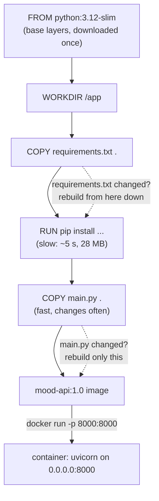

# 07 · A Dockerfile for an AI API

**What you'll build:** your own Docker image of the FastAPI Mood API from lesson 04, built from a 7-instruction Dockerfile, running as a container you can call on port 8000. Then you watch Docker's layer cache turn a 7-second rebuild into a 0.4-second one.
**Like you're 5:** a Dockerfile is a cake recipe written as numbered steps. Docker bakes the cake one layer at a time and keeps every finished layer in the fridge. Next time, if the first steps of the recipe didn't change, it takes those layers out of the fridge instead of baking them again.
**Time:** ~60 min · **Builds on:** [06 · Running containers: ports, volumes, env](../06-running-containers-ports-volumes-env) · **Needs:** Docker

## Why this matters
Running other people's images is half the job; the other half is packaging **your** AI app so anyone (a teammate, a CI robot, a Kubernetes cluster, a customer's server) can run it with one command. That package is built from a **Dockerfile**. Knowing how layers and caching work is the difference between a 10-second and a 10-minute rebuild, which matters a lot when AI images contain big libraries like PyTorch.

## What you'll learn
- **Dockerfile:** a text file of instructions (`FROM`, `WORKDIR`, `COPY`, `RUN`, `ENV`, `EXPOSE`, `CMD`) that describes how to build an image.
- **Build context:** the folder you send to Docker when you build (the `.` at the end of `docker build`); `COPY` can only take files from it.
- **Layers:** every `COPY`/`RUN`/`WORKDIR` instruction adds one layer on top of the previous ones.
- **Layer cache:** Docker reuses a layer if its instruction and inputs are unchanged, but once one layer changes, every layer after it is rebuilt. So: copy what rarely changes (requirements) first, code last.
- **Tags:** `mood-api:1.0` = name `mood-api`, version `1.0`.

## Before you start
- Docker running. `python:3.12-slim` downloads automatically (you may already have it from lesson 05).
- No pip install needed on your computer: the image installs its own packages from `requirements.txt` (`fastapi` turns functions into web addresses; `uvicorn` is the web server).
- No API key needed.

**Files in this folder**

| File | What it is |
|------|------------|
| `main.py` | the Mood API from lesson 04, plus one line that reads its version from the environment variable `APP_VERSION` |
| `requirements.txt` | the exact packages the app needs |
| `Dockerfile` | the recipe for the image (dissected below) |

## Run it
From the course folder (`cloud-and-devops-for-ai`):
```bash
cd part-2-docker/07-dockerfile-for-an-ai-api
```

### Step 1 · Read the Dockerfile
```bash
cat Dockerfile
```
Read it once now; "How it works" explains every line.

### Step 2 · Build the image
```bash
docker build -t mood-api:1.0 .
```
| Piece | Meaning |
|-------|---------|
| `docker build` | build an image from a Dockerfile |
| `-t mood-api:1.0` | **t**ag (name) the result: name `mood-api`, tag `1.0` |
| `.` | the **build context**: "this folder". Docker sends it to the builder and looks for a file called `Dockerfile` in it. Easy to forget! |

You should see the steps tick by (the first build takes 10–30 seconds, mostly downloading packages):
```
[+] Building 14.2s (10/10) FINISHED
 => [internal] load build definition from Dockerfile
 => [internal] load metadata for docker.io/library/python:3.12-slim
 => [internal] load .dockerignore
 => [1/5] FROM docker.io/library/python:3.12-slim@sha256:cb33f7f7...
 => [internal] load build context
 => [2/5] WORKDIR /app
 => [3/5] COPY requirements.txt .
 => [4/5] RUN pip install --no-cache-dir -r requirements.txt            5.3s
 => [5/5] COPY main.py .
 => exporting to image
 => => naming to docker.io/library/mood-api:1.0
```
Five numbered steps = the five instructions that change files (`FROM`, `WORKDIR`, `COPY`, `RUN`, `COPY`). `ENV`, `EXPOSE` and `CMD` only add settings, so they don't get a number.

During step 4 pip prints `WARNING: Running pip as the 'root' user can result in broken permissions...`. Inside a throw-away image this is harmless; lesson 08 builds the image in a way that avoids it.

### Step 3 · Find your image
```bash
docker images mood-api
```
You should see:
```
IMAGE          ID             DISK USAGE   CONTENT SIZE   EXTRA
mood-api:1.0   a52768a147c7        215MB         52.2MB
```
215 MB on disk: about 179 MB is the `python:3.12-slim` base, about 28 MB is FastAPI and friends, and a few KB is your code. "Content size" is the compressed size, what gets downloaded.

### Step 4 · Run it
```bash
docker run -d --name mood -p 8000:8000 -e APP_VERSION=1.0 mood-api:1.0
```
All flags are from lesson 06: background (`-d`), a name, door 8000 → 8000, and an environment variable the app reads. Now call it:
```bash
curl -s localhost:8000/health
curl -s -X POST localhost:8000/predict -H "Content-Type: application/json" -d '{"text": "I love Docker, it is great"}'
```
| Piece | Meaning |
|-------|---------|
| `curl -s URL` | fetch the address silently (no progress bar) |
| `-X POST` | use the HTTP method **POST** (send data) instead of the default GET |
| `-H "Content-Type: application/json"` | add a **h**eader saying "the data I send is JSON" |
| `-d '{...}'` | the **d**ata (request body). Single quotes keep the double quotes inside safe. |

You should see:
```
{"status":"ok","version":"1.0"}
{"text":"I love Docker, it is great","label":"positive","score":2}
```
`"version":"1.0"` came from `-e APP_VERSION=1.0`. You can also open http://localhost:8000/docs in the browser.

### Step 5 · Read its logs
```bash
docker logs mood
```
You should see:
```
INFO:     Started server process [1]
INFO:     Waiting for application startup.
INFO:     Application startup complete.
INFO:     Uvicorn running on http://0.0.0.0:8000 (Press CTRL+C to quit)
INFO:     172.17.0.1:50788 - "GET /health HTTP/1.1" 200 OK
INFO:     172.17.0.1:50794 - "POST /predict HTTP/1.1" 200 OK
```
`process [1]`: inside its container, uvicorn is process number 1, the main process. `172.17.0.1` is your computer as seen from inside the container.

### Step 6 · Rebuild without changes: everything comes from the cache
```bash
docker build -t mood-api:1.0 .
```
You should see every step marked `CACHED`, and the build takes well under a second:
```
 => CACHED [2/5] WORKDIR /app
 => CACHED [3/5] COPY requirements.txt .
 => CACHED [4/5] RUN pip install --no-cache-dir -r requirements.txt
 => CACHED [5/5] COPY main.py .
```

### Step 7 · Change only the code: only the last layer is rebuilt
Open `main.py` and add `"fun",` to the `POSITIVE_WORDS` list (for example after `"helpful",`). Save, then:
```bash
docker build -t mood-api:1.1 .
```
You should see:
```
 => CACHED [2/5] WORKDIR /app
 => CACHED [3/5] COPY requirements.txt .
 => CACHED [4/5] RUN pip install --no-cache-dir -r requirements.txt
 => [5/5] COPY main.py .
```
Only step 5 ran. The whole build took about **0.4 seconds** instead of 14, because the slow `pip install` layer was reused. This is why the Dockerfile copies `requirements.txt` and installs packages **before** copying the code.

### Step 8 · Change the requirements: pip runs again
Add a line `httpx==0.28.1` to the end of `requirements.txt`, save, then:
```bash
docker build -t mood-api:1.2 .
```
You should see:
```
 => CACHED [2/5] WORKDIR /app
 => [3/5] COPY requirements.txt .
 => [4/5] RUN pip install --no-cache-dir -r requirements.txt            5.0s
 => [5/5] COPY main.py .
```
`requirements.txt` changed, so step 3 changed, so step 4 and everything after it had to run again. Undo your edits to `main.py` and `requirements.txt` afterwards (with `git restore` if this course is a Git clone, or by hand).

### Step 9 · See the layers
```bash
docker history mood-api:1.0
```
You should see one row per instruction, newest on top (columns trimmed here):
```
CREATED BY                                      SIZE
CMD ["uvicorn" "main:app" "--host" "0.0.0.0"…   0B
EXPOSE [8000/tcp]                               0B
COPY main.py . # buildkit                       12.3kB
RUN /bin/sh -c pip install --no-cache-dir -r…   28.2MB
COPY requirements.txt . # buildkit              12.3kB
WORKDIR /app                                    8.19kB
ENV PYTHONUNBUFFERED=1                          0B
CMD ["python3"]                                 0B
RUN /bin/sh -c set -eux;   savedAptMark="$(a…   41.4MB
...
```
Everything below `ENV PYTHONUNBUFFERED=1` comes from the `python:3.12-slim` base image.

### Step 10 · Clean up
```bash
docker rm -f mood
docker rmi mood-api:1.1 mood-api:1.2
```
Keep `mood-api:1.0` if you want to compare sizes in lesson 08.

### What you should see
- `docker images mood-api` lists `mood-api:1.0` at about 215 MB.
- The running container answers `{"status":"ok","version":"1.0"}` on `/health` and labels "I love Docker, it is great" as `positive`.
- Rebuilds: all `CACHED` with no changes; only `[5/5] COPY main.py` after a code change; `[3/5]`, `[4/5]` and `[5/5]` after a requirements change.

## How it works


### The Dockerfile, line by line
| Line | Meaning |
|------|---------|
| `# ...` | a comment. Docker ignores it. |
| `FROM python:3.12-slim` | start from this image: Debian Linux with Python 3.12 already installed. Every Dockerfile starts with `FROM`. `slim` = without compilers and extras (lesson 08 explains why that matters). |
| `ENV PYTHONUNBUFFERED=1` | set an environment variable **inside the image** (like `-e`, but built in). This one makes Python print immediately, so `docker logs` shows lines live instead of in delayed batches. |
| `WORKDIR /app` | create the folder `/app` and make it the current folder for all following instructions and for the running container (like `mkdir -p /app && cd /app`). |
| `COPY requirements.txt .` | copy `requirements.txt` from the build context (your folder) into the image's current folder (`.` = `/app`). |
| `RUN pip install --no-cache-dir -r requirements.txt` | run a command **while building** and save the result as a layer. `--no-cache-dir` = don't keep pip's download cache in the image (saves space). |
| `COPY main.py .` | copy the code. Last, because it changes most often. |
| `EXPOSE 8000` | documentation: "this app listens on port 8000". It does **not** open the port; `-p` does that at `docker run`. |
| `CMD ["uvicorn", "main:app", "--host", "0.0.0.0", "--port", "8000"]` | the default command when a container starts. Written as a JSON list (the "exec form"), so no shell is involved and uvicorn becomes process 1 and receives stop signals properly. |

**Why `--host 0.0.0.0`?** By default uvicorn listens on `127.0.0.1`, which means "only visitors from inside this same container". Your browser comes from outside the container, through `-p`, so the app must listen on `0.0.0.0` = "every network address of this container". Forgetting this is the number-one "my container runs but I can't reach it" bug.

### The cache rule
Docker checks each instruction in order. A layer is reused if the instruction text is the same **and**, for `COPY`, the copied files have the same content. The first time something differs, that layer **and every layer after it** is rebuilt. So put instructions in order of "changes least" to "changes most": base image → system setup → requirements → `pip install` → your code.

**The classic mistake** is `COPY . .` before `RUN pip install`: then any change to any file (even the README) throws away the cached `pip install`, and every rebuild re-downloads every package. Lesson 08's `Dockerfile.naive` does exactly that so you can compare.

### RUN vs CMD
`RUN` happens **once, at build time**, and its result is frozen into the image (installing packages). `CMD` happens **every time a container starts** (starting the server). You can override `CMD` at the end of `docker run`, for example `docker run --rm mood-api:1.0 python -c "import fastapi; print(fastapi.__version__)"`.

## If something goes wrong
- **`ERROR: failed to solve: failed to read dockerfile: open Dockerfile: no such file or directory`** → you are not in the lesson folder, or you forgot the `.` at the end of `docker build`. `cd` into the folder and run it again.
- **`curl: (56) Recv failure: Connection reset by peer` or the browser can't connect, but the container is running** → the app listens only inside the container. Check that `CMD` has `--host 0.0.0.0`, and that you ran with `-p 8000:8000`.
- **`Bind for 0.0.0.0:8000 failed: port is already allocated`** → something else (maybe a uvicorn from lesson 04) uses port 8000. Stop it, or run with `-p 8001:8000` and call `localhost:8001`.
- **`ERROR: Could not find a version that satisfies the requirement fastapi==...`** → the build can't reach PyPI (no internet, a company proxy) or there's a typo in `requirements.txt`. Check your connection and the file.
- **The container exits straight away** → read why with `docker logs mood`. A Python error in `main.py` (like a missing comma) shows up there as a traceback.

## Try this
1. Run a second container from the same image on port 8001 with `APP_VERSION=2.0`, and check both `/health` answers.
2. Override the image's `CMD` to print the installed FastAPI version instead of starting the server.
3. Break the cache on purpose: change the Dockerfile so it copies `main.py` **before** `requirements.txt` and installs packages after both. Change one word in `main.py`, rebuild, and compare which steps re-run. Then put it back.

<details><summary>Hints and solutions</summary>

1. ```bash
   docker run -d --name mood2 -p 8001:8000 -e APP_VERSION=2.0 mood-api:1.0
   curl -s localhost:8000/health   # {"status":"ok","version":"1.0"}  (if 'mood' still runs)
   curl -s localhost:8001/health   # {"status":"ok","version":"2.0"}
   docker rm -f mood2
   ```
   One image, many containers, each with its own settings.
2. ```bash
   docker run --rm mood-api:1.0 python -c "import fastapi; print(fastapi.__version__)"
   ```
   Prints `0.159.1`. Everything after the image name replaces `CMD`.
3. Change the middle of the Dockerfile to:
   ```dockerfile
   COPY main.py .
   COPY requirements.txt .
   RUN pip install --no-cache-dir -r requirements.txt
   ```
   After editing `main.py`, the build re-runs `COPY main.py`, `COPY requirements.txt` **and** the slow `pip install`, because they all come after the changed layer. That's why the order matters.
</details>

## Check yourself
1. Why does the Dockerfile copy `requirements.txt` and run `pip install` before copying `main.py`?
2. What does the `.` at the end of `docker build -t mood-api:1.0 .` mean?
3. What is the difference between `RUN` and `CMD`?
4. Your container runs but `curl localhost:8000` fails. Name the two things you check first.

<details><summary>Answers</summary>

1. Packages change rarely and installing them is slow; code changes often. With this order, a code change only rebuilds the tiny last layer and the `pip install` layer comes from the cache.
2. It's the build context: "send this folder to the builder". `COPY` takes files from it, and Docker looks for `Dockerfile` in it.
3. `RUN` runs at build time and its result is saved in the image. `CMD` is the command that runs every time a container starts.
4. That the app listens on `0.0.0.0` inside the container (`--host 0.0.0.0`), and that the port is published with `-p 8000:8000` (check the PORTS column of `docker ps`). Then read `docker logs`.
</details>

## Learn more (optional)
**Read the official docs**
- Dockerfile reference (every instruction): https://docs.docker.com/reference/dockerfile/
- Build cache, how it works: https://docs.docker.com/build/cache/
- Writing a Dockerfile, best practices: https://docs.docker.com/build/building/best-practices/
- `docker build` reference: https://docs.docker.com/reference/cli/docker/buildx/build/
- FastAPI in containers (Docker): https://fastapi.tiangolo.com/deployment/docker/

**Watch**
- TechWorld with Nana, Dockerfile tutorial: https://www.youtube.com/results?search_query=techworld+with+nana+dockerfile+tutorial
- Fireship, Docker tutorial (build your own image): https://www.youtube.com/results?search_query=fireship+docker+tutorial+dockerfile
- Dockerize a FastAPI app: https://www.youtube.com/results?search_query=dockerize+fastapi+app+tutorial

## Next
→ [08 · Smaller, safer images](../08-smaller-safer-images)
