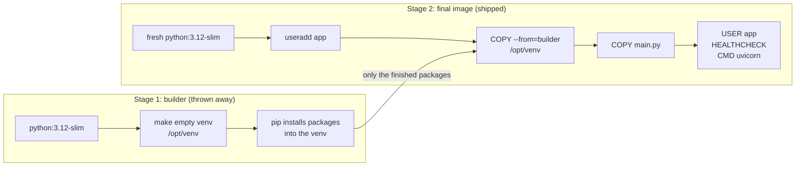

# 08 · Smaller, safer images

**What you'll build:** two images of the same Mood API: a "first try" image of **1.65 GB** that runs as the all-powerful root user, and a production image of **201 MB** that runs as a normal user, keeps junk and secrets out, and tells Docker whether the app is healthy. You measure the difference yourself.
**Like you're 5:** moving house, the first try is to throw the whole kitchen, the toolbox and the rubbish bin into the moving van. The smart way: build the furniture in the workshop, then put **only the finished furniture** in a small van, and give the driver a normal key, not the master key to the whole street.
**Time:** ~60 min · **Builds on:** [07 · A Dockerfile for an AI API](../07-dockerfile-for-an-ai-api) · **Needs:** Docker, about 2.5 GB free disk

## Why this matters
Every megabyte of an image is downloaded by every server, CI run and Kubernetes node that starts it: a 1.6 GB image makes deploys and autoscaling slow and costs money in storage and bandwidth. Every extra program in an image (compilers, `curl`, shells, old libraries) is something an attacker could use and something security scanners flag. And a container running as root turns a bug in your app into a much bigger problem. AI companies and security reviews check exactly these things, so this is the Dockerfile you'll actually ship.

## What you'll learn
- **Slim base images:** `python:3.12` (about 1.6 GB, with compilers and tools) vs `python:3.12-slim` (about 179 MB, just enough to run Python).
- **Multi-stage build:** one Dockerfile with two `FROM`s: a "builder" stage that installs things, and a clean final stage that copies in only the results.
- **Non-root user:** create a normal user with `useradd` and switch to it with `USER`, so the app has as few powers as possible.
- **.dockerignore:** a list of files that must never be sent to the builder (your `.venv`, `.git`, `.env` secrets).
- **HEALTHCHECK:** a command Docker runs regularly inside the container to report `healthy` or `unhealthy`.

## Before you start
- Docker running, and about 2.5 GB of free disk space (the naive image is big on purpose; you delete it at the end).
- No API key. No pip install needed on your computer, except in Step 2 (optional), which makes a local venv to show why `.dockerignore` matters.

**Files in this folder**

| File | What it is |
|------|------------|
| `main.py`, `requirements.txt` | the same Mood API as lesson 07 |
| `Dockerfile.naive` | the "first try": big base image, copies everything, installs as root, runs as root |
| `Dockerfile` | the production version: multi-stage, slim, non-root, health check |
| `.dockerignore` | files Docker must not send to the builder |

## Run it
From the course folder (`cloud-and-devops-for-ai`):
```bash
cd part-2-docker/08-smaller-safer-images
ls -a
```

### Step 1 · Look at the two recipes side by side
```bash
cat Dockerfile.naive
cat Dockerfile
```
The naive one is 5 instructions. The good one is longer but every extra line has a job (see "How it works").

### Step 2 · Make a local venv, like a real project has (optional but recommended)
```bash
python3 -m venv .venv
.venv/bin/pip install -r requirements.txt
du -sh .venv
```
(`du -sh` = **d**isk **u**sage, **s**ummary only, **h**uman-readable sizes.) You should see about `31M .venv`. Most real project folders contain a venv like this; watch what happens to it in Step 5.

### Step 3 · Build the naive image
```bash
docker build -f Dockerfile.naive -t mood-api:naive .
```
| Piece | Meaning |
|-------|---------|
| `-f Dockerfile.naive` | use this **f**ile as the Dockerfile (by default Docker looks for one called `Dockerfile`) |
| `-t mood-api:naive` | name and tag for the result |
| `.` | the build context: this folder |

The first build downloads `python:3.12` (about 430 MB compressed), so it takes a while.

### Step 4 · Build the production image
```bash
docker build -t mood-api:slim .
```
You should see two stages in the log, `builder` and `stage-1` (the final one), some steps running side by side:
```
 => [builder 1/4] FROM docker.io/library/python:3.12-slim@sha256:cb33f7f7...
 => [builder 2/4] RUN python -m venv --without-pip /opt/venv
 => [stage-1 2/5] RUN useradd --create-home --uid 10001 app
 => [builder 3/4] COPY requirements.txt .
 => [stage-1 3/5] WORKDIR /app
 => [builder 4/4] RUN pip --python /opt/venv/bin/python install --no-cache-dir -r requirements.txt
 => [stage-1 4/5] COPY --from=builder /opt/venv /opt/venv
 => [stage-1 5/5] COPY main.py .
 => => naming to docker.io/library/mood-api:slim
```

### Step 5 · Compare the sizes
```bash
docker images mood-api
```
You should see (sizes measured in October 2026 on linux/amd64; yours may differ a little):
```
IMAGE            ID             DISK USAGE   CONTENT SIZE   EXTRA
mood-api:1.0     b0510b75e49d        215MB         52.2MB
mood-api:naive   c3ca7bda0feb       1.65GB          426MB
mood-api:slim    2c5d45049726        201MB         48.7MB
```
(`mood-api:1.0` is lesson 07's single-stage slim image, if you kept it.)

| Image | Base | On disk | Download (compressed) | Runs as |
|-------|------|---------|-----------------------|---------|
| `mood-api:naive` | `python:3.12` | **1.65 GB** | 426 MB | root |
| `mood-api:1.0` (lesson 07) | `python:3.12-slim` | 215 MB | 52.2 MB | root |
| `mood-api:slim` (this lesson) | `python:3.12-slim`, multi-stage | **201 MB** | 48.7 MB | `app` (uid 10001) |

The same app, **8 times smaller** on disk. Most of the win comes from the slim base. The multi-stage build takes the last 14 MB off: in lesson 07, running pip also left about 9 MB of Python cache files (`__pycache__` for the standard library and pip itself) in the image; here they stay behind in the builder, and so would any build tools.

### Step 6 · See what .dockerignore saves you from
Switch the ignore file off, build the naive image again, then switch it back on:
```bash
mv .dockerignore .dockerignore.off
docker build -f Dockerfile.naive -t mood-api:naive-noignore . 2>&1 | grep "transferring context"
mv .dockerignore.off .dockerignore
docker build -f Dockerfile.naive -t mood-api:naive . 2>&1 | grep "transferring context"
```
(`mv` = rename; `2>&1` = send the build's progress messages, which go to the "error" stream, into the pipe too; `grep` keeps the lines about the context.)

You should see:
```
#5 transferring context: 27.08MB 0.8s done
#5 transferring context: 99B 2.3s done
```
Without `.dockerignore`, your whole `.venv` (27 MB) was sent to the builder and `COPY . .` put it in the image. With it, only 99 bytes travelled. Look inside both:
```bash
docker run --rm mood-api:naive-noignore ls -a /app
docker run --rm mood-api:naive ls -a /app
```
You should see:
```
.  ..  .dockerignore.off  .venv  Dockerfile  Dockerfile.naive  main.py  requirements.txt
.  ..  main.py  requirements.txt
```
If there had been a `.env` file with an API key in the folder, the first image would contain your secret, readable by anyone who pulls the image.

### Step 7 · Run the production image and watch its health
```bash
docker run -d --name mood -p 8000:8000 mood-api:slim
docker ps --filter name=mood
```
Wait 15 seconds and run `docker ps --filter name=mood` again. You should see the status change:
```
NAMES     STATUS
mood      Up 2 seconds (health: starting)
mood      Up 14 seconds (healthy)
```
Ask Docker for the details of the last checks:
```bash
docker inspect --format '{{json .State.Health}}' mood
```
| Piece | Meaning |
|-------|---------|
| `docker inspect mood` | print everything Docker knows about the container, as JSON |
| `--format '{{json .State.Health}}'` | only print the `State` → `Health` part, as JSON. `{{ }}` is a Go template. |

You should see something like `{"Status":"healthy","FailingStreak":0,"Log":[{"Start":"...","End":"...","ExitCode":0,"Output":""}]}`. `ExitCode: 0` = the check passed.

### Step 8 · Check who the app runs as
```bash
docker exec mood whoami
docker exec mood id
docker run --rm mood-api:naive whoami
```
You should see:
```
app
uid=10001(app) gid=10001(app) groups=10001(app)
root
```
The production container runs as the normal user `app`. The naive one runs as `root`.

### Step 9 · Clean up
```bash
docker rm -f mood
docker rmi mood-api:naive mood-api:naive-noignore
rm -rf .venv
```
Keep `mood-api:slim` if you like; lessons 09 and 10 use the same Dockerfile pattern.

### What you should see
- `docker images mood-api`: `naive` about 1.65 GB, `slim` about 201 MB.
- A build context of 27 MB without `.dockerignore` (with a `.venv`), 99 bytes with it.
- `docker ps` shows `(healthy)` for the `mood-api:slim` container, and `whoami` says `app`.

## How it works


### The production Dockerfile, line by line
| Line | Meaning |
|------|---------|
| `FROM python:3.12-slim AS builder` | start stage 1 and give it a name, `builder`, so stage 2 can refer to it |
| `RUN python -m venv --without-pip /opt/venv` | make an empty virtual environment (a self-contained package folder) at `/opt/venv`. `--without-pip`: the installer itself doesn't need to travel to the final image. |
| `COPY requirements.txt .` | copy the shopping list (cache-friendly, as in lesson 07) |
| `RUN pip --python /opt/venv/bin/python install --no-cache-dir -r requirements.txt` | use the base image's pip, but install **into** the venv (`--python` must come before `install`). `--no-cache-dir` keeps pip's download cache out. |
| `FROM python:3.12-slim` | start stage 2 from a **fresh** image. Nothing from stage 1 comes along unless you copy it. |
| `ENV PYTHONDONTWRITEBYTECODE=1 \` | don't write `.pyc` cache files (the app user couldn't write them anyway). The `\` at the end of a line means "the instruction continues on the next line". |
| `PYTHONUNBUFFERED=1 \` | print logs immediately (lesson 07) |
| `PATH="/opt/venv/bin:$PATH"` | look for programs in the venv first, so `uvicorn` and `python` mean the venv's ones. `$PATH` = the old value, kept after it. |
| `RUN useradd --create-home --uid 10001 app` | create a normal Linux user called `app` with a home folder and user ID 10001 (a high number that won't clash with users on the host) |
| `WORKDIR /app` | the app's folder |
| `COPY --from=builder /opt/venv /opt/venv` | copy the finished packages out of stage 1. This is the multi-stage trick. |
| `COPY main.py .` | the code. The files are owned by root and only readable by `app`, which is what we want: the app can't modify itself. |
| `USER app` | from here on, and when the container runs, act as `app`, not root |
| `EXPOSE 8000` | documentation: the app listens on 8000 |
| `HEALTHCHECK --interval=30s --timeout=3s --start-period=10s --retries=3 \` | every 30 s run the check; fail it if it takes over 3 s; failures in the first 10 s don't count (start-up time); mark `unhealthy` after 3 failures in a row |
| `CMD ["python", "-c", "import urllib.request; ..."]` (after HEALTHCHECK) | the check itself: open `http://127.0.0.1:8000/health` with Python's built-in `urllib` (the slim image has no `curl`). Any error → non-zero exit code → failed check. |
| `CMD ["uvicorn", "main:app", "--host", "0.0.0.0", "--port", "8000"]` | start the server (lesson 07) |

### .dockerignore, line by line
| Pattern | Keeps out | Why |
|---------|-----------|-----|
| `.venv/`, `venv/` | your local virtual environment | big, built for **your** computer, not the image's Linux |
| `__pycache__/`, `*.pyc` | Python's compiled cache | junk |
| `.pytest_cache/`, `.ruff_cache/` | tool caches | junk |
| `.git/` | the whole Git history | can be huge, and may contain old secrets |
| `.env` | secrets | must **never** end up in an image |
| `Dockerfile*`, `.dockerignore` | Docker's own files | not needed inside the image (Docker still reads them for the build) |

The patterns work like `.gitignore` (lesson 01). Even with a careful `COPY main.py .`, `.dockerignore` speeds up every build (less to send) and protects you the day someone writes `COPY . .`.

### Why each change matters
1. **Slim base (biggest win).** `python:3.12` includes compilers, header files and dozens of tools for building Python packages from source. Our packages come as ready-made "wheels", so we don't need them. Fewer programs = smaller image = fewer things for security scanners to flag (lesson 27 scans images).
2. **Multi-stage.** Anything only needed to **build** stays in the builder: pip, and for heavier AI apps, compilers like `gcc` or `build-essential` that can be hundreds of MB. Only the result is copied to the final stage.
3. **Non-root.** If someone finds a bug that lets them run commands in your app, as root they can install tools, change any file in the container, and are one step closer to escaping to the host. As `app` they can't even change your code. Kubernetes can be set to refuse root containers altogether.
4. **Health check.** "Running" is not the same as "working": a process can be alive but stuck. With a `HEALTHCHECK`, `docker ps` shows `healthy`/`unhealthy`, Docker Compose can wait for `healthy` before starting dependent services (lesson 09), and you can spot a broken container at a glance. (Kubernetes uses its own "probes" instead, lesson 17.)
5. **What about Alpine?** `python:3.12-alpine` is smaller still, but Alpine uses a different C library (musl), so many AI packages (NumPy, PyTorch...) don't have ready-made wheels for it and must be compiled, which is slow and sometimes fails. For Python AI apps, `-slim` is the usual safe choice.

## If something goes wrong
- **`no space left on device`** → the naive image needs about 2 GB. Free space with `docker image prune` (removes unused, untagged images) or `docker system df` to see what is big, then remove what you don't need with `docker rmi`.
- **`PermissionError: [Errno 13] Permission denied`** when the app writes a file → it runs as `app` and can't write to `/app` (owned by root). Write to `/tmp`, or to a volume, or create a folder for it before `USER app`: `RUN mkdir /app/data && chown app /app/data`.
- **`ERROR: The --python option must be placed before the pip subcommand name`** → you wrote `pip install --python ...`. It must be `pip --python /opt/venv/bin/python install ...`.
- **Status stays `(unhealthy)`** → see why with `docker inspect --format '{{json .State.Health}}' mood`: the `Output` of the failed checks shows the Python error. Usually the app crashed (check `docker logs mood`) or listens on a different port than the check calls.
- **`exec: "uvicorn": executable file not found in $PATH`** → the `ENV PATH=...` line is missing or misspelled in the final stage, so the venv's programs aren't found.

## Try this
1. Add `.env` protection proof: create a file `.env` with `SECRET=abc`, rebuild `mood-api:slim` and check the secret is **not** in the image.
2. Make the health check fail on purpose: run the image with a different port (`docker run -d --name sick mood-api:slim uvicorn main:app --host 0.0.0.0 --port 9000`) and watch it become `unhealthy` (about 1.5 minutes).
3. Prove that multi-stage keeps build tools out: in the **builder** stage add `RUN apt-get update && apt-get install -y --no-install-recommends build-essential` before the pip line, rebuild, and compare the size of the final image with before.

<details><summary>Hints and solutions</summary>

1. ```bash
   echo "SECRET=abc" > .env
   docker build -t mood-api:slim .
   docker run --rm mood-api:slim ls -a /app      # only main.py
   rm .env
   ```
   `.env` is in `.dockerignore`, so it never reached the builder, and the Dockerfile only copies `main.py` anyway: two layers of protection.
2. ```bash
   docker run -d --name sick mood-api:slim uvicorn main:app --host 0.0.0.0 --port 9000
   docker ps --filter name=sick            # (health: starting), later (unhealthy)
   docker inspect --format '{{json .State.Health}}' sick
   docker rm -f sick
   ```
   The app works on port 9000, but the check calls port 8000, so it fails 3 times in a row (30 s apart) and Docker marks it `unhealthy`. Note that Docker only **reports** it; Compose and Kubernetes are what act on it.
3. The builder now contains a C compiler (a few hundred MB), but `docker images mood-api` shows the final image at the **same** ~201 MB, because only `/opt/venv` is copied out. Remove the line afterwards to keep builds fast.
</details>

## Check yourself
1. Where does most of the size difference between `naive` and `slim` come from?
2. In a multi-stage build, what ends up in the final image?
3. Why run the app as a non-root user if it is "only a container"?
4. Your Dockerfile only does `COPY main.py .`. Why is `.dockerignore` still useful?

<details><summary>Answers</summary>

1. The base image: `python:3.12` (about 1.6 GB with compilers and tools) vs `python:3.12-slim` (about 179 MB). The multi-stage build and `.dockerignore` take off the rest.
2. Only the last stage's layers: its base image plus whatever it copies in (`COPY --from=builder ...`) or creates. Everything else in earlier stages is thrown away.
3. To limit the damage of a bug or attack: as a normal user, an attacker who gets into the app can't change system files or the app itself, and has a harder time escaping to the host.
4. Docker still **sends** the whole folder as the build context, so `.dockerignore` makes builds faster and keeps secrets like `.env` off the builder; and it protects you if someone later changes the Dockerfile to `COPY . .`.
</details>

## Learn more (optional)
**Read the official docs**
- Multi-stage builds: https://docs.docker.com/build/building/multi-stage/
- Build context and `.dockerignore`: https://docs.docker.com/build/concepts/context/
- Dockerfile reference: `USER`, `HEALTHCHECK` and the rest: https://docs.docker.com/reference/dockerfile/
- Best practices for writing Dockerfiles: https://docs.docker.com/build/building/best-practices/
- The official Python image and its variants (`slim`, `alpine`): https://hub.docker.com/_/python

**Watch**
- Reduce Docker image size (multi-stage builds): https://www.youtube.com/results?search_query=docker+multi+stage+build+reduce+image+size
- TechWorld with Nana, Docker best practices: https://www.youtube.com/results?search_query=techworld+with+nana+docker+best+practices
- Fireship, Docker security tips: https://www.youtube.com/results?search_query=fireship+docker+security

## Next
→ [09 · Docker Compose: multi-container apps](../09-docker-compose-multi-container-apps)
