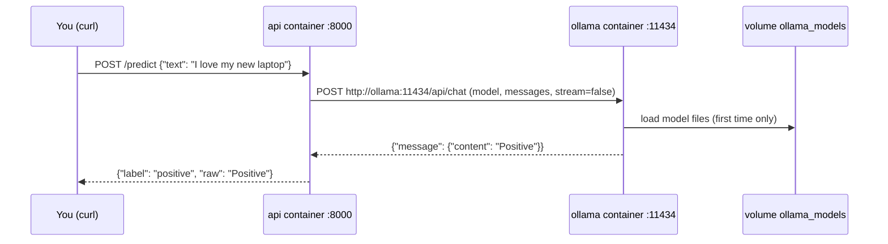

# 10 · Local LLMs in Docker

**What you'll build:** an open-source language model (Qwen 2.5, 0.5 billion parameters) running on **your** computer inside an **Ollama** container, with the model files kept in a volume, and your FastAPI Mood API in a second container that asks the model questions over the Compose network. No API key, no cloud, no cost per question. You also learn the exact flags that hand an NVIDIA GPU to a container.
**Like you're 5:** Ollama is a robot chef in its own kitchen (container). The recipe books (model files) sit on a shelf outside the kitchen (a volume), so if you rebuild the kitchen the books are still there. Your API is the waiter who walks over to the chef's kitchen door (`http://ollama:11434`) with each order.
**Time:** ~75 min (plus download time) · **Builds on:** [09 · Docker Compose: multi-container apps](../09-docker-compose-multi-container-apps) · **Needs:** Docker, about 10 GB free disk, 4 GB+ free RAM; an NVIDIA GPU is optional

## Why this matters
Many customers can't send their data to a cloud AI: hospitals, banks, governments, factories with no internet. The answer is to run an open model on their own machines, and the standard way to ship that is a container: `ollama/ollama` or `vllm/vllm-openai` images next to the app container, exactly like here. It's also handy for development: free, offline, and private. You'll reuse this pattern in Kubernetes (lesson 23) and in the open-source & on-device AI course.

## What you'll learn
- **Ollama:** a program that downloads open models and serves them over a simple HTTP API on port **11434**.
- **Models live in a volume:** `ollama_models:/root/.ollama` keeps gigabytes of model files when containers are re-created.
- **Container-to-container calls:** the API reaches Ollama at `http://ollama:11434` (service name as host name, lesson 09), set by the `OLLAMA_URL` environment variable.
- **Model size vs speed:** small models (0.5–3 billion parameters) run on a laptop CPU; bigger ones need a GPU and more memory.
- **GPUs in containers:** `docker run --gpus all` (or the Compose `deploy.resources.reservations.devices` block) gives a container access to NVIDIA GPUs, once the NVIDIA Container Toolkit is installed.

## Before you start
- Docker running, about **10 GB free disk** (the `ollama/ollama` image is about 3.4 GB to download and about 8.4 GB unpacked, because it includes GPU libraries; the model adds about 0.4 GB), and **4 GB+ of free memory**. On Docker Desktop: **Settings → Resources → Memory**, give Docker at least 4 GB.
- No pip install on your computer: the API image installs `fastapi`, `uvicorn` and `httpx` (to call Ollama's HTTP API).
- No API key needed.
- **Mac users:** Docker on a Mac can't use the Apple GPU, so models run on the CPU (fine for this small model). For bigger models on a Mac, see "Try this", exercise 3.

**Files in this folder**

| File | What it is |
|------|------------|
| `compose.yaml` | two services: `ollama` (the model server) and `api` (our app) |
| `compose.gpu.yaml` | an add-on file that gives `ollama` your NVIDIA GPU(s) |
| `main.py` | the API: `/ask` (free question), `/predict` (the model labels the mood), `/health` |
| `requirements.txt`, `Dockerfile`, `.dockerignore` | the API image, same pattern as lesson 08 |

## Run it
From the course folder (`cloud-and-devops-for-ai`):
```bash
cd part-2-docker/10-local-llms-in-docker
```

### Step 1 · Start Ollama and the API
```bash
docker compose up -d --build
```
The first time, Docker downloads the `ollama/ollama` image (about 3.4 GB), so this can take several minutes. You should end with:
```
 Container mood-llm-ollama-1 Started
 Container mood-llm-ollama-1 Waiting
 Container mood-llm-ollama-1 Healthy
 Container mood-llm-api-1 Starting
 Container mood-llm-api-1 Started
```

### Step 2 · Ask the API whether it's ready
```bash
curl -s localhost:8000/health
```
You should see:
```
{"status":"model-missing","ollama":"ok","model":"qwen2.5:0.5b","models_downloaded":[]}
```
The API can reach Ollama (`"ollama":"ok"`), but no model has been downloaded yet. Asking a question now gives a clear error:
```bash
curl -s -X POST localhost:8000/ask -H "Content-Type: application/json" -d '{"question": "What is Docker?"}'
```
```
{"detail":"Model 'qwen2.5:0.5b' is not downloaded yet. Pull it first."}
```

### Step 3 · Download (pull) the model into the volume
```bash
docker compose exec ollama ollama pull qwen2.5:0.5b
```
| Piece | Meaning |
|-------|---------|
| `docker compose exec ollama` | run a command inside the running `ollama` service |
| `ollama pull` | the Ollama program's "download a model" command |
| `qwen2.5:0.5b` | the model name and tag: Qwen 2.5 (by Alibaba), 0.5 billion parameters, about 400 MB. Browse others at ollama.com/library. |

You should see a progress bar and then `success`:
```
pulling manifest
pulling c5396e06af29: 100% ▕██████████████████▏ 397 MB
pulling 66b9ea09bd5b: 100% ▕██████████████████▏   68 B
...
verifying sha256 digest
writing manifest
success
```
Check what's downloaded:
```bash
docker compose exec ollama ollama list
```
```
NAME            ID              SIZE      MODIFIED
qwen2.5:0.5b    a8b0c5157701    397 MB    10 seconds ago
```

### Step 4 · Ask your API, which asks the model
```bash
curl -s localhost:8000/health
curl -s -X POST localhost:8000/ask -H "Content-Type: application/json" -d '{"question": "What is Docker? One sentence."}'
curl -s -X POST localhost:8000/predict -H "Content-Type: application/json" -d '{"text": "I love my new laptop"}'
```
You should see something like this (the model's exact wording varies by model version and computer):
```
{"status":"ok","ollama":"ok","model":"qwen2.5:0.5b","models_downloaded":["qwen2.5:0.5b"]}
{"model":"qwen2.5:0.5b","question":"What is Docker? One sentence.","answer":"Docker is a platform that packages applications and their dependencies into lightweight, portable containers that run the same way everywhere."}
{"model":"qwen2.5:0.5b","text":"I love my new laptop","label":"positive","raw":"Positive"}
```
The first answer can take 5–30 seconds on a CPU while Ollama loads the model into memory; the next ones are faster. `raw` is exactly what the model said; `label` is what our code made of it.

### Step 5 · Call Ollama directly from your laptop
The `ollama` service publishes port 11434, so you can talk to it yourself:
```bash
curl -s localhost:11434/api/tags
curl -s localhost:11434/v1/chat/completions -H "Content-Type: application/json" -d '{"model": "qwen2.5:0.5b", "messages": [{"role": "user", "content": "Say hi in French"}]}'
```
- `/api/tags` lists the downloaded models (what our `/health` uses).
- `/v1/chat/completions` is Ollama's **OpenAI-compatible** endpoint: the same request format as OpenAI's API, so most AI libraries and tools can use a local model by changing only the base address to `http://localhost:11434/v1`.

### Step 6 · Watch what Ollama is doing
```bash
docker compose logs ollama | tail -5
docker stats --no-stream
```
`docker stats` shows each container's CPU and memory use (`--no-stream` = print once instead of updating live). While answering, `mood-llm-ollama-1` uses a lot of CPU and around 1 GB of memory for this model.

### Step 7 · Stop and restart: the model stays
```bash
docker compose down
docker compose up -d
docker compose exec ollama ollama list
```
The model is still listed: it lives in the `mood-llm_ollama_models` volume, not in the container. When you're completely done, free the disk space:
```bash
docker compose down -v
docker rmi ollama/ollama:latest
```
(`down -v` deletes the models volume; `docker rmi` deletes the 8 GB Ollama image.)

### What you should see
- `/health` goes from `"status":"model-missing"` before the pull to `"status":"ok"` after it.
- `/ask` returns a short answer in the `answer` field; `/predict` labels "I love my new laptop" as `positive`.
- After `down` + `up`, `ollama list` still shows `qwen2.5:0.5b` without downloading again.

## How it works


### The app (`main.py`)
1. `OLLAMA_URL`, `OLLAMA_MODEL` and `OLLAMA_TIMEOUT` come from environment variables (set in `compose.yaml`), so the same image works with any Ollama address or model.
2. `ask_ollama(system, user)` sends one request to Ollama's `/api/chat` with a **system** message (instructions) and a **user** message (the question). `"stream": False` asks for the whole answer in one JSON reply instead of word by word. `"temperature": 0` makes answers as repeatable as possible, which is what you want for labelling.
3. Error handling turns low-level problems into clear HTTP answers: Ollama unreachable → **502** ("the server behind me failed"); model not downloaded (Ollama answers 404) → **503** ("not ready, try later") with a hint to pull it.
4. `/predict` asks for exactly one word, then searches the reply for `positive`, `negative` or `neutral`, because small models sometimes add a full stop or extra words. Never trust an LLM's output format blindly.
5. `/health` calls `/api/tags` and checks our model is in the list. It still answers 200 when the model is missing (with `"status":"model-missing"`), so the container counts as healthy and you can pull the model.

### compose.yaml, the new keys
| Key | Meaning |
|-----|---------|
| `image: ollama/ollama:latest` | the official Ollama image from Docker Hub. For a real deployment, pin a version tag instead of `latest` so it can't change under you. |
| `ports: - "11434:11434"` | publish Ollama's API so you can also call it from your laptop. Not needed for the API (it uses the network); remove it if nobody outside should reach the model. |
| `volumes: - ollama_models:/root/.ollama` | Ollama stores downloaded models in `/root/.ollama` inside the container; the named volume keeps them. |
| `OLLAMA_KEEP_ALIVE: 10m` | keep a model loaded in memory for 10 minutes after the last request (faster answers; set `0` to free memory at once) |
| `test: ["CMD", "ollama", "list"]` | the health check: `ollama list` only works when the Ollama server answers. (The image has no `curl`.) |
| `OLLAMA_URL: http://ollama:11434` | tells the API where Ollama is: service name `ollama`, port 11434 |
| `OLLAMA_MODEL: ${OLLAMA_MODEL:-qwen2.5:0.5b}` | use the `OLLAMA_MODEL` variable from your shell or `.env` if set, otherwise `qwen2.5:0.5b`. `:-` = "default if missing". |
| `depends_on: ollama: condition: service_healthy` | start the API only when Ollama answers (lesson 09) |

### GPUs: making big models fast (NVIDIA)
A CPU can run a 0.5B model; 7B+ models want a GPU. Containers can't see your GPU by default. On **Linux** (and **Windows with WSL2**), with an NVIDIA card:

1. Install the NVIDIA **driver** on the computer (on Windows: the normal Windows driver; WSL2 picks it up). Check with `nvidia-smi`.
2. Install the **NVIDIA Container Toolkit** (Linux only; Docker Desktop on Windows already includes GPU support): follow https://docs.nvidia.com/datacenter/cloud-native/container-toolkit/latest/install-guide.html, then:
   ```bash
   sudo nvidia-ctk runtime configure --runtime=docker
   sudo systemctl restart docker
   ```
   (`nvidia-ctk` = NVIDIA container toolkit CLI; `runtime configure --runtime=docker` = register the NVIDIA runtime in Docker's settings file; then Docker restarts to load it.)
3. Test that a container can see the GPU:
   ```bash
   docker run --rm --gpus all ubuntu:24.04 nvidia-smi
   ```
   You should see the same GPU table as on the host.
4. Start this lesson with the GPU add-on file:
   ```bash
   docker compose -f compose.yaml -f compose.gpu.yaml up -d --build
   ```
   (`-f` = use this file; with two `-f`, the second file's settings are **merged** on top of the first.) `docker compose logs ollama` then mentions your GPU (for example `inference compute ... library=cuda ... name="NVIDIA GeForce RTX 4070"`) instead of `library=cpu`.

**GPU flags, piece by piece**

| Flag / key | Meaning |
|------------|---------|
| `docker run --gpus all` | give the container **all** NVIDIA GPUs |
| `--gpus 1` | give it one GPU (any) |
| `--gpus '"device=0,1"'` | give it GPUs number 0 and 1 (numbers from `nvidia-smi`). The double quotes inside single quotes are needed because of the comma. |
| `deploy:` / `resources:` / `reservations:` / `devices:` (Compose) | "reserve these devices for the service": Compose's way of writing `--gpus` |
| `driver: nvidia` | the kind of device |
| `count: all` | how many GPUs (`all` or a number); or use `device_ids: ["0"]` for specific ones |
| `capabilities: [gpu]` | what the container may use them for (required) |

The single-container equivalent of this lesson's Ollama service, with a GPU, is the command from Ollama's own docs:
```bash
docker run -d --gpus=all -v ollama:/root/.ollama -p 11434:11434 --name ollama ollama/ollama
```
**AMD GPUs** use a different image and devices instead: `docker run -d --device /dev/kfd --device /dev/dri -v ollama:/root/.ollama -p 11434:11434 --name ollama ollama/ollama:rocm`.

**How big a model fits?** Roughly: memory needed ≈ parameters × bytes per parameter. Ollama's default downloads are 4-bit (about 0.5–0.6 bytes per parameter, plus some extra for the conversation), so a 7–8B model needs about 5–6 GB of GPU memory, and 0.5B about 0.5–1 GB. The open-source & on-device AI course goes much deeper into this.

## If something goes wrong
- **`no space left on device` while pulling `ollama/ollama`** → the image needs about 8.4 GB unpacked. Free space with `docker system df` and `docker image prune`, or remove big images you don't need (`docker rmi python:3.12` from lesson 08 frees 1.6 GB).
- **`/ask` answers `{"detail":"Model 'qwen2.5:0.5b' is not downloaded yet. Pull it first."}`** → run Step 3. If you set `OLLAMA_MODEL` to another model, pull that one.
- **`/ask` takes long and then answers `502 ... timed out`** → the CPU is slow or the model is too big for the memory. Use a smaller model, give Docker more memory, or raise the timeout by adding `OLLAMA_TIMEOUT: "300"` to the `api` service's environment.
- **`Error: model requires more system memory (...) than is available`** in the Ollama logs → the model doesn't fit. Use a smaller one (`qwen2.5:0.5b`, `llama3.2:1b`, `gemma3:1b`) or raise Docker Desktop's memory limit.
- **`could not select device driver "nvidia" with capabilities: [[gpu]]`** → the NVIDIA Container Toolkit isn't installed or Docker wasn't restarted after `nvidia-ctk runtime configure`. Do GPU steps 2–3 again. (On a Mac this never works: there's no NVIDIA GPU.)

## Try this
1. Switch to another small model without changing any code: pull `llama3.2:1b` and start the API with `OLLAMA_MODEL=llama3.2:1b`. Compare its answers and speed with Qwen.
2. Add an endpoint `/summarize` that takes `{"text": "..."}` and returns a one-sentence summary, reusing `ask_ollama`.
3. Mac (or any computer with Ollama installed natively): run Ollama **outside** Docker for full speed, and point the API container at it.

<details><summary>Hints and solutions</summary>

1. ```bash
   docker compose exec ollama ollama pull llama3.2:1b
   OLLAMA_MODEL=llama3.2:1b docker compose up -d
   curl -s localhost:8000/health
   time curl -s -X POST localhost:8000/ask -H "Content-Type: application/json" -d '{"question": "What is Docker? One sentence."}'
   ```
   `OLLAMA_MODEL=... docker compose up -d` sets the variable just for that command; Compose fills `${OLLAMA_MODEL:-...}` with it and re-creates the API container. `time` prints how long the command took. The 1B model is usually a bit better and a bit slower than 0.5B.
2. Add to `main.py`:
   ```python
   @app.post("/summarize")
   def summarize(body: TextIn):
       summary = ask_ollama(
           "Summarize the user's text in one short sentence.", body.text
       )
       return {"model": OLLAMA_MODEL, "summary": summary}
   ```
   Then `docker compose up -d --build` and call it with `curl -s -X POST localhost:8000/summarize -H "Content-Type: application/json" -d '{"text": "..."}'`.
3. Install Ollama from https://github.com/ollama/ollama (on a Mac it uses the Apple GPU), then run `ollama pull qwen2.5:0.5b` in a normal terminal. Stop this lesson's containers with `docker compose down`. In `compose.yaml`, in the `api` service:
   - change the `OLLAMA_URL` line to `OLLAMA_URL: http://host.docker.internal:11434`
   - delete the three `depends_on:` lines (there is no Ollama container to wait for any more)
   - on Linux only, add `extra_hosts: ["host.docker.internal:host-gateway"]`

   Then start only the API:
   ```bash
   docker compose up -d --build api
   curl -s localhost:8000/health
   ```
   `host.docker.internal` is Docker's name for "the computer the containers run on". `up ... api` starts only that service (and its dependencies, now none). The answers come from the Ollama app on your computer, at full native speed.
</details>

## Check yourself
1. Why are the model files in a named volume instead of inside the image or container?
2. How does the API container know where Ollama is?
3. What two things must be installed on a Linux computer before `--gpus all` works?
4. Why does `/predict` search the model's reply for a label instead of returning it directly?

<details><summary>Answers</summary>

1. Models are big (hundreds of MB to many GB). In a volume they survive container re-creation and image updates, so you download them once; inside a container they would vanish with it.
2. From the `OLLAMA_URL` environment variable, `http://ollama:11434`: `ollama` is the service name, which Compose's network turns into the container's address.
3. The NVIDIA driver and the NVIDIA Container Toolkit (registered with Docker via `nvidia-ctk runtime configure`, then a Docker restart).
4. Language models don't always follow format instructions exactly (they may add a full stop, capital letters or extra words). Checking and cleaning the output makes the API reliable.
</details>

## Learn more (optional)
**Read the official docs**
- Ollama (README, API and Docker instructions): https://github.com/ollama/ollama
- The `ollama/ollama` image on Docker Hub: https://hub.docker.com/r/ollama/ollama
- GPU support in Docker Compose: https://docs.docker.com/compose/how-tos/gpu-support/
- NVIDIA Container Toolkit install guide: https://docs.nvidia.com/datacenter/cloud-native/container-toolkit/latest/install-guide.html
- Docker Desktop GPU support on Windows (WSL2): https://docs.docker.com/desktop/features/gpu/
- HTTPX (the HTTP client used in `main.py`): https://www.python-httpx.org/

**Watch**
- Matt Williams, Ollama in Docker: https://www.youtube.com/results?search_query=matt+williams+ollama+docker
- NetworkChuck, run AI models locally with Ollama: https://www.youtube.com/results?search_query=networkchuck+ollama+local+ai
- Sam Witteveen, Ollama tutorials: https://www.youtube.com/results?search_query=sam+witteveen+ollama

## Next
→ [Part 3 · Microservices](../../part-3-microservices), starting with [11 · Monolith vs microservices](../../part-3-microservices/11-monolith-vs-microservices)
