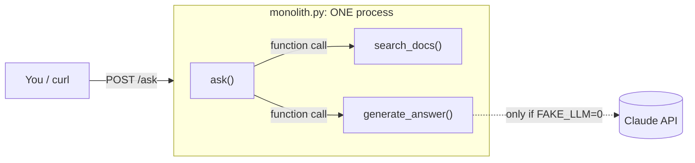
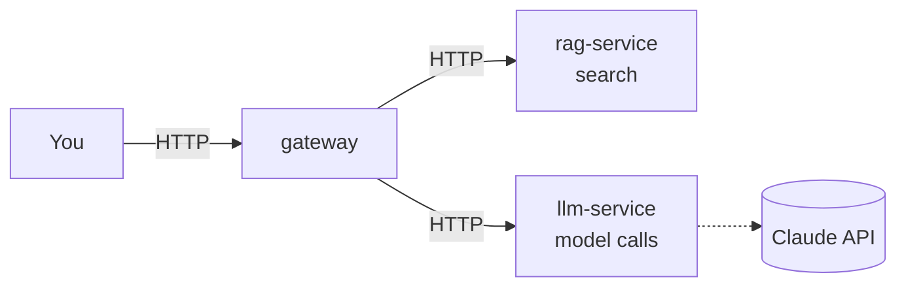

# 11 · Monolith vs microservices

**What you'll build:** a small AI helper for a coffee shop, written as ONE program (a "monolith"), and a clear picture of when you should (and should not) split it into several small programs ("microservices").
**Like you're 5:** a monolith is one big toy robot: easy to carry, but if one arm breaks, you send the whole robot to the repair shop. Microservices are a box of Lego robots that hold hands: you can fix or swap one, but now you have to make sure they keep holding hands.
**Time:** ~40 min · **Builds on:** [10 · Local LLMs in Docker](../../part-2-docker/10-local-llms-in-docker) · **Needs:** nothing extra (no API key, no Docker for this lesson)

## Why this matters
Almost every AI product starts as one program and later gets split up: the part that searches documents, the part that calls the model and the part that talks to users end up as separate services, owned by different people and scaled separately. Forward deployed and platform engineers are asked "should we split this?" all the time. The honest answer is often "not yet", and you should be able to explain why.

## What you'll learn
- **Monolith**: one program, one process, one deploy. All the parts call each other as normal functions.
- **Microservice**: one small program that does one job and talks to the others over the network (usually HTTP).
- **Trade-offs**: what you win by splitting (independent deploys and scaling, smaller blast radius) and what you pay (network calls that can fail, more moving parts, harder debugging).
- **When NOT to split**: a small team, a young product, or parts that always change together.
- **Service boundary**: the "seam" where you would cut. For an AI app the usual seams are search (RAG), the model call (LLM) and the front door (gateway).

## Before you start
- Switch on your Python virtual environment (as in [ai-from-zero 00 · Start here](../../../ai-from-zero/00-start-here)), then install this part's packages once:
  ```bash
  pip install fastapi "uvicorn[standard]" httpx anthropic redis pytest
  ```
  - `fastapi`: turns Python functions into web addresses.
  - `uvicorn[standard]`: the server that runs a FastAPI app.
  - `httpx`: lets one program call another program's web address (lessons 12 to 15).
  - `anthropic`: the official Python library for Claude.
  - `redis`: talks to the Redis queue (lesson 13).
  - `pytest`: runs automatic tests (lesson 15).
- No API key needed: the app uses a **fake LLM** by default. It returns a canned answer built from the documents, so everything works for free and offline. (Want real Claude answers? See "Try this" exercise 3.)

## Run it
1. Open a terminal in the course folder (`cloud-and-devops-for-ai`) and go into this lesson:
   ```bash
   cd part-3-microservices/11-monolith-vs-microservices
   ```
2. Start the monolith:
   ```bash
   uvicorn monolith:app --port 8000
   ```
3. **Leave it running.** Open a second terminal and ask a question:
   ```bash
   curl -X POST http://localhost:8000/ask -H "Content-Type: application/json" -d '{"question": "Do you have oat milk?"}'
   ```
   On Windows PowerShell, `curl` is a different program. Use `curl.exe` and swap the quotes:
   ```powershell
   curl.exe -X POST http://localhost:8000/ask -H "Content-Type: application/json" -d "{\"question\": \"Do you have oat milk?\"}"
   ```
   Or open http://localhost:8000/docs, click **POST /ask** → **Try it out** → type a question → **Execute**.
4. Ask something the shop's documents don't cover, like `"Do you sell pizza?"`.
5. Stop the server with **Ctrl + C** in the first terminal.

**Command, piece by piece** (`curl` is new in this course):

| Piece | Meaning |
|---|---|
| `curl` | a command-line tool that sends a web request and prints the answer |
| `-X POST` | use the HTTP method POST ("here is some data for you"), not the default GET ("give me a page") |
| `http://localhost:8000/ask` | the address: this computer (`localhost`), door number 8000, endpoint `/ask` |
| `-H "Content-Type: application/json"` | add a **header** (a label on the envelope) saying "the body is JSON" |
| `-d '{"question": "..."}'` | the **data** (body) to send. The single quotes `'...'` stop your shell from touching the double quotes inside |

### What you should see
In the second terminal:
```
{"question":"Do you have oat milk?","answer":"(fake LLM) Based on 1 document(s): We offer whole milk, oat milk, almond milk and soy milk. Plant-based milk costs no extra.","sources":["Milk options"],"took_ms":0}
{"question":"Do you sell pizza?","answer":"(fake LLM) I could not find anything about that in the documents.","sources":[],"took_ms":0}
```
In the server terminal:
```
INFO:     Uvicorn running on http://127.0.0.1:8000 (Press CTRL+C to quit)
INFO:     127.0.0.1:43846 - "POST /ask HTTP/1.1" 200 OK
INFO:     127.0.0.1:43856 - "POST /ask HTTP/1.1" 200 OK
```
Look at `took_ms`: 0 milliseconds. Search and "AI" happen inside one program, as plain function calls. Remember this number; in lesson 12 the same work crosses a network and gets slower.

## How it works

### The code: three jobs in one file
1. `DOCS` is a tiny list of shop documents (opening hours, Wi-Fi, milk, pets).
2. **Job 1, search:** `words()` turns text into a set of lowercase words, skipping filler like "the" and turning "dogs" into "dog". `search_docs()` gives each document a score (how many question words it shares) and returns the best 2. This is simple keyword search; real RAG uses embeddings ([ai-from-zero lesson 24](../../../ai-from-zero/part-5-rag-and-vector-databases/24-rag-ask-your-documents)), but the shape is the same: question in, documents out.
3. **Job 2, the model:** `generate_answer()` either builds a fake answer (`FAKE_LLM=1`, the default) or calls Claude with `anthropic.Anthropic().messages.create(...)`, passing the documents and the question. `CLAUDE_MODEL` picks the model (default `claude-opus-5-5`).
4. **Job 3, the front door:** `@app.post("/ask")` runs `search_docs()` then `generate_answer()` and returns JSON.



### Monolith vs microservices, side by side
Here is the same app split into services (you build this in lesson 12):


| Question | Monolith | Microservices |
|---|---|---|
| How do parts talk? | function calls: instant, never "lost" | network calls: slower, can time out or fail |
| How do you deploy? | one thing, all at once | each service on its own schedule |
| How do you scale? | copy the whole app | copy only the busy part (e.g. 10 LLM workers, 1 search) |
| What if one part crashes? | often the whole app is down | the others can keep going (if you design for it, lesson 15) |
| Debugging | one log, one stack trace | logs spread over many services; you need request IDs and tracing |
| Team fit | great for 1 small team | great when several teams own different parts |
| Tech choice | one language and set of libraries | each service can use what suits it (Python for AI, Go for the proxy ...) |
| Cost of running | one process | many processes, more memory, more things to monitor |

### When NOT to split (most of the time, at first)
- **The team is small** (say, under 5 to 8 people). Microservices are mostly a way to let many teams work without stepping on each other. One team gets the costs and few of the wins.
- **The product is young.** You don't know the right seams yet. A wrong split is worse than no split, because every change then touches two services and two deploys.
- **The parts always change together.** If every feature edits search AND the model call, they belong together.
- **You have no automation yet.** Without CI ([lesson 04](../../part-1-git-and-github/04-ci-with-github-actions)), containers and monitoring, ten services means ten times the manual work.

A good middle step is a **modular monolith**: one program, but with clean internal modules (like the three jobs above) that *could* become services later.

### When splitting pays off (typical in AI apps)
- **Different hardware or scaling needs.** The model server needs a GPU or lots of memory; search and the web front door don't.
- **Different speeds.** LLM calls take seconds; you want them in a queue with their own workers (lesson 13) so the rest of the app stays fast.
- **Different owners and release speeds.** The data team changes the RAG index daily; the platform team changes the gateway monthly.
- **Isolation of risk and secrets.** Only the llm-service holds the API key. A bug in the web layer can't leak it as easily.

### Words you'll meet
- **Service boundary / seam**: where you cut the app. Cut where data and changes naturally separate.
- **Coupling**: how much two parts depend on each other. Microservices only help if they are *loosely* coupled.
- **Distributed monolith**: the worst of both worlds: services that must all be deployed together because they're too tangled. Avoid it.

## If something goes wrong
- **`uvicorn: command not found`** → your venv is off, or the pip line wasn't run. Switch the venv on and run the pip line. `python -m uvicorn monolith:app --port 8000` also works.
- **`Error loading ASGI app. Could not import module "monolith"`** → you're in the wrong folder. `cd part-3-microservices/11-monolith-vs-microservices` first.
- **`address already in use`** → something else uses port 8000 (maybe a server from an earlier lesson). Stop it with Ctrl + C, or run on another port: `--port 8001` and use `http://localhost:8001`.
- **`{"detail":[{"type":"json_invalid", ...`** → the JSON in `-d` is broken, usually because of quotes. On Windows use the PowerShell line above, or the `/docs` page.
- **With `FAKE_LLM=0` you get `Internal Server Error` and the terminal says `Could not resolve authentication method`** → no API key is set. See exercise 3.

## Try this
1. Add a fifth document to `DOCS` about the shop's loyalty card, restart the server, and ask "How does the loyalty card work?".
2. Time it: run the same question 5 times and note `took_ms`. Then guess: what do you think it will be when search and the model live in separate containers? Write your guess down and check it in lesson 12.
3. Use real Claude answers (needs a key from https://console.anthropic.com; costs a little money per question). Set two environment variables, then start the server again.

<details><summary>Hint for 3</summary>

macOS / Linux:
```bash
export FAKE_LLM=0
export ANTHROPIC_API_KEY=sk-ant-...your key...
export CLAUDE_MODEL=claude-haiku-5-5   # optional: the cheap, fast model
uvicorn monolith:app --port 8000
```
Windows PowerShell:
```powershell
$env:FAKE_LLM = "0"
$env:ANTHROPIC_API_KEY = "sk-ant-...your key..."
uvicorn monolith:app --port 8000
```
`took_ms` jumps from 0 to a few thousand: the model call is by far the slowest part. That is one big reason AI apps split the model call into its own service with a queue (lesson 13).
</details>

## Check yourself
1. In one sentence each: what is a monolith, and what is a microservice?
2. Name two things that get *harder* when you split an app into services.
3. A 3-person startup asks whether to start with 6 microservices. What do you tell them, and why?
4. Why is "the model call" such a common thing to split out in AI apps?

<details><summary>Answers</summary>

1. A monolith is one program where all the parts run together and call each other as functions. A microservice is a small program that does one job and talks to other services over the network.
2. Any two of: calls can fail or time out; debugging across many logs; more things to deploy and monitor; keeping data consistent between services; local setup is heavier.
3. Start with one well-organised program (a modular monolith). With 3 people they would pay all the costs of microservices (deploys, networking, monitoring) and get almost none of the benefits (separate teams, separate scaling). Split later, at seams that real usage shows.
4. It is slow, expensive, may need special hardware, holds a secret API key, and needs different scaling (many workers) from the rest of the app.
</details>

## Learn more (optional)
**Read the official docs**
- FastAPI, "Bigger Applications - Multiple Files" (a modular monolith in FastAPI): https://fastapi.tiangolo.com/tutorial/bigger-applications/
- Docker docs, "What is a container?" (refresher): https://docs.docker.com/get-started/docker-concepts/the-basics/what-is-a-container/
- Claude API docs: https://platform.claude.com/docs

**Read more**
- Martin Fowler, "Microservices" (the classic article): https://martinfowler.com/articles/microservices.html
- Martin Fowler, "MonolithFirst": https://martinfowler.com/bliki/MonolithFirst.html

**Watch**
- ByteByteGo: [search "bytebytego microservices vs monolith"](https://www.youtube.com/results?search_query=bytebytego+microservices+vs+monolith)
- Fireship: [search "fireship microservices"](https://www.youtube.com/results?search_query=fireship+microservices)
- Hussein Nasser: [search "hussein nasser microservices"](https://www.youtube.com/results?search_query=hussein+nasser+microservices)
- TechWorld with Nana: [search "techworld with nana microservices explained"](https://www.youtube.com/results?search_query=techworld+with+nana+microservices+explained)

## Next
→ [12 · Split an AI app into services](../12-split-an-ai-app-into-services)
