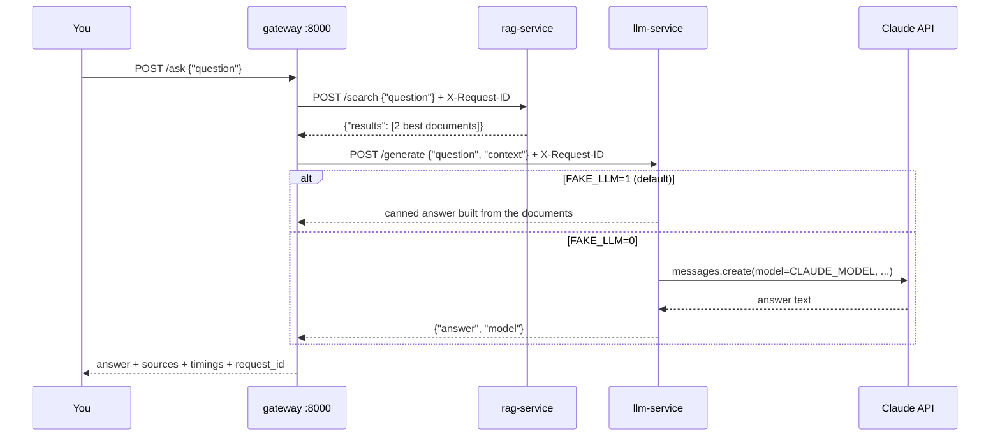
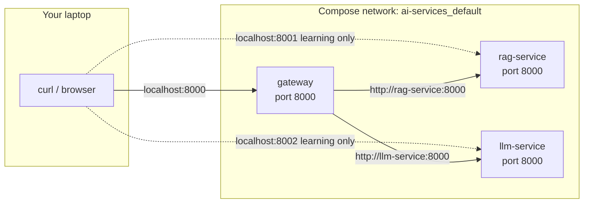

# 12 · Split an AI app into services

**What you'll build:** the coffee-shop AI helper from lesson 11, cut into three small FastAPI services that talk over HTTP: a **gateway** (front door), a **rag-service** (finds documents) and an **llm-service** (asks Claude, or fakes it). Docker Compose starts all three with one command.
**Like you're 5:** instead of one cook doing everything, the restaurant now has a waiter (gateway), a librarian who finds the recipe (rag-service) and a chef who cooks (llm-service). They pass notes to each other through a hatch (HTTP).
**Time:** ~60 min · **Builds on:** [11 · Monolith vs microservices](../11-monolith-vs-microservices) · **Needs:** Docker Desktop / Docker Engine with Compose (from [part 2](../../part-2-docker)); no API key

## Why this matters
This three-part shape (gateway → retrieval → model) is the skeleton of most real RAG products. Splitting it lets you scale the slow model calls separately, keep the API key in one place, and redeploy the search index without touching the rest. The same three images are reused in the Kubernetes lessons (16 to 22), so this is the app you'll carry through the rest of the course.

## What you'll learn
- **Service**: a program with one job and its own web address, running in its own container.
- **Gateway**: the single front door. It calls the other services and combines their answers.
- **Service discovery by name**: inside Docker Compose, a service is reachable at `http://<service-name>:<port>`, e.g. `http://rag-service:8000`.
- **Configuration through environment variables**: the same image behaves differently depending on `FAKE_LLM`, `CLAUDE_MODEL`, `RAG_URL` ...
- **Request ID**: one ID that follows a question through every service, so you can match up their logs.

## Before you start
- Docker running (`docker version` shows a **Server** section) and Compose v2 (`docker compose version`).
- Optional, to run the services without Docker or poke them from Python: the part's pip line (venv on):
  ```bash
  pip install fastapi "uvicorn[standard]" httpx anthropic redis pytest
  ```
- No API key needed: `FAKE_LLM=1` is the default. To use real Claude, copy `.env.example` to `.env` and fill it in (see "Try this" 2).

The folder:
```
12-split-an-ai-app-into-services/
├── compose.yaml          starts all three services
├── .env.example          settings for real Claude answers (copy to .env)
├── gateway/              main.py, requirements.txt, Dockerfile
├── rag-service/          main.py, docs.json (the shop's documents), requirements.txt, Dockerfile
└── llm-service/          main.py, requirements.txt, Dockerfile
```

## Run it
1. From the course folder, go into this lesson:
   ```bash
   cd part-3-microservices/12-split-an-ai-app-into-services
   ```
2. Build the three images and start the three containers in the background:
   ```bash
   docker compose up -d --build
   ```
   The first build downloads Python packages and takes a minute or two.
3. Check that all three are running and **healthy**:
   ```bash
   docker compose ps
   ```
4. Ask the gateway a question (Windows PowerShell: use `curl.exe` and `"{\"question\": \"Is the wifi free?\"}"`, or the page http://localhost:8000/docs):
   ```bash
   curl -X POST http://localhost:8000/ask -H "Content-Type: application/json" -d '{"question": "Is the wifi free?"}'
   ```
5. Ask the gateway whether it can reach its two helpers:
   ```bash
   curl http://localhost:8000/health/deps
   ```
6. Call each helper directly (they're published on ports 8001 and 8002 only so you can learn; lesson 14 hides them):
   ```bash
   curl -X POST http://localhost:8001/search -H "Content-Type: application/json" -d '{"question": "Can I bring my dog?"}'
   curl -X POST http://localhost:8002/generate -H "Content-Type: application/json" -d '{"question": "hi", "context": []}'
   ```
7. Read the logs of all three services, mixed together, with service names in front:
   ```bash
   docker compose logs
   ```
8. When you're done: `docker compose down` (stops and removes the containers; the images stay for lessons 13 to 20).

**Command, piece by piece**

| Piece | Meaning |
|---|---|
| `docker compose` | the Compose tool: works on ALL the services in `compose.yaml` in this folder |
| `up` | create and start the containers (and the network between them) |
| `-d` | "detached": run in the background and give you your terminal back |
| `--build` | build the images from the Dockerfiles first (do this after you change code) |
| `ps` | list this project's containers and their status |
| `logs` | show what the containers printed; add `-f` to keep following, or a name (`logs gateway`) for just one |
| `down` | stop and remove the containers and the network |

### What you should see
`docker compose ps` (a few columns trimmed to fit):
```
NAME                        IMAGE                SERVICE       STATUS                    PORTS
ai-services-gateway-1       ai-gateway:1.0       gateway       Up 10 seconds (healthy)   0.0.0.0:8000->8000/tcp
ai-services-llm-service-1   ai-llm-service:1.0   llm-service   Up 32 seconds (healthy)   0.0.0.0:8002->8000/tcp
ai-services-rag-service-1   ai-rag-service:1.0   rag-service   Up 32 seconds (healthy)   0.0.0.0:8001->8000/tcp
```
The `/ask` answer (on one line in your terminal):
```
{"question":"Is the wifi free?","answer":"(fake LLM) Based on 2 document(s): Free Wi-Fi is available in every shop.","sources":["Wi-Fi","Refund policy"],"model":"fake-llm","request_id":"65a916e1819f","timings_ms":{"rag":3,"llm":9}}
```
`/health/deps`:
```
{"rag-service":{"status":"ok","service":"rag-service","documents":6,"host":"70a95bc13df5"},"llm-service":{"status":"ok","service":"llm-service","mode":"fake","model":"fake-llm","version":"1.0","host":"ec618410da58"}}
```
The direct calls:
```
{"results":[{"id":"pets","title":"Pets","text":"Dogs are welcome on the terrace and inside our Riverside shop. We keep a water bowl and dog biscuits at the counter.","score":1}]}
{"answer":"(fake LLM) I could not find anything about that in the documents.","model":"fake-llm"}
```
Things to notice:
- `timings_ms`: search took ~3 ms and the (fake) model ~9 ms. In lesson 11 everything took 0 ms. **Every network hop costs time**, even inside one computer.
- `host` is the container's ID. Each service runs in its own container.
- `sources` tells you which documents were used. That is how you check a RAG answer.

## How it works



### rag-service (`rag-service/main.py`)
1. `DOCS_FILE` (default: `docs.json` next to the code) is loaded once at start into `DOCS`. Lesson 19 swaps this file using Kubernetes, without rebuilding the image.
2. `words()` lowercases text, removes hyphens ("Wi-Fi" → "wifi"), drops filler words and trims a final "s" ("dogs" → "dog").
3. `POST /search` scores every document by shared words, sorts, and returns the best `top_k` (default 2). It never calls an AI model: one job only.
4. `GET /health` says "I'm alive" and how many documents it has. Docker (and later Kubernetes) calls it to check the service.

### llm-service (`llm-service/main.py`)
1. Settings come from environment variables: `FAKE_LLM` (default `"1"`), `CLAUDE_MODEL` (default `claude-opus-5-5`; `claude-haiku-5-5` is the cheap option), `SERVICE_VERSION`, plus two "chaos knobs" used in lesson 15: `FAIL_RATE` and `DELAY_SECONDS`.
2. `POST /generate` takes `question` and `context` (a list of document texts).
   - Fake mode: `fake_answer()` returns the first sentence of the best document. Free and instant.
   - Real mode: `claude_answer()` numbers the documents, sends them with the question and a short `SYSTEM_PROMPT` ("use only these documents") to `client.messages.create(...)`, then joins the text blocks of the reply. If Claude declines (`stop_reason == "refusal"`) it returns a polite message.
3. The Anthropic client is created only on the first real call (`get_client()`), so fake mode never needs a key.
4. Errors become clear HTTP errors: no key → 500 with a hint, can't reach the API → 503, other API errors → 502. A good service tells the caller *what* went wrong.

### gateway (`gateway/main.py`)
1. `RAG_URL` and `LLM_URL` say where the helpers live. Their defaults (`localhost:8001`, `localhost:8002`) work when you run everything by hand; `compose.yaml` sets them to `http://rag-service:8000` and `http://llm-service:8000`.
2. `http = httpx.Client(timeout=30.0)` is one shared HTTP client. It re-uses connections, and the timeout means "never wait more than 30 s" (lesson 15 makes this much smarter).
3. `call_service()` POSTs JSON, turns error codes into exceptions with `raise_for_status()`, and converts any failure into a **502 Bad Gateway** that names the failing service.
4. `POST /ask`: makes a **request ID** (or re-uses one sent in the `X-Request-ID` header), calls rag-service, then llm-service, and measures each step with `time.perf_counter()`.

### How do containers find each other?
Compose creates a private network for the project (`ai-services_default`) with a tiny **DNS server** (a phone book for names). Each service is listed under its service name. So inside the gateway container, `rag-service` means "the rag-service container's address". From your laptop, you use `localhost:<published port>` instead.


All three listen on port 8000 *inside* their own container. That's fine: each container has its own network "house", so the doors don't clash. Only the published ports on your laptop (8000, 8001, 8002) must be different.

### `compose.yaml`, key by key (new parts)

| Key | Meaning |
|---|---|
| `name: ai-services` | the project name; it goes in front of container, network and volume names |
| `build: ./gateway` | build an image from the Dockerfile in that folder |
| `image: ai-gateway:1.0` | the name and tag to give the built image. Kubernetes lessons load exactly these names |
| `ports: - "8000:8000"` | publish: `<port on your laptop>:<port in the container>` |
| `environment:` | environment variables for the container |
| `${FAKE_LLM:-1}` | "use the variable `FAKE_LLM` from your shell or `.env` file; if it's missing or empty, use `1`" |
| `depends_on: ... condition: service_healthy` | start the gateway only after both helpers pass their health check |
| `restart: unless-stopped` | if the container crashes, start it again (unless you stopped it yourself) |

### Dockerfiles (new parts)
All three use the two-stage recipe from [lesson 08](../../part-2-docker/08-smaller-safer-images). New lines:

| Line | Meaning |
|---|---|
| `ARG VERSION=1.0` (llm-service) | a **build argument**: a value you can set with `docker build --build-arg VERSION=2.0`. Lesson 20 builds a v2.0 this way |
| `SERVICE_VERSION=$VERSION` | copy the build argument into an environment variable the app can read at run time |
| `COPY main.py docs.json ./` (rag-service) | copy two files into `/app`; the `./` at the end means "into the current folder" |
| `HEALTHCHECK --interval=10s` | run the check every 10 s |
| `--start-period=10s --start-interval=1s` | during the first 10 s, check every second, so the service turns "healthy" quickly (needs Docker Engine 25 or newer) |
| `--timeout=3s --retries=3` | a check that takes over 3 s fails; 3 failures in a row = "unhealthy" |

## If something goes wrong
- **`Bind for 0.0.0.0:8000 failed: port is already allocated`** → another container or program uses port 8000 (maybe lesson 09 or 11 is still running). Stop it (`docker compose down` in that folder, or Ctrl + C), or change the left number in `ports:` (e.g. `"8100:8000"`) and use `localhost:8100`.
- **`dependency failed to start: container ai-services-rag-service-1 is unhealthy`** → read why: `docker compose logs rag-service`. A Python error near the bottom is the usual cause. Fix it, then `docker compose up -d --build` again.
- **`unknown flag: --start-interval`** while building → your Docker is older than version 25. Update Docker Desktop / Docker Engine, or delete `--start-period=10s --start-interval=1s` from the three Dockerfiles.
- **The gateway answers `{"detail":"rag-service failed: ConnectError: ..."}` (502)** → the gateway can't reach a helper. Check `docker compose ps` (is it running?) and the URLs: inside Compose they must be `http://rag-service:8000`, not `localhost:8001` (inside a container, `localhost` means *that container itself*).
- **With `FAKE_LLM=0`: `{"detail":"FAKE_LLM=0 but ANTHROPIC_API_KEY is not set"}`** → the key didn't reach the container. Put it in `.env` next to `compose.yaml` (not in `.env.example`), then `docker compose up -d` again so the container is recreated with the new variables.

## Try this
1. Add a document to `rag-service/docs.json` (e.g. "Parking: free parking behind the Riverside shop"), rebuild only that service with `docker compose up -d --build rag-service`, and ask about parking. Notice that the gateway and llm-service did not restart: **independent deploys**.
2. Switch to real Claude answers. Copy `.env.example` to `.env`, put your key in it, then `docker compose up -d`. Ask the Wi-Fi question again and compare `timings_ms.llm` with the fake one.
3. Harder: make the llm-service talk to a **local open model** with Ollama instead of Claude (see [lesson 10](../../part-2-docker/10-local-llms-in-docker)). Add a third mode `LLM_PROVIDER=ollama` that calls Ollama's OpenAI-compatible endpoint with `httpx`.

<details><summary>Hint for 2</summary>

```bash
cp .env.example .env          # Windows PowerShell: Copy-Item .env.example .env
# edit .env: FAKE_LLM=0 and ANTHROPIC_API_KEY=sk-ant-...
docker compose up -d          # recreates llm-service with the new environment
docker compose exec llm-service printenv FAKE_LLM CLAUDE_MODEL
```
`.env` is read by Compose automatically. Add `.env` to your `.gitignore` so your key never lands on GitHub.
</details>

<details><summary>Solution for 3</summary>

In `llm-service/main.py`, add near the other settings:
```python
LLM_PROVIDER = os.getenv("LLM_PROVIDER", "claude")  # "claude" or "ollama"
OLLAMA_URL = os.getenv("OLLAMA_URL", "http://host.docker.internal:11434/v1")
OLLAMA_MODEL = os.getenv("OLLAMA_MODEL", "llama3.2")


def ollama_answer(req: GenerateRequest) -> str:
    import httpx  # add "httpx==0.28.1" to llm-service/requirements.txt
    docs = "\n".join(f"[{i}] {t}" for i, t in enumerate(req.context, start=1)) or "(no documents found)"
    r = httpx.post(f"{OLLAMA_URL}/chat/completions", timeout=120, json={
        "model": OLLAMA_MODEL,
        "messages": [
            {"role": "system", "content": SYSTEM_PROMPT},
            {"role": "user", "content": f"Documents:\n{docs}\n\nQuestion: {req.question}"},
        ],
    })
    r.raise_for_status()
    return r.json()["choices"][0]["message"]["content"].strip()
```
In `generate()`, right after the `if FAKE_LLM:` block, add:
```python
    if LLM_PROVIDER == "ollama":
        return {"answer": ollama_answer(req), "model": OLLAMA_MODEL}
```
In `compose.yaml` under `llm-service.environment` add `FAKE_LLM: "0"`, `LLM_PROVIDER: ollama`. `host.docker.internal` means "my laptop" from inside a container (on Linux also add `extra_hosts: ["host.docker.internal:host-gateway"]`). If Ollama runs as a Compose service itself (lesson 10), use `http://ollama:11434/v1`.
</details>

## Check yourself
1. Inside the gateway container, why does `http://rag-service:8000` work but `http://localhost:8001` does not?
2. Why does `timings_ms.rag` show a few milliseconds here when the same search took 0 ms in lesson 11?
3. Which service is the only one that needs the Anthropic API key, and why is that a good thing?
4. You change only the search scoring. Which commands rebuild and restart *only* that service?

<details><summary>Answers</summary>

1. Compose's DNS turns the service name `rag-service` into that container's address. `localhost` inside a container means the gateway container itself, and nothing listens on 8001 there (8001 is a door on your laptop, not in the container).
2. The search now involves an HTTP request: JSON encoding, a trip through the network stack, and decoding. That overhead is the price of splitting.
3. Only llm-service. Fewer places that hold a secret means fewer places it can leak from, and you can rotate the key by restarting one service.
4. `docker compose up -d --build rag-service`.
</details>

## Learn more (optional)
**Read the official docs**
- Docker Compose file reference (services, build, ports, depends_on): https://docs.docker.com/reference/compose-file/services/
- Networking in Compose (how service names become addresses): https://docs.docker.com/compose/how-tos/networking/
- Dockerfile reference (ARG, HEALTHCHECK): https://docs.docker.com/reference/dockerfile/
- HTTPX, the HTTP client used by the gateway: https://www.python-httpx.org/
- Claude Messages API: https://platform.claude.com/docs
- FastAPI: https://fastapi.tiangolo.com/

**Watch**
- TechWorld with Nana: [search "techworld with nana docker compose tutorial"](https://www.youtube.com/results?search_query=techworld+with+nana+docker+compose+tutorial)
- ByteByteGo: [search "bytebytego api gateway microservices"](https://www.youtube.com/results?search_query=bytebytego+api+gateway+microservices)
- freeCodeCamp: [search "freecodecamp microservices python course"](https://www.youtube.com/results?search_query=freecodecamp+microservices+python+course)

## Next
→ [13 · Queues and background workers](../13-queues-and-background-workers)
