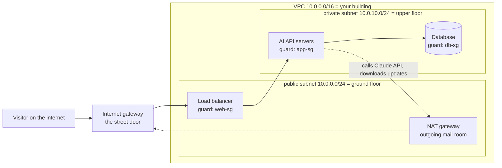

# 24 · Cloud basics: compute, storage, IAM and networks

**What you'll build:** a network plan for an AI app (a VPC split into public and private subnets) and a "door guard" check that shows which visitors your security groups let in. Then, optionally, a $5 billing alarm in a real cloud account so a mistake can never surprise you with a big bill.
**Like you're 5:** the cloud is a giant hotel for computers. You rent rooms (servers), lockers (storage) and key cards (IAM). Your own private floor plan inside the hotel is the network.
**Time:** ~75 min · **Builds on:** [23 · Serving models on Kubernetes with GPUs](../../part-4-kubernetes/23-serving-models-on-kubernetes-with-gpus) · **Needs:** Python 3.10+ (nothing to install). Optional: a free AWS, Google Cloud or Azure account for the billing alarm.

## Why this matters
So far everything ran on your laptop. Real AI products run on rented computers in a cloud: AWS, Google Cloud (GCP) or Microsoft Azure. A forward deployed engineer often walks into a customer who uses one of the three, so you must know the same idea under three different names: "an EC2 instance", "a Compute Engine VM" and "an Azure VM" are the same thing. You also need to know the three ideas that cause most real incidents: who is allowed to do what (IAM), who can reach what (networks) and how much it costs (billing).

## What you'll learn
- **Compute, storage, networking, identity**: the four building blocks every cloud sells, and their names on AWS, GCP and Azure side by side.
- **Region and availability zone**: a region is a city with cloud data centres; zones are separate buildings in that city, so one fire does not take your app down.
- **VPC, subnet, route table, security group**: your private floor plan in the cloud, explained as a building with floors, hallway signs and door guards.
- **IAM and least privilege**: give every person and program a key card that opens only the doors it needs.
- **Free tiers and billing alarms**: how to learn without paying, and how to get an email before a mistake gets expensive.

## Before you start
- Python 3.10 or newer. The script uses only Python's built-in `argparse` (reads command-line options) and `ipaddress` (understands IP addresses and ranges) modules, so there is nothing to `pip install`.
- No cloud account and no API key are needed for steps 1 to 5 of "Run it".
- Optional for steps 6 to 9: a free account on **one** cloud. Sign-up pages: [AWS Free Tier](https://aws.amazon.com/free/), [Google Cloud Free Program](https://cloud.google.com/free), [Azure free account](https://azure.microsoft.com/free/). All three ask for a card to prove you are a real person. Read the next section before you sign up.

### The free tiers in plain words (check the pages: offers change)
| Cloud | What a new account gets | The trap to avoid |
|---|---|---|
| AWS | A credit for new accounts (at the time of writing, $100 at sign-up plus up to $100 more for trying services) on a 6-month **free plan**, plus "always free" monthly allowances (for example 1 million Lambda calls) | Choosing the **paid plan** at sign-up removes the safety limits; a forgotten GPU server or NAT gateway keeps billing every hour |
| Google Cloud | $300 credit for 90 days, plus "always free" items such as one small `e2-micro` VM in some US regions | Free VM only in the listed regions and size; anything bigger uses your credit, then your card if you upgrade |
| Azure | $200 credit for 30 days, then a set of services free for 12 months and some always free | After 30 days you must choose pay-as-you-go to keep the 12-month items; what is not on the free list is billed |

Rule for this whole part: **set a billing alarm the same day you open an account** (steps 6 to 9 below), and delete what you create when you finish a lesson.

## Run it
1. From the course folder (`cloud-and-devops-for-ai`), go into this lesson's folder:
   ```bash
   cd part-5-cloud-and-operations/24-cloud-basics-compute-storage-iam-networks
   ```
2. Run the planner with its default settings:
   ```bash
   python network_planner.py
   ```
   On Mac or Linux, if `python` is not found, type `python3` instead.
3. Read the top half of the output (the subnet table). You will see 2 public and 2 private subnets, one of each in 2 zones.
4. Read the bottom half (the security-group check). 4 visitors are allowed and 3 are refused.
5. Plan a bigger network: a different address range and 3 zones.
   ```bash
   python network_planner.py --cidr 10.20.0.0/16 --azs 3
   ```
   **Command, piece by piece**
   | Piece | Meaning |
   |---|---|
   | `python` | start the Python interpreter |
   | `network_planner.py` | the script file to run |
   | `--cidr` | an option (a named setting) the script defines with `argparse`. `--` marks a long option name |
   | `10.20.0.0/16` | the VPC's address range in **CIDR** notation (explained in "How it works"): all addresses from `10.20.0.0` to `10.20.255.255` |
   | `--azs 3` | spread the subnets over 3 availability zones |

   Now you see 6 subnets: `public-a/b/c` and `private-a/b/c`.

Optional, in a real cloud account. You only need a browser: every cloud has a free **cloud shell**, a terminal inside the web console where the cloud's command-line tool is already installed and logged in as you. AWS: the `>_` **CloudShell** icon at the top of the console. Google Cloud: the **Activate Cloud Shell** button at the top right. Azure: the `>_` **Cloud Shell** button at the top.

6. Ask the cloud "who am I?". Run the line for your cloud in its cloud shell:
   ```bash
   aws sts get-caller-identity          # AWS
   gcloud config list                   # Google Cloud
   az account show --output table       # Azure
   ```
   **Command, piece by piece**
   | Piece | Meaning |
   |---|---|
   | `aws` / `gcloud` / `az` | the official command-line tool of AWS / Google Cloud / Azure |
   | `sts` | AWS **Security Token Service**, the part of AWS that hands out identities |
   | `get-caller-identity` | "tell me which account and which user or role is calling". Safe: it changes nothing |
   | `config list` | show gcloud's current settings: your account email and the active **project** (GCP groups everything into projects) |
   | `account show` | show the Azure **subscription** you are working in (Azure's billing container) |
   | `--output table` | print as a table instead of JSON |
   | `#` | starts a comment: the shell ignores the rest of the line |
7. Create a monthly budget of $5 that emails you at 80 % of actual spend and at 100 % of forecast spend. The easiest way is the web console:
   - **AWS:** search for **Budgets** → **Create budget** → **Use a template** → **Monthly cost budget** → amount `5` → your email → **Create budget**. (The **Zero spend budget** template is even stricter: it emails you as soon as you spend 1 cent.)
   - **Google Cloud:** **Billing** → **Budgets & alerts** → **Create budget** → amount `5` → keep the 50 %, 90 %, 100 % thresholds → **Finish**. Billing admins get the emails.
   - **Azure:** **Cost Management + Billing** → **Budgets** → **Add** → amount `5` → **Next** → add an alert condition at 80 % with your email → **Create**.
8. Or do the same from the cloud shell. AWS reads the budget from the two JSON files in this folder, [`aws-budget/budget.json`](aws-budget/budget.json) and [`aws-budget/notifications.json`](aws-budget/notifications.json). Upload them with the cloud shell's **Actions → Upload file** menu, change `you@example.com` to your email, then run:
   ```bash
   aws budgets create-budget \
     --account-id "$(aws sts get-caller-identity --query Account --output text)" \
     --budget file://budget.json \
     --notifications-with-subscribers file://notifications.json
   ```
   **Command, piece by piece**
   | Piece | Meaning |
   |---|---|
   | `aws budgets create-budget` | the Budgets service, action "create a budget" |
   | `\` | "the command continues on the next line" (it must be the very last character) |
   | `--account-id` | which AWS account the budget belongs to (a 12-digit number) |
   | `"$( ... )"` | run the command inside first and paste its output here. The quotes keep it as one piece |
   | `--query Account` | from the JSON answer, keep only the `Account` field |
   | `--output text` | print it as plain text (no quotes, no JSON) |
   | `--budget file://budget.json` | read the budget (name, amount, period) from that local file. `file://` means "a file, not text" |
   | `--notifications-with-subscribers file://notifications.json` | read the alert rules and the email address from that file |

   Google Cloud has one command for it (find your billing account ID with `gcloud billing accounts list`):
   ```bash
   gcloud billing budgets create --billing-account=000000-000000-000000 \
     --display-name="monthly-5-dollars" --budget-amount=5USD \
     --threshold-rule=percent=0.8 --threshold-rule=percent=1.0
   ```
   | Piece | Meaning |
   |---|---|
   | `billing budgets create` | the billing tool, budgets section, action "create" |
   | `--billing-account=` | which billing account to watch (replace the zeros with yours) |
   | `--display-name=` | the budget's name |
   | `--budget-amount=5USD` | the monthly amount and currency |
   | `--threshold-rule=percent=0.8` | send an alert at 80 %. Repeat the option for each extra threshold |

   On Azure, use the portal (step 7): its `az consumption budget` command cannot set email alerts in one simple line.
9. Check the budget exists: AWS `aws budgets describe-budgets --account-id "$(aws sts get-caller-identity --query Account --output text)" --output table`, Google Cloud `gcloud billing budgets list --billing-account=000000-000000-000000`, Azure: the **Budgets** page lists it.

### What you should see
Step 2 prints (real output):
```
🏢 VPC 10.0.0.0/16  ->  65,536 addresses in total
   first address 10.0.0.0, last address 10.0.255.255

subnet     zone    range            usable  door to the street?
public-a   zone-a  10.0.0.0/24         251  yes (route to internet gateway)
private-a  zone-a  10.0.10.0/24        251  no (outbound only, via NAT)
public-b   zone-b  10.0.1.0/24         251  yes (route to internet gateway)
private-b  zone-b  10.0.11.0/24        251  no (outbound only, via NAT)

🛂 Security-group check (default deny: anything not allowed is refused)
✅ ALLOW  A customer's browser opens the website
          198.51.100.25 -> web-sg:443  (HTTPS from anyone on the internet)
✅ ALLOW  The load balancer forwards a request to the API
          web-sg -> app-sg:8000  (only the load balancer may call the API)
❌ DENY   A stranger tries to call the API directly
          198.51.100.25 -> app-sg:8000  (no rule matches, so the guard says no (default deny))
✅ ALLOW  The API reads from the database
          app-sg -> db-sg:5432  (only the API servers may talk to Postgres)
❌ DENY   A stranger tries to reach the database
          198.51.100.25 -> db-sg:5432  (no rule matches, so the guard says no (default deny))
✅ ALLOW  You SSH in from the office
          203.0.113.7 -> app-sg:22  (SSH only from the office IP)
❌ DENY   You SSH in from a cafe
          192.0.2.50 -> app-sg:22  (no rule matches, so the guard says no (default deny))
```
Look at three things: each subnet has 256 addresses but only 251 are usable (the cloud keeps 5); the private subnets have no door to the street; and the stranger can reach the website but not the API or the database.

Step 6 on AWS prints something like this (your numbers differ):
```json
{
    "UserId": "AIDAEXAMPLEID12345",
    "Account": "123456789012",
    "Arn": "arn:aws:iam::123456789012:user/sam"
}
```
If `Arn` ends in `:root`, you are using the all-powerful root user: see "If something goes wrong".

## How it works

### 1. The four building blocks, side by side
Every cloud sells the same few things. Learn the idea once, then the three names.

| Idea (plain words) | AWS | Google Cloud | Azure |
|---|---|---|---|
| A rented computer (**VM**, virtual machine) | EC2 instance | Compute Engine VM | Virtual Machine |
| A computer with a GPU for AI models | EC2 G / P instances | Compute Engine G2 / A2 / A3 VMs | NC / ND series VMs |
| Run a container without managing servers | ECS on Fargate | Cloud Run | Azure Container Apps |
| Managed Kubernetes (Part 4, in the cloud) | EKS | GKE | AKS |
| Run one function per request (**serverless**) | Lambda | Cloud Run functions | Azure Functions |
| Call hosted AI models (Claude is on all three) | Amazon Bedrock | Vertex AI | Microsoft Foundry |
| A bucket of files (**object storage**) | S3 | Cloud Storage | Blob Storage |
| A hard disk for a VM (**block storage**) | EBS | Persistent Disk | Managed Disks |
| Managed Postgres database | RDS / Aurora | Cloud SQL / AlloyDB | Azure Database for PostgreSQL |
| Who may do what (**identity**) | IAM | IAM | Microsoft Entra ID + Azure RBAC |
| Your private network | VPC | VPC network | Virtual Network (VNet) |
| Door guards for servers | Security groups | VPC firewall rules | Network security groups (NSG) |
| Safe for passwords and API keys | Secrets Manager | Secret Manager | Key Vault |
| Logs and metrics | CloudWatch | Cloud Logging / Monitoring | Azure Monitor |
| Spending alarms | Budgets | Budgets & alerts | Cost Management budgets |
| Command-line tool | `aws` | `gcloud` | `az` |
| Container registry (for your images) | ECR | Artifact Registry | Azure Container Registry |

### 2. Regions and zones: cities and buildings
A **region** is a city where the cloud has data centres (for example `us-east-1` on AWS, `europe-west4` on GCP, `westeurope` on Azure). Inside a region there are several **availability zones**: separate buildings with their own power and cooling, a few kilometres apart. If you run 2 copies of your app in 2 zones, one building can lose power and your app still answers. That is why `network_planner.py` puts one public and one private subnet in each zone.

Pick a region close to your users (faster), allowed by your customer's data rules (some data must stay in the EU, for example) and where the GPUs or AI models you need are offered (not every region has every GPU or every Claude model).

### 3. The network as a building

- **VPC** (virtual private cloud) = your own building inside the cloud hotel. Nobody else's servers are inside it. You choose its address range, for example `10.0.0.0/16`.
- **CIDR notation** = how to write an address range. An IPv4 address has 32 bits (4 numbers of 8 bits). `/16` means "the first 16 bits are fixed" (`10.0`), the other 16 bits are free, so the range has 2^16 = 65,536 addresses. `/24` fixes 24 bits (`10.0.10`), leaving 2^8 = 256 addresses. Bigger number after the `/` = smaller range. `0.0.0.0/0` fixes nothing: it means "every address on the internet". `/32` fixes everything: exactly one address.
- **Subnet** = a floor of the building, a smaller range cut out of the VPC. On AWS a subnet lives in one zone; on GCP and Azure a subnet spans the whole region.
- **Route table** = the signs in the hallway that say where each address goes. A **public subnet** has a sign "everything else (`0.0.0.0/0`) → internet gateway". A **private subnet** has no such sign, so the internet cannot walk in.
- **Internet gateway** = the street door of the building.
- **NAT gateway** = a mail room: servers on private floors can *send* letters out (call the Claude API, download packages), and replies come back, but strangers cannot *walk in*. NAT gateways cost money every hour, even when idle; delete them when you finish practising.
- **Security group** = a door guard in front of each room, with a list of who may enter on which port. Anything not on the list is refused (**default deny**). Guards are **stateful**: if your API calls out, the reply is let back in automatically.
- **Network ACL** (AWS) = an extra turnstile for a whole floor. Most teams leave it at "allow all" and use security groups.

The script mirrors this:
1. `plan_subnets()` turns the text `"10.0.0.0/16"` into a network object with `ipaddress.ip_network()`, then `vpc.subnets(new_prefix=24)` lists every `/24` block inside it (256 of them). Public subnets take blocks 0, 1, 2...; private subnets take blocks 10, 11, 12... so you can tell them apart by the third number.
2. `RESERVED_PER_SUBNET = 5`: the cloud keeps a few addresses in every subnet (the network address, the router, DNS, one spare, the broadcast address), so a `/24` gives 251 usable addresses on AWS.
3. `SECURITY_GROUPS` is a dictionary of guards. A rule's `source` is either an address range (`"0.0.0.0/0"`, `"203.0.113.7/32"`) or another group's name (`"web-sg"`). Naming another group is the cloud way of saying "anyone wearing the web-sg badge", so you never have to type server IP addresses that change.
4. `is_allowed()` walks the guard's rules. A rule matches when the port is right and the visitor is either wearing the named badge or comes from inside the address range (`ip_address(source) in ip_network(rule["source"])`). If no rule matches, it returns `False`: default deny.
5. `main()` reads `--cidr` and `--azs` with `argparse`, builds the plan first (so a bad range fails before anything is printed), prints the table, then tests every visitor in `VISITORS`.

### 4. IAM: key cards, not master keys
**IAM** (identity and access management) answers "who may do what, on which thing?".
- An **identity** is a person (a user) or a program. Programs should use a **role** (AWS), a **service account** (GCP) or a **managed identity** (Azure): an identity that hands out short-lived keys automatically, so you never paste a long-lived password into code.
- A **policy** (AWS) or **role binding** (GCP, Azure) is the key card: a list of allowed actions on specific resources, for example "may read files in the bucket `acme-docs`, nothing else".
- **Least privilege** = give the smallest key card that still does the job. Lesson 27 writes one, line by line.
- The **root user** (AWS) / **owner** of the account can do everything, including closing the account. Protect it with MFA (a second factor, like a code from your phone), then do daily work as a normal user.

## If something goes wrong
- **`python: command not found`** (Mac or Linux) → type `python3 network_planner.py` instead. On Windows, install Python from python.org and tick "Add python.exe to PATH".
- **`Not a valid network range: 10.0.0.5/16 has host bits set`** → the free part of a range must be zeros. Use `10.0.0.0/16`, not `10.0.0.5/16`.
- **`10.0.0.0/24 is too small`** → a `/24` has room for only one `/24` subnet. Use a `/16` (or anything from `/20` down to `/8`) for a VPC.
- **`aws: command not found` / `Unable to locate credentials`** on your laptop → use the cloud shell in the browser instead (step 6). It is already installed and logged in.
- **`get-caller-identity` shows `:root`** → you are using the root user. In the console: open **IAM Identity Center** (or **IAM → Users**), create a normal admin user for yourself, turn on MFA for root, log out and log back in as the new user.
- **`AccessDeniedException` when creating a budget** → only the account owner or a user with billing permissions can create budgets. On AWS, the root user must first switch on **IAM access to billing** (Account settings) so normal admin users can see billing.

## Try this
1. Plan a VPC for a customer who already uses `10.0.0.0/16` in their office (two networks with the same range cannot be connected). Choose another range and plan 3 zones.
2. Add a visitor to `VISITORS`: "The database tries to call the API" (`"db-sg"` knocking on `"app-sg"`, port `8000`). Predict the answer, then run the script.
3. The office IP changed to `203.0.113.99`. Change one rule so SSH works from the new office address only. Then change it to allow the whole office network `203.0.113.0/24`, and test both cafe and office visitors.

<details><summary>Hints and solutions</summary>

1. `python network_planner.py --cidr 10.50.0.0/16 --azs 3`. Any range that does not overlap theirs works; `172.16.0.0/16` is fine too.
2. Add `("The database tries to call the API", "db-sg", "app-sg", 8000),` to the `VISITORS` list. It is **denied**: `app-sg` only lets `web-sg` in on port 8000. A database calling the API would be strange, so the guard is right to refuse it.
3. In `SECURITY_GROUPS["app-sg"]`, change the SSH rule's `"source"` to `"203.0.113.99/32"` (one address), then to `"203.0.113.0/24"` (256 addresses). With `/24`, the visitor `203.0.113.7` is allowed and the cafe `192.0.2.50` is still denied. In real life, even better: no SSH port at all, and use the cloud's browser-based session tools (AWS Systems Manager Session Manager, GCP IAP, Azure Bastion).
</details>

## Check yourself
1. Your API servers are in a private subnet. How can they still call the Claude API on the internet, and why can't a stranger call them?
2. Why is "`app-sg` allows port 8000 from `web-sg`" better than "`app-sg` allows port 8000 from `10.0.0.12/32`" (the load balancer's current IP)?
3. How many addresses are in `10.1.0.0/20`? (Hint: 32 − 20 = 12 free bits.)
4. You opened an AWS account for practice. Name the first two things you should do before starting any server.

<details><summary>Answers</summary>

1. Their outgoing traffic goes through the NAT gateway in a public subnet, which forwards it out and lets the replies back in. There is no route from the internet gateway into the private subnet and the security group has no rule for strangers, so nobody can start a connection *to* them.
2. Load balancers and servers get new IP addresses when they are replaced or scaled. A group name follows whatever machines wear that badge, so the rule never goes stale and never accidentally lets in a new machine that got the old IP.
3. 2^12 = 4,096 addresses (from `10.1.0.0` to `10.1.15.255`).
4. Turn on MFA for the root user and create a budget alarm (and then stop using root for daily work).
</details>

## Learn more (optional)
- This repo's [AWS AI Practitioner trainer](../../../aws-ai-practitioner) drills the AWS names from this lesson as flashcards and quizzes.

**Read the official docs**
- AWS: what is Amazon VPC: https://docs.aws.amazon.com/vpc/latest/userguide/what-is-amazon-vpc.html
- AWS: security groups: https://docs.aws.amazon.com/vpc/latest/userguide/vpc-security-groups.html
- AWS: IAM best practices: https://docs.aws.amazon.com/IAM/latest/UserGuide/best-practices.html
- AWS: managing costs with Budgets: https://docs.aws.amazon.com/cost-management/latest/userguide/budgets-managing-costs.html
- Google Cloud: VPC overview: https://cloud.google.com/vpc/docs/vpc
- Google Cloud: IAM overview: https://cloud.google.com/iam/docs/overview
- Google Cloud: create budgets: https://cloud.google.com/billing/docs/how-to/budgets
- Azure: virtual network overview: https://learn.microsoft.com/azure/virtual-network/virtual-networks-overview
- Azure: role-based access control (RBAC): https://learn.microsoft.com/azure/role-based-access-control/overview
- Azure: tutorial, create and manage budgets: https://learn.microsoft.com/azure/cost-management-billing/costs/tutorial-acm-create-budgets
- Python `ipaddress` module: https://docs.python.org/3/library/ipaddress.html

**Watch**
- freeCodeCamp, AWS Certified Cloud Practitioner full course: https://www.youtube.com/results?search_query=freecodecamp+aws+cloud+practitioner+full+course
- TechWorld with Nana, AWS basics for beginners: https://www.youtube.com/results?search_query=techworld+with+nana+aws+tutorial+for+beginners
- Fireship, cloud computing explained in 100 seconds: https://www.youtube.com/results?search_query=fireship+cloud+computing+100+seconds
- ByteByteGo, how VPCs and subnets work: https://www.youtube.com/results?search_query=bytebytego+vpc+subnet+explained
- Search: "CIDR notation explained simply": https://www.youtube.com/results?search_query=cidr+notation+explained+simply

## Next
→ [25 · Infrastructure as code with Terraform](../25-infrastructure-as-code-with-terraform)
