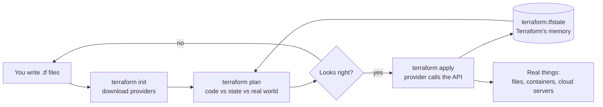

# 25 · Infrastructure as code with Terraform

**What you'll build:** three Terraform projects: one that writes a config file on your disk, one that starts a network and 2 to 3 web-server containers in Docker, and an annotated AWS project (network, door guard, server, private bucket) that you can read and validate without spending money.
**Like you're 5:** instead of building a Lego castle by hand every time, you write the instruction booklet once. Terraform reads the booklet, looks at what is already on the table, and adds or removes only the pieces that are missing or wrong.
**Time:** ~90 min · **Builds on:** [24 · Cloud basics](../24-cloud-basics-compute-storage-iam-networks) · **Needs:** Docker running (from Part 2) and Terraform 1.6 or newer. No cloud account needed.

## Why this matters
Clicking through a cloud console works once. It does not work for 3 environments (dev, staging, prod), for a customer who wants the same setup in their own account, or when you have to answer "who opened port 22 last Tuesday?". **Infrastructure as code** (IaC) means your servers, networks and permissions are written in text files, reviewed in pull requests and recreated with one command. Terraform is the most widely used IaC tool across AWS, Google Cloud and Azure, and forward deployed engineers use it to install the same AI platform into many customer accounts.

## What you'll learn
- **Declarative**: you describe *what you want* ("2 containers on ports 8081 and 8082"), not the steps to get there. Terraform works out the steps.
- **Provider**: a plugin that teaches Terraform one platform (AWS, Google Cloud, Azure, Docker, Kubernetes, even "files on disk").
- **Resource, variable, output, data source, local**: the five kinds of HCL blocks you will write all the time.
- **State**: Terraform's memory of what it created, stored in `terraform.tfstate`. Terraform compares the code, the state and the real world to plan changes.
- **The workflow** `init → plan → apply → destroy`: download plugins, preview changes, make them, remove everything.

## Before you start
1. Install Terraform (official guide: https://developer.hashicorp.com/terraform/install):
   - **Mac:** `brew tap hashicorp/tap && brew install hashicorp/tap/terraform`
   - **Windows:** `winget install --id Hashicorp.Terraform` (then open a new terminal), or use WSL2 and the Ubuntu lines.
   - **Ubuntu / WSL2:**
     ```bash
     wget -O - https://apt.releases.hashicorp.com/gpg | sudo gpg --dearmor -o /usr/share/keyrings/hashicorp-archive-keyring.gpg
     echo "deb [signed-by=/usr/share/keyrings/hashicorp-archive-keyring.gpg] https://apt.releases.hashicorp.com $(lsb_release -cs) main" | sudo tee /etc/apt/sources.list.d/hashicorp.list
     sudo apt update && sudo apt install terraform
     ```
     | Piece | Meaning |
     |---|---|
     | `wget -O -` | download a file and print it (`-O -` = output to the screen, not a file) |
     | `\|` | pipe: hand that text to the next command |
     | `gpg --dearmor -o <file>` | turn HashiCorp's signing key into the binary format apt needs and save it. apt uses it to check that packages really come from HashiCorp |
     | `echo "deb [...] <url> <name> main"` | print one "package source" line: where apt should download HashiCorp packages from |
     | `$(lsb_release -cs)` | replaced by your Ubuntu's code name, for example `noble` |
     | `sudo tee <file>` | write that line into apt's list of sources (as administrator) |
     | `&&` | run the next command only if the previous one worked |
2. Check it works:
   ```bash
   terraform version
   ```
   You should see `Terraform v1.x.y` (any version from 1.6 up is fine).
3. Docker must be running for example 2: `docker ps` should print a table header, not an error.
4. No API key and no cloud account needed. (Prefer fully open source? **OpenTofu** is a community fork of Terraform with the same language: replace `terraform` with `tofu` in every command. Docs: https://opentofu.org/docs/)

## Run it

### Example 1: Terraform with no cloud (files on your disk)
1. From the course folder (`cloud-and-devops-for-ai`), go into the first example:
   ```bash
   cd part-5-cloud-and-operations/25-infrastructure-as-code-with-terraform/1-local
   ```
2. Download the plugins this folder needs:
   ```bash
   terraform init
   ```
   You should see `Installing hashicorp/local v2.x` and `Terraform has been successfully initialized!`. A hidden `.terraform/` folder (the plugins) and a `.terraform.lock.hcl` file (the exact versions, so everyone on the team gets the same ones) appear.
3. Tidy and check the code:
   ```bash
   terraform fmt
   terraform validate
   ```
   `fmt` fixes spacing and lines up the `=` signs (it prints nothing if the file was already tidy). `validate` prints `Success! The configuration is valid.`
4. Preview what Terraform would do:
   ```bash
   terraform plan
   ```
   Read the end: `Plan: 2 to add, 0 to change, 0 to destroy.` Nothing has been created yet.
5. Do it:
   ```bash
   terraform apply
   ```
   Terraform shows the same plan and asks `Enter a value:`. Type `yes` and press Enter.
6. Look at what it made:
   ```bash
   cat output/dev-config.json
   terraform state list
   terraform output
   ```
7. Run `terraform apply` again. It says `No changes. Your infrastructure matches the configuration.` Running it twice is safe: that is the point of declarative tools.
8. Drift test: delete the file by hand, then ask Terraform:
   ```bash
   rm output/dev-config.json
   terraform plan
   ```
   Terraform notices the file is gone (`local_file.app_config will be created`). Run `terraform apply` and type `yes` to put it back.
9. Preview "production" values from the variable file:
   ```bash
   terraform plan -var-file=prod.tfvars
   ```
   Both resources show `must be replaced`, because the name prefix and the file name change.
10. Try a value the code refuses:
    ```bash
    terraform plan -var environment=test
    ```
11. Remove everything this example created:
    ```bash
    terraform destroy
    ```
    Type `yes`. `Destroy complete! Resources: 2 destroyed.`

**Commands, piece by piece**
| Piece | Meaning |
|---|---|
| `terraform init` | prepare the folder: download the providers listed in `required_providers`, set up where state is kept. Run it once per folder, and again after adding a provider |
| `terraform fmt` | rewrite the `.tf` files in the standard layout. `-recursive` also does sub-folders, `-check` only reports |
| `terraform validate` | check the code makes sense (names, types, required settings) without touching anything real |
| `terraform plan` | compare code + state + real world and print what would change. `+` create, `-` destroy, `~` change in place, `-/+` replace (destroy then create) |
| `terraform apply` | make the planned changes after you type `yes` |
| `terraform output` | print the outputs again |
| `terraform state list` | list every resource Terraform remembers in its state |
| `terraform destroy` | remove everything in the state (asks for `yes`) |
| `-var environment=test` | set one variable on the command line |
| `-var-file=prod.tfvars` | read many variables from a file |
| `-auto-approve` | skip the `yes` question (only for scripts and CI; dangerous by hand) |

### Example 2: Terraform drives Docker
1. Go to the second example (from `1-local`):
   ```bash
   cd ../2-docker
   ```
2. Download the Docker provider, then create everything:
   ```bash
   terraform init
   terraform apply
   ```
   Type `yes`. The image download takes about 20 seconds the first time.
3. Visit both copies:
   ```bash
   curl http://localhost:8081
   curl http://localhost:8082
   docker ps --filter name=tf-ai
   ```
   On Windows PowerShell use `curl.exe` instead of `curl`, or open the URLs in a browser.
4. Scale up to 3 copies by changing one number:
   ```bash
   terraform apply -var replicas=3
   ```
   The plan says `1 to add`: Terraform keeps the 2 that are fine and adds only `tf-ai-api-2` on port 8083.
5. Break something behind Terraform's back, then let it heal:
   ```bash
   docker rm -f tf-ai-api-1
   terraform apply -var replicas=3
   ```
   The plan says `docker_container.api[1] will be created`. Type `yes`.
6. Clean up (keep the same `-var`, so Terraform plans with the same code):
   ```bash
   terraform destroy -var replicas=3
   ```

### Example 3: the annotated AWS project (read, validate, do not apply)
1. Go to the third example:
   ```bash
   cd ../3-aws-example
   ```
2. Read the four files in this order: `versions.tf`, `variables.tf`, `main.tf`, `outputs.tf`. Every block has a comment.
3. Check it without an AWS account (this downloads the AWS provider, about 180 MB):
   ```bash
   terraform init -backend=false
   terraform validate
   ```
   `-backend=false` = "don't set up state storage, I only want to check the code".
4. Only if you have your own AWS account **with a billing alarm** (lesson 24) and want to try it for real, in AWS CloudShell: `terraform init`, `terraform apply`, open the `api_url` output after about 2 minutes, then **`terraform destroy`** the same day. Everything here costs a few cents per hour while it exists.

### What you should see
Example 1, step 5 (real output; your pet name is random):
```
random_pet.server_name: Creating...
random_pet.server_name: Creation complete after 0s [id=dev-stunning-shrew]
local_file.app_config: Creating...
local_file.app_config: Creation complete after 0s [id=efe6c38f0cfe7c563bc7ab47d02d3d18fde06f38]

Apply complete! Resources: 2 added, 0 changed, 0 destroyed.

Outputs:

config_file = "./output/dev-config.json"
server_name = "dev-stunning-shrew"
```
Step 6 prints `{"environment":"dev","model":"claude-haiku-5-5","project":"ai-platform","server":"dev-stunning-shrew"}`. Notice that `random_pet` was created **before** `local_file`: the file uses the pet's name, so Terraform worked out the order by itself.

Step 9 (shortened):
```
  # local_file.app_config must be replaced
-/+ resource "local_file" "app_config" {
      ~ filename             = "./output/dev-config.json" -> "./output/prod-config.json" # forces replacement
  # random_pet.server_name must be replaced
-/+ resource "random_pet" "server_name" {
      ~ prefix    = "dev" -> "prod" # forces replacement
Plan: 2 to add, 0 to change, 2 to destroy.
```
Step 10:
```
Error: Invalid value for variable
  on main.tf line 29:
  29: variable "environment" {
    │ var.environment is "test"
environment must be "dev" or "prod".
```
Example 2, steps 2 to 4 (real output, shortened):
```
docker_image.echo: Creation complete after 23s [id=sha256:fcb75f69...hashicorp/http-echo:1.0]
docker_container.api[0]: Creation complete after 4s [id=7d168d4e6432...]
docker_container.api[1]: Creation complete after 6s [id=75928e1f3daa...]

Apply complete! Resources: 4 added, 0 changed, 0 destroyed.

Outputs:

urls = [
  "http://localhost:8081",
  "http://localhost:8082",
]
$ curl http://localhost:8081
Hello from a container that Terraform created (copy 0)
$ curl http://localhost:8082
Hello from a container that Terraform created (copy 1)
$ terraform apply -var replicas=3
docker_container.api[2]: Creation complete after 3s [id=ce58c063cda9...]
Apply complete! Resources: 1 added, 0 changed, 0 destroyed.
```
Example 3, step 3: `Success! The configuration is valid.`

## How it works

### 1. The workflow

A **provider** is a translator. You write `resource "docker_container"`, the Docker provider turns it into calls to Docker's API. The AWS provider turns `resource "aws_instance"` into calls to AWS's API. Same language, different translators.

**State** (`terraform.tfstate`, a JSON file) is Terraform's memory: "I created container `7d168d4e...` for `docker_container.api[0]`". Without it, Terraform cannot know which real things it owns. Keep it safe (it can contain passwords), never edit it by hand, and never commit it to git (this folder's `.gitignore` excludes it). Teams store it in a shared bucket with locking: see the commented `backend "s3"` block in `3-aws-example/versions.tf`.

### 2. HCL, the language, block by block
Terraform files use **HCL** (HashiCorp Configuration Language). Every file is made of blocks: `type "label" "label" { key = value }`.

| Block (from `1-local/main.tf`) | What it means |
|---|---|
| `terraform { required_version = ">= 1.6" ... }` | settings for Terraform itself: the oldest Terraform allowed, and which providers to download |
| `required_providers { local = { source = "hashicorp/local", version = "~> 2.5" } }` | "I need the provider published as `hashicorp/local` on the Terraform Registry". `~> 2.5` = "2.5 or newer, but below 3.0" (no surprise breaking changes) |
| `variable "environment" { type = string, default = "dev" }` | an input. `type` refuses wrong kinds of values, `default` is used when you give none |
| `validation { condition = contains(["dev","prod"], var.environment) ... }` | a rule checked before anything happens. `contains(list, value)` is true if the value is in the list |
| `resource "random_pet" "server_name" { ... }` | one thing to create. First label = the **resource type** (provider name + kind), second label = **your name** for it. Together: the address `random_pet.server_name` |
| `locals { model = var.environment == "prod" ? "claude-opus-5-5" : "claude-haiku-5-5" }` | named values computed in this folder. `a ? b : c` = "if a then b else c" |
| `random_pet.server_name.id` | read the `id` attribute of another resource. This **reference** is how Terraform learns the order: the file waits for the pet |
| `"${path.module}/output/${var.environment}-config.json"` | `${ ... }` puts a value inside text. `path.module` = this folder. Result: `./output/dev-config.json` |
| `jsonencode(local.config)` | a built-in function: turn a map into JSON text |
| `output "server_name" { value = ... }` | a value printed after `apply` and readable with `terraform output` (and by other tools and scripts) |

Symbols you meet everywhere: `var.x` = a variable, `local.x` = a local, `<type>.<name>.<attribute>` = a resource's attribute, `data.<type>.<name>.<attribute>` = a data source's attribute, `#` = a comment, `[...]` = a list, `{...}` = a map (keys and values).

### 3. The Docker example (`2-docker/main.tf`)
1. `provider "docker" {}` is empty, so it talks to the Docker on your computer.
2. `resource "docker_network" "ai"` creates the network `tf-ai-net` (like a subnet in the cloud).
3. `resource "docker_image" "echo"` pulls `hashicorp/http-echo:1.0`, a tiny server that answers fixed text. `keep_locally = false` means `destroy` deletes the image too.
4. `resource "docker_container" "api"` has `count = var.replicas`. **`count`** turns one block into N copies, named `api[0]`, `api[1]`... Inside, **`count.index`** is the copy's number, used for the name (`tf-ai-api-0`), the port (`8081 + 0`) and the text.
5. `image = docker_image.echo.image_id` is a reference, so the image is pulled before any container starts.
6. `ports { internal = 5678 external = ... }` is a **nested block**: container port 5678 appears on your computer's port 8081, 8082...
7. `output "urls"` uses a **for expression**: `[for i in range(var.replicas) : "http://localhost:${var.base_port + i}"]` = "for each number from 0 to replicas − 1, make one URL".

### 4. The AWS example (`3-aws-example/`)
It builds lesson 24's building for real: `aws_vpc` (building) → `aws_subnet` (floor) → `aws_internet_gateway` (street door) → `aws_route_table` + `aws_route_table_association` (the hallway sign "everything else goes out the street door") → `aws_security_group` with one ingress rule for port 80 and one egress rule for everything (the door guard) → `aws_instance` (the server, with a `user_data` script that installs Docker and starts http-echo on port 80) → `aws_s3_bucket` with a public access block and versioning (a locked, private locker).

New ideas in it:
- **Data sources** (`data "aws_availability_zones"`, `data "aws_ssm_parameter"`) only *read* information, for example "what is the newest Amazon Linux image?". They never create anything.
- **`default_tags`** in the provider labels every resource with `Project` and `ManagedBy`, so you can find (and pay for) everything this project made.
- **IAM role for the server**: the server gets a key card that can read from its bucket only (`s3:GetObject` on `bucket/*`, `s3:ListBucket` on the bucket), plus Session Manager access so no SSH port is opened. Lesson 27 explains least privilege in detail.
- **`metadata_options { http_tokens = "required" }`** forces the safer version of the server's metadata service, which blocks a common way attackers steal a server's credentials.
- **`random_id`** gives the bucket a unique ending, because S3 bucket names are shared by every AWS customer in the world.

## If something goes wrong
- **`terraform: command not found`** → the install did not finish or the terminal was open before it. Open a new terminal; on Windows check `winget list Hashicorp.Terraform`.
- **`Error: Failed to query available provider packages` / `could not connect to registry.terraform.io`** → `init` needs the internet to download providers. Check your connection or company proxy, then rerun `terraform init`.
- **`Error: Error pinging Docker server: Cannot connect to the Docker daemon`** (example 2) → start Docker Desktop (or `sudo systemctl start docker` on Linux) and wait until `docker ps` works. On Windows without WSL2, add `host = "npipe:////.//pipe//docker_engine"` inside `provider "docker" {}`.
- **`Bind for 0.0.0.0:8081 failed: port is already allocated`** → another program uses that port. Pick other ports: `terraform apply -var base_port=9081`.
- **`Error acquiring the state lock`** → another `terraform` command is still running in this folder (or crashed). Wait for it to finish. Only if you are sure nothing is running: `terraform force-unlock <LOCK_ID>` with the ID from the message.
- **Example 3: `No valid credential sources found`** when running `plan` → expected without an AWS login. `validate` is enough here; use AWS CloudShell if you really want to apply.

## Try this
1. In `1-local`, add a variable `team` (type `string`, default `"forward-deployed"`) and put it in the JSON file. Run `plan` and read which resource changes and why.
2. In `2-docker`, change the default `message`. Before applying, predict: will Terraform change the containers in place or replace them? Run `terraform plan` and check.
3. In `2-docker`, add a second kind of container: one Redis container (`redis:7-alpine`) on the same network, without publishing any port. Add an output with its name.

<details><summary>Hints and solutions</summary>

1. Add
   ```hcl
   variable "team" {
     type    = string
     default = "forward-deployed"
   }
   ```
   and inside `locals { config = { ... } }` add `team = var.team`. The plan shows `local_file.app_config must be replaced`, because its `content` changes and a local file cannot be edited "in place" by this provider. `random_pet` stays untouched.
2. Replaced (`-/+`, `forces replacement` next to `command`). A running container cannot change its start command, so Docker must create a new one. Many cloud settings work the same way: read every plan for `-/+` before typing `yes`.
3. Add to `main.tf`:
   ```hcl
   resource "docker_image" "redis" {
     name         = "redis:7-alpine"
     keep_locally = true # destroy must not delete an image other projects (lesson 13) use
   }

   resource "docker_container" "redis" {
     name  = "tf-ai-redis"
     image = docker_image.redis.image_id
     networks_advanced {
       name = docker_network.ai.name
     }
   }

   output "redis_name" {
     value = docker_container.redis.name
   }
   ```
   No `ports` block means Redis is reachable only from containers on `tf-ai-net`, like a database in a private subnet.
</details>

## Check yourself
1. What is the difference between `terraform plan` and `terraform apply`?
2. You deleted a container by hand. How does Terraform know it must recreate it?
3. Why must `terraform.tfstate` never go into git, and where do teams keep it?
4. In `version = "~> 2.5"`, which provider versions are allowed?

<details><summary>Answers</summary>

1. `plan` only compares and prints what would change; it touches nothing. `apply` makes those changes (after you type `yes`).
2. Before planning, Terraform **refreshes**: it asks Docker about every resource in its state. The state says `api[1]` should exist, Docker says it does not, so the plan creates it.
3. It can contain secrets (passwords, keys, IP addresses) and two people applying with two different copies would fight. Teams keep it in a remote **backend** such as an S3 bucket, a Google Cloud Storage bucket or Terraform Cloud, with locking so only one apply runs at a time.
4. 2.5 and any newer 2.x (2.6, 2.9.1...), but not 3.0 or above.
</details>

## Learn more (optional)
**Read the official docs**
- Terraform documentation: https://developer.hashicorp.com/terraform/docs
- Get started tutorials (Docker, AWS, GCP, Azure): https://developer.hashicorp.com/terraform/tutorials
- The Terraform language (HCL): https://developer.hashicorp.com/terraform/language
- State: https://developer.hashicorp.com/terraform/language/state
- Terraform CLI commands: https://developer.hashicorp.com/terraform/cli/commands
- Terraform Registry (all providers and their resources): https://registry.terraform.io/
- AWS provider documentation: https://registry.terraform.io/providers/hashicorp/aws/latest/docs
- Docker provider documentation: https://registry.terraform.io/providers/kreuzwerker/docker/latest/docs
- OpenTofu documentation: https://opentofu.org/docs/

**Watch**
- freeCodeCamp, HashiCorp Terraform Associate full course: https://www.youtube.com/results?search_query=freecodecamp+terraform+course
- TechWorld with Nana, Terraform explained / Terraform tutorial for beginners: https://www.youtube.com/results?search_query=techworld+with+nana+terraform+tutorial
- Fireship, Terraform in 100 seconds: https://www.youtube.com/results?search_query=fireship+terraform+in+100+seconds
- Search: "terraform state explained": https://www.youtube.com/results?search_query=terraform+state+explained

## Next
→ [26 · Observability: logs, metrics, traces](../26-observability-logs-metrics-traces)
