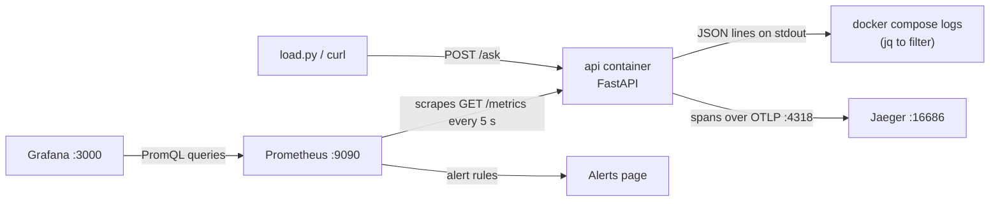

# 26 · Observability: logs, metrics, traces

**What you'll build:** a small AI question-answering API that writes JSON logs, counts everything in Prometheus metrics and sends a trace of every LLM call to Jaeger, plus a ready-made Grafana dashboard ("requests, errors, latency, tokens, cost") and three alert rules. One `docker compose up` starts all of it.
**Like you're 5:** your app is a car. **Logs** are the diary ("10:02, turned left"), **metrics** are the dashboard dials (speed, fuel), and **traces** are a video of one trip showing how long each street took.
**Time:** ~90 min · **Builds on:** [25 · Infrastructure as code with Terraform](../25-infrastructure-as-code-with-terraform) and Docker Compose from [09](../../part-2-docker/09-docker-compose-multi-container-apps) · **Needs:** Docker with Compose, about 3 GB of free disk for the images. No API key (a fake model is the default); optional `ANTHROPIC_API_KEY` to watch real Claude calls.

## Why this matters
An AI app that "works on my laptop" will still be slow, expensive or broken for some users in production, and you will not be there to watch. Observability is how you find out *what* went wrong, *where* and *for whom*, without guessing: "the error rate jumped to 12 % at 14:05, all failures are model timeouts, and this one user's request spent 9 of its 10 seconds waiting for the LLM". LLM apps add their own dials: tokens per minute, cost per hour and model latency. Customers ask a forward deployed engineer for exactly these dashboards before they let an AI system go live.

## What you'll learn
- **Structured logs**: one JSON object per line (`{"level": "ERROR", "error": "...", "trace_id": "..."}`), so a machine can filter and count them.
- **Metrics with Prometheus**: counters and histograms your app exposes at `/metrics`; Prometheus **scrapes** (collects) them every few seconds and you query them with **PromQL**.
- **Dashboards with Grafana**: graphs built from PromQL queries, loaded automatically from a JSON file.
- **Traces with OpenTelemetry**: a **trace** is the story of one request; each step is a **span** with a start, a duration and labels such as `gen_ai.usage.output_tokens`.
- **Alerts and the golden signals**: watch traffic, errors, latency and saturation, and let rules like "more than 10 % errors for 1 minute" raise the alarm.

## Before you start
- Docker with Compose v2: `docker compose version` should print `Docker Compose version v2.x`.
- About 3 GB of free disk: Grafana's image alone is large.
- Ports 8000, 9090, 3000, 16686 and 4318 must be free. Stop earlier lessons first (`docker compose down` in their folders).
- The packages are installed **inside** the image from [`app/requirements.txt`](app/requirements.txt), so you do not need them on your laptop:
  - `fastapi`, `uvicorn`: the web API and its server (Part 1 of ai-from-zero).
  - `anthropic`: the official Claude SDK, used only when `FAKE_LLM=0`.
  - `prometheus-client`: creates counters and histograms and prints them at `/metrics`.
  - `opentelemetry-sdk`, `opentelemetry-exporter-otlp-proto-http`: create spans and send them to Jaeger over **OTLP** (the OpenTelemetry protocol).
- `load.py` uses only Python's standard library: run it with any Python 3.10+.
- No API key needed. To use real Claude later: `export ANTHROPIC_API_KEY=sk-ant-...` and `export FAKE_LLM=0` before `docker compose up` (`CLAUDE_MODEL=claude-haiku-5-5` is the cheap option).

## Run it
1. From the course folder (`cloud-and-devops-for-ai`), go into this lesson's folder:
   ```bash
   cd part-5-cloud-and-operations/26-observability-logs-metrics-traces
   ```
2. Build the API image and start all four containers in the background:
   ```bash
   docker compose up -d --build
   ```
   The first time, Docker downloads Prometheus, Grafana and Jaeger (a few minutes).
   | Piece | Meaning |
   |---|---|
   | `docker compose` | the tool that runs the containers listed in `compose.yaml` together |
   | `up` | create and start them (and their network) |
   | `-d` | "detached": run in the background and give you the terminal back |
   | `--build` | build the `api` image from `./app/Dockerfile` first |
3. Check all four are `Up`, then check the API:
   ```bash
   docker compose ps
   curl http://localhost:8000/health
   ```
   You should see `{"status":"ok","model":"fake-llm"}`. If `curl` says the connection was reset, wait 3 seconds and try again (the API is still starting). On Windows PowerShell use `curl.exe`.
4. Ask one question:
   ```bash
   curl -X POST http://localhost:8000/ask -H "Content-Type: application/json" -d '{"question": "How long does shipping take?"}'
   ```
   The answer ends with a `trace_id`. Copy it: you will look it up in step 9.
   | Piece | Meaning |
   |---|---|
   | `-X POST` | send a POST request (we are sending data, not just reading a page) |
   | `-H "Content-Type: application/json"` | a **header**: tells the server the body is JSON |
   | `-d '{...}'` | the request body (the data). Single quotes keep the inner double quotes intact |
5. Look at the raw metrics, the way Prometheus sees them:
   ```bash
   curl -s http://localhost:8000/metrics | grep -E "^(http_requests_total|llm_tokens_total)"
   ```
   | Piece | Meaning |
   |---|---|
   | `-s` | silent: no progress bar |
   | `grep -E "^(a\|b)"` | keep lines that **start with** (`^`) `a` or (`\|`) `b`. `-E` allows the `(a\|b)` "either" syntax |
6. Send 200 questions, 4 at a time, so the graphs have data:
   ```bash
   python load.py
   ```
   About 5 % of answers are `502`: the fake model fails on purpose, so you can practise finding errors.
7. Read the logs, then keep only the errors with **jq** (a JSON filter; install with `sudo apt install jq`, `brew install jq` or `winget install jqlang.jq`):
   ```bash
   docker compose logs api --no-log-prefix | tail -3
   docker compose logs api --no-log-prefix | jq -c 'select(.level == "ERROR") | {time, error, trace_id}'
   ```
   | Piece | Meaning |
   |---|---|
   | `logs api` | print what the `api` container wrote to its output |
   | `--no-log-prefix` | don't put `api-1 \|` in front of each line, so every line is pure JSON |
   | `tail -3` | show only the last 3 lines |
   | `jq -c` | parse each line as JSON; `-c` prints compact one-line results |
   | `select(.level == "ERROR")` | keep only objects whose `level` field is `"ERROR"` |
   | `\| {time, error, trace_id}` | from those, keep just these three fields |
8. Open **Prometheus** at http://localhost:9090. Go to **Status → Target health**: `ask-api` must be `UP`. Then on the **Query** page paste this and press **Execute** (switch to the **Graph** tab):
   ```
   sum by (status) (rate(http_requests_total{path="/ask"}[1m]))
   ```
9. Open **Jaeger** at http://localhost:16686. Choose **Service: ask-api**, click **Find Traces**, and open one. You see `POST /ask` → `ask` → `retrieve` and `chat fake-llm`. Click the `chat` span to see its tags (`gen_ai.request.model`, `gen_ai.usage.input_tokens`...). You can also paste the `trace_id` from step 4 or step 7 into the search box at the top.
10. Open **Grafana** at http://localhost:3000 (anonymous viewing is on; to edit, sign in as `admin` / `admin`). Go to **Dashboards → AI → Ask API: AI service health**. Run `python load.py 500 4` again and watch the graphs move (they refresh every 5 seconds).
11. Make an alert fire. Restart the API with a 30 % failure rate and send traffic for about 2 minutes:
    ```bash
    FAKE_ERROR_RATE=0.3 docker compose up -d
    python load.py 500 4
    ```
    On Windows PowerShell set the variable first: `$env:FAKE_ERROR_RATE="0.3"`, then `docker compose up -d`. In Prometheus, open **Alerts**: `AskApiHighErrorRate` goes from *inactive* to *pending* to **firing**.
12. Stop and remove everything (add `--rmi local` to also delete the API image you built):
    ```bash
    docker compose down
    ```

### What you should see
Step 4 (real output):
```json
{"answer":"Based on our documents: Standard shipping takes 3 to 5 working days. Express takes 1 day.","sources":["shipping"],"trace_id":"f72505edca330f572ec51f2d3810aea3"}
```
Step 5, after the load in step 6 (real output, your numbers differ):
```
http_requests_total{method="POST",path="/ask",status="200"} 189.0
http_requests_total{method="POST",path="/ask",status="502"} 12.0
llm_tokens_total{direction="input",model="fake-llm"} 7629.0
llm_tokens_total{direction="output",model="fake-llm"} 4076.0
```
Step 6:
```
Sending 200 requests, 4 at a time, to http://localhost:8000/ask ...
  status 200: 188
  status 502: 12
```
Step 7 (one line per event; the error has a `trace_id` you can paste into Jaeger):
```
{"time": "2026-10-22T13:59:40.756+00:00", "level": "INFO", "service": "ask-api", "message": "answered", "question_chars": 30, "sources": ["warranty"], "duration_ms": 740, "model": "fake-llm", "trace_id": "0c73353dbda00270b2163c9f979b837c"}
{"time":"2026-10-22T13:59:40.294+00:00","error":"fake model overloaded","trace_id":"c24056780b22a7254a22313d7ef7a9d6"}
```
Step 9, one trace in Jaeger (real spans, read from Jaeger's API):
```
POST /ask           1131 ms  http.route=/ask  http.response.status_code=502
└─ ask              1124 ms
   ├─ retrieve         0 ms  retrieve.documents=1
   └─ chat fake-llm 1123 ms  gen_ai.operation.name=chat  gen_ai.request.model=fake-llm  (error: fake model overloaded)
```
Almost the whole request is the model call: that is normal for LLM apps, and now you can prove it.

Step 11, Prometheus **Alerts** page: `AskApiHighErrorRate` **firing** (the error share was about 0.27, above the 0.10 limit).

## How it works

Notice the arrows: Prometheus **pulls** metrics from the app, while the app **pushes** spans to Jaeger and simply prints logs.

### 1. Logs (`app/main.py`, part 1)
1. `JsonFormatter.format()` turns every log record into one line of JSON with `time`, `level`, `service`, `message`, any extra fields, and the current `trace_id` if the line was written inside a trace. That `trace_id` is the bridge between a log line and its trace.
2. `log_event("answered", question_chars=..., sources=..., duration_ms=...)` logs an event with named fields. Notice what it does **not** log: the user's question text, the answer or the API key. Logs are copied to many places and kept for months; never put secrets or personal data in them.
3. `print`-style text logs ("Answered question in 740ms") are fine for humans, but you cannot reliably count or filter them. JSON lines can be searched by any log tool (CloudWatch, Cloud Logging, Loki, Elasticsearch, Datadog).

### 2. Metrics (`app/main.py`, part 2)
1. A **Counter** only goes up: `REQUESTS`, `LLM_TOKENS`, `LLM_ERRORS`. A **Histogram** sorts each measurement into "buckets" (`<= 0.1 s`, `<= 0.25 s`, ...), which lets Prometheus work out percentiles: `REQUEST_SECONDS`, `LLM_SECONDS`.
2. **Labels** split a metric: `http_requests_total{method="POST", path="/ask", status="502"}` is one line, the same with `status="200"` is another.
3. The `measure()` middleware runs around every request and labels it with the **route template** (`/ask`), never the full URL. If you used raw URLs with ids in them, every new id would create a new line, and Prometheus would run out of memory (this is called **high cardinality**).
4. `GET /metrics` returns `generate_latest()`: the current value of every metric in Prometheus' text format.

**PromQL, piece by piece** (the dashboard and alerts use these)
| Piece | Meaning |
|---|---|
| `http_requests_total` | the metric name: all its lines |
| `{path="/ask", status=~"5.."}` | keep lines whose `path` is exactly `/ask` and whose `status` matches the pattern `5..` (500 to 599). `=~` = "matches the regular expression" |
| `[1m]` | look at the last 1 minute of samples |
| `rate(...)` | per-second increase of a counter over that window ("requests per second") |
| `sum(...)` | add all matching lines together |
| `sum by (status) (...)` | add up, but keep one result per `status` |
| `histogram_quantile(0.95, ...)` | from histogram buckets, the value 95 % of requests were below (the **p95** latency) |
| `... / ... > 0.10` | divide two results (errors / all) and keep it only if above 0.10 (10 %) |

### 3. Traces (`app/main.py`, part 3)
1. `TracerProvider(resource=Resource.create({"service.name": SERVICE_NAME}))` sets up tracing and names this service `ask-api` in Jaeger.
2. `BatchSpanProcessor(OTLPSpanExporter())` collects finished spans and sends them in batches. The exporter reads the address from the environment variable `OTEL_EXPORTER_OTLP_ENDPOINT` (set to `http://jaeger:4318` in `compose.yaml`) and posts to `/v1/traces`. If the variable is missing, spans are simply not sent: the app keeps working.
3. Recent FastAPI versions create the outer `POST /ask` span on their own once a tracer provider exists. `telemetry={"operation_spans": False, "exclude": ...}` in `FastAPI(...)` keeps that span but hides FastAPI's tiny inner steps and the `/metrics` and `/health` calls that would otherwise fill Jaeger every 5 seconds.
4. In `ask()`, `with tracer.start_as_current_span("ask"):` starts a span; the spans started inside it (`retrieve`, `chat fake-llm`) become its **children**, which is how Jaeger draws the tree.
5. `call_llm()` names its span `chat <model>` and adds attributes from OpenTelemetry's **GenAI semantic conventions** (`gen_ai.operation.name`, `gen_ai.request.model`, `gen_ai.usage.input_tokens`, `gen_ai.usage.output_tokens`). Using the standard names means any tracing tool understands them. On failure it calls `span.record_exception()` and marks the span as an error (red in Jaeger), and also counts `LLM_ERRORS`.

### 4. The fake model and the real one
`fake_llm()` sleeps 0.2 to 1.2 seconds, fails `FAKE_ERROR_RATE` of the time and estimates tokens as characters ÷ 4. With `FAKE_LLM=0`, `claude_llm()` calls `anthropic.Anthropic().beta.messages.create(...)` and reads the real numbers from `response.usage.input_tokens` and `response.usage.output_tokens`. On the strongest models it also switches on the API's server-side fallback (`betas=[...]`, `fallbacks="default"`), the same safety net the rest of this repo uses. Everything else (logs, metrics, traces) stays the same.

### 5. The config files
**`compose.yaml`, the new keys**
| Key | Meaning |
|---|---|
| `build: ./app` | build this service's image from `./app/Dockerfile` |
| `image: prom/prometheus:v3.15.1` | use a ready-made image, pinned to an exact version |
| `"${FAKE_LLM:-1}"` | use the environment variable `FAKE_LLM` from your terminal, or `1` if it is not set |
| `OTEL_EXPORTER_OTLP_ENDPOINT: "http://jaeger:4318"` | where to send spans. `jaeger` is the service name, which works as a host name on the compose network |
| `volumes: - ./prometheus:/etc/prometheus:ro` | show the local folder inside the container at that path, `:ro` = read-only |
| `depends_on: [jaeger]` | start Jaeger before the API |

**`prometheus/prometheus.yml`**
| Key | Meaning |
|---|---|
| `scrape_interval: 5s` | visit every target every 5 seconds (15 to 60 s is common in production) |
| `rule_files` | where the alert rules are |
| `scrape_configs` → `job_name: ask-api` | one group of targets; becomes the label `job="ask-api"` |
| `static_configs` → `targets: ["api:8000"]` | the address to scrape (on Kubernetes, lesson 28 discovers pods automatically instead) |

**`prometheus/alerts.yml`**: each rule has `expr` (a PromQL question), `for` (how long it must stay true before firing, so a single blip does not wake anyone), `labels.severity` (`page` = wake someone up, `ticket` = fix during work hours) and `annotations` (the human message). Sending the alert to email or Slack is the job of a separate program, **Alertmanager**.

**Grafana files**: `grafana/provisioning/datasources/datasources.yml` creates the Prometheus data source with the id `prometheus`; `grafana/provisioning/dashboards/dashboards.yml` tells Grafana to load every JSON file from `/var/lib/grafana/dashboards`; `grafana/dashboards/ask-api.json` is the dashboard itself: each panel has a `title`, a `type` (`stat` or `timeseries`) and `targets` with the PromQL `expr`. Change a dashboard in the UI, then **Export → Export as JSON** and save it over this file to keep it in git.

**The four golden signals** (from Google's SRE book) are on the dashboard's first row: **traffic** (requests per second), **errors** (error rate), **latency** (p95) and **saturation** (how full the system is; for an LLM app, tokens per minute and cost per hour are good stand-ins).

## If something goes wrong
- **`Bind for 0.0.0.0:8000 failed: port is already allocated`** → another lesson's containers are still running. Run `docker ps`, then `docker compose down` in that lesson's folder (or `docker stop <name>`).
- **`curl: (56) Recv failure: Connection reset by peer`** right after `up` → the API is still starting. Wait a few seconds; `docker compose logs api` shows `Application startup complete` when ready.
- **Prometheus target `ask-api` is `DOWN`** → the API container crashed. `docker compose logs api` shows the Python error; fix it and run `docker compose up -d --build`.
- **Grafana panels say "No data"** → send traffic (`python load.py`) and wait 10 to 20 seconds: `rate(...[1m])` needs at least two scrapes. Check the time picker at the top right says "Last 15 minutes".
- **No traces in Jaeger** → spans are sent in batches every few seconds, so wait 5 seconds and click **Find Traces** again. Check `docker compose exec api env | grep OTEL` prints the endpoint.
- **`no space left on device`** while pulling → free space with `docker system prune` (removes stopped containers and unused images), then retry.

## Try this
1. Add a counter `questions_without_documents_total` that goes up when `retrieve()` finds nothing. Ask "Do you sell bikes on the moon?" and find your metric at `/metrics`.
2. Add a Grafana panel "Share of questions without documents" using your new counter.
3. Write a new alert `AskApiNoDocuments` that fires when more than half of the questions in the last 5 minutes found no documents (a sign your knowledge base is missing a topic).

<details><summary>Hints and solutions</summary>

1. Near the other metrics add
   ```python
   NO_DOCS = Counter("questions_without_documents_total", "Questions where retrieve() found nothing")
   ```
   and in `ask()`, right after `docs = retrieve(body.question)`, add `if not docs: NO_DOCS.inc()`. Rebuild: `docker compose up -d --build api`. Then `curl -s http://localhost:8000/metrics | grep questions_without`.
2. In Grafana sign in as admin, open the dashboard, **Edit → Add → Visualization**, choose the Prometheus data source and enter
   `sum(rate(questions_without_documents_total[5m])) / sum(rate(http_requests_total{path="/ask", status="200"}[5m]))`
   with unit **Percent (0.0-1.0)**. Save, then export the JSON over `grafana/dashboards/ask-api.json` to keep it.
3. Add to `prometheus/alerts.yml` under `rules:`
   ```yaml
         - alert: AskApiNoDocuments
           expr: |
             sum(rate(questions_without_documents_total[5m]))
               / sum(rate(http_requests_total{path="/ask", status="200"}[5m])) > 0.5
           for: 5m
           labels:
             severity: ticket
           annotations:
             summary: "Most questions find no documents: the knowledge base is missing a topic"
   ```
   Then `docker compose restart prometheus` and check **Alerts**.
</details>

## Check yourself
1. Which of the three (logs, metrics, traces) would you open first for each question: "Is the error rate higher than yesterday?", "Why did *this* user's request take 9 seconds?", "What exactly was the error message at 14:05?"
2. Why do we label metrics with `/ask` and not with the full URL, and why don't we put the user's question text in a label?
3. What does `histogram_quantile(0.95, ...)` tell you that an average does not?
4. Why does every log line carry a `trace_id`?

<details><summary>Answers</summary>

1. Metrics (a number over time); a trace (the timeline of that one request); logs (the exact event and message).
2. Every different label value creates a new time series. Full URLs or free text would create millions, making Prometheus slow or crash (high cardinality). And question text is personal data that must not be copied into monitoring systems.
3. The time that 95 % of requests stay under. An average hides the slow tail: 19 fast requests and 1 very slow one look "fine" on average, but that 1 user waited a long time.
4. So you can jump from an error in the logs to the full trace of that same request (and back), instead of guessing which trace belongs to which log line.
</details>

## Learn more (optional)
**Read the official docs**
- Prometheus: overview and getting started: https://prometheus.io/docs/introduction/overview/
- Prometheus: querying basics (PromQL): https://prometheus.io/docs/prometheus/latest/querying/basics/
- Prometheus: alerting rules: https://prometheus.io/docs/prometheus/latest/configuration/alerting_rules/
- Prometheus Python client: https://prometheus.github.io/client_python/
- Grafana documentation: https://grafana.com/docs/grafana/latest/
- Grafana provisioning (data sources and dashboards from files): https://grafana.com/docs/grafana/latest/administration/provisioning/
- OpenTelemetry: what is OpenTelemetry: https://opentelemetry.io/docs/what-is-opentelemetry/
- OpenTelemetry for Python: https://opentelemetry.io/docs/languages/python/
- OpenTelemetry semantic conventions for generative AI: https://opentelemetry.io/docs/specs/semconv/gen-ai/
- Jaeger documentation: https://www.jaegertracing.io/docs/
- Google SRE book, "Monitoring distributed systems" (the four golden signals): https://sre.google/sre-book/monitoring-distributed-systems/

**Watch**
- TechWorld with Nana, Prometheus monitoring explained: https://www.youtube.com/results?search_query=techworld+with+nana+prometheus+explained
- freeCodeCamp, Grafana and Prometheus course: https://www.youtube.com/results?search_query=freecodecamp+prometheus+grafana+course
- Fireship, OpenTelemetry / observability in 100 seconds: https://www.youtube.com/results?search_query=fireship+opentelemetry
- ByteByteGo, logging, metrics and tracing explained: https://www.youtube.com/results?search_query=bytebytego+logging+tracing+metrics

## Next
→ [27 · Security and secrets in production](../27-security-and-secrets-in-production)
