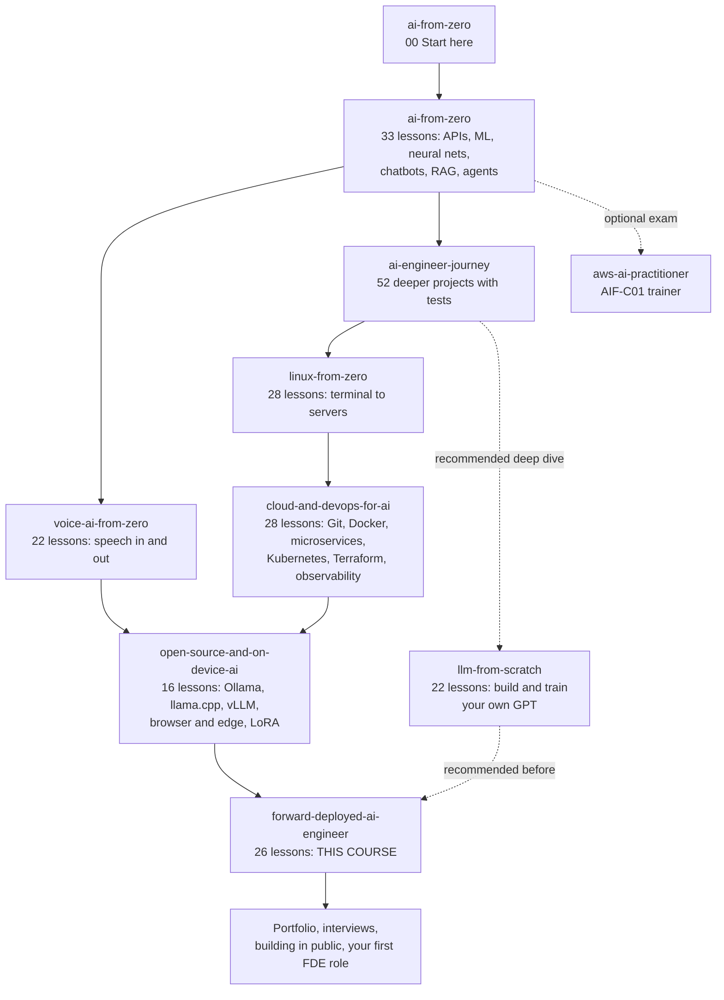

# Forward Deployed AI Engineer 🚀

**The last course of the path.** 26 lessons that turn "I can build AI apps" into "I can walk into a company, find the problem worth solving, connect AI to their messy data and locked-down systems, prove it works, deploy it in their environment, and hand it over so it keeps working."

A **forward deployed engineer (FDE)** embeds with a customer and turns their problem into a deployed AI system. The job mixes four things: discovery and clear communication with technical and non-technical people; enterprise data and integrations (SQL, PDFs, company APIs, SSO, firewalls, personal data); production LLM engineering (evals, guardrails, cost, monitoring, agents); and deployment inside the customer's cloud or data centre. This course teaches all four, mostly through one fictional customer, **Northwind Logistics**, and ends with three capstones and a career part.

Like you're 5: so far you've learned to build great toys in your own room. Now you learn to visit other people's houses, find out what they really need, build it with the bricks *they* have, check that it's safe for their little brother, and teach them how to look after it when you leave.

Every lesson follows the same pattern, so you never get stuck on your own: what you'll build → why it matters → what you'll learn → install → run it (with the real output you should see) → how it works, with every command, flag and SQL clause explained piece by piece → fixes for common problems → three exercises with hints and solutions → a short self-check quiz → official docs and videos → the next lesson.

## Who it's for
- You finished **AI from Zero** (or have equivalent experience: Python, APIs, chatbots, RAG, agents).
- You want to work where AI meets real companies: as a forward deployed engineer, AI solutions engineer, applied AI engineer or AI consultant, or you build AI inside your own company and keep hitting "the enterprise stuff".
- You learn alone, at about an hour a day. Every lesson runs on a laptop; every test runs without an API key.

## The parts

| Part | You'll be able to | Time |
|------|-------------------|------|
| [1 · The role](part-1-the-role) | explain the job, run a discovery interview, write success metrics and a design doc, give a demo that builds trust | 1 week |
| [2 · Enterprise data and integration](part-2-enterprise-data-and-integration) | query messy company databases, ingest PDFs/Excel/email, integrate with OAuth APIs and webhooks, add SSO with per-user permissions, keep personal data out of LLMs and logs | 2–3 weeks |
| [3 · Production LLM engineering](part-3-production-llm-engineering) | write prompts that hold up, build RAG that works, measure quality with evals in CI, defend against prompt injection, control cost and latency, trace and monitor | 2 weeks |
| [4 · Agents at work](part-4-agents-at-work) | design tools and MCP servers for customer systems, run a head agent with specialist agents, build long-running workflows with human approval, evaluate agents and set safety limits | 1–2 weeks |
| [5 · Deploying at the customer](part-5-deploying-at-the-customer) | deploy into a customer's cloud network, run fully air-gapped on open models, write runbooks and hand over | 1–2 weeks |
| [6 · Impact capstones](part-6-impact-capstones) | build three complete multi-agent systems with human approval, evals and a Docker Compose deployment, runnable on local open models | 2 weeks |
| [7 · Career](part-7-career) | turn this repo into a portfolio and prepare for FDE interview loops | 3–4 days |

**Total: about 8–10 weeks at 1 hour a day.**

## All 26 lessons

**Part 1 · The role**

- [01 · What a forward deployed engineer does](part-1-the-role/01-what-a-forward-deployed-engineer-does)
- [02 · Discovery: turning a customer problem into a spec](part-1-the-role/02-discovery-turning-a-customer-problem-into-a-spec)
- [03 · Scoping: success metrics and a design doc](part-1-the-role/03-scoping-success-metrics-and-a-design-doc)
- [04 · Demos that win trust](part-1-the-role/04-demos-that-win-trust)

**Part 2 · Enterprise data and integration**

- [05 · SQL for real company data](part-2-enterprise-data-and-integration/05-sql-for-real-company-data)
- [06 · Ingesting messy documents: PDF, Excel, email](part-2-enterprise-data-and-integration/06-ingesting-messy-documents-pdf-excel-email)
- [07 · Connecting to company systems: REST, webhooks, OAuth](part-2-enterprise-data-and-integration/07-connecting-to-company-systems-rest-webhooks-oauth)
- [08 · Single sign-on and permissions-aware AI](part-2-enterprise-data-and-integration/08-single-sign-on-and-permissions-aware-ai)
- [09 · PII detection and redaction](part-2-enterprise-data-and-integration/09-pii-detection-and-redaction)

**Part 3 · Production LLM engineering**

- [10 · Prompt engineering patterns that hold up](part-3-production-llm-engineering/10-prompt-engineering-patterns-that-hold-up)
- [11 · RAG that works: hybrid search, reranking, citations](part-3-production-llm-engineering/11-rag-that-works-hybrid-search-reranking-citations)
- [12 · Evals: golden sets, LLM judges and CI](part-3-production-llm-engineering/12-evals-golden-sets-llm-judges-and-ci)
- [13 · Guardrails and prompt-injection defence](part-3-production-llm-engineering/13-guardrails-and-prompt-injection-defense)
- [14 · Cost and latency: caching, routing, batching](part-3-production-llm-engineering/14-cost-and-latency-caching-routing-batching)
- [15 · Tracing and monitoring LLM apps](part-3-production-llm-engineering/15-tracing-and-monitoring-llm-apps)

**Part 4 · Agents at work**

- [16 · Designing good tools and MCP servers for customer systems](part-4-agents-at-work/16-designing-good-tools-and-mcp-servers-for-customer-systems)
- [17 · A head agent and a specialist team](part-4-agents-at-work/17-head-agent-and-specialist-team)
- [18 · Long-running workflows, retries and human approval](part-4-agents-at-work/18-long-running-workflows-retries-and-human-approval)
- [19 · Agent evals and safety limits](part-4-agents-at-work/19-agent-evals-and-safety-limits)

**Part 5 · Deploying at the customer**

- [20 · Deploy into a customer cloud VPC](part-5-deploying-at-the-customer/20-deploy-into-a-customer-cloud-vpc)
- [21 · Air-gapped on-prem with open models](part-5-deploying-at-the-customer/21-air-gapped-on-prem-with-open-models)
- [22 · Runbooks, handover and training the customer](part-5-deploying-at-the-customer/22-runbooks-handover-and-training-the-customer)

**Part 6 · Impact capstones**

- [23 · Capstone: disaster relief command center](part-6-impact-capstones/23-capstone-disaster-relief-command-center)
- [24 · Capstone: public benefits navigator](part-6-impact-capstones/24-capstone-public-benefits-navigator)
- [25 · Capstone: a full customer engagement, simulated](part-6-impact-capstones/25-capstone-full-customer-engagement-simulation)

**Part 7 · Career**

- [26 · Portfolio and interviews for FDE roles](part-7-career/26-portfolio-and-interviews-for-fde-roles)

## Where this course sits in the repo
This is the final stop. The solid arrows are the recommended order; dotted arrows are optional or recommended extras.



## Before you start (prerequisites)
What each earlier course gives you here. "Required" means lessons assume it; the others make specific lessons easier. You can start this course after **Part 2** of each of the three infrastructure courses and take the rest in parallel.

| Course | Status | Used most in |
|--------|--------|--------------|
| [AI from Zero](../ai-from-zero) (all) | **required** | everywhere: FastAPI, chatbots (Part 4), RAG and Postgres (Part 5), agents (Part 6) |
| [AI Engineer Journey](../ai-engineer-journey) | strongly recommended | JWT login (1.6) before lesson 08; calling APIs (1.8) before lesson 07; RAG evals (7.5) before lesson 12; multi-agent systems and MCP (Level 8) before Part 4 |
| [Linux from Zero](../linux-from-zero) (Parts 1–3; Part 4 for Part 5) | **required** | running servers and scripts in every lesson; systemd, SSH and networking in Part 5 |
| [Cloud and DevOps for AI](../cloud-and-devops-for-ai) (Parts 1–2; the rest before Part 5) | **required** | Git and CI (lessons 03, 12), Docker Compose (Part 6), Kubernetes, Terraform and observability (Parts 3 and 5) |
| [Open-source and On-device AI](../open-source-and-on-device-ai) (Parts 1–2; the rest before lesson 21) | **required** | the Ollama option in every LLM lesson, the air-gapped deployment in lesson 21, local capstones |
| [Voice AI from Zero](../voice-ai-from-zero) | optional | voice intake in capstone 24 |
| [LLM from Scratch](../llm-from-scratch) | recommended, not mandatory | explaining and debugging model behaviour for customers; fine-tuning conversations |
| [AWS AI Practitioner](../aws-ai-practitioner) | optional | some enterprise customers like to see a certificate |

Not sure where you stand? Run the skills check in [lesson 01](part-1-the-role/01-what-a-forward-deployed-engineer-does): it prints a study plan pointing to the exact courses.

## Set up once
1. **Python 3.10 or newer** and a terminal (see [AI from Zero 00 · Start here](../ai-from-zero/00-start-here)). Windows users: work inside **WSL2 Ubuntu** (see [Linux from Zero 01](../linux-from-zero/part-1-first-steps/01-what-is-linux-and-the-terminal)); several lessons run Linux tools.
2. Open a terminal in this course folder (`forward-deployed-ai-engineer`) and create one virtual environment for the whole course:
   ```bash
   python -m venv .venv
   source .venv/bin/activate
   ```
   On Windows PowerShell (outside WSL) the second line is `.venv\Scripts\Activate.ps1`.

   **Command, piece by piece**

   | Piece | Meaning |
   |-------|---------|
   | `python -m venv` | run Python's built-in `venv` module, which creates a **virtual environment**: a private folder of packages for this course, so courses can't break each other |
   | `.venv` | the folder to create; the leading `.` hides it in normal file listings |
   | `source` | run a file's commands in *this* terminal (Mac/Linux) |
   | `.venv/bin/activate` | the file that switches this terminal to the course's Python; your prompt then starts with `(.venv)` |

3. In each lesson folder, install that lesson's packages (every lesson has a `requirements.txt`, listed in its README):
   ```bash
   pip install -r requirements.txt
   ```
4. **An AI model, for the lessons that call one.** Pick one or both:
   - **Claude (default):** create an API key and set `ANTHROPIC_API_KEY` exactly as in [Get your API key](../ai-from-zero/part-4-chatbots/README.md#get-your-api-key-once-about-10-minutes). The default model is **Claude Opus 5.5** (`claude-opus-5-5`); for cheap practice set `export CLAUDE_MODEL=claude-haiku-5-5`.
   - **A local open model (free, private, no key):** install Ollama from https://ollama.com, pull the model the lesson suggests (for example `ollama pull llama3.2`), then `export LLM_PROVIDER=ollama`. The lessons talk to Ollama through its OpenAI-compatible address, `http://localhost:11434/v1`.

   Every test in the course uses a fake model, so `pytest` always runs offline and free.
5. **Optional tools**, only for the lessons that say so: PostgreSQL 16 (lesson 05), Docker and Docker Compose (Parts 5–6), kind and kubectl (Part 5). [Cloud and DevOps for AI](../cloud-and-devops-for-ai) explains each one.

**Costs:** the code is free. Claude lessons cost cents to a few dollars in total with Haiku 5.5 (more with Opus 5.5); with Ollama they're free. Nothing needs a cloud account or credit card: cloud lessons include a local version.

## How each lesson works
1. Open the lesson folder and read its README from the top.
2. `cd` into the folder (from this course folder), run the commands in **Run it** one step at a time, and compare with **What you should see**. Outputs marked **example** come from an AI model and will be worded differently for you; all other outputs are real and should match.
3. Read **How it works** with the code open next to it.
4. Do the three exercises in **Try this**, then answer **Check yourself** before opening the answers.
5. Run `pytest -q` in the folder: green tests mean the lesson works on your machine.

## The running example: Northwind Logistics
A fictional European freight company with 45 support agents, a 15-year-old shipment system, policy PDFs on SharePoint, a CRM and a ticketing system, single sign-on, and customers' personal and bank data. You meet them in lesson 02 ("we want an AI chatbot"), discover what they actually need, write their design doc (03), demo it (04), then connect to their database (05), documents (06), APIs and webhooks (07), SSO and permissions (08) and protect their data (09). Later parts make it production-grade and deploy it.

## When you finish
Build in public: write up two or three projects from this repo as case studies (lesson 26 shows how), share them, and start applying. Then pick a real problem near you (a local charity, a school office, a clinic) and do a small engagement for real, from discovery to handover. That is the job.
