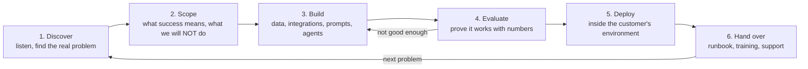
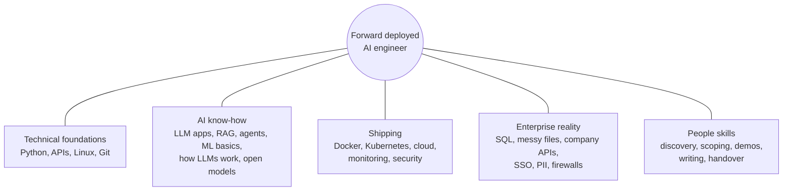
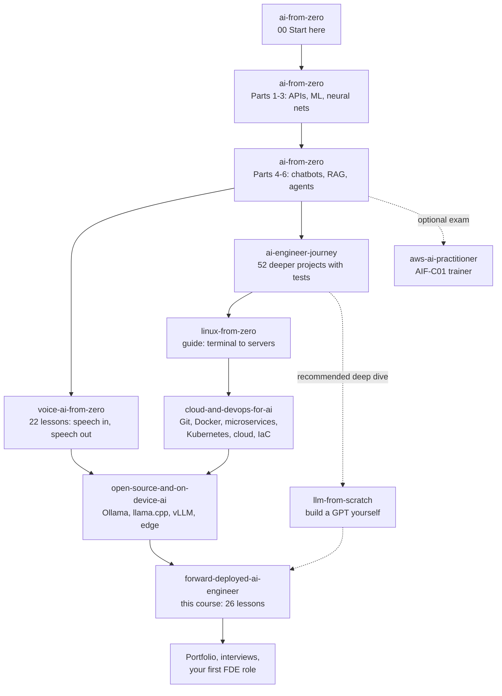

# 01 · What a forward deployed engineer does

**What you'll build:** a clear picture of the forward deployed AI engineer job, and a small program (`skills_check.py`) that rates your skills and prints a personal study plan pointing to the exact courses in this repo.
**Like you're 5:** a forward deployed engineer is like a doctor who makes home visits. Instead of waiting in the hospital (the software company), they go to the patient's house (the customer), listen carefully, find out what is really wrong, and fix it right there with the tools in their bag.
**Time:** ~1 h · **Builds on:** [AI from Zero](../../../ai-from-zero) (finished) · **Needs:** Python 3.10+ only (no API key)

## Why this matters
Companies that sell AI (Anthropic, OpenAI, Palantir, Scale AI, Databricks, many start-ups) hire **forward deployed engineers (FDEs)** to make AI actually work inside customer companies: a bank, a hospital, a logistics firm, a government office. A model that is clever in a demo is worth nothing until it is connected to the customer's data, passes their security review, runs in their environment and is trusted by their staff. That last mile is the FDE's job, and it is one of the fastest-growing engineering roles in AI.

## What you'll learn
- **Forward deployed engineer (FDE):** an engineer who sits with a customer, turns their problem into a working, deployed AI system, and stays until it delivers value.
- **The FDE loop:** discover → scope → build → evaluate → deploy → hand over, then repeat with the next problem.
- **How FDE differs** from a software engineer, an ML engineer and a solutions engineer.
- **The skills map:** the 12 skills the job needs, and which course in this repo teaches each one.
- **Your study plan:** a program you run that turns your self-ratings into an ordered list of next steps.

## Before you start
- You need Python and a terminal (set up in [AI from Zero 00 · Start here](../../../ai-from-zero/00-start-here)).
- Install the one package this lesson uses (for running the tests):
  ```bash
  pip install -r requirements.txt
  ```
  | Package | What it's for |
  |---------|---------------|
  | `pytest` | runs the small automatic tests in `test_skills_check.py` |
- No API key needed.

## The job, in plain words

### A one-sentence definition
A forward deployed AI engineer **embeds with a customer** and **turns their problem into a deployed AI system** that their people trust and use.

"Forward deployed" is a military-sounding phrase that just means "placed out where the action is" (at the customer), instead of "back at headquarters" (writing the product everyone shares).

### The FDE loop
Every engagement, small or big, goes round the same loop:



| Step | What you do | Where you learn it |
|------|-------------|--------------------|
| 1. Discover | interview users, watch them work, read their data | [02 · Discovery](../02-discovery-turning-a-customer-problem-into-a-spec) |
| 2. Scope | agree a success metric, non-goals, risks; write a design doc | [03 · Scoping](../03-scoping-success-metrics-and-a-design-doc) |
| 3. Build | SQL, messy files, company APIs, SSO, PII, prompts, RAG, agents | Parts 2–4 of this course |
| 4. Evaluate | golden sets, LLM judges, evals in CI | [12 · Evals](../../part-3-production-llm-engineering/12-evals-golden-sets-llm-judges-and-ci) |
| 5. Deploy | customer cloud (VPC), on-prem, air-gapped | [Part 5](../../part-5-deploying-at-the-customer) |
| 6. Hand over | runbooks, training, a clean exit | [22 · Runbooks and handover](../../part-5-deploying-at-the-customer/22-runbooks-handover-and-training-the-customer) |

### A day in the life
Here is a realistic Tuesday for an FDE working with a (fictional) logistics company, Northwind Logistics. You will meet Northwind again in lessons 02–09.

| Time | What happens | Skill used |
|------|--------------|------------|
| 08:30 | Read overnight alerts: the ticket-triage assistant flagged 3 tickets as "low confidence". Look at the traces. | monitoring, debugging |
| 09:00 | Stand-up with the customer's IT team. Their firewall team still has not opened the port to the CRM. | communication, networking |
| 09:30 | Shadow two support agents for an hour. Notice they copy order numbers from emails into a legacy system by hand. | discovery |
| 10:30 | Write SQL against their warehouse to measure how many tickets are "where is my parcel?" (it's 41%). | SQL, data |
| 12:00 | Lunch with the support team lead. Hear that agents don't trust AI that "makes things up". | trust, listening |
| 13:00 | Add citations to every answer and a "show me the source" button. Run the eval set: accuracy goes from 82% to 88%. | RAG, evals |
| 15:00 | Security review call: explain where data goes, PII redaction, SSO, audit logs. Answer in plain words. | security, communication |
| 16:00 | Demo to the operations director. One answer is wrong live; you say so, show how it's caught, and move on. | demos, honesty |
| 17:00 | Write a short update for your own company's product team: "customers need SSO groups → permission filters". | feedback loop, writing |

Notice: only about half the day is writing code. The rest is listening, measuring, explaining and unblocking.

### FDE vs other engineering jobs

| | Software engineer (SWE) | ML engineer | Solutions / sales engineer | **Forward deployed engineer** |
|---|---|---|---|---|
| Main question | "How do we build the product well?" | "How do we make the model better?" | "Will this product fit this buyer?" | "How do we make AI deliver value **for this customer, now**?" |
| Works mostly with | own team, product manager | data, training jobs, GPUs | prospects before they buy | customer's staff, data and systems, after (or while) they buy |
| Typical output | features shipped to all users | a trained, evaluated model | a demo, a proof of concept, answers to questions | a deployed system in the customer's environment + numbers proving it works |
| Writes production code? | yes, a lot | yes (training and serving) | some (demos, scripts) | yes, a lot, often in someone else's environment |
| Talks to customers? | rarely | rarely | constantly | constantly |
| Success measured by | product quality, delivery speed | model metrics | deals won | customer outcomes (hours saved, money, accuracy) |

A short way to remember it: a solutions engineer shows that it **could** work, an FDE makes it **actually** work, and stays until it does.

### The skills map
The job is wide. You don't need to be the world's best at any one of these; you need to be **good enough at all of them** and very good at learning quickly.



`skills_check.py` turns this map into 12 concrete skills you can rate.

### The whole roadmap of this repo
This course is the last stop of a path from "never written code" to FDE. Here is the full path; the arrows show the recommended order, and dotted arrows are optional.



| Course | What you get from it as a future FDE | Link |
|--------|--------------------------------------|------|
| AI from Zero | Python, APIs, ML, chatbots, RAG, agents: the basics of everything | [ai-from-zero](../../../ai-from-zero) |
| Voice AI from Zero | speech-to-text and text-to-speech, often requested by call centres and field teams | [voice-ai-from-zero](../../../voice-ai-from-zero) |
| AI Engineer Journey | deeper projects with tests, JWT login, evals, multi-agent systems, MCP | [ai-engineer-journey](../../../ai-engineer-journey) |
| Linux from Zero | servers, logs, SSH, systemd: what you face inside a customer's data centre | [linux-from-zero](../../../linux-from-zero) |
| Cloud and DevOps for AI | Git, Docker, Kubernetes, Terraform, monitoring: how you ship | [cloud-and-devops-for-ai](../../../cloud-and-devops-for-ai) |
| Open-source and On-device AI | local models for customers who can't send data out | [open-source-and-on-device-ai](../../../open-source-and-on-device-ai) |
| LLM from Scratch (recommended) | how models work inside, so you can explain and debug them | [llm-from-scratch](../../../llm-from-scratch) |
| AWS AI Practitioner (optional) | a certificate some enterprise customers like to see | [aws-ai-practitioner](../../../aws-ai-practitioner) |
| **Forward Deployed AI Engineer** | the customer-facing craft, enterprise integration, production LLM engineering, capstones | [this course](../..) |

## Run it
1. Open a terminal in the `forward-deployed-ai-engineer` folder (the course root), with your virtual environment on (see the [course README](../../README.md#set-up-once)).
2. Go into this lesson's folder:
   ```bash
   cd part-1-the-role/01-what-a-forward-deployed-engineer-does
   ```
3. Install the test tool:
   ```bash
   pip install -r requirements.txt
   ```
4. Run the skills check and answer the 12 questions honestly (type a number from 0 to 3, then press Enter):
   ```bash
   python skills_check.py
   ```
5. Or give all 12 answers at once, in the order of the questions:
   ```bash
   python skills_check.py --answers 3,2,1,0,0,1,0,0,1,0,0,0
   ```
6. Run the tests:
   ```bash
   pytest -q
   ```

**Command, piece by piece**

| Piece | Meaning |
|-------|---------|
| `cd` | "change directory": move into a folder |
| `part-1-the-role/01-...` | the path to the folder; `/` separates one folder from the next one inside it |
| `pip install` | download and install Python packages |
| `-r requirements.txt` | `-r` = "read the list of packages from this file" |
| `python skills_check.py` | run the Python program in the file `skills_check.py` |
| `--answers` | an **option** (also called a flag): extra information for the program; two dashes mark a long option name |
| `3,2,1,...` | the value given to `--answers`: 12 numbers separated by commas, no spaces |
| `pytest` | the test runner: finds files named `test_*.py` and runs every function named `test_*` in them |
| `-q` | "quiet": print a short summary instead of every test name |

### What you should see
Real output of step 5:
```
Your skills profile
-------------------
Python and APIs                          [############] 3/3
Machine learning basics                  [########....] 2/3
LLM apps                                 [####........] 1/3
How LLMs work inside                     [............] 0/3
Linux and the terminal                   [............] 0/3
Git, Docker and CI                       [####........] 1/3
Kubernetes and cloud                     [............] 0/3
Open and local models                    [............] 0/3
Customer skills                          [####........] 1/3
Enterprise data and integration          [............] 0/3
Production LLM engineering               [............] 0/3
Agents and deployment at the customer    [............] 0/3

Total: 8/36 (22% of the way)

Your study plan (in this order):
  1. LLM apps (now 1/3) -> ai-from-zero/part-4-chatbots to part-6-ai-agents-and-teams, ai-engineer-journey/level-7 and level-8
  2. How LLMs work inside (now 0/3) -> llm-from-scratch (deep), ai-engineer-journey/level-5 and level-6 (lighter)
  3. Linux and the terminal (now 0/3) -> linux-from-zero
  ...
  10. Agents and deployment at the customer (now 0/3) -> forward-deployed-ai-engineer/part-4-agents-at-work, part-5-deploying-at-the-customer
```
And the tests:
```
....                                                                     [100%]
4 passed in 0.03s
```
Look at the plan: it only lists skills you rated 0 or 1, and keeps them in learning order (foundations first). Each `->` tells you which folder of this repo to open.

## How it works
`skills_check.py` is one short file. In order:

1. **`SKILLS`** is a list of 12 **tuples** (a tuple is a fixed group of values in round brackets). Each one holds the skill's name, what it means in plain words, and where the repo teaches it. The list is in learning order on purpose.
2. **`LEVELS`** is a **dictionary** (a lookup table of key → value) that explains what 0, 1, 2 and 3 mean.
3. **`parse_answers(text)`** splits `"3,2,1,..."` at the commas, checks there are exactly 12 pieces and that each is `0`–`3`, and returns a list of whole numbers. If anything is wrong it **raises** a `ValueError` (stops with an explanation) instead of guessing.
4. **`ask_scores()`** asks one question per skill with `input(...)`, and repeats the question until you type a valid number.
5. **`study_plan(scores)`** uses `zip(SKILLS, scores)` to walk through skills and scores side by side (like zipping two halves of a zip together) and keeps only the ones below 2.
6. **`report(scores)`** builds the text: `"#" * (score * 4)` repeats `#` four times per point, so 3/3 is a full 12-character bar. Then it adds the plan.
7. **`main()`** uses **`argparse`** (Python's built-in helper for command-line options) to read `--answers`. With it, no questions are asked; without it, `ask_scores()` runs. `Ctrl + C` stops cleanly.

```
your answers ──► parse_answers / ask_scores ──► scores [3,2,1,...]
                                                   │
                         SKILLS (learning order) ──┤
                                                   ▼
                              study_plan (keep scores < 2) ──► report ──► printed plan
```

`test_skills_check.py` checks the four important behaviours: good input is accepted, bad input is refused with a clear message, the plan keeps learning order, and a perfect score sends you to the capstones.

## If something goes wrong
- **`Problem: Give exactly 12 numbers, one per skill (you gave 11).`** → count your numbers; there are 12 skills. No spaces are needed after commas.
- **`python: command not found`** (Mac/Linux) → use `python3` instead, or turn on your virtual environment first.
- **`No module named pytest`** → your virtual environment is off, or you skipped `pip install -r requirements.txt`.
- **`can't open file 'skills_check.py'`** → you are in the wrong folder. Run `pwd` (Mac/Linux) or `cd` (Windows) to see where you are, then `cd` into this lesson's folder.
- **Some links in the roadmap table show "404" on GitHub** → a course may still be being written. The order of the path stays the same.

## Try this
1. **Re-rate yourself after each course.** Save today's result: `python skills_check.py --answers ... > today.txt`. Repeat after each course and compare.
   <details><summary>Hint</summary>

   `>` sends the program's printed output into a file instead of the screen (it replaces the file if it exists). Open `today.txt` in your editor. Seeing the bars grow is a good motivator.
   </details>
2. **Add a 13th skill.** Add `("Voice AI", "speech-to-text and text-to-speech", "voice-ai-from-zero")` to `SKILLS`, after "Open and local models". What else must change?
   <details><summary>Solution</summary>

   Nothing else in `skills_check.py`: every function uses `len(SKILLS)`, so the count updates by itself. But the test `test_parse_answers_accepts_twelve_numbers` and the `"exactly 12"` check in the tests now fail, because they hard-code 12. Update them to 13 numbers. This is why tests are useful: they tell you what your change affected.
   </details>
3. **Weighted plan.** FDE roles weigh "Customer skills" and "Enterprise data" heavily. Make the plan show skills scored below **3** for those two, and below 2 for the rest.
   <details><summary>Solution</summary>

   ```python
   KEY_SKILLS = {"Customer skills", "Enterprise data and integration"}

   def study_plan(scores):
       plan = []
       for (name, _, where), score in zip(SKILLS, scores):
           target = 3 if name in KEY_SKILLS else 2      # aim higher on the skills that matter most for FDEs
           if score < target:
               plan.append((name, where, score))
       return plan
   ```
   Run the tests: the existing ones still pass, because they only use 3s and low scores.
   </details>

## Check yourself
1. In one sentence, what does a forward deployed engineer do that a solutions engineer usually doesn't?
2. Why is only about half of an FDE's day spent writing code?
3. In the FDE loop, where do you go if the evaluation shows the system isn't good enough, and why not straight to deploy?
4. Why does `study_plan` keep skills in a fixed order instead of sorting by lowest score?

<details><summary>Answers</summary>

1. They build and deploy the real system in the customer's environment and stay until it delivers measurable value; a solutions engineer mostly shows it could work before the sale.
2. Because the hard parts of making AI work at a customer are often not code: finding the real problem, getting access to data and systems, earning trust, explaining risks, and training people.
3. Back to Build. Deploying something you have measured as not good enough damages trust, which is the FDE's most valuable asset.
4. Because skills build on each other: you need Python and Linux before Docker, and Docker before Kubernetes. Fixing the lowest score first could send you to Kubernetes before you can use a terminal.
</details>

## Learn more (optional)
**Read the official docs**
- Python `argparse` tutorial: https://docs.python.org/3/howto/argparse.html
- pytest getting started: https://docs.pytest.org/en/stable/getting-started.html
- Mermaid flowcharts (the diagrams in this course): https://mermaid.js.org/syntax/flowchart.html
- Anthropic's guide to building effective agents (how Anthropic thinks about AI systems at customers): https://www.anthropic.com/engineering/building-effective-agents

**Watch**
- Andrej Karpathy, "Intro to Large Language Models" (1 hour, the best big-picture talk to be able to explain LLMs to a customer): https://www.youtube.com/watch?v=zjkBMFhNj_g
- Andrej Karpathy, "Deep Dive into LLMs like ChatGPT" (longer, how they are built and why they make mistakes): https://www.youtube.com/watch?v=7xTGNNLPyMI
- What forward deployed engineers do (search): https://www.youtube.com/results?search_query=forward+deployed+engineer
- Day in the life of a forward deployed engineer (search): https://www.youtube.com/results?search_query=forward+deployed+engineer+day+in+the+life

## Next
→ [02 · Discovery: turning a customer problem into a spec](../02-discovery-turning-a-customer-problem-into-a-spec)
