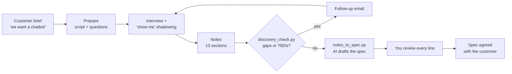
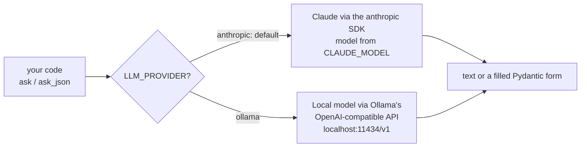

# 02 · Discovery: turning a customer problem into a spec

**What you'll build:** a complete discovery kit (interview script, question bank, notes template), a worked example with a fictional customer, Northwind Logistics, and two small tools: `discovery_check.py` finds gaps in your notes and drafts the follow-up email, and `notes_to_spec.py` uses an LLM to turn your notes into a structured problem spec.
**Like you're 5:** discovery is like a doctor's first visit. The patient says "I need a plaster!", but a good doctor first asks "where does it hurt, since when, show me", because the real problem might be a broken arm.
**Time:** ~2 h · **Builds on:** [01 · What a forward deployed engineer does](../01-what-a-forward-deployed-engineer-does) · **Needs:** nothing for the kit and checker; an Anthropic API key **or** a local Ollama model for `notes_to_spec.py` (tests run without either)

## Why this matters
Most failed AI projects did not fail because the model was weak. They failed because the team built the thing the customer **asked for** instead of the thing the customer **needed**, or never agreed what "success" meant. Discovery is the first and most important step of every FDE engagement: an hour of good questions saves weeks of building the wrong system.

## What you'll learn
- **Discovery:** structured conversations (and watching people work) to find the real problem, its size, and the limits around it.
- **Problem vs solution:** customers often name a solution ("a chatbot"); your job is to find the outcome they need ("faster, correct replies").
- **Evidence:** every pain point needs a number or a quote and where it came from, so nobody argues later about whether it was real.
- **A problem spec:** a short, structured summary of the problem that the whole team (and the customer) agrees on before building.
- **LLM as a drafting assistant:** using an AI to structure notes, while you stay responsible for every fact.

## Before you start
- Install (with your virtual environment on):
  ```bash
  pip install -r requirements.txt
  ```
  | Package | What it's for |
  |---------|---------------|
  | `anthropic` | Anthropic's official library for talking to Claude |
  | `openai` | the OpenAI library; we use it only to talk to a **local** Ollama model, which speaks the same format |
  | `pydantic` | describes the shape of the spec, like a form the AI must fill in |
  | `pytest` | runs the tests |
- **For `notes_to_spec.py` only, pick one:**
  - **Claude:** set `ANTHROPIC_API_KEY` (see [Get your API key](../../../ai-from-zero/part-4-chatbots/README.md#get-your-api-key-once-about-10-minutes)). Cheap option: `export CLAUDE_MODEL=claude-haiku-5-5`.
  - **Local and free:** install Ollama from https://ollama.com, run `ollama pull llama3.2`, then `export LLM_PROVIDER=ollama`.
- `discovery_check.py`, `--dry-run` and the tests need neither.

**What's in this folder**

| File | What it is |
|------|------------|
| `interview_script.md` | a 60-minute running order for a first discovery meeting |
| `question_bank.md` | 56 questions grouped by topic; ⭐ marks the must-asks |
| `notes_template.md` | the empty notes template (13 sections) |
| `northwind_brief.md` | the customer's first email: the worked example starts here |
| `northwind_interview_notes.md` | the filled-in notes after the on-site meeting |
| `discovery_check.py` | finds empty sections and TBDs, drafts the follow-up email |
| `notes_to_spec.py` | asks an LLM to turn notes into a structured problem spec |
| `llm.py` | the course's small helper that talks to Claude or a local Ollama model |
| `fake_llm.py`, `test_discovery.py` | a pretend AI and the tests that use it |

## Discovery in one picture



## The worked example: Northwind Logistics
1. **Read `northwind_brief.md`.** Dana, the VP, asks for "an AI chatbot for our customer support" and "a demo of what's possible".
2. **Read `northwind_interview_notes.md`.** After one hour of interviews and one hour watching Sam (an agent) work, the picture is different:

| What the brief said | What discovery found |
|---------------------|----------------------|
| "An AI chatbot" | Agents don't want a bot talking to customers. They want the boring lookup done for them. |
| "Our team is drowning" | 40% of 9,000 weekly emails are "where is my shipment?" (WISMO), each taking about 6 minutes of copy-pasting into a 15-year-old system. |
| "Customers say we are slow" | Median first response time is 19 hours; contracts promise 8. Two top-20 customers complained at renewal. |
| (not mentioned) | Tickets hold personal and bank data, GDPR applies, data must stay in the EU, and finance documents must be visible to finance only. |
| (not mentioned) | Every reply must be approved by an agent. Security review takes 3–4 weeks: start now. |

So the **problem statement** becomes:
> Northwind's 45 support agents spend about 6 minutes per "where is my shipment?" email looking up the legacy TMS by hand, so the median first reply takes 19 hours against an 8-hour contract promise.

And the **real need** is: an assistant inside the agent's workflow that looks up the shipment and drafts a correct reply for the agent to approve. Not a customer-facing chatbot.

**A good problem statement** has: who (45 agents), what they do (look up TMS by hand), how much it costs (6 minutes, 40% of tickets) and why it matters (19 h vs 8 h promised).

### The 6 habits that made this discovery good
1. **They asked about the last real ticket**, not "would you like AI?".
2. **They watched Sam work** and timed 9 tickets (4–9 minutes): that number beats any guess.
3. **They wrote where each number came from** ("HelpDesk report Priya showed us", "Priya's estimate; check with SQL").
4. **They met security on day one.** Marek can block the project; now he is part of it.
5. **They found the hidden data:** Sam's personal cheat sheet of good replies (perfect examples for prompts and evals).
6. **They wrote TBD for unknowns** instead of guessing, so nothing gets forgotten.

## Run it
1. Open a terminal in the course folder `forward-deployed-ai-engineer`, virtual environment on.
2. Go to this lesson:
   ```bash
   cd part-1-the-role/02-discovery-turning-a-customer-problem-into-a-spec
   ```
3. Install the packages:
   ```bash
   pip install -r requirements.txt
   ```
4. Check the empty template (everything should be missing):
   ```bash
   python discovery_check.py notes_template.md
   ```
5. Check the Northwind notes and draft the follow-up email:
   ```bash
   python discovery_check.py northwind_interview_notes.md --email
   ```
6. See exactly what would be sent to the AI, without sending it (no key, no cost):
   ```bash
   python notes_to_spec.py northwind_interview_notes.md --dry-run
   ```
7. Draft the spec with Claude and save it (needs `ANTHROPIC_API_KEY`):
   ```bash
   python notes_to_spec.py northwind_interview_notes.md --out spec.md
   ```
   Or with a local model instead (Mac/Linux; on Windows PowerShell first run `$env:LLM_PROVIDER="ollama"`, then the command without the first part):
   ```bash
   LLM_PROVIDER=ollama python notes_to_spec.py northwind_interview_notes.md --out spec.md
   ```
8. Run the tests (no key needed):
   ```bash
   pytest -q
   ```

**Commands, piece by piece**

| Piece | Meaning |
|-------|---------|
| `python discovery_check.py` | run the checker program |
| `northwind_interview_notes.md` | an **argument**: the file the program should read (no dashes, so it's not an option) |
| `.md` | **Markdown**: plain text with light formatting: `#` is a heading, `##` a smaller heading, `-` a bullet, `|` builds tables |
| `--email` | an on/off option: if present, also print the email draft |
| `--dry-run` | "rehearsal": show what would happen, but don't do it (here: don't call the AI) |
| `--out spec.md` | an option with a value: save the result into the file `spec.md` |
| `LLM_PROVIDER=ollama` (before a command) | set an **environment variable** for this one command only (Mac/Linux). Our `llm.py` reads it to choose the local model |
| `$env:LLM_PROVIDER="ollama"` | the same in Windows PowerShell, for the rest of this terminal session |
| `export LLM_PROVIDER=ollama` | Mac/Linux: set it for the rest of this terminal session |
| `ollama pull llama3.2` | download the open model `llama3.2` (about 2 GB) to your computer so Ollama can run it |

### What you should see
Step 5 (real output):
```
Notes: northwind_interview_notes.md
Sections answered: 13/13
  [x] Who we talked to
  [x] The problem in their words
  ...
  [x] Next steps
Open items (TBD): 2
  - Security, privacy and compliance: - AI may run in their Azure EU region or with a provider that has EU data residency. Which option will legal accept? TBD
  - Risks and unknowns: - Scanned PDFs need OCR. How many of the 60 are scanned? TBD
Not ready yet: fill the gaps above (use --email to ask).

------------------------------------------------------------
Subject: Thank you, and a few follow-up questions

Hi Northwind Logistics team,

Thank you for your time today. To make sure our design matches how you work, could you help with these:

1. AI may run in their Azure EU region or with a provider that has EU data residency. Which option will legal accept?
2. Scanned PDFs need OCR. How many of the 60 are scanned?

We will send the draft design doc once we have these. Thanks again!
```
Step 6 (real output, shortened):
```
Would send 5,760 characters to anthropic (claude-opus-5-5):

Here are discovery notes from a customer meeting. Turn them into a problem spec.

<notes>
# Discovery notes: Northwind Logistics · 2026-10-06 (on site, Rotterdam)
...
```
Step 7 (**example** output: the AI's wording will differ every time):
```
# Problem spec: Northwind Logistics

**Problem:** Northwind's 45 support agents spend about 6 minutes per "where is my shipment?" ticket searching the legacy TMS by hand, so the median first response is 19 hours against an 8-hour contract target.

**They asked for:** An AI chatbot for customer support
**They need:** An assistant that looks up shipments and drafts replies for agents to approve
**Users:** 45 support agents (pilot: 10 in Rotterdam, English only)

## Success metrics
| Metric | Baseline | Target |
|--------|----------|--------|
| Median first response time | 19 hours | under 8 hours |
| Agent handling time per WISMO ticket | 6 minutes | under 2 minutes |
| Drafts sent with small or no edits | 0% | at least 70% |
...
## Open questions
- Which AI hosting option will legal accept?
- How many of the 60 policy PDFs are scanned?
```
Tests:
```
......                                                                   [100%]
6 passed in 0.19s
```

## How it works

### `discovery_check.py` (no AI)
1. **`REQUIRED`** is a dictionary: each of the 13 template headings → the question to ask if that section is missing.
2. **`read_sections(markdown)`** walks through the file line by line. A line starting with `## ` starts a new section; other lines are added to the current section, except hint lines starting with `>`.
3. **`is_answered(lines)`** removes bullet marks (`- `, `1. `) with a **regular expression** (a mini-language for text patterns: `^([-*]|\d+\.)\s*` means "at the start: a dash or star, or digits followed by a dot, then any spaces") and checks whether anything real is left. A bare `TBD` or `-` doesn't count.
4. **`check(markdown)`** returns four lists: answered sections, missing sections, lines containing `TBD`, and headings that aren't in the template (usually a typo).
5. **`follow_up_email(...)`** turns every missing section into its question from `REQUIRED`, and every TBD line into a question, and wraps them in a polite email.

### `notes_to_spec.py` (with AI)
1. **`ProblemSpec`** is a **Pydantic model**: a form with named, typed fields (`problem_statement: str`, `pain_points: list[PainPoint]`...). `Field(description=...)` tells the AI what goes in each box.
2. **`SYSTEM`** is the **system prompt** (standing instructions): use only facts from the notes, never invent numbers, put unknowns in `open_questions`. This matters: an invented number in a customer document destroys trust.
3. **`build_prompt(notes)`** wraps the notes in `<notes>...</notes>` tags so the model clearly sees where the notes start and end.
4. **`llm.ask_json(prompt, ProblemSpec, system=SYSTEM)`** asks the model to fill in the form and returns a checked Python object. If the reply doesn't fit the form, Pydantic raises an error instead of giving you half a spec.
5. **`to_markdown(spec)`** turns the object into a readable Markdown document with tables.
6. **`--dry-run`** prints the prompt and stops. Use it to check what data would leave your computer before you send it: a habit customers' security teams love.

### `llm.py` (the course helper)

- **`get_client()`** creates the connection once. For Claude it checks `ANTHROPIC_API_KEY` first and stops with a clear message if it's missing.
- **`ask(prompt, system)`** returns text. For Claude it uses `client.beta.messages.create(...)` with the **server-side fallback** switched on for Opus/Sonnet 5.5 (if a request is ever declined, Anthropic retries it on another model inside the same call).
- **`ask_json(prompt, Shape)`** returns a filled form. Claude uses **structured outputs** (`messages.parse(output_format=Shape)`), which guarantees valid JSON. Ollama gets the JSON schema in `response_format`, and `_json_part()` cuts away any chatter or ```` ``` ```` fences small models sometimes add.
- **Tests** replace `llm._client` with `FakeClaude` or `FakeOllama` from `fake_llm.py`, which return fixed answers and record what was sent. No key, no cost, same result every run.

## If something goes wrong
- **`ANTHROPIC_API_KEY is not set in this terminal`** → set the key in this terminal (see the link in Before you start), or use `--dry-run`, or switch to Ollama with `export LLM_PROVIDER=ollama`.
- **`Connection refused` / `APIConnectionError` with Ollama** → Ollama isn't running. Start the Ollama app (or run `ollama serve` in another terminal) and check `ollama list` shows `llama3.2`.
- **`ValidationError` or `The model did not return JSON` with Ollama** → small local models sometimes break the format. Try again, or use a bigger model (`export OLLAMA_MODEL=llama3.1:8b` after `ollama pull llama3.1:8b`).
- **`Sections not in the template (check the spelling of the heading)`** → you renamed a `##` heading. Copy the heading text exactly from `notes_template.md`.
- **The AI's spec contains a number that isn't in your notes** → that's a **hallucination** (the model made something up). Delete it, and strengthen `SYSTEM`. This is why you always review the draft.

## Try this
1. **Run your own discovery.** Interview a friend about a boring task they do at work or school (15 minutes, use 10 ⭐ questions). Copy `notes_template.md` to `friend_notes.md`, fill it in, and run `python discovery_check.py friend_notes.md --email`.
   <details><summary>Hint</summary>

   On Mac/Linux: `cp notes_template.md friend_notes.md`. On Windows PowerShell: `Copy-Item notes_template.md friend_notes.md`. The hardest part is getting numbers: keep asking "about how many?" and "how long does one take?".
   </details>
2. **Make TBDs stand out by section.** Change the output so open items are grouped under their section name instead of repeated on every line.
   <details><summary>Solution</summary>

   Replace the loop that prints open items in `main()` with:
   ```python
   from itertools import groupby
   for name, items in groupby(open_items, key=lambda pair: pair[0]):   # pairs are already in file order
       print(f"  {name}:")
       for _, line in items:
           print(f"    {line}")
   ```
   </details>
3. **Catch invented numbers.** Write a function `numbers_not_in_notes(spec_markdown, notes)` that finds every number in the spec (use `re.findall(r"\d+(?:[.,]\d+)?", text)`) that never appears in the notes, and print them as warnings after the spec in `main()`.
   <details><summary>Solution</summary>

   ```python
   import re

   def numbers_not_in_notes(spec_markdown, notes):
       found = set(re.findall(r"\d+(?:[.,]\d+)?", spec_markdown))
       return sorted(n for n in found if n not in notes)
   ```
   In `main()`, after `print(markdown)`:
   ```python
   suspicious = numbers_not_in_notes(markdown, path.read_text(encoding="utf-8"))
   if suspicious:
       print("Check these numbers, they are not in the notes: " + ", ".join(suspicious), file=sys.stderr)
   ```
   It's a simple **guardrail**: a cheap, automatic check on the AI's output. Lesson 13 goes much further.
   </details>

## Check yourself
1. Dana asked for "an AI chatbot". Why didn't the team just build one?
2. Why is "Walk me through the last time this happened" a better question than "Would an AI assistant help you?"
3. Why does every pain point in the notes say where its number came from?
4. `notes_to_spec.py` uses a strict form (Pydantic) instead of asking for free text. Name two benefits.

<details><summary>Answers</summary>

1. Discovery showed the real need was faster, correct replies with a human in control; agents didn't want a bot talking to customers, and a customer-facing bot would have had to pass much harder security and quality bars.
2. It asks about real past behaviour, which gives facts and numbers. Questions about the future invite polite, hopeful answers that don't predict what people actually do.
3. So numbers can be checked and trusted later. An estimate ("Priya's estimate") is handled differently from a measured fact ("HelpDesk report"); you might verify it with SQL first (lesson 05).
4. Any two of: every section is always present; code can use the fields directly (render tables, count metrics); invalid replies are caught as errors; it's easier to compare drafts and test.
</details>

## Learn more (optional)
**Read the official docs**
- Structured outputs with Claude: https://platform.claude.com/docs/en/build-with-claude/structured-outputs
- Prompt engineering overview (Claude docs): https://platform.claude.com/docs/en/build-with-claude/prompt-engineering/overview
- Ollama's OpenAI compatibility: https://github.com/ollama/ollama/blob/main/docs/api/openai-compatibility.mdx
- Pydantic models: https://docs.pydantic.dev/latest/concepts/models/

**Read**
- "The Mom Test" by Rob Fitzpatrick: a short book on asking questions that even your mum can't lie to you about. The best single resource on discovery interviews.

**Watch**
- The Mom Test, customer interview questions (search): https://www.youtube.com/results?search_query=the+mom+test+customer+interviews
- Requirements gathering for software projects (search): https://www.youtube.com/results?search_query=requirements+gathering+interview+techniques

## Next
→ [03 · Scoping: success metrics and a design doc](../03-scoping-success-metrics-and-a-design-doc)
