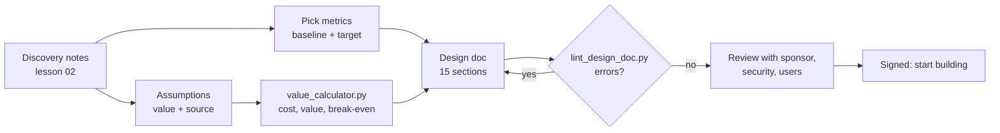

# 03 · Scoping: success metrics and a design doc

**What you'll build:** a design-doc template and a fully filled example for Northwind Logistics, a value calculator (`value_calculator.py`) that turns assumptions into monthly cost, value and break-even, and a design-doc linter (`lint_design_doc.py`) that catches the mistakes reviewers always find.
**Like you're 5:** before building a sandcastle with friends, you agree how big it will be, where the moat goes, what you will *not* build today (no tower!), and how you'll know it's finished. Then nobody argues halfway through.
**Time:** ~2 h · **Builds on:** [02 · Discovery](../02-discovery-turning-a-customer-problem-into-a-spec) · **Needs:** nothing extra (no API key)

## Why this matters
Scoping turns "let's do something with AI" into a promise everyone can check: what we build, what we don't, how success is measured, what it costs, and what could go wrong. The **design doc** is the FDE's most important document: the customer's sponsor, security team and your own company all sign it before building starts. Projects without one drift, grow, and end in "but we thought it would also...".

## What you'll learn
- **Success metrics:** one **primary** metric that decides success, plus **supporting** metrics and **guardrail** metrics (things that must not get worse), each with a baseline and a target.
- **Non-goals:** writing down what you will not do, which protects the project from growing without limit (**scope creep**).
- **Value and cost estimates:** tokens × price for the AI bill, time saved × hourly cost for the value, and **break-even** (how many months until the build has paid for itself).
- **Risks:** each with likelihood, impact, a mitigation and a named owner.
- **A design doc:** the 15-section document that ties it all together, checked automatically by a linter.

## Before you start
- Install (virtual environment on):
  ```bash
  pip install -r requirements.txt
  ```
  | Package | What it's for |
  |---------|---------------|
  | `pytest` | runs the tests in `test_scoping.py` |
- No API key needed. Everything else uses Python's built-in modules (`json`, `re`, `argparse`).

**What's in this folder**

| File | What it is |
|------|------------|
| `design_doc_template.md` | the empty template: 15 sections with hints |
| `northwind_design_doc.md` | the filled example: Northwind's Shipment Reply Assistant pilot |
| `northwind_assumptions.json` | the numbers behind the business case, each with its source |
| `value_calculator.py` | cost, value and break-even from the assumptions |
| `lint_design_doc.py` | checks a design doc for missing sections, numberless metrics, ownerless risks, vague words |
| `test_scoping.py` | tests for both tools |

## From discovery to a signed design doc



### Good metrics, step by step
1. **Start from what the customer said** in discovery: Dana wants faster replies, Priya wants less handling time, Sam wants drafts he can use.
2. **Make each one measurable:** "faster" becomes "median first response time"; "drafts he can use" becomes "share of drafts sent with small or no edits".
3. **Write today's number (the baseline).** Without it you can never prove improvement. If nobody knows, write "not measured" and measure it in week 1.
4. **Write the target** with a number and a date.
5. **Pick one primary metric.** It is the one that decides go/no-go. Northwind: handling time per WISMO ticket, 6 min → under 2 min.
6. **Add guardrails**: things that must not get worse while you chase the primary metric. Northwind: shipment status correct ≥ 98%, unsupported claims < 1%. (A system that answers fast but wrong would hit the primary metric and still be a disaster.)

| Vague (bad) | Measurable (good) |
|-------------|-------------------|
| "Improve customer support" | "Median first response time for WISMO tickets from 19 h to under 8 h by 2027-01-20" |
| "Accurate AI" | "Shipment status correct in at least 98% of 50 weekly sampled drafts" |
| "Agents like it" | "At least 70% of drafts sent with small or no edits" |

### Non-goals: the most underrated section
Northwind's non-goals say: no customer-facing chatbot, nothing sent without approval, no claims or invoices, English only, no TMS changes. Each one is a future argument you avoid. When someone asks in week 6 "can it also do refunds?", you point to the non-goals and say "great idea for phase 2".

## Run it
1. Open a terminal in the course folder `forward-deployed-ai-engineer`, virtual environment on.
2. Go to this lesson:
   ```bash
   cd part-1-the-role/03-scoping-success-metrics-and-a-design-doc
   ```
3. Install:
   ```bash
   pip install -r requirements.txt
   ```
4. Calculate Northwind's business case:
   ```bash
   python value_calculator.py northwind_assumptions.json
   ```
5. Compare a cheaper model:
   ```bash
   python value_calculator.py northwind_assumptions.json --model claude-haiku-5-5
   ```
6. Ask "what if only half the drafts are accepted?":
   ```bash
   python value_calculator.py northwind_assumptions.json --set acceptance_rate=0.35
   ```
7. Lint the filled design doc, then the empty template:
   ```bash
   python lint_design_doc.py northwind_design_doc.md
   python lint_design_doc.py design_doc_template.md
   ```
8. Run the tests:
   ```bash
   pytest -q
   ```

**Commands, piece by piece**

| Piece | Meaning |
|-------|---------|
| `northwind_assumptions.json` | the input file. **JSON** is a text format for data: `{ }` holds named values (`"name": value`), `[ ]` holds lists, text goes in double quotes, numbers don't |
| `--model claude-haiku-5-5` | option with a value: use this model's prices instead of the one in the file |
| `--set acceptance_rate=0.35` | change one assumption for this run only. You can repeat `--set` several times |
| `=` inside `acceptance_rate=0.35` | separates the assumption's name from its new value (no spaces around it) |
| `.md` | a Markdown file (see lesson 02): `##` headings and `|` tables are what the linter reads |

### What you should see
Step 4 (real output):
```
Model: claude-opus-5-5
AI-eligible tickets per month:        15,600
LLM cost per ticket:                  0.0320 USD
LLM cost per month:                      499 USD
Infrastructure per month:              1,500 USD
Agent hours saved per month:             728 h
Value of time saved per month:        29,120 USD
Net value per month:                  27,121 USD
Break-even on the build cost:            4.4 months
```
Step 5 (first lines): the AI bill drops from 499 to 12 USD a month.
```
Model: claude-haiku-5-5
AI-eligible tickets per month:        15,600
LLM cost per ticket:                  0.0008 USD
LLM cost per month:                       12 USD
```
Step 6 (last lines): half the acceptance → half the hours saved, break-even more than doubles.
```
Agent hours saved per month:             364 h
Value of time saved per month:        14,560 USD
Net value per month:                  12,561 USD
Break-even on the build cost:            9.6 months
```
Step 7:
```
northwind_design_doc.md: 0 error(s), 0 warning(s)
```
```
ERROR   Empty section: '## Summary'
ERROR   Empty section: '## Background and problem'
...
ERROR   Success metrics: '<name>' target has no number
ERROR   Risks: '<what could go wrong>' has no mitigation
WARNING Non-goals: only 0 listed; aim for at least 3

design_doc_template.md: 17 error(s), 1 warning(s)
```
Tests: `6 passed`.

**The big lesson in these numbers:** the AI bill (499 USD) is tiny next to the value of agents' time (29,120 USD). What decides success is the **acceptance rate**, which depends on quality and trust, not on the model price. That's why the design doc spends so much space on evaluation and guardrails.

## How it works

### `value_calculator.py`
1. **`PRICES`** maps each model to its price in US dollars per million input and output tokens (October 2026). A local open model has no per-token price: you pay for hardware through `infra_cost_per_month` instead.
2. **`load(path)`** reads the JSON file and keeps only each assumption's `"value"`. The `"source"` fields are for humans: every number in a business case should say where it came from.
3. **`apply_overrides(values, overrides)`** handles `--set name=number`. `text.partition("=")` splits at the first `=`; `type(values[name])(number)` turns the text into the same type as the original (whole number or decimal).
4. **`calculate(v)`** does the maths:
   - tickets per month = emails per week × 52/12 × share in scope = 9,000 × 4.33 × 0.40 ≈ **15,600**
   - cost per ticket = (6,000 input tokens × $4 + 400 output tokens × $20) / 1,000,000 = **$0.032**
   - hours saved = tickets × acceptance rate × (6 − 2) minutes / 60 = 15,600 × 0.70 × 4 / 60 ≈ **728 h**
   - value = hours × $40; net = value − AI bill − infrastructure; break-even = build cost / net.
5. **`report()`** formats the numbers. `{x:>12,.0f}` means: right-align (`>`) in 12 characters, with thousands commas (`,`), 0 decimals (`.0f`).

```
assumptions.json ──► load ──► --set overrides ──► calculate ──► report
   (value + source)                                  │
                                    PRICES[model] ───┘
```

### `lint_design_doc.py`
1. **`sections(markdown)`** splits the doc at `## ` headings, like lesson 02's checker.
2. **`table_rows(lines)`** turns Markdown table lines (`| a | b |`) into lists of cells, skipping the header row and the `|---|` separator line.
3. **`lint(markdown)`** collects **errors** (must fix) and **warnings** (should fix):
   - every one of the 15 sections exists and isn't empty;
   - exactly one metric is `primary`; every metric has a baseline, a target containing a digit, and a "how we measure";
   - at least 3 non-goals (warning);
   - every risk has a mitigation and an owner;
   - vague words (`better`, `improve`, `seamless`...) in Goals or Success metrics (warning). `\b` in the pattern means "word boundary", so `better` doesn't match `betterment`.
4. **`main()`** prints the problems and exits with code **1** if there are errors, **0** otherwise. An **exit code** is a number every program returns when it ends; 0 means success. CI systems (GitHub Actions in [cloud-and-devops-for-ai](../../../cloud-and-devops-for-ai)) fail a check when a command returns non-zero, so you could lint every design doc automatically.

### The design doc, section by section
Open `northwind_design_doc.md` next to `design_doc_template.md` and compare. The sections that matter most for an FDE:

| Section | Why it exists | Northwind example |
|---------|---------------|-------------------|
| Summary | the sponsor may read only this | problem, solution, metric, decision date in 4 sentences |
| Non-goals | prevents scope creep | no chatbot, nothing sent without approval |
| Success metrics | defines "done" and "worked" | handling time 6 → under 2 min (primary) |
| Proposed solution | shows it's buildable, with a diagram | webhook → assistant → TMS, policies, CRM → LLM → internal note |
| Security, privacy | the section security teams read first | EU region, SSO, redaction, audit log, DPA |
| Evaluation plan | how quality is proven before users see it | golden set → offline gate → shadow mode → pilot |
| Rollout plan | dates and go/no-go gates | week 7 gate: 98% status accuracy |
| Risks | shows you thought ahead, names owners | firewall delay → fallback to CSV export (owner: Tomasz) |
| Alternatives | shows you didn't just pick the shiny option | templates only, replace the TMS, do nothing |

## If something goes wrong
- **`Problem: Unknown assumption 'accept'. Known: ...`** → the name after `--set` must match a key in the JSON file exactly (copy it from the list in the message).
- **`Problem: No price for model 'gpt-x'. Add it to PRICES.`** → add a line to `PRICES` with that model's input and output price per million tokens.
- **`json.decoder.JSONDecodeError`** → the JSON file has a typo. Common causes: a comma after the last item, single quotes instead of double quotes, or a comment (JSON doesn't allow comments).
- **The linter says `Missing section` but the section is there** → the heading text must match exactly, including capitals and commas (`## Security, privacy and compliance`), and must start with `## ` (two hashes and a space).
- **A table row is reported wrong** → every row needs the same number of `|` cells as the header. An empty cell is `| |`.

## Try this
1. **Your own business case.** Copy `northwind_assumptions.json` to `my_assumptions.json` and change it for a different problem (for example a school office answering 500 parent emails a week). Run the calculator.
   <details><summary>Hint</summary>

   Change `emails_per_week`, `share_in_scope`, `minutes_today`, `agent_cost_per_hour` and `build_cost`, and update every `source`. If break-even is "never", try `--model claude-haiku-5-5`: for small volumes the fixed `infra_cost_per_month` usually matters most.
   </details>
2. **Sensitivity table.** Print break-even for acceptance rates 0.3, 0.5, 0.7 and 0.9 in one run.
   <details><summary>Solution</summary>

   Add to the end of `main()` (inside the `try`, after the report):
   ```python
   print("\nAcceptance rate -> break-even months")
   for rate in (0.3, 0.5, 0.7, 0.9):
       r = calculate(dict(values, acceptance_rate=rate))      # dict(..., key=value) copies and changes one value
       months = "never" if r["break_even_months"] is None else f"{r['break_even_months']:.1f}"
       print(f"  {rate:.0%}: {months}")
   ```
   For Northwind: 30% → 11.4 months, 50% → 6.4, 70% → 4.4, 90% → 3.4. This kind of table is exactly what a sponsor asks for.
   </details>
3. **A new lint rule.** Make the linter report an error if the `## Rollout plan` section doesn't mention a gate or a decision (the words `gate` or `decision`).
   <details><summary>Solution</summary>

   In `lint()`, before `return`:
   ```python
   rollout = " ".join(found.get("Rollout plan", [])).lower()
   if "Rollout plan" in found and found["Rollout plan"] and not re.search(r"\b(gate|decision)", rollout):
       errors.append("Rollout plan: add at least one go/no-go gate or decision point")
   ```
   Then add a test that removes the gates from the Northwind doc and expects this error.
   </details>

## Check yourself
1. Why does Northwind's design doc have guardrail metrics, and what could happen without them?
2. The AI bill is about 500 USD a month and the value about 29,000 USD. Which assumption would you work hardest to verify, and how?
3. Why write non-goals that seem obvious, like "no reply is sent without an agent approving it"?
4. Why should the linter exit with code 1 when there are errors?

<details><summary>Answers</summary>

1. To make sure chasing the primary metric doesn't make something else worse. Without them, a system that drafts fast but gets shipment statuses wrong would "succeed" on handling time while sending wrong information to customers.
2. The acceptance rate (and the minutes saved), because value is directly proportional to it and it depends on quality and trust. Verify it in shadow mode and the pilot by logging how much agents edit each draft.
3. Because what's obvious to you isn't obvious to everyone. Written down and signed, it prevents arguments later and reassures security and staff.
4. So scripts and CI pipelines can tell that the check failed and stop, without a human reading the output.
</details>

## Learn more (optional)
**Read the official docs**
- Claude pricing (check current prices): https://platform.claude.com/docs/en/about-claude/pricing
- Token counting (measure tokens per ticket instead of guessing): https://platform.claude.com/docs/en/build-with-claude/token-counting
- Python `json` module: https://docs.python.org/3/library/json.html
- GitHub's guide to Markdown tables: https://docs.github.com/en/get-started/writing-on-github/working-with-advanced-formatting/organizing-information-with-tables

**Watch**
- How to write a software design doc (search): https://www.youtube.com/results?search_query=how+to+write+a+software+design+document
- ByteByteGo, system design basics (search): https://www.youtube.com/results?search_query=bytebytego+system+design
- Defining success metrics / OKRs for projects (search): https://www.youtube.com/results?search_query=how+to+define+success+metrics+for+a+project

## Next
→ [04 · Demos that win trust](../04-demos-that-win-trust)
