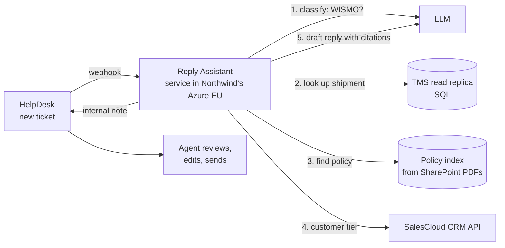

# Design doc: Northwind Shipment Reply Assistant (pilot)

**Customer:** Northwind Logistics (fictional) · **Author:** FDE team · **Status:** in review · **Last updated:** 2026-10-13

## Summary
Northwind's support agents spend about 6 minutes on each "where is my shipment?" (WISMO) email, looking up a legacy system by hand, so the median first reply takes 19 hours against an 8-hour contract promise. We will build an assistant inside HelpDesk that looks up the shipment, checks the delivery policy and drafts a reply that the agent approves or edits. A 12-week pilot with 10 agents will show whether handling time drops below 2 minutes and first response time below 8 hours. Decision on wider rollout: 2027-01-27.

## Background and problem
- 45 agents handle about 9,000 emails a week; about 40% are WISMO (Priya's estimate, being confirmed with SQL).
- A WISMO ticket takes about 6 minutes (we timed 9 tickets: 4 to 9 minutes), mostly copying tracking numbers into the TMS.
- Median first response time (FRT) is 19 hours (HelpDesk report); contracts promise 8 hours. Two top-20 customers raised it at renewal.
- New agents need 6 weeks to learn the TMS; staff turnover is 30% a year.

## Goals
- Cut agent handling time for WISMO tickets from 6 minutes to under 2 minutes for pilot agents.
- Bring median FRT for pilot agents' WISMO tickets from 19 hours to under 8 hours.
- Reach a draft acceptance rate (sent with small or no edits) of at least 70%.
- Pass Northwind's security review with no high-severity findings.

## Non-goals
- No customer-facing chatbot. Customers never talk to the AI directly.
- No reply is sent without an agent approving it.
- No damage claims or invoice disputes in the pilot (they go to other teams).
- No Dutch or Polish emails in the pilot (English only).
- No changes to the TMS itself; we only read from it.

## Success metrics
| Metric | Type | Baseline | Target | How we measure |
|--------|------|----------|--------|----------------|
| Agent handling time per WISMO ticket | primary | 6 min | under 2 min | HelpDesk time-on-ticket for pilot agents, weekly |
| Median first response time (WISMO, pilot agents) | supporting | 19 h | under 8 h | HelpDesk report, weekly |
| Draft acceptance rate (no or small edits) | supporting | 0% | 70% or more | edit distance between draft and sent reply, logged by the assistant |
| Shipment status correct in draft | guardrail | not measured | 98% or more | weekly review of 50 random drafts against the TMS |
| Drafts with an unsupported claim (hallucination) | guardrail | not measured | under 1% | same weekly review: every promise must cite a policy or TMS record |

## Users and use cases
- **Pilot agents (10, Rotterdam):** open a WISMO ticket in HelpDesk → the assistant's draft is already in an internal note, with the shipment status, last scan and cited policy → agent checks it, edits if needed, clicks "Use draft" → reply is sent from HelpDesk as usual.
- **Team lead (Priya):** sees a weekly dashboard of acceptance rate, handling time and flagged drafts.
- **Low confidence:** if the tracking number isn't found or the status is unclear, the assistant writes "No draft: shipment not found" instead of guessing.

## Proposed solution

Components:
- **Reply Assistant (Python, FastAPI):** receives the webhook, runs steps 1 to 5, writes the draft back as an internal note.
- **LLM:** Claude through an EU data-residency option, or an open model in Northwind's Azure tenant if legal prefers (decision in week 2).
- **Policy index:** the 60 policy PDFs, cleaned and split into chunks with metadata (lesson 06), refreshed nightly.
- **Redaction:** bank details are removed before any text reaches the LLM (lesson 09).

## Data and integrations
| Source | How we connect | Access from | Freshness |
|--------|----------------|-------------|-----------|
| HelpDesk tickets | REST API + "ticket created" webhook | Priya (admin) | real time |
| TMS shipments and scans | read-only SQL replica | Marek approves firewall rule; Tomasz sets up | nightly (fallback: CSV export) |
| SharePoint policy PDFs | Microsoft Graph API, app registration | IT | nightly |
| SalesCloud CRM | REST API, OAuth2 client credentials | sales ops | real time |

## Security, privacy and compliance
- All processing in Northwind's Azure EU region; no data stored outside the EU.
- Agents sign in with Microsoft Entra ID (SSO); finance documents are filtered out for non-finance users (lesson 08).
- Bank details and other sensitive fields are redacted before LLM calls; logs contain ticket IDs, never email bodies (lesson 09).
- Every draft, its sources and the agent's final reply are logged for audit for 90 days.
- A Data Processing Agreement (DPA) is signed before any real ticket is processed.

## Evaluation plan
- **Golden set:** 300 anonymised past WISMO tickets from Priya's export, each labelled by two agents with the correct status and an acceptable reply.
- **Offline gate (week 7):** status correct in at least 98% of golden tickets, unsupported claims under 1%, judged by agents plus an LLM judge checked against agents (lesson 12).
- **Shadow mode (weeks 8 to 9):** drafts are generated for live tickets but not shown; we compare them with what agents actually sent.
- **Pilot (weeks 10 to 12):** the success metrics above, reviewed weekly with Priya.

## Rollout plan
| Week | Milestone | Gate |
|------|-----------|------|
| 1–2 | access, DPA, security review started, hosting decision | hosting option approved by legal |
| 3–6 | build: integrations, policy index, drafting, redaction | demo to Dana and Priya (lesson 04) |
| 7 | offline evaluation on the golden set | 98% status accuracy, under 1% unsupported claims |
| 8–9 | shadow mode on live tickets | no high-severity issues found |
| 10–12 | pilot with 10 agents | weekly metric review |
| 2027-01-27 | decision meeting | primary metric met → plan rollout to all 45 agents |

## Risks
| Risk | Likelihood | Impact | Mitigation | Owner |
|------|------------|--------|------------|-------|
| Firewall rule for TMS replica is late | high | high | start the request in week 1; fallback to nightly CSV export | Tomasz |
| Agents don't trust the drafts | medium | high | involve Sam and 2 agents in testing from week 4; show sources on every draft | Priya |
| Legal rejects every hosted LLM | medium | medium | open model in Northwind's Azure tenant (Part 5) prepared as plan B | FDE team |
| Wrong shipment status in a draft | low | high | status copied from TMS by code, never generated by the LLM; weekly review | FDE team |
| Scanned PDFs can't be read | medium | low | OCR the scanned ones; list them in week 1 | FDE team |

## Open questions
- Which LLM hosting option does legal accept? Owner: Marek, by 2026-10-24.
- How many of the 60 policy PDFs are scanned? Owner: Tomasz, by 2026-10-20.
- Can HelpDesk show a "Use draft" button, or only an internal note? Owner: Priya, by 2026-10-20.

## Alternatives considered
- **Customer-facing chatbot (what was first asked for):** higher risk, harder security review, and agents opposed it. Rejected for the pilot.
- **Reply templates only (no AI):** cheap, but agents still do the TMS lookup, which is most of the 6 minutes.
- **Replace the TMS:** solves the root cause but takes years. Out of scope.
- **Do nothing:** FRT stays at 19 hours; renewal risk with top customers.

## Sign-off
- Dana Okafor (VP Customer Operations): budget and go/no-go.
- Marek Nowak (IT security): security and data flows.
- Priya Raman (support team lead): workflow and pilot group.
