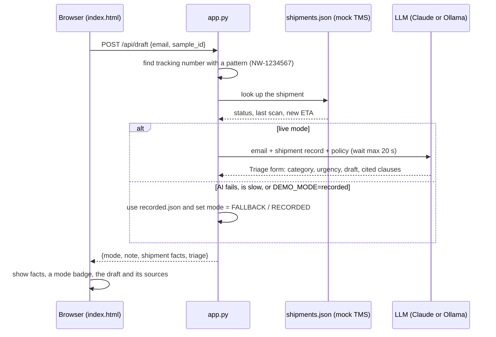

# 04 · Demos that win trust

**What you'll build:** a small web app, the **Northwind Reply Assistant**: paste a customer email, and it looks up the shipment in a mock "TMS", then drafts a reply with cited policy clauses. It is built for live demos: facts come from code (not AI), a badge always says whether the answer is LIVE, RECORDED or FALLBACK, and a `preflight.py` checklist tests everything before you go on stage. You also get a 20-minute demo script.
**Like you're 5:** a good demo is like a magic show where you *show* the audience how the trick works. They trust you more, and if the rabbit doesn't come out of the hat, you have a second rabbit in your pocket and you tell them about it.
**Time:** ~2 h · **Builds on:** [03 · Scoping](../03-scoping-success-metrics-and-a-design-doc) and [AI from Zero 19 · Chatbot with a web page](../../../ai-from-zero/part-4-chatbots/19-chatbot-with-a-web-page) · **Needs:** nothing to run in recorded mode and for the tests; an Anthropic API key **or** a local Ollama model for live answers

## Why this matters
For an FDE, the demo is often the moment the customer decides whether to trust you. A demo that hides how it works, or breaks and is covered up, loses that trust for good. A demo that uses the customer's own problem, shows where every fact comes from, and handles failure calmly wins it, even when something goes wrong. The same app becomes the first version of the real system.

## What you'll learn
- **Demo script:** a planned 20 minutes that starts with the customer's problem and numbers, not with technology.
- **Facts from code, words from AI:** the tracking number and shipment status are looked up by code; the AI only writes around them, so it can't make them up.
- **Graceful fallback:** if the AI is slow or down, the app shows a **recorded** answer and says so on screen, instead of a spinner or a crash.
- **Timeouts:** stop waiting after N seconds (`asyncio.wait_for`).
- **Preflight check:** an automatic checklist you run before every demo.

## Before you start
- Install (virtual environment on):
  ```bash
  pip install -r requirements.txt
  ```
  | Package | What it's for |
  |---------|---------------|
  | `fastapi` | the web framework for the app's API (from [AI from Zero Part 1](../../../ai-from-zero/part-1-apis)) |
  | `uvicorn[standard]` | the web server that runs the FastAPI app |
  | `httpx` | makes HTTP requests; used by `preflight.py` and by FastAPI's test client |
  | `anthropic` | talks to Claude |
  | `openai` | talks to a local Ollama model (same API format) |
  | `pydantic` | the `Triage` form the AI fills in |
  | `pytest` | runs the tests |
- **Live AI (optional):** set `ANTHROPIC_API_KEY` (see [Get your API key](../../../ai-from-zero/part-4-chatbots/README.md#get-your-api-key-once-about-10-minutes)), or install Ollama, run `ollama pull llama3.2` and `export LLM_PROVIDER=ollama`. Without either, the app still runs and falls back to recorded answers.

**What's in this folder**

| File | What it is |
|------|------------|
| `app.py` | the FastAPI app: page, samples, health check, `/api/draft` |
| `static/index.html` | the one-page web interface |
| `samples.json` | 4 realistic Northwind emails (the demo's script) |
| `shipments.json` | a tiny stand-in for Northwind's TMS (shipment records) |
| `policy.md` | 4 clauses of Northwind's delivery terms, with ids like `DT-3.2` |
| `recorded.json` | good answers saved earlier, used in recorded and fallback modes |
| `preflight.py` | the before-the-demo checklist |
| `demo_script.md` | the 20-minute demo plan, including what to do when things break |
| `llm.py`, `fake_llm.py` | the course's LLM helper and the fake used in tests |
| `test_app.py` | 10 tests, including "AI down", "AI slow" and "no API key" |

## How a request flows



## Run it
1. Open a terminal in the course folder `forward-deployed-ai-engineer`, virtual environment on.
2. Go to this lesson:
   ```bash
   cd part-1-the-role/04-demos-that-win-trust
   ```
3. Install:
   ```bash
   pip install -r requirements.txt
   ```
4. Run the tests first (no key needed):
   ```bash
   pytest -q
   ```
5. Start the app in **recorded** mode (works anywhere, no AI). Mac/Linux:
   ```bash
   DEMO_MODE=recorded uvicorn app:app --reload
   ```
   Windows PowerShell: `$env:DEMO_MODE="recorded"; uvicorn app:app --reload`
6. Open http://127.0.0.1:8000 in your browser. Click **Delayed shipment**, then **Draft reply**. You see the TMS facts, a yellow **RECORDED** badge and the draft.
7. Leave the app running. Open a **second** terminal in the same folder (virtual environment on) and run the preflight check:
   ```bash
   python preflight.py
   ```
8. Stop the app with `Ctrl + C` in the first terminal. Start it in **live** mode (needs your key or Ollama):
   ```bash
   uvicorn app:app --reload
   ```
   In PowerShell, first clear the setting from step 5: `Remove-Item Env:DEMO_MODE`.
9. Try the four samples, then type your own email (for example "Hi, where is NW-4821907?") and run `python preflight.py` again.
10. Pull the plug: turn off Wi-Fi (or unset your key and restart) and click **Draft reply**. The app shows **FALLBACK** and explains why, but the TMS facts still appear.

**Commands, piece by piece**

| Piece | Meaning |
|-------|---------|
| `DEMO_MODE=recorded` | set the environment variable `DEMO_MODE` for this one command (Mac/Linux); `app.py` reads it with `os.getenv` |
| `uvicorn` | the web server program |
| `app:app` | "in the file `app.py`, use the object named `app`" (the FastAPI app). Left of `:` is the file without `.py`, right is the variable |
| `--reload` | restart the server automatically when you save a code file (for development, not for production) |
| `$env:DEMO_MODE="recorded"; ...` | PowerShell: set the variable for this terminal, then (`;`) run the next command |
| `Remove-Item Env:DEMO_MODE` | PowerShell: delete that variable again |
| `http://127.0.0.1:8000` | `127.0.0.1` is "this computer" (also called `localhost`); `8000` is the **port**, the door number uvicorn listens on |
| `python preflight.py` | run the checklist against the app at `http://127.0.0.1:8000` (change with `--url`) |
| `Ctrl + C` | stop the program running in this terminal |

### What you should see
Tests (step 4):
```
..........                                                               [100%]
10 passed in 1.64s
```
Preflight with the app in recorded mode (step 7, real output):
```
App is up: mode=recorded provider=anthropic model=claude-opus-5-5
  delayed    mode=recorded      0.0 s  tracking=NW-4821907
  delivered  mode=recorded      0.0 s  tracking=NW-3310452
  damaged    mode=recorded      0.0 s  tracking=NW-7750031
  no-number  mode=recorded      0.0 s  tracking=None

Fix before the demo:
  - DEMO_MODE is not 'live': the audience will only see recorded answers
```
Preflight in live mode with a working model (**example**: times depend on the model and network):
```
App is up: mode=live provider=anthropic model=claude-opus-5-5
  delayed    mode=live          1.1 s  tracking=NW-4821907
  delivered  mode=live          1.1 s  tracking=NW-3310452
  damaged    mode=live          1.1 s  tracking=NW-7750031
  no-number  mode=live          1.1 s  tracking=None

All green. Good luck!
```
Live mode with **no** API key and a custom email (real output of `/api/draft`, shortened):
```
{"mode":"unavailable","note":"Live AI unavailable (RuntimeError: ANTHROPIC_API_KEY is not set in this terminal). The shipment lookup above still works.","tracking":"NW-3310452","shipment":{"customer":"Kowalska Trading",...,"status":"delivered",...},"triage":null}
```
In the terminal running uvicorn, every request prints one line, for example:
```
[draft] mode=fallback sample=delayed tracking=NW-4821907 seconds=0.0
```
A live draft for **Delayed shipment** (**example**: the AI's wording varies):
```
Dear Joost,

I'm sorry your pallet NW-4821907 hasn't arrived yet. It was held at our Rotterdam hub this morning
(21 October, 06:40) because of a vehicle breakdown. The new expected delivery time is 22 October before 12:00.

Because this delay of more than 24 hours was caused by us, you can request a 10% credit on the transport
charge (delivery terms DT-3.2). ...
Policy cited: DT-3.1, DT-3.2
```

## How it works

### `app.py`
1. **Loading data:** `SAMPLES`, `SHIPMENTS`, `RECORDED` and `POLICY` are read once at start-up from the JSON and Markdown files next to `app.py` (`HERE = Path(__file__).parent` is "the folder this file is in", so it works from any current folder).
2. **Settings:** `DEMO_MODE` (`live` or `recorded`) and `TIMEOUT` (default 20 seconds) come from environment variables, so you can change them without editing code.
3. **`TRACKING = re.compile(r"\bNW-\d{7}\b")`** is a regular expression: `NW-` then exactly 7 digits (`\d{7}`), as a whole word (`\b`).
4. **`Triage`** is the Pydantic form the AI fills in. `Literal[...]` means only those exact words are allowed, so a category can't be "Shipping-ish".
5. **`SYSTEM`** holds the rules: use only the record and policy, cite clause ids, route damage and invoices, ask for a tracking number if there isn't one.
6. **`find_facts(email)`** finds the tracking number and looks it up in `SHIPMENTS`. This is plain code. The AI never decides the status.
7. **`build_prompt()`** puts the email, the shipment record and the policy inside tags (`<email>`, `<shipment_record>`, `<policy>`), so the model can tell them apart.
8. **`live_triage(prompt)`** calls `llm.ask_json(...)`. `llm.py` stops with `SystemExit` when the key is missing (right for a script, wrong for a server), so this function turns it into a normal `RuntimeError` the endpoint can catch.
9. **`/api/draft`** is an `async` endpoint:
   - `asyncio.to_thread(live_triage, ...)` runs the slow AI call in a helper thread so the server stays responsive;
   - `asyncio.wait_for(..., TIMEOUT)` gives up after `TIMEOUT` seconds and raises `TimeoutError`;
   - any failure → use the recorded answer for that sample (`mode = "fallback"`), or, for a custom email, return the facts with `mode = "unavailable"`;
   - the response always includes `mode` and a human-readable `note`, so the screen never lies about what you see.
10. **`/api/health`** reports the mode, provider, model and which samples have recorded backups. `preflight.py` reads it.

### `static/index.html`
- On load, it fetches `/api/samples` and makes one button per sample.
- **Draft reply** sends `{email, sample_id}` with `fetch(...)` and shows the result.
- It builds every piece of text with `textContent`, never `innerHTML`, so an email containing `<script>` is shown as text, not run. Small habit, big security win.
- The mode badge is green for LIVE, yellow for RECORDED/FALLBACK, red for UNAVAILABLE.

### `preflight.py`
`check(base_url)` calls `/api/health`, then posts every sample to `/api/draft`, exactly like the browser. It collects problems: not in live mode, a sample without a recorded backup, a live failure, or a reply slower than 10 seconds. It exits with code 1 if anything needs fixing.

### `test_app.py`
FastAPI's `TestClient` calls the app in memory (no server needed). `FakeClaude` replaces the real client. The tests prove the demo's promises: facts come from code, the AI gets the record and the policy, failures and timeouts fall back **and say so**, and a missing key never crashes the app.

## If something goes wrong
- **`ERROR: [Errno 98] Address already in use`** → another program (often an earlier uvicorn) uses port 8000. Stop it with `Ctrl + C` in its terminal, or start on another port: `uvicorn app:app --port 8001` and `python preflight.py --url http://127.0.0.1:8001`.
- **Every answer says FALLBACK** → the live AI isn't working. The note says why: `ANTHROPIC_API_KEY is not set` (set it in the terminal that runs uvicorn, then restart), `APIConnectionError` (no internet, or Ollama not running), or `timed out`.
- **`App not reachable at http://127.0.0.1:8000`** in preflight → the app isn't running, or runs on another port. Start it in another terminal first.
- **Ollama answers are slow or the draft is odd** → small local models are slower on a laptop and weaker at following rules. Warm up the model with one request before the demo, raise `DEMO_TIMEOUT` (for example `export DEMO_TIMEOUT=60`), or use a bigger model.
- **`422 Unprocessable Entity`** → the email box was empty (the API refuses empty or over-5,000-character emails).

## Try this
1. **Add a fifth sample.** Add an invoice question to `samples.json` (for example "Invoice INV-2291 charges us twice for NW-4821907") with id `invoice`, and a matching recorded answer in `recorded.json`. Run the tests and `preflight.py`.
   <details><summary>Hint</summary>

   The test `test_page_and_samples_are_served` expects 4 samples: update it to 5. `test_every_recorded_answer_fits_the_form` will tell you if your recorded answer has a wrong field (for example `"category": "invoice"` is allowed, `"billing"` is not). Preflight warns if a sample has no recorded backup.
   </details>
2. **Show response time in the badge.** Make the page show `LIVE · 1.4 s` instead of just `LIVE`.
   <details><summary>Solution</summary>

   In `show(data)` in `index.html`, change the badge line to:
   ```javascript
   $("badges").replaceChildren(badge(`${data.mode.toUpperCase()} · ${data.seconds} s`, data.mode));
   ```
   Audiences notice speed. Showing it honestly sets expectations for production.
   </details>
3. **Record new answers automatically.** Write `record.py` that posts every sample to a running app in live mode and saves the triage results into `recorded.json`, so your backups always match the current prompt.
   <details><summary>Solution</summary>

   ```python
   # record.py: refresh recorded.json from a live run. Start the app in live mode first.
   import json

   import httpx

   client = httpx.Client(base_url="http://127.0.0.1:8000", timeout=60)
   recorded = {}
   for sample in client.get("/api/samples").json():
       result = client.post("/api/draft", json={"email": sample["email"], "sample_id": sample["id"]}).json()
       if result["mode"] != "live":
           raise SystemExit(f"{sample['id']}: not live ({result['note']}). Fix the AI first.")
       recorded[sample["id"]] = result["triage"]
   with open("recorded.json", "w", encoding="utf-8") as f:
       json.dump(recorded, f, indent=2, ensure_ascii=False)
   print(f"Saved {len(recorded)} answers. Read them before the demo!")
   ```
   Restart the app afterwards (it loads `recorded.json` at start-up).
   </details>

## Check yourself
1. Why is the shipment status looked up by code instead of asked from the AI?
2. What should the screen show when the live AI fails during a demo, and why not hide it?
3. Why does the demo script start with the customer's numbers instead of the architecture?
4. `live_triage` converts `SystemExit` into `RuntimeError`. What would happen to the server without that?

<details><summary>Answers</summary>

1. Because it must be exactly right, and code reading the system of record can't make it up. The AI is good at wording, not at being the source of truth. It also makes the demo easy to explain: "facts from your system, words from the AI".
2. A clear FALLBACK (or RECORDED) badge and a note explaining why. Hiding it would mislead the customer; if they found out later, they would stop trusting everything else you showed.
3. Because the audience cares about their problem, not your technology. Using their numbers proves you listened and frames everything that follows as a solution to their pain.
4. `SystemExit` isn't an ordinary `Exception`, so the endpoint's `except Exception` wouldn't catch it; the request would fail with an error (or worse, the worker could stop) instead of falling back gracefully.
</details>

## Learn more (optional)
**Read the official docs**
- FastAPI: static files and responses: https://fastapi.tiangolo.com/tutorial/static-files/
- FastAPI testing with `TestClient`: https://fastapi.tiangolo.com/tutorial/testing/
- Python `asyncio.wait_for` and `asyncio.to_thread`: https://docs.python.org/3/library/asyncio-task.html
- Reducing hallucinations (Claude docs): https://platform.claude.com/docs/en/test-and-evaluate/strengthen-guardrails/reduce-hallucinations
- Uvicorn settings (ports, reload): https://www.uvicorn.org/settings/

**Watch**
- How to give a great software demo (search): https://www.youtube.com/results?search_query=how+to+give+a+great+software+demo
- Sales engineering demo tips (search): https://www.youtube.com/results?search_query=sales+engineer+demo+best+practices
- FastAPI full course, freeCodeCamp (search): https://www.youtube.com/results?search_query=freecodecamp+fastapi+course

## Next
→ [Part 2 · Enterprise data and integration: 05 · SQL for real company data](../../part-2-enterprise-data-and-integration/05-sql-for-real-company-data)
