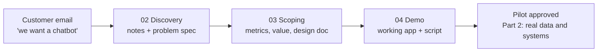

# Part 1 · The role

What a forward deployed AI engineer actually does, and the customer-facing craft that separates a great FDE from a good programmer: discovery, scoping and demos. You follow one fictional customer, **Northwind Logistics**, from their first email to a design doc and a working demo. Northwind comes back in Part 2, where you connect to its data and systems.

| # | Lesson | What you'll have | Time |
|---|--------|------------------|------|
| 01 | [What a forward deployed engineer does](01-what-a-forward-deployed-engineer-does) | a clear picture of the job, the roadmap of this repo, and your personal study plan | 1 h |
| 02 | [Discovery: turning a customer problem into a spec](02-discovery-turning-a-customer-problem-into-a-spec) | an interview script, question bank, notes template, a gap checker and an AI spec drafter | 2 h |
| 03 | [Scoping: success metrics and a design doc](03-scoping-success-metrics-and-a-design-doc) | a design-doc template + filled example, a value calculator and a design-doc linter | 2 h |
| 04 | [Demos that win trust](04-demos-that-win-trust) | a demo web app with honest fallbacks, a preflight checklist and a demo script | 2 h |

**Total: about 7 hours** (one week at 1 hour a day).

## How the four lessons connect



## Set up for this part
1. Follow **Set up once** in the [course README](../README.md#set-up-once) (a virtual environment for the course).
2. In each lesson folder, install that lesson's packages:
   ```bash
   pip install -r requirements.txt
   ```
   | Lesson | Packages |
   |--------|----------|
   | 01, 03 | `pytest` only |
   | 02 | `anthropic`, `openai`, `pydantic`, `pytest` |
   | 04 | `fastapi`, `uvicorn[standard]`, `httpx`, `anthropic`, `openai`, `pydantic`, `pytest` |
3. **AI (only for lesson 02's spec drafter and lesson 04's live mode):** either an Anthropic API key (`ANTHROPIC_API_KEY`, see [Get your API key](../../ai-from-zero/part-4-chatbots/README.md#get-your-api-key-once-about-10-minutes)) or a free local model with Ollama (`ollama pull llama3.2`, then `export LLM_PROVIDER=ollama`). Every test in this part runs without either.

## After this part you can
- Explain the FDE role and how it differs from SWE, ML engineer and solutions engineer.
- Run a discovery interview, take structured notes and turn them into a problem spec.
- Define a primary metric with a baseline and target, plus guardrail metrics.
- Estimate AI cost, value and break-even, and write a design doc a security team can sign.
- Build and run a demo that shows its sources and fails honestly.

## Next
→ [Part 2 · Enterprise data and integration](../part-2-enterprise-data-and-integration)
