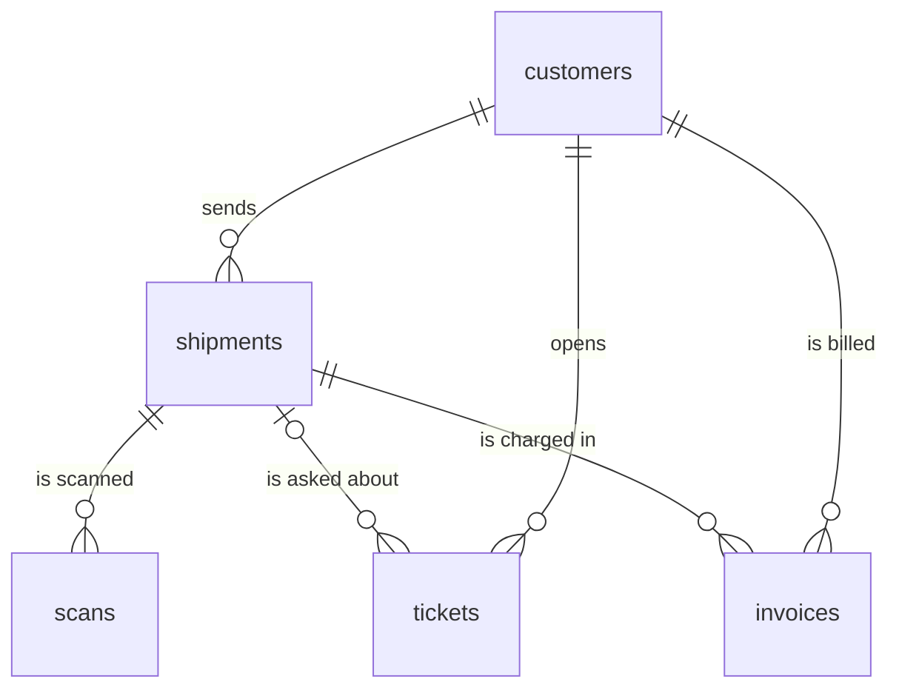

# 05 · SQL for real company data

**What you'll build:** a realistic, deliberately **messy** copy of Northwind Logistics' database (customers, shipments, scans, tickets, invoices), a read-only SQL runner, and eight annotated query files that take you from `SELECT` to joins, `GROUP BY`, cleaning, CTEs and window functions. You'll use them to answer the real question from discovery: is "where is my shipment?" really 40% of tickets?
**Like you're 5:** a database is a giant cupboard of labelled boxes (tables), each full of cards (rows). SQL is how you ask the cupboard questions: "give me every red card from the shoe box, sorted by size". Real company cupboards are messy: some cards say "red", some "RED", some "redd", and some have no colour at all.
**Time:** ~3 h · **Builds on:** [04 · Demos that win trust](../../part-1-the-role/04-demos-that-win-trust) and [AI from Zero 03 · API that saves to a database](../../../ai-from-zero/part-1-apis/03-api-that-saves-to-a-database) · **Needs:** nothing extra (PostgreSQL is optional)

## Why this matters
Almost every customer's most valuable data sits in a SQL database: orders, shipments, tickets, invoices. As an FDE you'll query it to measure the problem (lesson 02's "40%" was a guess), to build evaluation sets, to feed facts to an LLM, and to prove results. You'll often be handed read-only access to a 15-year-old database with no documentation and inconsistent values. Being fast and careful with SQL is one of the most practical skills on the job.

## What you'll learn
- **SELECT basics:** pick columns (`SELECT`), rows (`WHERE`), order (`ORDER BY`) and how many (`LIMIT`).
- **Joins:** combine tables on a shared key; `JOIN` keeps matches only, `LEFT JOIN` keeps every row on the left.
- **Aggregates:** `COUNT`, `SUM`, `AVG` per group with `GROUP BY`, and filtering groups with `HAVING`.
- **Cleaning in SQL:** `CASE`, `LOWER`, `TRIM`, `LIKE`, `SUBSTR`, `COALESCE` to turn 16 spellings into 5 categories.
- **CTEs and window functions:** `WITH` to build a query step by step; `ROW_NUMBER`, `LAG`, `RANK` and running totals to look at related rows without collapsing them.

## Before you start
- Install (virtual environment on):
  ```bash
  pip install -r requirements.txt
  ```
  | Package | What it's for |
  |---------|---------------|
  | `psycopg[binary]` | talks to PostgreSQL (only for the optional Postgres steps); `[binary]` includes the compiled parts so you don't need a compiler |
  | `pytest` | runs the tests |
  SQLite needs no install: it's built into Python (`import sqlite3`).
- **Optional PostgreSQL:** install PostgreSQL 16 from https://www.postgresql.org/download/ (or run it in Docker: `docker run -d --name pg -e POSTGRES_PASSWORD=pw -p 5432:5432 postgres:16`; Docker is taught in [cloud-and-devops-for-ai](../../../cloud-and-devops-for-ai)).
- No API key needed.

**What's in this folder**

| File | What it is |
|------|------------|
| `make_db.py` | builds `northwind.db` with fixed-seed "random" data (identical for everyone) |
| `run_sql.py` | runs a `.sql` file or one query, read-only, and prints neat tables |
| `queries/01_first_look.sql` … `08_response_times.sql` | the lesson, one topic per file, every query commented |
| `queries/postgres_examples.sql` | PostgreSQL-only versions of the date maths |
| `load_into_postgres.py` | copies the SQLite data into PostgreSQL |
| `test_queries.py` | 15 tests (one runs only when you give it a PostgreSQL URL) |

## The data


Read `||--o{` as "one ... to many": one customer has many shipments; one shipment has many scans. A ticket *may* point at a shipment (`|o`: zero or one).

| Table | Rows | Key columns | Mess you'll find |
|-------|------|-------------|------------------|
| `customers` | 120 | `customer_id`, `name`, `country`, `tier` | 10 duplicates (`BROUWER METALS `), countries as `NL`/`nl`/`Netherlands`, missing tiers |
| `shipments` | 3,000 | `shipment_id` (`NW-1234567`), `status`, `promised_date`, `delivered_at` | statuses like `delivred`, `Delivered `, dates as `21/09/2026`, weights of 0 or below |
| `scans` | 14,268 | `shipment_id`, `scanned_at`, `event` | (clean: machine-generated) |
| `tickets` | 2,000 | `category`, `subject`, `created_at`, `first_response_at` | 16 spellings of 5 categories, 188 with no category, tracking-number typos |
| `invoices` | 2,584 | `shipment_id`, `amount_eur`, `paid_at` | 72 shipments invoiced twice |

## Run it
1. Open a terminal in the course folder `forward-deployed-ai-engineer`, virtual environment on.
2. Go to this lesson:
   ```bash
   cd part-2-enterprise-data-and-integration/05-sql-for-real-company-data
   ```
3. Install:
   ```bash
   pip install -r requirements.txt
   ```
4. Build the database:
   ```bash
   python make_db.py
   ```
5. Run the files **in order**, reading each `.sql` file in your editor next to its output:
   ```bash
   python run_sql.py queries/01_first_look.sql
   python run_sql.py queries/02_joins.sql
   python run_sql.py queries/03_group_by.sql
   python run_sql.py queries/04_cleaning.sql
   python run_sql.py queries/05_ctes.sql
   python run_sql.py queries/06_window_functions.sql
   python run_sql.py queries/07_data_quality.sql
   python run_sql.py queries/08_response_times.sql
   ```
6. Ask your own question:
   ```bash
   python run_sql.py -e "SELECT status, COUNT(*) FROM shipments GROUP BY status"
   ```
7. Prove the database is protected (this must fail):
   ```bash
   python run_sql.py -e "DELETE FROM tickets"
   ```
8. Run the tests:
   ```bash
   pytest -q
   ```
9. **Optional, PostgreSQL:** create a database, copy the data, and run the same files there (replace the user and password with yours):
   ```bash
   createdb northwind
   python load_into_postgres.py postgresql://postgres:pw@localhost/northwind
   python run_sql.py queries/05_ctes.sql --postgres postgresql://postgres:pw@localhost/northwind
   python run_sql.py queries/postgres_examples.sql --postgres postgresql://postgres:pw@localhost/northwind
   NORTHWIND_PG_URL=postgresql://postgres:pw@localhost/northwind pytest -q
   ```

**Commands, piece by piece**

| Piece | Meaning |
|-------|---------|
| `python run_sql.py queries/01_first_look.sql` | run every query in that file; `queries/` is the folder, `/` separates folder and file |
| `-e "SELECT ..."` | `-e` (short for `--execute`) = run this one query; the quotes keep the whole query together as one argument |
| `--postgres postgresql://postgres:pw@localhost/northwind` | run on PostgreSQL instead. The **connection URL** reads: `postgresql://` (kind of database) `postgres` (user) `:pw` (password) `@localhost` (which computer) `/northwind` (database name). Default port 5432 is implied; add `:5432` after the host to be explicit |
| `createdb northwind` | a PostgreSQL command-line tool: create an empty database called `northwind` (add `-U postgres` if it asks for a user) |
| `docker run -d --name pg -e POSTGRES_PASSWORD=pw -p 5432:5432 postgres:16` | start PostgreSQL 16 in a container: `-d` in the background, `--name pg` call it pg, `-e` set its password, `-p 5432:5432` connect your port 5432 to the container's |
| `NORTHWIND_PG_URL=... pytest -q` | set an environment variable for this one command, so the PostgreSQL test runs instead of being skipped |

### SQL, piece by piece
Every clause used in the query files, in the order the database **thinks** about them (which is not the order you write them):

| Clause | Plain meaning | Example from the files |
|--------|---------------|------------------------|
| `FROM tickets AS t` | which table to read; `AS t` gives it a short nickname | `FROM tickets AS t` |
| `JOIN customers AS c ON c.customer_id = t.customer_id` | glue rows from another table where the key matches; rows without a match are dropped | 02 |
| `LEFT JOIN ... ON ...` | like `JOIN`, but keep every row from the left table; missing matches become `NULL` | 02: tickets with typo'd tracking numbers |
| `WHERE status = 'delayed'` | keep only rows where this is true; text goes in single quotes | 01 |
| `AND` / `OR` / `NOT` | combine conditions | `WHERE status = 'delayed' AND destination = 'Utrecht'` |
| `IS NULL` / `IS NOT NULL` | test for "no value". `= NULL` never matches anything, a classic bug | 01 |
| `LIKE '%where is%'` | text pattern: `%` = any text, `_` = exactly one character | 04 |
| `IN ('wismo', 'where is my shipment')` | equal to any value in the list | 04 |
| `GROUP BY category` | put rows with the same value in one group, one output row per group | 03 |
| `COUNT(*)`, `SUM(x)`, `AVG(x)`, `MIN`, `MAX` | **aggregate functions**: one number per group | 03 |
| `HAVING SUM(price_eur) > 100000` | filter **groups** (after `GROUP BY`); `WHERE` filters **rows** (before) | 03 |
| `SELECT a, b AS nickname` | which columns to output, optionally renamed | everywhere |
| `CASE WHEN ... THEN ... ELSE ... END` | if/else inside a query | 04 |
| `LOWER(x)`, `UPPER(x)`, `TRIM(x)` | lower-case, upper-case, remove spaces at both ends | 04 |
| `SUBSTR(text, start, length)` | cut out part of a text; the first character is position 1 | 04: `SUBSTR('21/09/2026', 7, 4)` = `2026` |
| `a \|\| b` | glue texts together | 04: rebuilding dates |
| `COALESCE(tier, 'unknown')` | the first value that isn't `NULL` | 04 |
| `ROUND(x, 1)` | round to 1 decimal | 05 |
| `ORDER BY tickets DESC` | sort; `DESC` = biggest first, `ASC` (the default) = smallest first | everywhere |
| `LIMIT 5` | only the first 5 rows | everywhere |
| `UNION ALL` | stack the results of two queries on top of each other | 01, 07 |
| `WITH name AS (SELECT ...)` | a **CTE**: give a sub-query a name and use it like a table below | 05 |
| `CROSS JOIN totals` | combine every row with every row of `totals` (here: one row, the grand total) | 05 |
| `(SELECT COUNT(*) FROM ...)` | a **sub-query**: a query inside a query | 06, 07 |
| `ROW_NUMBER() OVER (PARTITION BY shipment_id ORDER BY scanned_at DESC)` | number rows 1, 2, 3... **restarting for each shipment**, newest first | 06 |
| `LAG(scanned_at) OVER (...)` | the value from the previous row in the window | 06 |
| `SUM(COUNT(*)) OVER (ORDER BY month)` | a running total: the sum of all rows up to this one | 06 |
| `RANK() OVER (ORDER BY ... DESC)` | 1st, 2nd, 3rd place; ties share a place | 06 |
| `;` | ends a statement | everywhere |
| `-- text` | a comment: ignored by the database. `run_sql.py` prints the comment above each query as its title | everywhere |

The order the database works in: `FROM`/`JOIN` → `WHERE` → `GROUP BY` → `HAVING` → `SELECT` → `ORDER BY` → `LIMIT`. That's why you can't use a `SELECT` nickname inside `WHERE`: it doesn't exist yet when `WHERE` runs.

### What you should see
Step 4 (real output):
```
Created northwind.db:
  customers     120 rows
  shipments   3,000 rows
  scans      14,268 rows
  tickets     2,000 rows
  invoices    2,584 rows
```
Step 5, file 03, the raw categories (real output, shortened). This is what "categories set by hand, often wrong" from discovery looks like:
```
== Tickets per category AS TYPED: look how messy it is (16 spellings plus NULL, for 5 real categories)
category             | tickets
---------------------+--------
where is my shipment | 189
NULL                 | 188
 WISMO               | 158
wismo                | 140
WISMO                | 131
Where is my shipment | 130
...
(17 rows)
```
File 05, after cleaning, **the answer to the discovery question** (real output):
```
== Lesson 02 question: is "where is my shipment?" really about 40% of tickets?
category       | tickets | percent
---------------+---------+--------
wismo          | 824     | 41.2
other          | 404     | 20.2
invoice        | 358     | 17.9
damage         | 228     | 11.4
address_change | 186     | 9.3
(5 rows)
```
Priya's estimate holds: 41.2%. You can now write "41% (measured, SQL on the TMS sample)" in the design doc instead of "40% (estimate)".

File 06, `LAG` in action (real output):
```
shipment_id | event            | location      | scanned_at          | previous_scan
------------+------------------+---------------+---------------------+--------------------
NW-1001021  | picked_up        | Rotterdam     | 2026-07-04 12:54:00 | NULL
NW-1001021  | hub              | Rotterdam hub | 2026-07-05 00:54:00 | 2026-07-04 12:54:00
NW-1001021  | hub              | Paris depot   | 2026-07-05 08:54:00 | 2026-07-05 00:54:00
...
```
File 07, the data-quality report (real output):
```
check_name                                         | problem_rows
---------------------------------------------------+-------------
tickets without a category                         | 188
tickets pointing at a shipment that does not exist | 23
tickets with no first response yet                 | 88
shipments with weight zero or below                | 24
promised dates not written as YYYY-MM-DD           | 63
status written in a non-standard way               | 88
delivered time set but status is not delivered     | 26
shipments invoiced more than once                  | 72
customers that look like duplicates                | 10
customer emails not in lower case                  | 21
(10 rows)
```
File 08 (real output): median first response is about 18 hours, and only 13.7% of answered tickets met the 8-hour contract promise.
```
== Share of answered tickets that met the 8-hour contract promise
answered | within_8h | percent_within_8h
---------+-----------+------------------
1912     | 262       | 13.7
```
Step 7:
```
ERROR: attempt to write a readonly database
```
Step 8: `14 passed, 1 skipped`. Step 9 on PostgreSQL gives the same numbers (money shows as `146370` instead of `146370.0`), and `postgres_examples.sql` prints a median of `18.1` hours for WISMO.

## How it works

### `make_db.py`
1. **`SCHEMA`** creates five tables. `PRIMARY KEY` = the column that uniquely identifies each row; `REFERENCES customers(customer_id)` = a **foreign key**: this column points at a row in another table.
2. **`rng = random.Random(42)`**: a random generator with a fixed **seed**, so the "random" data is identical on every computer. Tests can then check exact numbers.
3. **`make_customers()`** builds 110 companies, then adds 10 duplicates with names like `"HARTMANN TEXTILES "` or `"Hartmann Textiles B.V."`, the way real CRMs collect them.
4. **`make_shipments()`** adds deliberate errors: 3% odd status spellings, 2% dates as `DD/MM/YYYY`, 1% impossible weights.
5. **`make_tickets()`** picks each ticket's true reason with the real-world mix (41% WISMO), then writes the category the way a hurried agent would (`" WISMO"`, `"where is my shipment"`, or nothing). Response times use `lognormvariate`, a distribution with a long tail (most answers in a day, a few take days), centred near 19 hours.
6. **`make_invoices()`** charges 3% of shipments twice (a billing bug you'll find in file 07).
7. **`main(path)`** writes everything with `executemany` and `?` **placeholders**: the values are sent separately from the SQL text, which is how you must always pass values to SQL (it prevents **SQL injection**, where text is mistaken for commands).

### `run_sql.py`
1. **`connect()`** opens the file with `mode=ro` (read-only). Any `INSERT`, `UPDATE` or `DELETE` fails. With `--postgres` it connects with `psycopg` instead.
2. **`split_statements(sql)`** uses `sqlite3.complete_statement()` to find where each statement ends, so a `;` inside a text like `'a;b'` doesn't split a query in half.
3. **`title_of(statement)`** uses the `--` comment just above each query as its heading.
4. **`run()`** executes one statement and returns the column names (`cursor.description`) and rows. **`as_table()`** pads each column to the same width and prints `NULL` for missing values, at most 20 rows.

### `load_into_postgres.py`
It reuses `make_db.SCHEMA`, swaps `REAL` for `NUMERIC(12, 2)` (exact decimals: what you want for money), and streams each table in with `COPY`, PostgreSQL's fast bulk loader.

### SQLite vs PostgreSQL in one table
| | SQLite | PostgreSQL |
|---|--------|-----------|
| What it is | a library; the database is one file | a server program; many users at once |
| Typical use at customers | small apps, laptops, exports | the main database of countless companies |
| Date maths | `julianday(b) - julianday(a)` (days) | `b::timestamp - a::timestamp` (an interval), `EXTRACT(EPOCH FROM ...)` (seconds) |
| Median | build it with `ROW_NUMBER` (file 08) | `PERCENTILE_CONT(0.5) WITHIN GROUP (ORDER BY ...)` |
| Count with a condition | `SUM(CASE WHEN ... THEN 1 ELSE 0 END)` | the same, or `COUNT(*) FILTER (WHERE ...)` |
| `ROUND(x, 1)` | works on any number | needs `NUMERIC` (cast `REAL`/`DOUBLE` first) |

Files 01–07 run unchanged on both; the tests check that they return the same answers.

## If something goes wrong
- **`northwind.db not found. Run: python make_db.py`** → build the database first (step 4), in this folder.
- **`ERROR: no such column: ...`** → a typo in a column name, or a `SELECT` nickname used in `WHERE`. Run `python run_sql.py -e "SELECT * FROM tickets LIMIT 1"` to see the real column names.
- **`ERROR: near "...": syntax error`** → usually a missing comma between columns, a missing closing bracket, or `"double quotes"` around text. In SQL, text goes in `'single quotes'`; double quotes are for column names.
- **A query returns 0 rows unexpectedly** → you probably compared with `= NULL` (use `IS NULL`) or matched text with the wrong case or spaces (`'Delivered '` ≠ `'delivered'`; clean with `LOWER(TRIM(...))`).
- **`psycopg.OperationalError: connection ... failed`** → PostgreSQL isn't running, or the user, password, port or database name in the URL is wrong. Check with `psql postgresql://postgres:pw@localhost/northwind`.

## Try this
1. **Late deliveries.** How many delivered shipments arrived after their promised date? (Compare `SUBSTR(delivered_at, 1, 10)` with `promised_date`, only for rows where `promised_date` is already in `YYYY-MM-DD` form.)
   <details><summary>Solution</summary>

   ```bash
   python run_sql.py -e "SELECT COUNT(*) AS late FROM shipments WHERE delivered_at IS NOT NULL AND promised_date LIKE '____-__-__' AND SUBSTR(delivered_at, 1, 10) > promised_date"
   ```
   Dates written as `YYYY-MM-DD` sort correctly as plain text, which is one reason that format is the standard. The answer is 586.
   </details>
2. **Unpaid money.** Write a query listing the 5 customers with the most unpaid invoice money (`paid_at IS NULL`), with their total. Ignore the double-charged copies by counting each shipment only once.
   <details><summary>Solution</summary>

   ```sql
   -- Unpaid amount per customer, each shipment counted once
   WITH unique_invoices AS (
       SELECT shipment_id, MIN(customer_id) AS customer_id, MIN(amount_eur) AS amount_eur
       FROM invoices
       WHERE paid_at IS NULL
       GROUP BY shipment_id
   )
   SELECT c.name, ROUND(SUM(u.amount_eur), 0) AS unpaid_eur
   FROM unique_invoices AS u
   JOIN customers AS c ON c.customer_id = u.customer_id
   GROUP BY c.customer_id, c.name
   ORDER BY unpaid_eur DESC
   LIMIT 5;
   ```
   Save it as `queries/09_unpaid.sql` and run `python run_sql.py queries/09_unpaid.sql`.
   </details>
3. **Time between a customer's tickets.** For each ticket, show how many days passed since the same customer's previous ticket, using `LAG` and `julianday` (SQLite).
   <details><summary>Solution</summary>

   ```sql
   -- Days since the same customer's previous ticket
   SELECT customer_id, ticket_id, created_at,
          ROUND(julianday(created_at)
                - julianday(LAG(created_at) OVER (PARTITION BY customer_id ORDER BY created_at)), 1)
              AS days_since_previous
   FROM tickets
   ORDER BY customer_id, created_at
   LIMIT 10;
   ```
   The first ticket of each customer shows `NULL`: there is no previous row in its window.
   </details>

## Check yourself
1. What's the difference between `WHERE` and `HAVING`?
2. Why does the tickets-with-typos query need a `LEFT JOIN` instead of a `JOIN`?
3. Why did the runner open the database read-only, and why does that matter even more at a customer?
4. A window function and `GROUP BY` both work on groups of rows. What's the key difference?

<details><summary>Answers</summary>

1. `WHERE` filters individual rows before grouping; `HAVING` filters whole groups after `GROUP BY`, so it can use aggregates like `SUM(...)`.
2. We are looking for tickets with **no** matching shipment. A `JOIN` drops exactly those rows; a `LEFT JOIN` keeps them with `NULL`s, so `WHERE s.shipment_id IS NULL` finds them.
3. So a typo or a wrong paste can never change or delete data. At a customer, a single accidental `UPDATE` on their production database could break their business and your relationship; ask for read-only access or a replica.
4. `GROUP BY` collapses each group into one output row; a window function keeps every row and adds a value computed over its window (row number, previous value, running total).
</details>

## Learn more (optional)
**Read the official docs**
- SQLite SQL language reference: https://www.sqlite.org/lang.html
- SQLite window functions: https://www.sqlite.org/windowfunctions.html
- PostgreSQL tutorial: https://www.postgresql.org/docs/current/tutorial.html
- PostgreSQL window functions tutorial: https://www.postgresql.org/docs/current/tutorial-window.html
- PostgreSQL `WITH` queries (CTEs): https://www.postgresql.org/docs/current/queries-with.html
- Python `sqlite3` module: https://docs.python.org/3/library/sqlite3.html
- psycopg 3 documentation: https://www.psycopg.org/psycopg3/docs/

**Watch**
- freeCodeCamp, SQL full course for beginners (search): https://www.youtube.com/results?search_query=freecodecamp+sql+full+course
- SQL window functions explained (search): https://www.youtube.com/results?search_query=sql+window+functions+explained
- PostgreSQL tutorial for beginners (search): https://www.youtube.com/results?search_query=postgresql+tutorial+for+beginners

## Next
→ [06 · Ingesting messy documents: PDF, Excel, email](../06-ingesting-messy-documents-pdf-excel-email)
