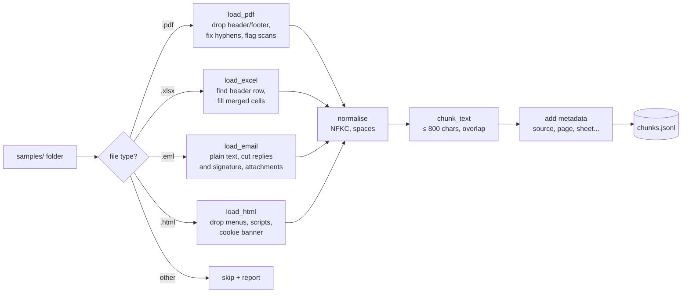

# 06 · Ingesting messy documents: PDF, Excel, email

**What you'll build:** an ingestion pipeline (`ingest.py`) that reads the four kinds of files every company is full of (a PDF with headers, footers, split words and a scanned page; an Excel rate card with merged cells and a title row; an email with a reply chain, a signature and an attachment; and a web page full of menus and cookie banners) and turns them into clean text **chunks with metadata**, saved as JSON Lines, ready for RAG.
**Like you're 5:** imagine tidying a messy toy box before you can play. You throw away the wrappers (headers, menus, signatures), put the broken pieces back together (split words), sort everything into small labelled bags (chunks), and write on each bag where it came from (metadata).
**Time:** ~3 h · **Builds on:** [05 · SQL for real company data](../05-sql-for-real-company-data) and [AI from Zero 24 · RAG: ask your documents](../../../ai-from-zero/part-5-rag-and-vector-databases/24-rag-ask-your-documents) · **Needs:** nothing extra (no API key)

## Why this matters
In RAG demos the documents are clean text files. At a customer they are 60 policy PDFs (some scanned), Excel files with merged cells, years of emails and an intranet. If the text going in is messy (page footers in the middle of sentences, "deliv-ery", cookie banners, quoted replies), retrieval finds the wrong pieces and the LLM answers badly, no matter how good the model is. Ingestion is unglamorous and decides most of a RAG system's quality: "garbage in, garbage out".

## What you'll learn
- **Loaders per format:** `pypdf` for PDFs, `pandas`/`openpyxl` for Excel, Python's `email` package for `.eml`, `BeautifulSoup` for HTML.
- **Cleaning:** removing repeated headers and footers, re-joining hyphenated words, cutting reply chains and signatures, dropping menus and scripts, filling merged cells.
- **Normalising:** one consistent form of every character (Unicode **NFKC**), single spaces, no stray blank lines.
- **Chunking:** splitting text into small pieces that keep whole paragraphs, with a little **overlap** so context isn't cut.
- **Metadata:** labelling every chunk with its source, page, sheet, rows, section or sender, so answers can cite sources and permissions can be enforced (lesson 08).

## Before you start
- Install (virtual environment on):
  ```bash
  pip install -r requirements.txt
  ```
  | Package | What it's for |
  |---------|---------------|
  | `pypdf` | reads the text out of PDF files |
  | `openpyxl` | reads and writes Excel `.xlsx` files (pandas uses it underneath; `make_samples.py` uses it to write) |
  | `pandas` | tables in Python: we use it to tidy the Excel sheets |
  | `beautifulsoup4` | reads HTML and lets you remove or pick out parts of a web page |
  | `reportlab` | creates PDF files; only `make_samples.py` uses it, to build the practice PDF |
  | `pytest` | runs the tests |
  Reading emails needs no install: Python's built-in `email` package does it.
- No API key needed.

**What's in this folder**

| File | What it is |
|------|------------|
| `make_samples.py` | creates 4 messy practice files in `samples/` |
| `ingest.py` | the pipeline: load → clean → normalise → chunk → metadata → save |
| `test_ingest.py` | 7 tests: one per file type, plus normalising, chunking and folder handling |

## The pipeline



## The four file formats, opened up
| Format | What's really inside | The trap |
|--------|----------------------|----------|
| **PDF** (`.pdf`) | instructions to draw characters at positions on pages. There are no "paragraphs", only lines of text placed on a page. A scanned PDF is just a picture per page: **no text layer** | headers and footers repeat on every page; words split at line ends; scans need **OCR** (optical character recognition: turning a picture of text into text) |
| **Excel** (`.xlsx`) | a zip file of XML files: one per sheet, holding cells like `A1 = "Zone"` | the real table starts at row 3; **merged cells** hold their value only in the top-left cell; notes under the table look like data |
| **Email** (`.eml`) | **headers** (`From:`, `Subject:`, `Date:`...) then a body in **MIME** parts: often the same text twice (`text/plain` and `text/html`) inside `multipart/alternative`, plus attachments, all inside `multipart/mixed` | the reply chain repeats old emails (`On ... wrote:` and `>` lines), and the signature adds phone numbers and disclaimers |
| **HTML** (`.html`) | tags like `<h2>`, `<p>`, `<nav>`, `<script>` around text | menus, scripts, cookie banners and footers are text too; `&nbsp;` and pasted ligatures (`fi`) look normal but aren't |
| **JSON Lines** (`.jsonl`, our output) | one complete JSON object per line | easy to stream, append and read line by line; a normal `.json` file is one big object instead |

The start of `samples/customer_email.eml`, opened in a text editor, shows the MIME structure:
```
From: Joost van Dijk <joost.vandijk@brouwer-metals.example>
Subject: RE: Pallet NW-4821907 still not delivered
Content-Type: multipart/mixed; boundary="===============5042269234336852519=="

--===============5042269234336852519==
Content-Type: multipart/alternative; ...
Content-Type: text/plain; charset="utf-8"
Content-Transfer-Encoding: quoted-printable

The pallet NW-4821907 still hasn't arrived and our production line in Utrecht=
 is waiting.
```
`boundary` is the separator line between parts; `quoted-printable` is an old encoding where a line ending in `=` continues on the next line. The `email` package decodes all of this for you.

## Run it
1. Open a terminal in the course folder `forward-deployed-ai-engineer`, virtual environment on.
2. Go to this lesson:
   ```bash
   cd part-2-enterprise-data-and-integration/06-ingesting-messy-documents-pdf-excel-email
   ```
3. Install:
   ```bash
   pip install -r requirements.txt
   ```
4. Create the practice files, then **open each one** (PDF viewer, Excel/LibreOffice, a text editor for `.eml`, a browser for `.html`) to see the mess for yourself:
   ```bash
   python make_samples.py
   ```
5. Ingest the folder and look at the summary:
   ```bash
   python ingest.py samples/
   ```
6. Show the first 3 chunks in full, and save all chunks:
   ```bash
   python ingest.py samples/ --show 3 --out chunks.jsonl
   ```
7. Look at the saved file (one chunk per line). Mac/Linux:
   ```bash
   head -n 2 chunks.jsonl
   ```
   Windows PowerShell: `Get-Content chunks.jsonl -TotalCount 2`
8. Run the tests:
   ```bash
   pytest -q
   ```

**Commands, piece by piece**

| Piece | Meaning |
|-------|---------|
| `python ingest.py samples/` | run the pipeline on the folder `samples`; the trailing `/` just makes clear it's a folder |
| `--show 3` | print the first 3 chunks in full (text and metadata) |
| `--out chunks.jsonl` | also save every chunk to this file |
| `head -n 2 chunks.jsonl` | print the first 2 lines of a file (`head` = the top; `-n 2` = 2 lines) |
| `Get-Content ... -TotalCount 2` | the PowerShell way to do the same |

### What you should see
Step 4:
```
  customer_email.eml         1,848 bytes
  delivery_terms.pdf         3,376 bytes
  faq.html                   1,335 bytes
  rate_card_brouwer.xlsx     5,743 bytes
```
Step 5 (real output):
```
file                       chunks  notes
customer_email.eml              2
delivery_terms.pdf              2  page 3 has no text layer (scanned image?): needs OCR
faq.html                        3
rate_card_brouwer.xlsx          2
Total: 9 chunks
```
Step 6 (real output, first 3 chunks; your `file_sha256` values may differ because the generated files contain their creation time):
```
----------------------------------------------------------------------
customer_email.eml#0-1009c062
{"source": "customer_email.eml", "type": "email", "file_sha256": "847701114d587e33", "chunk": 0, "chars": 195, "subject": "RE: Pallet NW-4821907 still not delivered", "from": "Joost van Dijk <joost.vandijk@brouwer-metals.example>", "date": "Wed, 21 Oct 2026 09:14:00 +0200", "message_id": "<20261021091400.4821907@brouwer-metals.example>", "attachments": ["missing_parts.csv"]}

Hello,
The pallet NW-4821907 still hasn't arrived and our production line in Utrecht is waiting.
Can you confirm the new delivery time today? The list of missing parts is attached.
Regards,
Joost

----------------------------------------------------------------------
customer_email.eml#1-3bccba48
{"source": "customer_email.eml", "type": "email", ..., "attachment": "missing_parts.csv", ...}

part_number,description,quantity
BM-1001,Steel bracket,400
BM-2040,Hinge,120

----------------------------------------------------------------------
delivery_terms.pdf#0-8c1bb0a3
{"source": "delivery_terms.pdf", "type": "pdf", "file_sha256": "9b6948ec2004ac5b", "chunk": 0, "chars": 450, "page": 1}

3. Delivery
3.1 If a shipment is delayed, Northwind informs the customer of the new expected delivery time as soon as it is known, by email and in the tracking portal.
3.2 For delays over 24 hours caused by Northwind, business customers may request a 10% credit on the transport charge. ...
```
Look for what's **missing**: the old reply ("will arrive tomorrow"), Joost's phone number and disclaimer, the PDF's "General Delivery Terms v4.2" header and "Page 1 of 3" footer. And what's **fixed**: "deliv-" + "ery" became "delivery". The Excel chunk reads `Zone: NL; Weight from (kg): 100; ...` on every row, even where the Excel cell was merged and empty.

Tests: `7 passed`.

## How it works
`ingest.py`, top to bottom:

1. **`normalise(text)`** runs `unicodedata.normalize("NFKC", text)`. **Unicode** gives some characters several forms: the ligature `fi` (one character) and `fi` (two), or a non-breaking space and a normal space. NFKC turns each into its plain, standard form, so a search for "final" finds "final". Then regular expressions squeeze repeated spaces and blank lines.
2. **`fix_hyphenation(text)`** joins `deliv-\nery` → `delivery` with the pattern `(\w)-\n(\w)` (a letter, a hyphen, a line break, a letter).
3. **`load_pdf(path)`**:
   - `PdfReader(path).pages[i].extract_text()` gets each page's text;
   - every line is turned into a pattern with digits replaced by `#`, so `Page 1 of 3` and `Page 2 of 3` look identical; lines that appear on at least half the pages are headers or footers and are removed;
   - lines that are just wrapped text (not ending with `.`, and the next one starting in lower case) are joined;
   - an empty page means no text layer: it's reported as "needs OCR" instead of silently disappearing.
4. **`load_excel(path)`** reads every sheet with `pd.read_excel(..., sheet_name=None, header=None)` (all sheets, no assumptions about headers):
   - `dropna(how="all")` drops empty rows; the first row with 2+ values is the real header;
   - rows above the header (the title) and one-value rows below the table (the notes) are kept as text;
   - `ffill()` ("forward fill") copies each zone down into the empty merged cells below it;
   - each row becomes `Column: value; Column: value`, so a row still makes sense when it ends up alone in a chunk.
5. **`load_email(path)`** parses the file with `BytesParser(policy=policy.default)`, takes the `text/plain` part (falls back to HTML), cuts everything after `On ... wrote:` or the `-- ` signature line, drops `>` lines, and keeps `subject`, `from`, `date`, `message_id` and attachment names as metadata. Small CSV or text attachments become their own document.
6. **`load_html(path)`** deletes `script`, `style`, `nav`, `header`, `footer`, `aside` and `form` tags and anything with "cookie" in its id or class, then makes one document per `<h2>` section (question + answer), with the section heading as metadata.
7. **`chunk_text(text)`** splits text into paragraphs (and over-long paragraphs into sentences), then packs them into chunks of at most `MAX_CHARS = 800` characters. When a chunk is full, its last paragraph is repeated at the start of the next one if it's short (`OVERLAP_CHARS = 200`): that's the **overlap**, so a question that spans two chunks still finds its context.
8. **`ingest_file(path)`** runs the right loader from `LOADERS`, then normalises and chunks each document. Every chunk gets an **id** like `delivery_terms.pdf#0-8c1bb0a3` (file, position, and a short hash of the text) and metadata: source, type, a fingerprint of the file (`file_sha256`: if it hasn't changed next night, you can skip re-ingesting it), chunk number, length, plus the loader's own fields.
9. **`ingest_folder(folder)`** handles every file, skips unknown types, reports broken files without stopping (one bad PDF out of 60 must not kill the night's run), and keeps identical chunk texts only once (**deduplication**: the same FAQ copied to two places).
10. **`main()`** prints the report and, with `--out`, writes **JSON Lines**: `json.dumps(chunk)` + a line break per chunk. The next step (lesson 11, or [AI from Zero 23](../../../ai-from-zero/part-5-rag-and-vector-databases/23-your-first-vector-database-chroma)) loads this file into a vector database.

## If something goes wrong
- **`samples is not a folder. Did you run: python make_samples.py ?`** → create the practice files first (step 4), in this lesson folder.
- **`ModuleNotFoundError: No module named 'bs4'`** → the package is installed as `beautifulsoup4` but imported as `bs4`. Run `pip install -r requirements.txt` with your virtual environment on.
- **A real PDF gives empty text or "needs OCR" on every page** → it's scanned. Use an OCR tool such as Tesseract (for example via the `ocrmypdf` command, which adds a text layer) and ingest the result. Ask the customer whether a digital original exists first: it's always better.
- **A real PDF's text comes out in a strange order, or columns are mixed** → `extract_text()` follows drawing order. Try `page.extract_text(extraction_mode="layout")` in pypdf, or a layout-aware tool, and always look at a sample of the output.
- **A real Excel file gives `ValueError` or wrong columns** → the "first row with 2+ values is the header" rule didn't fit. Print `pd.read_excel(path, header=None).head(15)` and adjust the rule for that customer's layout. Every company's spreadsheets are different; write a small loader per template if needed.

## Try this
1. **Bigger and smaller chunks.** Run `python -c "import ingest; print(ingest.chunk_text(open('samples/faq.html').read(), max_chars=200))"`. Then change `MAX_CHARS` to 300 at the top of `ingest.py` and run step 5 again. How many chunks do you get, and what's the trade-off?
   <details><summary>Hint</summary>

   Smaller chunks are more precise to retrieve but carry less context (a rule may be split from its exception); bigger chunks keep context but bring noise and cost more tokens. 300–1,000 characters with a small overlap is a common starting point; lesson 11 measures it properly with evals.
   </details>
2. **Ingest a `.txt` file.** Add support for plain text files: a loader that returns the whole file as one document, with the number of lines as metadata.
   <details><summary>Solution</summary>

   ```python
   def load_text(path):
       text = Path(path).read_text(encoding="utf-8", errors="replace")   # 'replace' survives odd bytes
       return [{"text": text, "metadata": {"lines": text.count("\n") + 1}}], []
   ```
   Then add `".txt": ("text", load_text)` to `LOADERS`. Create `samples/note.txt`, run step 5, and see it appear in the report.
   </details>
3. **Skip unchanged files.** Make `ingest_folder` accept a set of fingerprints already ingested last time and skip files whose `file_fingerprint(path)` is in it, reporting "unchanged, skipped".
   <details><summary>Solution</summary>

   ```python
   def ingest_folder(folder, known_fingerprints=frozenset()):
       all_chunks, report, seen = [], [], set()
       for path in sorted(Path(folder).iterdir()):
           if path.suffix.lower() not in LOADERS:
               report.append((path.name, 0, ["skipped: unsupported file type"]))
               continue
           if file_fingerprint(path) in known_fingerprints:
               report.append((path.name, 0, ["unchanged, skipped"]))
               continue
           ...  # the rest stays the same
   ```
   To get the known fingerprints, read last night's `chunks.jsonl`: `{json.loads(line)["metadata"]["file_sha256"] for line in open("chunks.jsonl")}`. This is how nightly ingestion of 60 PDFs stays fast.
   </details>

## Check yourself
1. Why remove a PDF's header and footer instead of leaving them in? They're "just a few words".
2. Why does each Excel row become `Column: value; Column: value` instead of just the values?
3. What would happen to a RAG answer if the email's quoted reply chain were kept?
4. Why does every chunk carry its source and page or section?

<details><summary>Answers</summary>

1. They appear in every chunk, so they make unrelated chunks look similar to the search, waste tokens, and can break sentences in the middle (a footer between "deliv-" and "ery").
2. So a row still makes sense on its own after chunking or retrieval. "NL; 100; 500; 110" means nothing; "Zone: NL; Weight from (kg): 100; ...; Price EUR: 110" can be read and quoted by the LLM.
3. The old text ("will arrive tomorrow") would be retrieved as if it were current and could be repeated to the customer, contradicting newer facts. Duplicated text also skews retrieval.
4. So answers can cite where they came from (trust, lesson 04), people can check them, stale or changed files can be re-ingested, and access rules can be applied per source (lesson 08).
</details>

## Learn more (optional)
**Read the official docs**
- pypdf, extracting text: https://pypdf.readthedocs.io/en/stable/user/extract-text.html
- pandas `read_excel`: https://pandas.pydata.org/docs/reference/api/pandas.read_excel.html
- openpyxl tutorial: https://openpyxl.readthedocs.io/en/stable/tutorial.html
- Python `email` package examples: https://docs.python.org/3/library/email.examples.html
- Beautiful Soup documentation: https://www.crummy.com/software/BeautifulSoup/bs4/doc/
- Unicode normalisation (`unicodedata.normalize`): https://docs.python.org/3/library/unicodedata.html
- JSON Lines format: https://jsonlines.org/
- Anthropic, "Contextual retrieval" (making chunks easier to find): https://www.anthropic.com/engineering/contextual-retrieval

**Watch**
- Chunking strategies for RAG (search): https://www.youtube.com/results?search_query=chunking+strategies+for+rag
- Extract text and tables from PDFs with Python (search): https://www.youtube.com/results?search_query=python+extract+text+from+pdf+pypdf
- pandas for beginners, freeCodeCamp (search): https://www.youtube.com/results?search_query=freecodecamp+pandas+tutorial

## Next
→ [07 · Connecting to company systems: REST, webhooks, OAuth](../07-connecting-to-company-systems-rest-webhooks-oauth)
