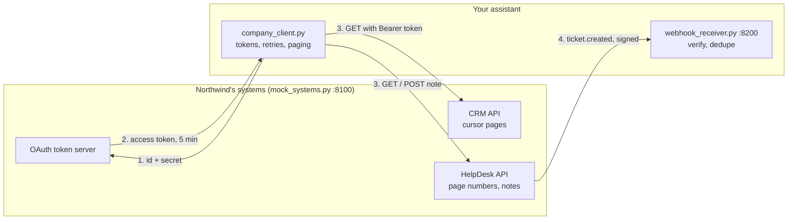
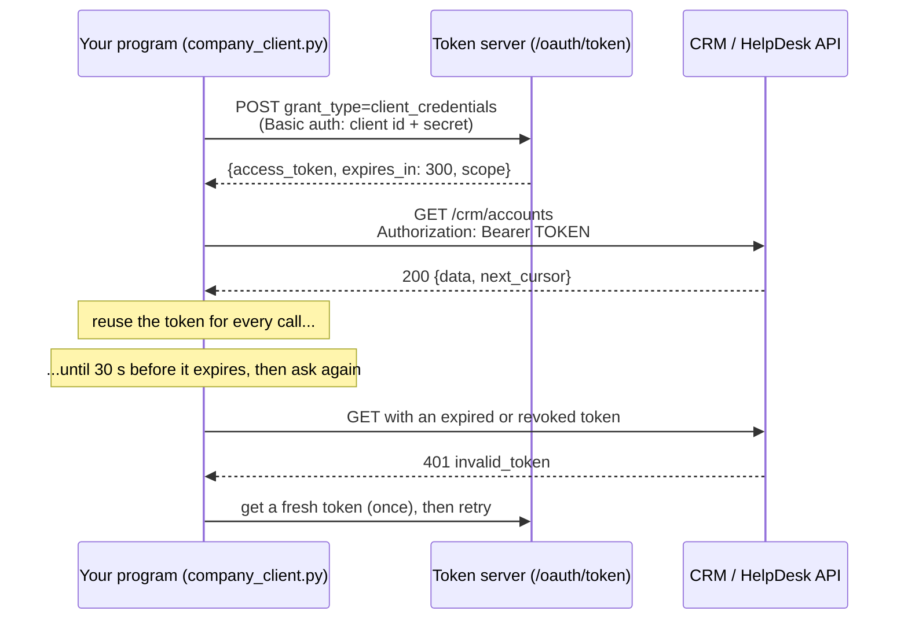
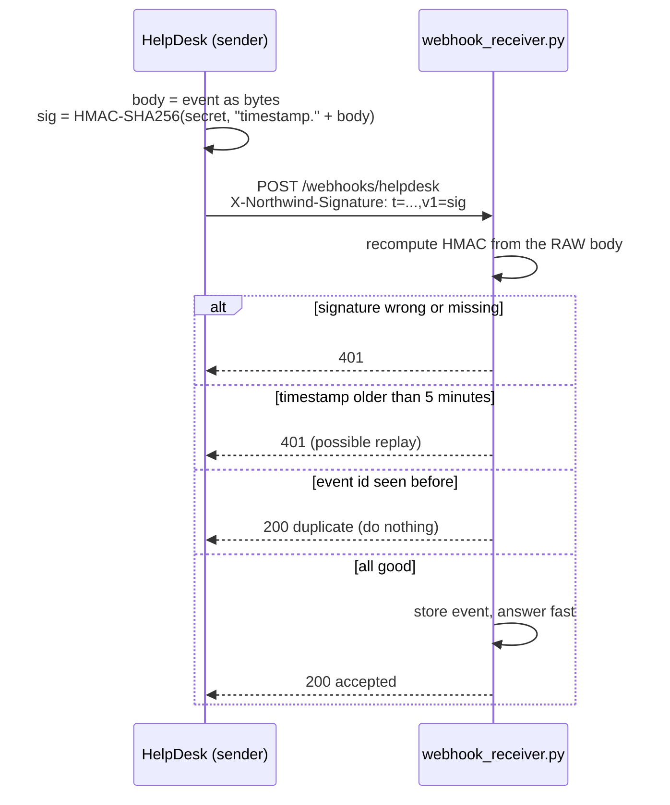

# 07 · Connecting to company systems: REST, webhooks, OAuth

**What you'll build:** a mock of Northwind's company systems that you run locally (a SalesCloud-style CRM and a HelpDesk-style ticketing API, both behind OAuth2, with rate limits, random failures and expiring tokens), a robust API client that survives all of it (token caching, pagination, retries with backoff, `Retry-After`, idempotent writes), and a webhook receiver that verifies HMAC signatures and refuses tampered, replayed and duplicate events.
**Like you're 5:** company systems are like a big office building. To get in you swap your ID card for a visitor badge that expires at 5 pm (OAuth token). The receptionist lets in only a few people per minute (rate limit) and sometimes says "come back in a moment" (retry). And when something happens, the building phones *you* (webhook), but you only trust calls that use the secret password you agreed on (signature).
**Time:** ~3 h · **Builds on:** [06 · Ingesting messy documents](../06-ingesting-messy-documents-pdf-excel-email) and [AI Engineer Journey 1.8 · Weather proxy: calling other APIs](../../../ai-engineer-journey/level-1-apis/08-weather-proxy-calling-other-apis) · **Needs:** nothing extra (no API key)

## Why this matters
An AI assistant is only useful when it can read from and write to the customer's real systems: look up the account in the CRM, read the ticket, post a draft as an internal note, react the moment a ticket arrives. Real enterprise APIs make you authenticate with OAuth, give you data in pages, limit how fast you can call, fail now and then, and push events to you through webhooks. A client that breaks on the first `429` or writes the same note three times after a retry will be switched off by the customer's IT team. This lesson is the plumbing every FDE writes in week one.

## What you'll learn
- **REST APIs:** resources at URLs, read with `GET`, created with `POST`, answers as JSON with **status codes**.
- **OAuth2 client credentials:** a program (not a person) swaps its client id and secret for a short-lived **access token** with limited **scopes**.
- **Pagination:** fetching big lists page by page, in the two common styles (cursor and page number).
- **Resilience:** **retries** with **exponential backoff and jitter**, obeying **`Retry-After`**, timeouts, and **idempotency keys** so a retried write happens only once.
- **Webhooks:** the system calls *you*; you verify an **HMAC signature**, reject old timestamps (**replay protection**) and ignore duplicates.

## Before you start
- Install (virtual environment on):
  ```bash
  pip install -r requirements.txt
  ```
  | Package | What it's for |
  |---------|---------------|
  | `fastapi` | the mock company systems and the webhook receiver are FastAPI apps |
  | `uvicorn[standard]` | runs them as web servers |
  | `httpx` | the HTTP client used by `company_client.py`, `send_webhook.py`, and FastAPI's test client |
  | `python-multipart` | lets FastAPI read form fields (the OAuth token request is a form) |
  | `pytest` | runs the tests |
- No API key needed. You need **three terminals** for the full run (two servers + one for commands).

**What's in this folder**

| File | What it is |
|------|------------|
| `mock_systems.py` | the pretend CRM + HelpDesk + OAuth server (port 8100) |
| `company_client.py` | the robust client: tokens, retries, pagination, idempotent writes |
| `sync.py` | uses the client like the Northwind assistant would |
| `signing.py` | `sign()` and `verify()` for webhook signatures |
| `webhook_receiver.py` | your webhook endpoint (port 8200) |
| `send_webhook.py` | sends good, duplicate, tampered, replayed, unsigned and wrongly signed events |
| `test_integration.py` | 12 tests with a fake clock, so even "wait 1 second" runs instantly |

## The big picture



### OAuth2 client credentials, step by step

Why not just send the secret with every request? Because the secret lives forever and can do everything; a token lives 5 minutes and can do only what its **scopes** allow (`crm.read`, `tickets.write`...). If a token leaks into a log, the damage is small and short. The `readonly-bot` client can't get `tickets.write` at all: **least privilege**.

### What a retry loop looks like
```
request ──► 200-299 ──────────────────────────► done
        ├─► 401 (first time) ──► new token ──► try again
        ├─► 429 ──► wait Retry-After seconds ──► try again
        ├─► 500/502/503/504 or network error ──► wait 0.5, 1, 2, 4 s (+ jitter) ──► try again
        └─► 400/403/404 ──► stop: retrying won't fix it
```

### HTTP status codes you will meet
| Code | Name | What it means here | Retry? |
|------|------|--------------------|--------|
| 200 / 201 | OK / Created | worked (201: something new was created) | no need |
| 400 | Bad Request | your request is wrong (bad grant type, bad scope) | no: fix the request |
| 401 | Unauthorized | no token, or it's invalid or expired | once, with a new token |
| 403 | Forbidden | valid token, but not allowed (missing scope) | no |
| 404 | Not Found | no such ticket | no |
| 422 | Unprocessable Entity | the body doesn't match what the API expects | no |
| 429 | Too Many Requests | rate limit: slow down; `Retry-After` says how long | yes, after waiting |
| 500 / 502 / 503 / 504 | server errors | the server or something behind it had a problem | yes, with backoff |

## Run it
1. Open a terminal in the course folder `forward-deployed-ai-engineer`, virtual environment on. Go to this lesson and install:
   ```bash
   cd part-2-enterprise-data-and-integration/07-connecting-to-company-systems-rest-webhooks-oauth
   pip install -r requirements.txt
   ```
2. Run the tests (no servers needed):
   ```bash
   pytest -q
   ```
3. **Terminal 1:** start the mock company systems:
   ```bash
   uvicorn mock_systems:app --port 8100
   ```
   Open http://127.0.0.1:8100/docs to see every endpoint (FastAPI draws this page for you).
4. **Terminal 2** (same folder, virtual environment on): start your webhook receiver:
   ```bash
   uvicorn webhook_receiver:app --port 8200
   ```
5. **Terminal 3** (same folder, virtual environment on): run the client:
   ```bash
   python sync.py
   ```
6. Still in terminal 3, try the API by hand with `curl`. A wrong secret, then a correct one:
   ```bash
   curl -s -X POST http://127.0.0.1:8100/oauth/token -u fde-assistant:wrong -d grant_type=client_credentials
   curl -s -X POST http://127.0.0.1:8100/oauth/token -u readonly-bot:readonly-secret-change-me -d grant_type=client_credentials
   curl -s http://127.0.0.1:8100/crm/accounts
   ```
   (Windows: use `curl.exe` instead of `curl` in PowerShell, or run these in Git Bash.)
7. Make HelpDesk send a signed webhook to your receiver, delivered twice like real senders sometimes do:
   ```bash
   curl -s -X POST "http://127.0.0.1:8100/admin/simulate/ticket-created?target=http://127.0.0.1:8200/webhooks/helpdesk&ticket_id=7&times=2"
   ```
   Watch terminal 2: one `accepted`, one `duplicate ... ignored`.
8. Attack your own receiver:
   ```bash
   python send_webhook.py good
   python send_webhook.py twice
   python send_webhook.py tampered
   python send_webhook.py replay
   python send_webhook.py unsigned
   python send_webhook.py wrong-secret
   ```
9. Stop both servers with `Ctrl + C` in terminals 1 and 2.

**Commands, piece by piece**

| Piece | Meaning |
|-------|---------|
| `uvicorn mock_systems:app --port 8100` | serve the `app` object from `mock_systems.py` on port 8100 (two servers can't share a port, so the receiver uses 8200) |
| `curl` | a command-line tool that sends HTTP requests and prints the answer |
| `-s` | "silent": hide the progress bar |
| `-X POST` | use the POST method (curl uses GET unless told otherwise) |
| `-u fde-assistant:wrong` | HTTP **Basic auth**: send `user:password` (here client id and secret) in the `Authorization` header, base64-encoded |
| `-d grant_type=client_credentials` | send this as form data in the body (and makes curl use POST) |
| `"http://...?target=...&ticket_id=7&times=2"` | `?` starts the **query string**; `name=value` pairs are separated by `&`. The quotes stop your shell from treating `&` as "run in background" |
| `python send_webhook.py tampered` | the word after the file name picks which attack to send |

### What you should see
Step 2: `12 passed`.

Step 5 (real output; the retry lines differ from run to run because failures are random):
```
[auth] new token, scope='crm.read tickets.read tickets.write', valid 300 s
CRM: 45 accounts, tiers {'silver': 15, 'bronze': 15, 'gold': 15}
[retry] HTTP 503, waiting 0.64 s (attempt 1 of 5)
[retry] HTTP 503, waiting 0.78 s (attempt 1 of 5)
HelpDesk: 75 open tickets, 60 of them WISMO
[retry] HTTP 429, waiting 1.00 s (attempt 1 of 5)
Note written: id 1; sent twice with the same Idempotency-Key -> same note id 1
Stats: {'requests': 11, 'retries': 3, 'tokens': 1}
```
One token for 11 requests; random `503`s retried after a short, slightly random wait; a `429` obeyed for exactly the `Retry-After` second; and the note written once although it was sent twice.

Step 6 (real output):
```
{"error":"invalid_client"}
{"access_token":"i4iDwuY3FmjKhRL-h5iScAPdZ_tZ4Cwf","token_type":"Bearer","expires_in":300,"scope":"crm.read tickets.read"}
{"detail":"missing bearer token"}
```
Step 7 (real output):
```
{"event_id":"evt_7_1792695256","delivered_status_codes":[200,200]}
```
Terminal 2:
```
[webhook] accepted evt_7_1792695256: ticket.created -> ticket 7 'Where is my shipment NW-4800007?'
[webhook] duplicate evt_7_1792695256 ignored
```
Step 8 (real output):
```
Sending 'good' to http://127.0.0.1:8200/webhooks/helpdesk
  -> HTTP 200 {"status":"accepted"}
Sending 'twice' to http://127.0.0.1:8200/webhooks/helpdesk
  -> HTTP 200 {"status":"accepted"}
  -> HTTP 200 {"status":"duplicate"}
Sending 'tampered' to http://127.0.0.1:8200/webhooks/helpdesk
  -> HTTP 401 {"detail":"invalid signature: signature does not match"}
Sending 'replay' to http://127.0.0.1:8200/webhooks/helpdesk
  -> HTTP 401 {"detail":"invalid signature: signature timestamp too old (possible replay)"}
Sending 'unsigned' to http://127.0.0.1:8200/webhooks/helpdesk
  -> HTTP 401 {"detail":"invalid signature: missing signature header"}
Sending 'wrong-secret' to http://127.0.0.1:8200/webhooks/helpdesk
  -> HTTP 401 {"detail":"invalid signature: signature does not match"}
```

## How it works

### `mock_systems.py` (pretend Northwind)
1. **`CLIENTS`** lists two registered programs with their secrets and allowed scopes. In real life an admin registers your app in the customer's identity provider or API console and gives you the secret through a secure channel.
2. **`/oauth/token`** accepts `grant_type=client_credentials`, reads the id and secret from Basic auth (or form fields), checks them with `secrets.compare_digest` (a comparison that takes the same time whether the first or last character is wrong, so attackers can't guess it letter by letter), checks the requested scopes, and returns a random token valid for `TOKEN_TTL` seconds.
3. **`require(scope)`** is a FastAPI **dependency** that every protected endpoint uses: Bearer token present → known and not expired (`401`) → has the scope (`403`) → under `RATE_LIMIT` calls in this second (`429` with `Retry-After: 1`) → and, for GETs, a random `503` with probability `FAIL_RATE` (seeded, so runs are repeatable).
4. **`/crm/accounts`** pages with a **cursor**: the answer contains `next_cursor`; you send it back to get the next page, until it's `null`. **`/helpdesk/tickets`** pages with **page numbers** and a `total`.
5. **`POST /helpdesk/tickets/{id}/notes`** stores a note. If the request has an **`Idempotency-Key`** header it has seen before, it returns the first result instead of creating a second note.
6. **`/admin/simulate/ticket-created`** builds an event, turns it into bytes once, signs exactly those bytes with `signing.sign()`, and posts them to your `target`, `times` times.

### `company_client.py` (your robust client)
1. **`token()`** returns the cached token, or asks `/oauth/token` for a new one when there's none or it expires within 30 seconds (a safety margin, so a token never expires mid-request).
2. **`request(method, path)`** loops up to `max_retries + 1` times:
   - adds `Authorization: Bearer <token>`;
   - **network errors** (`httpx.TransportError`: refused connection, timeout) and **retryable statuses** (`429`, `5xx`) → `_wait()` then try again; only for GETs, or writes that are safe to repeat (`retry_writes=True`, used with an idempotency key);
   - a **`401`** → forget the token, fetch a new one, try again, but only once (if the secret is wrong, retrying forever would just hammer the server);
   - other errors (`400`, `403`, `404`) → raise `APIError` immediately.
3. **`_wait(attempt, retry_after)`** uses `Retry-After` when the server sends it; otherwise **exponential backoff** `0.5 × 2^attempt` seconds (0.5, 1, 2, 4...) plus **jitter** (a random extra up to 0.5 s). Without jitter, a thousand clients that failed together would all retry at the same instant and knock the server over again.
4. **`iter_accounts()` / `iter_tickets()`** are **generators** (`yield from`): they hand out records one by one and fetch the next page only when needed, so 1 million tickets never sit in memory at once.
5. **`add_note()`** generates an idempotency key (`uuid.uuid4()`, a random unique id) unless you pass one, and marks the write as safe to retry.
6. `sleep`, `clock` and `log` are parameters so the tests can use a **fake clock**: "wait 1 second" just moves the fake time forward, and the 12 tests run in about a second.

### `signing.py` and `webhook_receiver.py` (the system calls you)

1. **HMAC** ("hash-based message authentication code") mixes a shared secret with the message and produces a fingerprint. Without the secret you can't produce a matching fingerprint; change one byte of the message and the fingerprint changes completely.
2. **`sign()`** signs `"<timestamp>." + body`, so the time can't be changed either. **`verify()`** parses `t=...,v1=...`, rejects timestamps more than 300 seconds away (**replay protection**), recomputes the HMAC and compares with `hmac.compare_digest` (constant time).
3. **`helpdesk_webhook()`** reads `await request.body()`, the **raw bytes**. If you parsed the JSON and re-encoded it, spaces or key order could change and the signature would no longer match.
4. **`PROCESSED`** remembers event ids: senders retry when they don't get a quick `200`, so the same event can arrive twice. Doing the work twice could mean two AI drafts on one ticket.
5. It answers immediately. Slow work (calling an LLM) belongs in a background job or queue (see [cloud-and-devops-for-ai, queues and background workers](../../../cloud-and-devops-for-ai)), because senders give up after a few seconds and retry.

### Where the secrets live
The client secret and webhook secret are read from environment variables (`NORTHWIND_CLIENT_SECRET`, `WEBHOOK_SECRET`). The defaults in this lesson only work with the local mock. At a customer, secrets come from their secret manager (Azure Key Vault, AWS Secrets Manager, HashiCorp Vault...) and are never committed to Git or printed in logs.

## If something goes wrong
- **`httpx.ConnectError: [Errno 111] Connection refused`** → the server isn't running (or runs on another port). Start terminal 1 (`--port 8100`) and terminal 2 (`--port 8200`) first, and wait for `Application startup complete`.
- **`ERROR: [Errno 98] Address already in use`** → an old server is still running on that port. Stop it with `Ctrl + C` in its terminal (or close that terminal), then start again.
- **`Form data requires "python-multipart" to be installed`** → run `pip install -r requirements.txt` with your virtual environment on.
- **Every webhook is rejected with `signature does not match`** → the sender and receiver use different `WEBHOOK_SECRET` values. Set the same value in every terminal, or unset it everywhere to use the default.
- **`APIError: ... still failing after 5 retries`** → the API is really down, or the failure rate is very high. Start the mock with `FAIL_RATE=0 uvicorn mock_systems:app --port 8100` to rule it out, then look at what the server returns.

## Try this
1. **Watch it struggle.** Restart the mock with a harsh setting: `FAIL_RATE=0.5 RATE_LIMIT=2 uvicorn mock_systems:app --port 8100` and run `python sync.py`. Count the retries in `Stats`. Then try `FAIL_RATE=1` and see the client give up cleanly.
   <details><summary>Hint</summary>

   With `FAIL_RATE=1` every GET fails; after 5 retries (0.5 + 1 + 2 + 4 + 8 seconds plus jitter, about 16 s) you get `APIError: ... HTTP 503`. In PowerShell set the variables first: `$env:FAIL_RATE="0.5"; $env:RATE_LIMIT="2"; uvicorn mock_systems:app --port 8100`.
   </details>
2. **Ask for less.** Make `sync.py` request only the scopes it needs per step: create a second client with `scope="crm.read"` for the accounts, and check its token can't write a note.
   <details><summary>Solution</summary>

   ```python
   reader = CompanyClient(base_url="http://127.0.0.1:8100", client_id="fde-assistant",
                          client_secret="assistant-secret-change-me", scope="crm.read")
   print(len(list(reader.iter_accounts())))        # works
   try:
       reader.add_note(1, "test")
   except Exception as error:
       print("refused as expected:", error)        # HTTP 403 ... token lacks scope tickets.write
   ```
   </details>
3. **Process webhooks in the background.** Change the receiver so it stores the event and returns at once, and a FastAPI `BackgroundTasks` function "processes" it afterwards (for now: `time.sleep(2)` and a print).
   <details><summary>Solution</summary>

   ```python
   import time
   from fastapi import BackgroundTasks

   def process(event):
       time.sleep(2)                                   # pretend this is the slow LLM call
       print(f"[worker] drafted a reply for ticket {event['data']['id']}")

   @app.post("/webhooks/helpdesk")
   async def helpdesk_webhook(request: Request, background: BackgroundTasks, x_northwind_signature: str = Header(None)):
       ...                                             # same checks as before
       RECEIVED.append(event)
       background.add_task(process, event)             # runs after the response has been sent
       return {"status": "accepted"}
   ```
   `python send_webhook.py good` now answers instantly; the `[worker]` line appears 2 seconds later. For real workloads use a proper queue (Redis + workers), which [cloud-and-devops-for-ai](../../../cloud-and-devops-for-ai) covers.
   </details>

## Check yourself
1. Why does the client get a token and reuse it, instead of sending the client secret with every call?
2. Why is a `POST` not retried automatically unless it has an idempotency key?
3. What does jitter add to exponential backoff, and why does it matter?
4. A webhook signature checks out, but the timestamp is 2 hours old. Why reject it?

<details><summary>Answers</summary>

1. The secret is long-lived and powerful; a token is short-lived and limited to some scopes. Sending the secret less often means fewer chances to leak it, and a leaked token expires in minutes.
2. A POST creates something. If the first attempt actually succeeded but the answer was lost, a blind retry creates a duplicate (two notes, two refunds). With an idempotency key the server recognises the retry and returns the first result.
3. A random extra delay, so clients that failed at the same moment don't all retry at the same moment and overload the server again (a "thundering herd").
4. Someone may have captured a real, signed message and is sending it again (a replay attack). A valid signature only proves who sent it once, not that it's being sent now.
</details>

## Learn more (optional)
**Read the official docs**
- OAuth 2.0 client credentials grant (RFC 6749, section 4.4): https://datatracker.ietf.org/doc/html/rfc6749#section-4.4
- HTTP status codes (MDN): https://developer.mozilla.org/en-US/docs/Web/HTTP/Status
- `Retry-After` header (MDN): https://developer.mozilla.org/en-US/docs/Web/HTTP/Headers/Retry-After
- HTTPX client documentation: https://www.python-httpx.org/
- FastAPI dependencies: https://fastapi.tiangolo.com/tutorial/dependencies/
- Python `hmac` module: https://docs.python.org/3/library/hmac.html
- GitHub's guide to validating webhook deliveries (the same signature idea): https://docs.github.com/en/webhooks/using-webhooks/validating-webhook-deliveries

**Watch**
- OAuth 2.0 explained (search): https://www.youtube.com/results?search_query=oauth+2.0+client+credentials+explained
- Webhooks explained, ByteByteGo and others (search): https://www.youtube.com/results?search_query=webhooks+explained
- Exponential backoff and retries (search): https://www.youtube.com/results?search_query=exponential+backoff+jitter+explained
- REST API concepts, freeCodeCamp (search): https://www.youtube.com/results?search_query=freecodecamp+rest+api+course

## Next
→ [08 · Single sign-on and permissions-aware AI](../08-single-sign-on-and-permissions-aware-ai)
