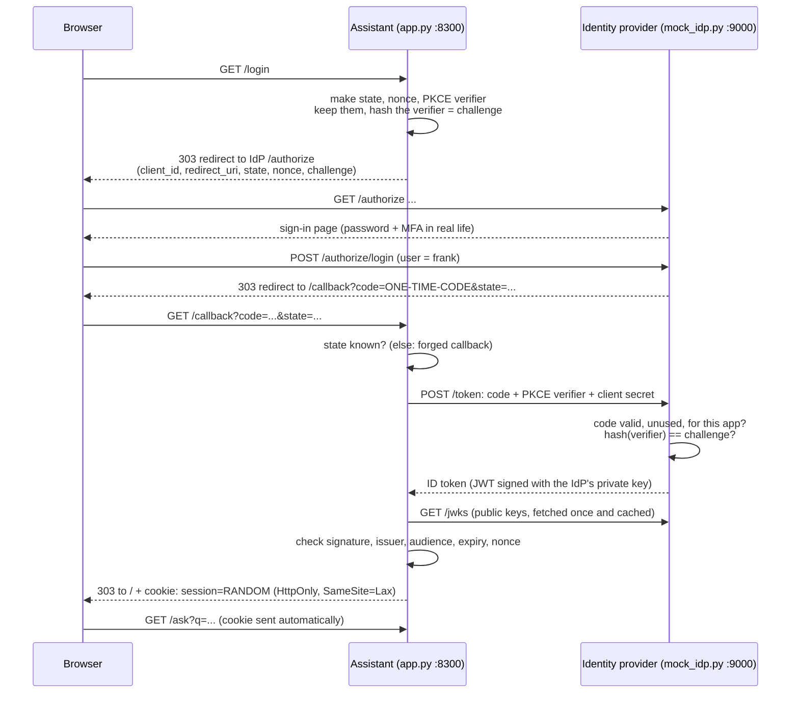
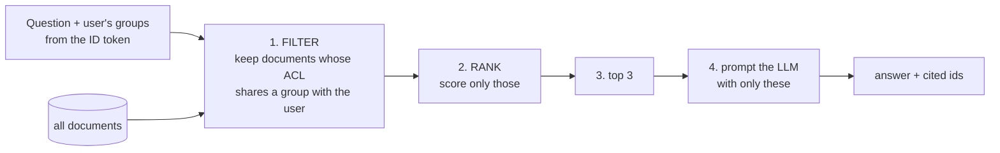

# 08 · Single sign-on and permissions-aware AI

**What you'll build:** a mock company identity provider (like Microsoft Entra ID or Okta) that speaks **OpenID Connect**, and a Northwind assistant that signs users in through it (authorization code flow with PKCE, state and nonce), validates their **ID token** (a signed JWT) properly, and answers questions using **only the documents the user's groups may read**. 21 tests prove that forged, expired, replayed and misdirected tokens are refused, and that restricted text never reaches search results, the LLM prompt or the logs.
**Like you're 5:** single sign-on is like a school wristband. You show your face once at the front desk (the identity provider) and get a wristband that says your name and your class (the ID token). Every room (app) checks the wristband instead of asking you again. And the library assistant only fetches books from the shelves your class is allowed to use, even if you ask very nicely for a book from the teachers' shelf.
**Time:** ~3 h · **Builds on:** [07 · Connecting to company systems](../07-connecting-to-company-systems-rest-webhooks-oauth) and [AI Engineer Journey 1.6 · Login API: hashed passwords and JWT](../../../ai-engineer-journey/level-1-apis/06-login-api-hashed-passwords-and-jwt) · **Needs:** nothing extra to run and test; an Anthropic API key **or** a local Ollama model for AI-written answers

## Why this matters
Enterprises don't let you add another username and password: every internal tool must use their **single sign-on (SSO)**, so people are added and removed in one place. And the first question every security team asks about an AI assistant is: "Can a support agent get it to reveal the finance or HR documents?" If the answer depends on the model's good behaviour, the project stops there. The only acceptable answer is architectural: the model is never *given* documents the user can't read. This lesson builds exactly that.

## What you'll learn
- **SSO with OpenID Connect (OIDC):** your app sends the user to the company's **identity provider (IdP)**, which signs them in and sends back proof of who they are.
- **The authorization code flow with PKCE, state and nonce:** the safe way for a web app to sign users in, and the attack each piece prevents.
- **JWT validation:** checking signature (with the IdP's public keys from **JWKS**), issuer, audience, expiry and nonce, and refusing `alg: none`.
- **Sessions:** after sign-in, a random session id in an `HttpOnly`, `SameSite` cookie.
- **Permissions-aware retrieval:** each document has an **access control list (ACL)** of groups; search **filters first, then ranks**, so restricted text never reaches the LLM.

## Before you start
- Install (virtual environment on):
  ```bash
  pip install -r requirements.txt
  ```
  | Package | What it's for |
  |---------|---------------|
  | `fastapi`, `uvicorn[standard]` | the identity provider and the assistant are two web apps |
  | `httpx` | the assistant calls the identity provider's `/token` and `/jwks` |
  | `python-multipart` | reads the sign-in and token forms |
  | `PyJWT[crypto]` | creates and checks JWTs; `[crypto]` adds RSA support |
  | `cryptography` | generates the identity provider's RSA key pair |
  | `anthropic`, `openai` | the course's `llm.py` (Claude, or Ollama through its OpenAI-compatible API) |
  | `pytest` | runs the tests |
- **AI (optional):** set `ANTHROPIC_API_KEY`, or use Ollama (`ollama pull llama3.2`, `export LLM_PROVIDER=ollama`). Without either, `/ask` still works: it lists the documents you're allowed to read instead of writing an answer.

**What's in this folder**

| File | What it is |
|------|------------|
| `mock_idp.py` | the pretend identity provider (port 9000): discovery, sign-in page, `/token`, `/jwks` |
| `jwt_check.py` | `validate_id_token()`: every check a real app must do |
| `acl_search.py` | 5 Northwind documents with group ACLs, and a search that filters first |
| `app.py` | the assistant (port 8300): `/login`, `/callback`, `/ask`, `/logout` |
| `llm.py`, `fake_llm.py` | the course's LLM helper and the fake used in tests |
| `test_sso.py` | 21 tests: token attacks, the permission matrix, the full login flow |

**The people and documents**

| User | Groups | Can read |
|------|--------|----------|
| Alice Jansen | staff, support | DOC-1 Delivery terms, DOC-2 WISMO reply macros |
| Frank de Vries | staff, finance | DOC-1, DOC-3 Credit note approval limits |
| Carol Nowak | staff, claims | DOC-1, DOC-4 Claims handling procedure |
| Dana Okafor | staff, management | DOC-1, DOC-3, DOC-4, DOC-5 Salary bands 2027 |

## How sign-in works



Why each piece exists:

| Piece | What it is | The attack it stops |
|-------|------------|---------------------|
| **authorization code** | a one-time, 60-second code in the browser's address bar, swapped for the token server-to-server | tokens never travel through the browser's address bar or history |
| **client secret** at `/token` | proves the code is being swapped by *our* app | someone else's app using a code it intercepted |
| **PKCE** (`code_challenge` / `code_verifier`) | the app keeps a random secret, sends only its hash first, and the secret itself at `/token` | a stolen code is useless without the verifier, which never left the server |
| **state** | random value sent out and checked on return, usable once | an attacker tricking your browser into finishing *their* login (CSRF) |
| **nonce** | random value that the IdP copies into the ID token | replaying an ID token from another login |
| **registered redirect URIs** | the IdP only sends users back to addresses the app registered | sending the code to an attacker's website |
| `HttpOnly`, `SameSite=Lax` cookie | the session id can't be read by page scripts or sent by other sites' forms | session theft through injected scripts; cross-site requests |

### Inside an ID token
A JWT is three **base64url**-encoded parts joined by dots: `HEADER.PAYLOAD.SIGNATURE`, for example `eyJhbGciOiJSUzI1NiIsImtpZCI6ImYyZWRmOGIxIiwidHlwIjoiSldUIn0.eyJpc3Mi...` (about 685 characters). Decoded:
```
header:  {"alg": "RS256", "kid": "f2edf8b1", "typ": "JWT"}
payload: {"iss": "http://127.0.0.1:9000", "aud": "northwind-assistant", "sub": "frank",
          "name": "Frank de Vries", "email": "frank@northwind.example", "groups": ["staff", "finance"],
          "nonce": "Qm1x9w", "iat": 1792656000, "exp": 1792656300}
```
| Field | Meaning | Checked in `validate_id_token()` |
|-------|---------|----------------------------------|
| `alg` | how it was signed: `RS256` = RSA signature over a SHA-256 hash | only `RS256` allowed; never `none` |
| `kid` | key id: which of the IdP's public keys to use | must exist in `/jwks` |
| `iss` | issuer: who made the token | must be our IdP |
| `aud` | audience: which app it is for | must be our client id |
| `sub` | subject: the user's stable id | required |
| `groups` | the user's groups (what permissions are built on) | used by `/ask` |
| `nonce` | copied from our `/login` | must match the one we stored |
| `iat`, `exp` | issued at, expires at (seconds since 1 January 1970, "Unix time") | must not be expired (30 s leeway) |

Anyone can decode the payload (paste a token into any JWT viewer): it's **encoded, not encrypted**. What nobody can do without the IdP's private key is make the signature match a changed payload. That's why `test_changed_payload_is_refused` promotes Alice to `management` and fails.

## How permissions-aware answers work


The order matters. If you rank everything first and filter afterwards ("post-filtering"):
- restricted documents use up the top-3 slots, so allowed answers disappear (`test_filter_happens_before_top_k`);
- one forgotten filter in one code path sends restricted text to the LLM, and no system prompt reliably stops a model from repeating text it was given;
- counts and scores can leak that a matching secret document exists.

In production the same rule lives **inside the database query**, so the filter can't be forgotten:
```sql
-- PostgreSQL + pgvector (AI from Zero lesson 26): filter by ACL in the same query that ranks by meaning
SELECT id, title, text
FROM chunks
WHERE allowed_groups && %(user_groups)s        -- && = "the two arrays share at least one element"
ORDER BY embedding <=> %(question_embedding)s  -- <=> = cosine distance (pgvector)
LIMIT 3;
```
In Chroma it's a metadata filter on the query (for example `where={"group_support": True}`); every vector database has an equivalent. The groups come from the **verified** token, never from something the user typed.

## Run it
1. Open a terminal in the course folder `forward-deployed-ai-engineer`, virtual environment on. Go to this lesson and install:
   ```bash
   cd part-2-enterprise-data-and-integration/08-single-sign-on-and-permissions-aware-ai
   pip install -r requirements.txt
   ```
2. Run the tests (no servers or key needed):
   ```bash
   pytest -q
   ```
3. **Terminal 1:** start the identity provider:
   ```bash
   uvicorn mock_idp:app --port 9000
   ```
4. **Terminal 2** (same folder, virtual environment on, and your `ANTHROPIC_API_KEY` or `LLM_PROVIDER=ollama` if you want AI answers): start the assistant:
   ```bash
   uvicorn app:app --port 8300
   ```
5. Open **http://127.0.0.1:8300** (use exactly `127.0.0.1`, not `localhost`: cookies belong to the exact host name, and the IdP sends you back to `127.0.0.1`).
6. Click **Sign in with Northwind SSO**, pick **Frank de Vries (staff, finance)**. You land back on the assistant: "Hi Frank de Vries".
7. Ask `credit note approval limit`, then `salary bands`. Read the JSON answers.
8. Click **sign out**, sign in as **Alice Jansen**, and ask the same two questions.
9. Peek at what the IdP publishes: http://127.0.0.1:9000/.well-known/openid-configuration and http://127.0.0.1:9000/jwks.

**Commands and addresses, piece by piece**

| Piece | Meaning |
|-------|---------|
| `uvicorn mock_idp:app --port 9000` | run the identity provider on port 9000 |
| `uvicorn app:app --port 8300` | run the assistant on port 8300 |
| `/.well-known/openid-configuration` | the standard address where every OIDC provider lists its other addresses (**discovery**) |
| `/jwks` | **JSON Web Key Set**: the provider's public keys. `n` and `e` are the two numbers that make up an RSA public key |
| `/ask?q=salary+bands` | `?` starts the query string; `+` is how a space is written in a URL |

### What you should see
Tests (step 2):
```
.....................                                                    [100%]
21 passed in 0.96s
```
Step 7 as Frank, with no AI configured (real output):
```
{"user":"frank","groups":["staff","finance"],"mode":"sources_only","sources":[{"id":"DOC-3","title":"Credit note approval limits"},{"id":"DOC-1","title":"Delivery terms"}],"answer":"AI unavailable (ANTHROPIC_API_KEY is not set in this terminal). Documents you may read: [DOC-3] Credit note approval limits; [DOC-1] Delivery terms"}
{"user":"frank","groups":["staff","finance"],"mode":"sources_only","sources":[],"answer":"AI unavailable (ANTHROPIC_API_KEY is not set in this terminal). Documents you may read: none match your question"}
```
Step 8 as Alice (real output):
```
{"user":"alice","groups":["staff","support"],"mode":"sources_only","sources":[{"id":"DOC-1","title":"Delivery terms"},{"id":"DOC-2","title":"WISMO reply macros"}],...}
{"user":"alice","groups":["staff","support"],"mode":"sources_only","sources":[],...}
```
Same questions, different people, different documents. Neither Frank nor Alice even learns that a salary document exists. Terminal 2 logs ids, never document text:
```
[ask] user=frank groups=['staff', 'finance'] sources=['DOC-3', 'DOC-1']
[ask] user=frank groups=['staff', 'finance'] sources=[]
[ask] user=alice groups=['staff', 'support'] sources=['DOC-1', 'DOC-2']
```
With AI configured, Frank's first answer reads like this (**example**, wording varies):
```
"answer": "Credit notes up to 1,000 EUR are approved by finance; above 1,000 EUR the CFO must approve [DOC-3]."
```
Reloading an old `/callback` address (for example with the browser's back button) gives:
```
{"detail":"unknown or reused state: start again at /login"}
```

## How it works

### `mock_idp.py`
1. **`PRIVATE_KEY`** is a fresh 2048-bit RSA key pair, created at start-up. The private half signs tokens; `/jwks` publishes only the public half (`RSAAlgorithm.to_jwk(PRIVATE_KEY.public_key())`). Restarting the IdP changes the key, just like real **key rotation**; that's what `kid` is for.
2. **`USERS`** is the company directory with groups. **`CLIENTS`** holds the registered app with its secret and allowed `redirect_uris`.
3. **`/authorize`** refuses unknown clients and unregistered redirect addresses, then shows a page with one button per user, carrying `state`, `nonce` and `code_challenge` along in hidden form fields.
4. **`/authorize/login`** stores a one-time `code` for 60 seconds and redirects the browser to `redirect_uri?code=...&state=...`.
5. **`/token`** checks the client's Basic auth, `CODES.pop(code)` (so a code works once), that the code was issued to this client and redirect address, and that `pkce_challenge(code_verifier)` equals the stored challenge. Then it signs the claims with `jwt.encode(..., algorithm="RS256", headers={"kid": KEY_ID})`.

### `jwt_check.py`
1. **`public_key_for(token, jwks)`** reads the header's `kid` (reading before verifying is fine; trusting it is not) and builds the key with `jwt.PyJWK(...)`.
2. **`validate_id_token()`** calls `jwt.decode()` with `algorithms=["RS256"]` (a fixed list: the token doesn't get to choose, which blocks the classic `alg: none` and algorithm-switching attacks), `audience`, `issuer`, a 30-second `leeway` for clock differences, and `require` for the essential claims. Each failure becomes a `TokenError` with a plain reason. Finally it compares the `nonce`.

### `acl_search.py`
`allowed()` intersects two sets of groups (`&`). `search()` builds `visible` first, then sorts by a tiny keyword `score()` (title words count double), then keeps the top `top_k` with a score above zero. Swap `score()` for embeddings (AI from Zero Part 5, lesson 11 of this course) and the structure stays the same.

### `app.py`
1. **`idp()`** fetches the discovery document and the JWKS once and caches them.
2. **`/login`** creates `state`, `nonce` and a PKCE `verifier` with `secrets.token_urlsafe()` (cryptographically random text), stores them in `PENDING[state]`, and redirects to the IdP with the hashed `challenge`.
3. **`/callback`** pops `PENDING[state]` (unknown or reused → 400), swaps the code at `/token` with the verifier and client secret, validates the ID token, creates a random session id, stores the claims in `SESSIONS`, and sets the cookie.
4. **`/ask`** gets the user from the session (no session → 401), calls `search(q, user["groups"])`, and builds the prompt **only** from those documents, wrapped in `<documents>` tags with ids so the answer can cite them. If the LLM isn't available it lists the permitted titles instead. The log line records user, groups and document **ids**: enough to audit, without copying sensitive text into logs.

In production you'd also: keep sessions and pending logins in a shared store (Redis or a database) instead of dictionaries, set `secure=True` on the cookie (HTTPS only), refresh the JWKS when an unknown `kid` appears, and use a maintained OIDC library (for example Authlib) for the protocol details. Knowing what it does for you, as you now do, is what lets you debug it at a customer.

### Real identity providers
| Provider | Where the group claim comes from |
|----------|----------------------------------|
| Microsoft Entra ID | enable "groups" in the app registration's token configuration; groups arrive as ids (GUIDs), and users in very many groups get an "overage" pointer instead, which you resolve with Microsoft Graph |
| Okta | add a "groups" claim with a filter in the authorization server |
| Google Workspace | no groups in the ID token; look them up with the Admin SDK Directory API |
| Keycloak (open source, often on-prem) | add a "group membership" mapper to the client |

## If something goes wrong
- **After signing in you are back at "Sign in with Northwind SSO"** → you opened the assistant as `localhost:8300` but the IdP returned you to `127.0.0.1:8300`; the cookie belongs to `127.0.0.1`. Always use `http://127.0.0.1:8300`.
- **`httpx.ConnectError` when clicking Sign in** → the identity provider isn't running. Start terminal 1 first.
- **`sign-in failed: unknown key id ...`** → you restarted the IdP (new keys) while the assistant kept the old ones in its cache. Restart the assistant too (in production: re-fetch the JWKS when a `kid` is unknown).
- **`{"detail":"unknown or reused state: start again at /login"}`** → you reloaded or went back to an old `/callback` page. Each login can finish only once: go to `/login` again.
- **`ModuleNotFoundError: No module named 'jwt'`** → the package is called `PyJWT` but imported as `jwt`. Run `pip install -r requirements.txt` with the virtual environment on. (If you have the unrelated package `jwt` installed, uninstall it: `pip uninstall jwt`.)

## Try this
1. **Add a user.** Add `"sam": {"name": "Sam Lee", "email": "sam@northwind.example", "groups": ["staff", "support", "claims"]}` to `USERS` in `mock_idp.py`, restart the IdP, sign in as Sam and ask about damage claims. Then add Sam to the `ACCESS` table in the tests.
   <details><summary>Hint</summary>

   Sam is in two specialist groups, so he can read DOC-1, DOC-2 and DOC-4. The test `test_every_user_sees_exactly_their_documents` runs once per entry in `ACCESS`: add `"sam": {"DOC-1", "DOC-2", "DOC-4"}`.
   </details>
2. **Document-level deny.** Some customers also need "everyone in finance except contractors". Add an optional `"denied_groups"` list to documents and make `allowed()` return `False` if the user is in any denied group. Add a test.
   <details><summary>Solution</summary>

   ```python
   def allowed(document, user_groups):
       groups = set(user_groups)
       if groups & set(document.get("denied_groups", [])):     # a deny always wins over an allow
           return False
       return bool(groups & set(document["allowed_groups"]))
   ```
   Test idea: give DOC-3 `"denied_groups": ["contractors"]` in a copy of the documents, and check that `search("credit note", ["finance", "contractors"], documents=copy)` doesn't return it.
   </details>
3. **Token lifetime.** The ID token expires in 5 minutes, but the session lasts 8 hours. Make `/ask` refuse sessions older than 1 hour by storing the login time in the session and checking it.
   <details><summary>Solution</summary>

   In `callback()`: `SESSIONS[session_id] = {**claims, "signed_in_at": time.time()}` (add `import time`). In `current_user()`:
   ```python
   if time.time() - user["signed_in_at"] > 3600:
       SESSIONS.pop(session_id, None)
       raise HTTPException(401, "session expired: sign in again at /login")
   ```
   Because the IdP remembers who is signed in, users usually go through `/login` again without typing anything: that's the "single" in single sign-on.
   </details>

## Check yourself
1. Why must the assistant check the token's `aud` (audience), even if the signature is valid?
2. What does PKCE protect against, given that the code already travels only once?
3. Why is "tell the model in the system prompt not to reveal finance documents" not an acceptable permission system?
4. Where should the user's groups come from: the request, the session, or the ID token? Why?

<details><summary>Answers</summary>

1. A valid token from the same IdP might have been issued for a different app (say, a low-security internal tool). If you accepted it, anyone who can get a token for *any* company app could use yours. `aud` says "this token is for northwind-assistant".
2. Interception of the code (through browser history, logs, a malicious browser extension, or a mobile app's redirect). Without the verifier, which never leaves the app's server, the stolen code can't be swapped for a token.
3. Models can be tricked (prompt injection) or simply make mistakes, and the restricted text would already be in the prompt, logs and traces. Permissions must be enforced before retrieval, in code and in the database query, so restricted text is never given to the model at all.
4. From the validated ID token (stored in the server-side session after validation). Anything in the request can be typed by the user; the token's groups are signed by the IdP.
</details>

## Learn more (optional)
**Read the official docs**
- OpenID Connect Core 1.0 (the specification): https://openid.net/specs/openid-connect-core-1_0.html
- PKCE (RFC 7636): https://datatracker.ietf.org/doc/html/rfc7636
- JSON Web Token (RFC 7519): https://datatracker.ietf.org/doc/html/rfc7519
- PyJWT usage examples: https://pyjwt.readthedocs.io/en/stable/usage.html
- Microsoft identity platform and OpenID Connect: https://learn.microsoft.com/en-us/entra/identity-platform/v2-protocols-oidc
- Microsoft: configure group claims for applications: https://learn.microsoft.com/en-us/entra/identity/hybrid/connect/how-to-connect-fed-group-claims
- pgvector (filtering and ranking in one query): https://github.com/pgvector/pgvector
- OWASP Top 10 for LLM applications (sensitive information disclosure): https://owasp.org/www-project-top-10-for-large-language-model-applications/

**Watch**
- OAuth 2.0 and OpenID Connect in plain English (search): https://www.youtube.com/results?search_query=oauth+2.0+and+openid+connect+in+plain+english
- PKCE explained (search): https://www.youtube.com/results?search_query=pkce+explained
- JWT explained (search): https://www.youtube.com/results?search_query=jwt+explained
- Permission-aware RAG / document level security (search): https://www.youtube.com/results?search_query=rag+document+level+access+control

## Next
→ [09 · PII detection and redaction](../09-pii-detection-and-redaction)
