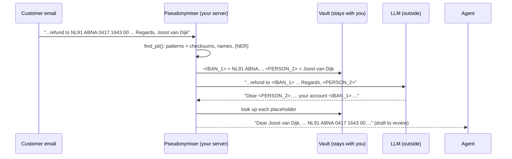
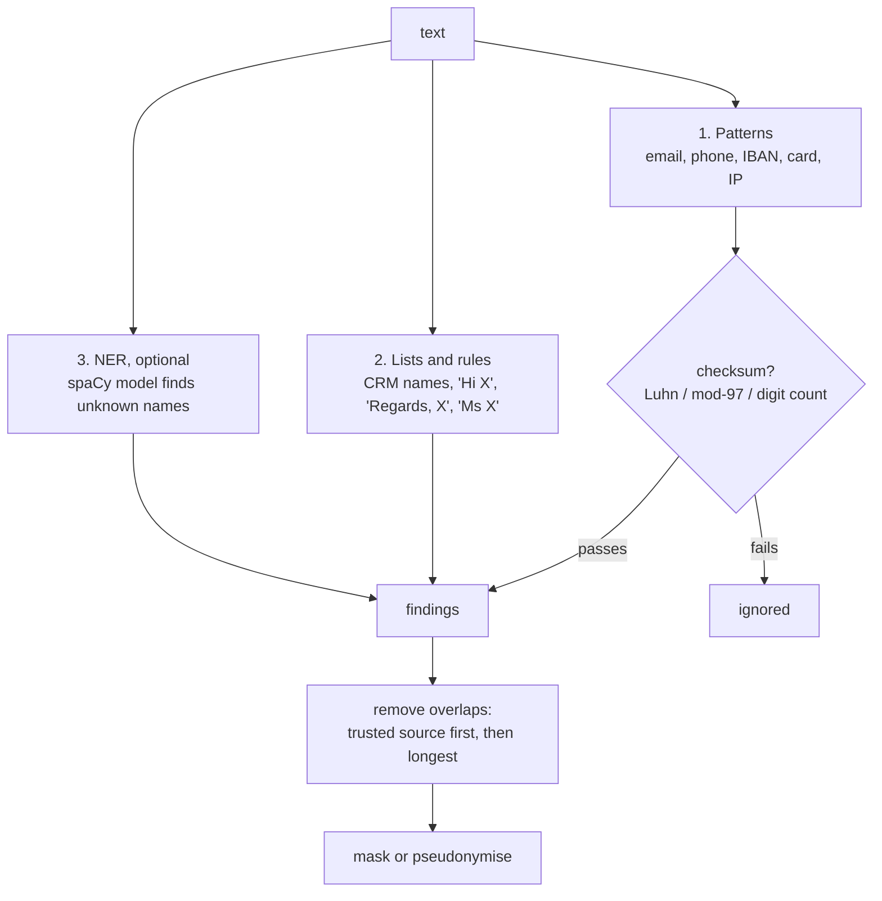

# 09 · PII detection and redaction

**What you'll build:** a personal-data detector (`pii.py`) that finds emails, phone numbers, IBANs, card numbers, IP addresses and names in three layers (patterns with checksums, known-name lists and rules, and an optional NER model); one-way **masking** for logs; reversible **pseudonymisation** so an LLM only ever sees placeholders like `<PERSON_1>` and you put the real values back afterwards; and a logging filter that masks anything that slips into a log line. You'll also try **Microsoft Presidio**, the open-source toolkit many companies use for the same job.
**Like you're 5:** before you post a letter to a pen friend you've never met, you cover your home address and phone number with stickers that say "ADDRESS" and "PHONE". Your pen friend can still answer the letter ("I hope PHONE rings soon!"), and when the answer comes back, you peel the stickers off at home.
**Time:** ~2.5 h · **Builds on:** [08 · Single sign-on and permissions-aware AI](../08-single-sign-on-and-permissions-aware-ai) · **Needs:** nothing extra to run and test; an Anthropic API key **or** a local Ollama model for a live reply; optional spaCy/Presidio install (about 60 MB) for the NER layer

## Why this matters
Customer tickets, emails and CRM notes are full of personal data: names, phone numbers, bank details. Laws like the EU's **GDPR** require you to process only what you need (**data minimisation**), and customers' security teams will ask exactly where each piece goes: to the LLM provider? into logs? into traces? An FDE who can say "bank details and names are replaced by placeholders before any model call, and logs are masked by a filter, here are the tests" gets through the security review in days instead of months. This was in Northwind's design doc (lesson 03) as a requirement.

## What you'll learn
- **PII (personally identifiable information):** data that identifies a person, directly (name, email) or together with other data (IP address).
- **Detection layers:** **patterns** (regular expressions) made reliable with **checksums** (Luhn for cards, mod-97 for IBANs), **lists and rules** (names you already know, greetings, sign-offs), and **NER** (named-entity recognition: a model that spots names it has never seen).
- **Masking vs pseudonymisation:** masking (`[PHONE]`) is one-way; pseudonymisation (`<PHONE_1>`) keeps a private **vault** so you can restore the real values later.
- **The LLM round trip:** pseudonymise → model → restore, so the model never sees the real values.
- **Logging hygiene:** log ids and counts, not content; and add a masking filter as a safety net.

## Before you start
- Install (virtual environment on):
  ```bash
  pip install -r requirements.txt
  ```
  | Package | What it's for |
  |---------|---------------|
  | `anthropic`, `openai` | the course's `llm.py` (Claude, or a local Ollama model) |
  | `cryptography` | encrypts the placeholder vault (`Fernet`) |
  | `pytest` | runs the tests |
- **Optional, for `--ner` and `presidio_demo.py`:**
  ```bash
  pip install -r requirements-optional.txt
  ```
  | Package | What it's for |
  |---------|---------------|
  | `spacy` | a natural-language-processing library; we use its NER |
  | `en_core_web_sm` (the long GitHub link) | spaCy's small English model (about 13 MB), downloaded as a Python package from spaCy's official releases on GitHub |
  | `presidio-analyzer`, `presidio-anonymizer` | Microsoft's open-source PII detection and anonymisation toolkit |
- **AI (optional):** `ANTHROPIC_API_KEY`, or Ollama with `export LLM_PROVIDER=ollama`. Without either, the demo uses a clearly labelled example reply.

**What's in this folder**

| File | What it is |
|------|------------|
| `pii.py` | detectors, `find_pii()`, `mask()`, and the reversible `Pseudonymiser` |
| `safe_logging.py` | a logging filter that masks PII in every log line |
| `demo.py` | the full round trip on a realistic Northwind customer email |
| `presidio_demo.py` | the same with Microsoft Presidio, plus a custom recogniser |
| `llm.py`, `fake_llm.py` | the course's LLM helper and the test fake |
| `test_pii.py` | 18 tests (one needs the optional NER install and is skipped without it) |
| `requirements-optional.txt` | the extra packages for NER and Presidio |

## The privacy round trip


The model writes a perfectly good reply without ever knowing the real name or account number.

### Three words that are often mixed up
| | What happens | Can you get the data back? | Still "personal data" under GDPR? |
|---|---|---|---|
| **Masking / redaction** | `+31 6 1234 5678` → `[PHONE]` | no | the masked text usually isn't |
| **Pseudonymisation** | `+31 6 1234 5678` → `<PHONE_1>`, with a vault | yes, with the vault | **yes**: whoever has the vault can re-identify people, so protect the vault |
| **Anonymisation** | data changed so nobody can ever re-identify anyone | no | no, but true anonymisation is much harder than it looks (a postcode + birth date + gender is often unique) |

### Detection in three layers

Each layer catches what the others miss. Patterns are precise for structured data; lists are perfect for names you already know (the sender's name is in the CRM); NER catches the driver's name nobody listed, but is a statistical model and sometimes wrong.

## Run it
1. Open a terminal in the course folder `forward-deployed-ai-engineer`, virtual environment on. Go to this lesson and install:
   ```bash
   cd part-2-enterprise-data-and-integration/09-pii-detection-and-redaction
   pip install -r requirements.txt
   ```
2. Run the tests:
   ```bash
   pytest -q
   ```
3. Run the round trip (patterns, lists and rules only):
   ```bash
   python demo.py
   ```
4. Optional: install the NER extras, then run with NER and compare step 1 of the output:
   ```bash
   pip install -r requirements-optional.txt
   python demo.py --ner
   ```
5. Optional: the same email through Presidio:
   ```bash
   python presidio_demo.py
   ```
6. Try your own text in Python's interactive mode:
   ```bash
   python -c "import pii; print(pii.mask('Mail me at sam@example.com or call 06-12345678'))"
   ```

**Commands, piece by piece**

| Piece | Meaning |
|-------|---------|
| `-r requirements-optional.txt` | install every line of that file; a line can be a package name or a direct link to a package file (`.whl`, a "wheel": Python's ready-to-install package format) |
| `--ner` | an on/off option: also run the spaCy NER layer |
| `python -c "..."` | run the Python code inside the quotes directly, without a file |
| `import pii; print(...)` | `;` separates two Python statements on one line |

### What you should see
Step 2: `18 passed` (or `17 passed, 1 skipped` without the optional NER install).

Step 3 (real output, no AI configured):
```
1) PII found:
   IBAN         'NL91 ABNA 0417 1643 00'                   via pattern
   CREDIT_CARD  '4111 1111 1111 1111'                      via pattern
   PHONE        '+31 6 1234 5678'                          via pattern
   PHONE        '030 555 0199'                             via pattern
   PERSON       'Kowalska'                                 via rule
   IP_ADDRESS   '192.168.10.24'                            via pattern
   PERSON       'Joost van Dijk'                           via list
   EMAIL        'joost.vandijk@brouwer-metals.example'     via pattern

2) What a careless log line would write, after the safety-net filter:
2026-10-23 00:03:46,925 INFO northwind: new ticket body: [IBAN], or charge my card [CREDIT_CARD] for the re-delivery.

3) What the LLM receives:
Hello,

My pallet NW-4821907 to Utrecht is late again (promised 2026-10-20). Please refund the 10% credit to
<IBAN_1>, or charge my card <CREDIT_CARD_1> for the re-delivery.
Call me on <PHONE_1> or my office <PHONE_2>. Ms <PERSON_1> from your team said it was fixed,
but your driver Pieter Bakker never came.
Our portal logs show the order came from <IP_ADDRESS_1>. Invoice INV-2291, amount 1,250.00 EUR.

Regards,
<PERSON_2>
<EMAIL_1>

4) No AI available (ANTHROPIC_API_KEY is not set in this terminal).
   Using an EXAMPLE reply of the kind the LLM writes:
Dear <PERSON_2>,

I'm sorry your pallet NW-4821907 is late again. I've asked our finance team to process the 10% credit to your account <IBAN_1>; we won't charge your card. We'll call you on <PHONE_1> as soon as we have the new delivery time.
...
5) Restored on our side, ready for the agent to review:
Dear Joost van Dijk,

I'm sorry your pallet NW-4821907 is late again. I've asked our finance team to process the 10% credit to your account NL91 ABNA 0417 1643 00; we won't charge your card. We'll call you on +31 6 1234 5678 as soon as we have the new delivery time.
...
2026-10-23 00:03:46,926 INFO northwind: drafted reply for ticket T-1042 using 8 placeholders
```
Look at what was **kept**: the tracking number, invoice number, amount and dates are business data the model needs, and none of them were touched. And look at what was **missed**: "Pieter Bakker" is still there, because nobody listed him and no rule matched. With an API key, step 4 shows the model's own reply (**example**, wording varies), still full of placeholders.

Step 4, with `--ner` (real output, first lines): the NER layer finds the driver, and the placeholders shift by one.
```
   PERSON       'Kowalska'                                 via rule
   PERSON       'Pieter Bakker'                            via ner
   ...
Call me on <PHONE_1> or my office <PHONE_2>. Ms <PERSON_1> from your team said it was fixed,
but your driver <PERSON_2> never came.
...
Regards,
<PERSON_3>
```
Step 5 (real output; the first run may first print a warning while it tries to download the internet's public-suffix list, used to check email domains):
```
Found:
   IBAN_CODE       'NL91 ABNA 0417 1643 00'                   score 1.00
   PHONE_NUMBER    '0417 1643 00'                             score 0.40
   CREDIT_CARD     '4111 1111 1111 1111'                      score 1.00
   PHONE_NUMBER    '+31 6 1234 5678'                          score 0.40
   PHONE_NUMBER    '030 555 0199'                             score 0.40
   PERSON          'Ms Kowalska'                              score 0.85
   PERSON          'Pieter Bakker'                            score 0.85
   IP_ADDRESS      '192.168.10.24'                            score 0.60
   PHONE_NUMBER    '192.168.10.24'                            score 0.40
   PERSON          'Joost van Dijk\njoost.vandijk@brouwer-metals.example\nCustomer' score 0.85
   NW_CUSTOMER_ID  'NWC-004471'                               score 1.00
```
Presidio gives every finding a **confidence score**, so you choose a threshold. Notice its mistakes too: part of the IBAN and the IP address also scored as phone numbers (low score, 0.40), and the small NER model swallowed the sign-off, the email and the next line into one "person". Every tool makes mistakes; that's why you test on the customer's real data and combine layers. (The exact list can vary slightly between Presidio and model versions.)

## How it works

### `pii.py`
1. **`Finding`** is a small **dataclass** (a class that just holds named values): where the PII starts and ends, its kind, the text, and which layer found it.
2. **`PATTERNS`** holds one compiled regular expression per kind. A few symbols you'll see: `\b` word boundary; `\d` a digit; `{2,7}` "between 2 and 7 times"; `(?: ...)` a group that isn't captured; `(?<![\w+])` "not preceded by a letter, digit or `+`" (a **lookbehind**); `(?!\w)` "not followed by a letter or digit" (a **lookahead**).
3. **Checksums** turn "looks like" into "is": `luhn_ok()` (every real card number passes it; most random digit strings don't), `iban_ok()` (move the first four characters to the end, turn letters into numbers with A = 10, the result modulo 97 must be 1), and `phone_ok()` (9 to 15 digits). That's how `4111 1111 1111 1112` and the tracking number `NW-4821907` stay untouched.
4. **`find_names(text, known_names)`** matches names you already know (case-insensitive, whole words) and four rules: titles (`Ms Kowalska`), introductions (`my name is ...`), greetings (`Dear ...`) and sign-offs (a name on the line after `Regards,`).
5. **`find_with_ner()`** loads spaCy's model once and keeps entities labelled `PERSON`.
6. **`find_pii()`** collects all candidates and removes overlaps: the most trusted source wins (`PRIORITY`: checked pattern, then list, then rule, then NER), then the longest. So an over-long NER guess can't swallow an email address that a pattern found exactly.
7. **`mask()`** replaces each finding with `[KIND]`, working from the end of the text backwards so earlier positions stay correct.
8. **`Pseudonymiser`**:
   - `pseudonymise(text)` gives each distinct value a numbered placeholder in reading order. The key is normalised (spaces removed, lower case), so `NL91 ABNA...` and `NL91ABNA...` share `<IBAN_1>`, and the same person is always the same placeholder across a conversation;
   - `restore(text)` swaps placeholders back; one the model invented (`<PERSON_7>`) is left visible instead of guessed;
   - `placeholder_for(kind, value)` tells you which placeholder stands for a value;
   - `export_vault(key)` / `import_vault(key, token)` encrypt the vault with **Fernet** (symmetric encryption from the `cryptography` package), for when it must be stored, for example between turns of a chat. The vault is the most sensitive thing in this whole design: store it encrypted, delete it when the conversation ends, never log it.

### `safe_logging.py`
`RedactingFilter` is a `logging.Filter`: Python calls its `filter(record)` for every log record before writing it. It builds the final message with `record.getMessage()`, masks it, and stores the masked text back. `get_logger()` attaches it to a handler and sets `propagate = False` so records don't also flow to other, unfiltered handlers. It's a **safety net**, not the main rule. The main rule is in `demo.py`'s last line: log the ticket id and a count, never the content.

### `demo.py`
Runs the five steps you saw. The LLM call goes through `llm.ask()` with a system prompt that says to keep placeholders exactly as written. Without AI, it fills an example reply with the **right** placeholders using `placeholder_for()`, because numbering depends on what was found (with `--ner`, Joost becomes `<PERSON_3>`). The test `test_llm_never_sees_pii_and_reply_is_restored` runs `demo.main()` with a fake Claude and checks that none of the real values appear in anything sent to the model.

### `presidio_demo.py`
`NlpEngineProvider` tells Presidio to use the small spaCy model (its default is the 600 MB large one). A `PatternRecognizer` adds a Northwind-specific type, `NW_CUSTOMER_ID` (`NWC-` + 6 digits), with the context word "customer" to raise confidence. `AnonymizerEngine` then replaces findings using **operators**: here `replace`; others include `mask`, `hash` and `encrypt`.

### Where to put this in a real system
| Place | What to do |
|-------|-----------|
| Before every LLM call | pseudonymise prompts (and retrieved documents, if they contain PII) |
| Logs | log ids and counts; masking filter as a safety net |
| Traces and evals (lessons 12, 15) | store masked text, or restrict access to traces like you would to the database |
| Vector database (lesson 06, 11) | decide per field: does the search need the name? If not, mask before embedding |
| Data you send to customers' vendors | only after their security team approves the data flow (design doc, lesson 03) |

## If something goes wrong
- **A real phone number or name isn't found** → the formats differ per country and company. Add a pattern (with tests!), add the names you know from the CRM to `known_names`, or turn on `--ner`. Measure on a sample of real tickets: count misses and false alarms.
- **Business data is masked by mistake (an order number looks like a phone number)** → make the pattern stricter, or check the surrounding words (Presidio's `context`). Add the case to `test_business_data_is_not_mistaken_for_pii` so it never comes back.
- **`OSError: [E050] Can't find model 'en_core_web_sm'`** → install the optional extras: `pip install -r requirements-optional.txt` (with your virtual environment on).
- **`presidio_demo.py` prints a long `ProxyError ... publicsuffix.org` warning or is slow the first time** → Presidio's email check tries to download the public-suffix list from the internet. Without internet it falls back to a built-in copy and carries on; the results are still printed.
- **The restored reply contains `<PERSON_4>`** → the model invented a placeholder that isn't in the vault. Show it to the agent as is (it's visibly wrong) and tighten the system prompt; never guess a value.

## Try this
1. **Dutch citizen numbers.** Northwind's Dutch customers sometimes write their BSN (citizen service number: 9 digits that pass the "11-test"). Add a `BSN` pattern with a validator. The 11-test: multiply the digits by 9, 8, 7, 6, 5, 4, 3, 2 and -1, add them up; the total must be divisible by 11. `111222333` passes; `123456789` doesn't.
   <details><summary>Solution</summary>

   ```python
   def bsn_ok(number):
       digits = [int(d) for d in number]
       total = sum(d * w for d, w in zip(digits, [9, 8, 7, 6, 5, 4, 3, 2, -1]))
       return total % 11 == 0 and total != 0
   ```
   Add `"BSN": re.compile(r"(?<!\d)\d{9}(?!\d)")` to `PATTERNS` and `"BSN": bsn_ok` to `VALIDATORS`, then a test: `("BSN", "111222333") in kinds("BSN 111222333")` and nothing for `123456789`.
   </details>
2. **Partial masking for humans.** Agents sometimes need to recognise an account without seeing all of it. Write `partial_mask(text)` that shows only the last 4 characters of IBANs and cards (`**** **** **** 1111`).
   <details><summary>Solution</summary>

   ```python
   def partial_mask(text):
       def hide(f):
           if f.kind in ("IBAN", "CREDIT_CARD"):
               return re.sub(r"[A-Z0-9]", "*", f.text[:-4]) + f.text[-4:]
           return f"[{f.kind}]"
       return replace_findings(text, find_pii(text), hide)
   ```
   `partial_mask("card 4111 1111 1111 1111")` → `card **** **** **** 1111`.
   </details>
3. **Measure your detector.** Write 10 short sentences of your own (some with PII, some with lookalikes like order numbers), label what should be found, and compute **precision** (of what was found, how much was right) and **recall** (of what should be found, how much was found) with and without `use_ner=True`.
   <details><summary>Hint</summary>

   Store cases as `(text, {("PHONE", "06-12345678"), ...})`. For each, `found = set(kinds(text))`; true positives = `found & expected`; precision = TP / total found; recall = TP / total expected. For privacy, recall usually matters more: a missed IBAN is worse than an extra mask. Lesson 12 turns this into a proper eval.
   </details>

## Check yourself
1. Why are checksums (Luhn, mod-97) useful on top of regular expressions?
2. After pseudonymisation, is the text sent to the LLM still "personal data" under GDPR? What do you have to protect?
3. Why give the same person the same placeholder every time, instead of a new one each time?
4. Why is the logging filter called a "safety net" rather than the solution?

<details><summary>Answers</summary>

1. A pattern only checks the shape (16 digits); many non-card numbers have that shape. A checksum checks the digits themselves, so lookalikes (order numbers, typos) are rejected and you mask less business data by mistake.
2. Pseudonymised data still counts as personal data, because the vault can turn it back. You must protect the vault: keep it on your side, encrypt it if stored, delete it when done, and never log or send it.
3. So the model understands it's one person ("<PERSON_2> wrote... <PERSON_2> wants...") and writes a coherent reply, and so restoring is unambiguous.
4. Because a filter can only mask what the detector recognises; an unusual name or format slips through. The real protection is not logging content at all (ids and counts only); the filter catches mistakes.
</details>

## Learn more (optional)
**Read the official docs**
- Microsoft Presidio: https://microsoft.github.io/presidio/
- spaCy named entities: https://spacy.io/usage/linguistic-features#named-entities
- Python `logging` cookbook (filters): https://docs.python.org/3/howto/logging-cookbook.html
- Python `re` (regular expressions): https://docs.python.org/3/library/re.html
- `cryptography` Fernet: https://cryptography.io/en/latest/fernet/
- GDPR text (EUR-Lex): https://eur-lex.europa.eu/eli/reg/2016/679/oj
- Anthropic privacy and data usage (Claude API): https://privacy.claude.com/
- OWASP Top 10 for LLM applications: https://owasp.org/www-project-top-10-for-large-language-model-applications/

**Watch**
- What is PII and why it matters (search): https://www.youtube.com/results?search_query=what+is+pii+personally+identifiable+information
- Microsoft Presidio PII detection tutorial (search): https://www.youtube.com/results?search_query=microsoft+presidio+pii+tutorial
- GDPR explained for developers (search): https://www.youtube.com/results?search_query=gdpr+explained+for+developers
- Regular expressions tutorial (search): https://www.youtube.com/results?search_query=regular+expressions+tutorial+python

## Next
This is the last lesson of Part 2. Next: **Part 3 · Production LLM engineering**.
→ [10 · Prompt engineering patterns that hold up](../../part-3-production-llm-engineering/10-prompt-engineering-patterns-that-hold-up)
