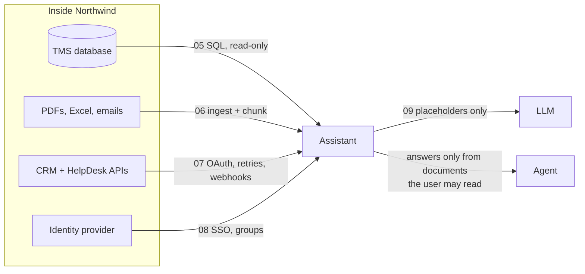

# Part 2 · Enterprise data and integration

The customer said yes to the pilot. Now you need their data and their systems: a messy SQL database, PDFs, spreadsheets and emails, company APIs behind OAuth, webhooks, single sign-on, permissions, and personal data that must be protected. This is the part of the FDE job that tutorials skip and customers judge you on. Everything runs locally against realistic mocks of **Northwind Logistics'** systems.

| # | Lesson | What you'll have | Time |
|---|--------|------------------|------|
| 05 | [SQL for real company data](05-sql-for-real-company-data) | a messy Northwind database, a read-only SQL runner and 8 annotated query files (joins, GROUP BY, cleaning, CTEs, window functions), on SQLite and PostgreSQL | 3 h |
| 06 | [Ingesting messy documents: PDF, Excel, email](06-ingesting-messy-documents-pdf-excel-email) | a pipeline that turns PDFs, Excel, `.eml` and HTML into clean chunks with metadata | 3 h |
| 07 | [Connecting to company systems: REST, webhooks, OAuth](07-connecting-to-company-systems-rest-webhooks-oauth) | mock CRM + HelpDesk APIs, a robust client (tokens, retries, pagination, idempotency) and a signed-webhook receiver | 3 h |
| 08 | [Single sign-on and permissions-aware AI](08-single-sign-on-and-permissions-aware-ai) | a mock identity provider, OIDC login with PKCE, JWT validation and search that never shows users what they may not see | 3 h |
| 09 | [PII detection and redaction](09-pii-detection-and-redaction) | a PII detector, masking for logs, reversible pseudonymisation around LLM calls, and Presidio | 2.5 h |

**Total: about 14.5 hours** (two to three weeks at 1 hour a day).

## How the pieces fit together



## Set up for this part
1. Follow **Set up once** in the [course README](../README.md#set-up-once).
2. In each lesson folder, install that lesson's packages:
   ```bash
   pip install -r requirements.txt
   ```
   | Lesson | Packages |
   |--------|----------|
   | 05 | `psycopg[binary]` (only for the optional PostgreSQL steps), `pytest` |
   | 06 | `pypdf`, `openpyxl`, `pandas`, `beautifulsoup4`, `reportlab`, `pytest` |
   | 07 | `fastapi`, `uvicorn[standard]`, `httpx`, `python-multipart`, `pytest` |
   | 08 | the lesson 07 list plus `PyJWT[crypto]`, `cryptography`, `anthropic`, `openai` |
   | 09 | `anthropic`, `openai`, `cryptography`, `pytest`; optional `requirements-optional.txt` (spaCy + Presidio) |
3. **Optional:** PostgreSQL 16 for lesson 05 (installed, or in Docker); an Anthropic API key or Ollama for AI-written answers in lessons 08 and 09. All tests run without them.
4. Lessons 07 and 08 run two servers at once: keep two or three terminals open, each in the lesson folder with the virtual environment on.

## After this part you can
- Measure a customer's problem directly in their database, safely and read-only, and find the data-quality problems before they bite.
- Turn messy PDFs, spreadsheets, emails and web pages into clean, cited chunks for RAG.
- Integrate with enterprise APIs the way their IT team expects: OAuth2, scopes, pagination, rate limits, retries, idempotency, signed webhooks.
- Add SSO to an AI app and guarantee, with tests, that answers only use documents the user may read.
- Keep personal data out of LLM calls and logs, and explain how to a security reviewer.

## Next
→ [Part 3 · Production LLM engineering](../part-3-production-llm-engineering)
