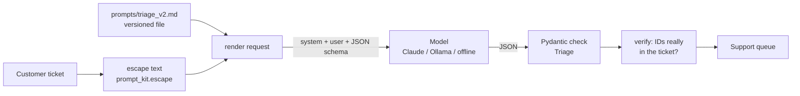

# 10 · Prompt engineering patterns that hold up

**What you'll build:** a support-ticket triage step for Northwind Logistics whose prompt lives in a versioned file, wraps customer text in XML-style tags, teaches with examples, forces a JSON shape, double-checks the answer, and is protected by automatic tests.
**Like you're 5:** a prompt is a recipe card for a cook who follows it very literally. A good card says who the cook is, what's in the kitchen, the rules, shows a finished plate, and has a version number so nobody secretly changes it.
**Time:** ~2 h · **Builds on:** [09 · PII detection and redaction](../../part-2-enterprise-data-and-integration/09-pii-detection-and-redaction) · **Needs:** nothing for `--offline` and the tests; an Anthropic API key (or Ollama) for real model runs

## Why this matters
At a customer, your prompt is not a chat message, it is production code that runs thousands of times a day. A prompt that "worked in the demo" breaks when a ticket is written in capital letters, mentions two problems, or contains text that looks like instructions. Forward deployed engineers are trusted when their prompts are structured, tested and versioned like any other code, so a change can be reviewed, measured (lesson 12) and rolled back.

## What you'll learn
- **System prompt structure**: role, context, rules, examples and output format, each in its own clearly marked section.
- **XML-tagged context**: putting customer text inside `<ticket>...</ticket>` so the model knows it is data, not instructions.
- **Few-shot examples**: two or three finished answers that show the model exactly what "good" looks like.
- **Structured outputs**: a JSON schema the model's answer must fit, turned into a typed Python object.
- **Prompt versioning and prompt tests**: prompt files with version numbers, a fingerprint lock, and `pytest` checks that run free on every change.

## Before you start
1. Open a terminal in the course folder and switch on your virtual environment (as in earlier lessons).
2. Install the packages:
   ```bash
   cd part-3-production-llm-engineering/10-prompt-engineering-patterns-that-hold-up
   pip install -r requirements.txt
   ```
   - `anthropic`: the official Claude SDK.
   - `pydantic`: describes the JSON shape we want back and checks it.
   - `httpx`: talks to a local Ollama model if you choose that option.
   - `pytest`: runs the tests.
3. Choose how the model runs (this is the same for every lesson in Parts 3 and 4, see the [Part 3 README](../README.md)):
   - **No key at all:** every script has `--offline`, which uses a small stand-in instead of a real model. Free.
   - **Claude:** `export ANTHROPIC_API_KEY=sk-ant-...` (Windows PowerShell: `$env:ANTHROPIC_API_KEY="sk-ant-..."`). Optional: `export CLAUDE_MODEL=claude-haiku-5-5` to pay much less while learning.
   - **Local model:** install Ollama, `ollama pull qwen3:8b`, then `export LLM_PROVIDER=ollama`.

**Command, piece by piece:** `pip install -r requirements.txt`

| Piece | Meaning |
|---|---|
| `pip` | Python's package installer |
| `install` | "download and install these packages" |
| `-r` | "read the package names from a file" (r = requirements) |
| `requirements.txt` | the file listing one package per line; `>=1.13` means "version 1.13 or newer" |

**Command, piece by piece:** `export CLAUDE_MODEL=claude-haiku-5-5`

| Piece | Meaning |
|---|---|
| `export` | create an environment variable that programs started from this terminal can read |
| `CLAUDE_MODEL` | the variable's name; `llm.py` looks for it |
| `=` | "set it to" (no spaces around `=` in the shell) |
| `claude-haiku-5-5` | the value: the cheapest Claude model |

## Run it
1. See the exact request the program would send (free, no API call):
   ```bash
   python triage.py --show-prompt
   ```
2. Run the 8 sample tickets with the offline stand-in, using prompt v2:
   ```bash
   python triage.py --offline
   ```
3. Same, with the old prompt v1, to see why free-text answers are fragile:
   ```bash
   python triage.py --offline --version 1
   ```
4. Check every prompt's version and lock:
   ```bash
   python prompt_kit.py
   ```
5. Run the tests:
   ```bash
   pytest -v
   ```
6. With a key (or Ollama): run the samples through the real model, then try your own ticket:
   ```bash
   python triage.py
   python triage.py "Pallet NW-12345 arrived soaking wet, the cardboard has collapsed"
   ```

**Command, piece by piece:** `python triage.py --offline --version 1`

| Piece | Meaning |
|---|---|
| `python` | start the Python interpreter |
| `triage.py` | the program file to run |
| `--offline` | a "flag": an option that switches a feature on (here: use the stand-in, not a real model) |
| `--version 1` | a flag with a value: use prompt file `prompts/triage_v1.md` |

**Command, piece by piece:** `pytest -v`

| Piece | Meaning |
|---|---|
| `pytest` | the test runner: finds files named `test_*.py` and runs every function named `test_*` |
| `-v` | verbose: print one line per test with PASSED or FAILED |

### What you should see
`python triage.py --offline` (real output):
```
(offline: answers come from keyword rules in offline_responder(), not from a real model)

Prompt triage v2 on 8 sample tickets
ticket  expected                 got                                      ok
T-1001  late_delivery/high       late_delivery/high                       ✅
T-1002  damaged_goods/normal     damaged_goods/normal                     ✅
T-1003  billing/normal           billing/normal                           ✅
T-1004  lost_shipment/normal     lost_shipment/normal                     ✅
T-1005  late_delivery/urgent     late_delivery/urgent                     ✅
T-1006  address_change/low       address_change/low                       ✅
T-1007  other/urgent             other/urgent                             ✅
T-1008  other/low                other/low                                ✅
Score: 8/8 exactly right (category + priority + shipment_id)
```
`python triage.py --offline --version 1` (real output, end):
```
T-1007  other/urgent             INVALID: 6 validation errors for Triage  ❌
T-1008  other/low                INVALID: 6 validation errors for Triage  ❌
Score: 0/8 exactly right (category + priority + shipment_id)
```
The stand-in is keyword rules, not AI, so its 8/8 proves only that the plumbing works. For v1 it copies a very common real failure on purpose: chatty text around the JSON, and labels in its own words ("Late Delivery" instead of `late_delivery`). With a real model, v1 answers change from run to run; that inconsistency is exactly the problem.

`python prompt_kit.py` (real output):
```
triage   v1  fingerprint 181de5a7c46b  owner fde-team  changed 2026-09-01  (46 tokens approx.)
triage   v2  fingerprint 5f226cfa34a1  owner fde-team  changed 2026-10-01  (684 tokens approx.)
Lock: OK
```
`pytest -v` ends with `17 passed`. With a real Claude key, `python triage.py` prints the same table; on these clear tickets expect most or all rows to be ✅ (example, not a guarantee: models vary).

What to look at: in `--show-prompt`, the customer's `<b>` became `&lt;b&gt;`, and the system part contains no data from this ticket. Both matter later (lesson 13 security, lesson 14 caching).

## How it works


1. **The prompt is a file, not a string in code.** Open `prompts/triage_v2.md`. It has three parts:

   | Piece of the file | Meaning |
   |---|---|
   | `---` ... `---` | the **header** (often called "front matter"): facts about the prompt, one `key: value` per line |
   | `version: 2` | the number you bump on every change |
   | `owner`, `changed`, `changelog` | who to ask, when it changed, and why |
   | text before `=== user ===` | the **system prompt**: the cook's standing instructions, the same for every ticket |
   | text after `=== user ===` | the **user message template**; `{{ticket}}` is a gap filled in for each request |

2. **The system prompt has sections.** Role ("You are the first-line triage assistant for Northwind..."), then `<context>` (facts the model can't know: ID format, delivery promises, queue names), `<rules>` (numbered, each one testable, including how to break ties such as late AND damaged), `<examples>`, and a final instruction. The tags are not magic words; they are labelled boxes that make it obvious where each part starts and ends. Claude is trained to pay attention to such tags.

3. **Few-shot examples.** The three `<example>` blocks show a whole ticket and the exact answer. Pick examples that are different from each other (here: damaged, urgent medicine, a simple request) and that demonstrate your trickiest rules. One bad example teaches a bad habit, so `test_examples_in_the_prompt_match_the_output_schema` checks each one against the schema.

4. **Customer text is data, inside tags, escaped.** `prompt_kit.render_user()` fills `{{ticket}}` using `escape()`, which turns `<` into `&lt;` and `>` into `&gt;`. A ticket containing `</ticket><rules>...` therefore can't close our tag and smuggle in rules. Rule 6 also tells the model to treat the ticket as data. (Lesson 13 goes deep on this.)

5. **Structured output.** `class Triage(BaseModel)` in `triage.py` is the answer's shape. `Literal[...]` lists the only allowed words, so `"Late Delivery"` is impossible. `llm.chat(..., schema=Triage)` sends this shape as a **JSON schema** in `output_config.format`; Claude's answer is then guaranteed to fit it, and `reply.parsed` is a real `Triage` object. Read the schema like a form:

   | JSON schema key | Meaning |
   |---|---|
   | `"type": "object"` | the answer is a set of named fields |
   | `"properties"` | the fields and the type of each one |
   | `"enum": [...]` | only these exact values are allowed |
   | `"required": [...]` | these fields must always be present |
   | `"additionalProperties": false` | no extra fields allowed |

6. **Verify after the model.** Even a well-shaped answer can be wrong. `verify()` checks that `shipment_id` really appears in the ticket (models sometimes "invent" a plausible ID). If not, it removes the ID, sets `needs_human`, and records a warning. Cheap code checks like this catch the most expensive mistakes.

7. **Versioning and the lock.** `prompt_kit.load("triage")` picks the highest version; `load("triage", 1)` picks exactly v1. `Prompt.fingerprint` is the first 12 characters of a SHA-256 hash: change one comma and it changes. `prompts.lock.json` stores the fingerprint for each `name@vN`, and `test_every_prompt_is_locked_and_unchanged` fails if a prompt changes without a new version. Every answer also records `version` and `fingerprint`, so months later you can tell which prompt produced it.

8. **`llm.py`, the shared door to the model.** Every lesson in Parts 3 and 4 has the same `llm.py`. `llm.chat()` takes messages (plus optional `system`, `tools`, `schema`, `effort`, `cache`) and returns a `Reply` with `.text`, `.parsed`, `.tool_calls`, token counts, `.cost_usd` and `.seconds`. It talks to Claude by default, or to Ollama's OpenAI-compatible API when `LLM_PROVIDER=ollama`. `llm.set_client()` lets tests and `--offline` swap in `FakeClaude` from `fake_llm.py`, which returns responses shaped exactly like the real SDK's. `effort="low"` asks Claude to think briefly: triage is a simple job.

9. **Prompt tests.** `test_prompts.py` runs free in under a second: placeholders all filled, customer text can't close tags, examples valid, system prompt static (so it can be cached) and under a token budget, the request really includes the schema, invented IDs get removed. These tests check the prompt's *construction*. Whether its *answers are good* is measured with evals in lesson 12.

## If something goes wrong
- **`ModuleNotFoundError: No module named 'pydantic'`** → your virtual environment is off or packages aren't installed: activate it and re-run `pip install -r requirements.txt`.
- **`❌ Could not create the Claude client`** or **`Your API key is wrong`** → set `ANTHROPIC_API_KEY` in *this* terminal (each new terminal starts without it), or add `--offline`.
- **`test_every_prompt_is_locked_and_unchanged` fails** → you edited a prompt file. Either copy it to a new file with a higher `version:` (best), or, if the change is intentional, run `python prompt_kit.py --lock` and commit the lock file with the change.
- **`ValueError: triage_v2.md needs ['ticket'], got [...]`** → the template's `{{placeholders}}` and the values you passed don't match; fix the spelling on one side.
- **With Ollama: `ValidationError` on the answer** → small local models follow schemas less reliably. Try a bigger model (`OLLAMA_MODEL=qwen3:14b`) or keep `verify()` and route failures to a human.

## Try this
1. **Easy:** add a ninth ticket to `tickets.jsonl` (a parcel that is late *and* damaged) and run `python triage.py --offline`. Which category should it get according to rule 1?
   <details><summary>Hint</summary>Rule 1 says damaged_goods wins. The offline rules check damage words before lateness, so it should agree. Add `"expected": {"category": "damaged_goods", "priority": "normal", "shipment_id": "NW-..."}`.</details>
2. **Medium:** create `prompts/triage_v3.md` that adds a fourth example for `billing`. Run `pytest` (the lock test fails: v3 isn't locked), then `python prompt_kit.py --lock`, then `pytest` again.
   <details><summary>Solution</summary>Copy v2 to `triage_v3.md`, set `version: 3`, update `changed` and `changelog`, add an `<example>` with a ticket like "We were invoiced for a collection that never happened (INV-3001)" and `{"category": "billing", "priority": "normal", "shipment_id": null, "sentiment": "unhappy", "summary": "...", "needs_human": false}`. `load("triage")` now returns v3 automatically; `--version 2` still runs the old one.</details>
3. **Harder:** add a field `language: Literal["en", "other"]` to `Triage` and a rule that non-English tickets get `needs_human: true`. Update the three examples and add a test that an example without `language` fails validation.
   <details><summary>Hint</summary>After adding the field, `test_examples_in_the_prompt_match_the_output_schema` fails until every example has `"language": "en"`: that is the test doing its job. Remember to make it a new prompt version and to update `offline_responder()` so its JSON includes the new field.</details>

## Check yourself
1. Why does the customer's ticket go in the user message instead of the system prompt?
2. What two different jobs do `Literal[...]` in `Triage` and `verify()` do?
3. A teammate fixes a typo in `triage_v2.md` directly. What happens, and why is that useful?
4. Why are the prompt tests not enough to know the prompt gives good answers?

<details><summary>Answers</summary>

1. The system prompt stays byte-for-byte the same for every ticket, which makes it cacheable and easy to review; and keeping customer text separate (and escaped, inside tags) makes it clearly data, not instructions.
2. `Literal` (through the schema) controls the *shape*: only allowed labels can come back. `verify()` checks the *truth* of some content: the shipment ID must really be in the ticket.
3. The lock test fails because the fingerprint changed while the version did not. Every change to a prompt becomes visible and deliberate, and logged answers keep pointing to the exact text that produced them.
4. They only check how the prompt is built. Quality needs a set of real tickets with known right answers, scored on every version: that is an eval (lesson 12).
</details>

## Learn more (optional)
**Read the official docs**
- Prompt engineering overview (Anthropic): https://platform.claude.com/docs/en/build-with-claude/prompt-engineering/overview
- Structured outputs: https://platform.claude.com/docs/en/build-with-claude/structured-outputs
- Effort parameter: https://platform.claude.com/docs/en/build-with-claude/effort
- Pydantic models: https://docs.pydantic.dev/latest/concepts/models/
- JSON Schema basics: https://json-schema.org/understanding-json-schema
- pytest getting started: https://docs.pytest.org/en/stable/getting-started.html
- Ollama docs (see the OpenAI compatibility page): https://github.com/ollama/ollama/tree/main/docs

**Watch**
- Anthropic on prompt engineering: https://www.youtube.com/results?search_query=anthropic+prompt+engineering
- DeepLearning.AI prompt engineering short courses: https://www.youtube.com/results?search_query=deeplearning.ai+prompt+engineering+for+developers
- Structured outputs with LLMs: https://www.youtube.com/results?search_query=llm+structured+outputs+json+schema+pydantic

## Next
→ [11 · RAG that works: hybrid search, reranking, citations](../11-rag-that-works-hybrid-search-reranking-citations)
