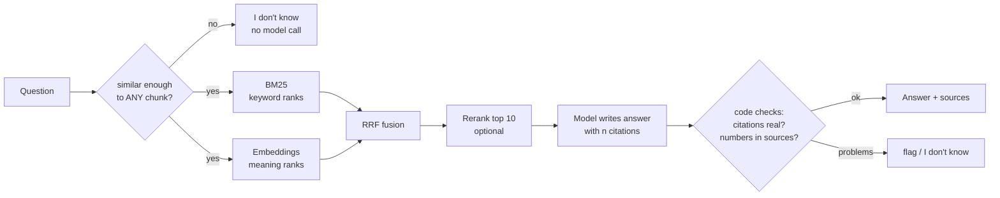

# 11 · RAG that works: hybrid search, reranking, citations

**What you'll build:** a question-answering system over Northwind's six policy documents that searches two ways at once (keywords and meaning), fuses the results, can rerank them, answers with numbered citations that code double-checks, and says "I don't know" instead of guessing. You'll also measure which setup finds the right text most often.
**Like you're 5:** a librarian looks for your book two ways: by the exact words on the cover, and by what the book is about. She puts both piles together, reads the top few carefully, and when she answers she points at the page. If no book is about your question, she says so.
**Time:** ~3 h · **Builds on:** [10 · Prompt patterns](../10-prompt-engineering-patterns-that-hold-up), and the RAG basics of [AI from Zero Part 5](../../../ai-from-zero/part-5-rag-and-vector-databases) and [Journey 7.3](../../../ai-engineer-journey/level-7-real-world-ai-apps/03-rag-ask-questions-about-your-pdfs) · **Needs:** nothing for `--offline`, the comparison and the tests (an ~80 MB embedding model downloads once); an Anthropic API key or Ollama for real answers

## Why this matters
Almost every customer asks for "chat with our documents". The first demo is easy; what fails in production is retrieval: the customer types a form code like `CL-7` and pure vector search misses it, or types "my parcel never showed up" and pure keyword search misses "declared lost". Then the model answers confidently from the wrong page. An FDE who can show hybrid search, measured hit rates, real citations and a working "I don't know" earns the customer's trust (and avoids the screenshot of a made-up policy on social media).

## What you'll learn
- **Chunking strategies**: cutting documents into pieces by fixed size versus by heading, and why headings matter.
- **BM25 keyword search**: the classic search-engine score that loves rare, exact words such as `UN3481`.
- **Hybrid search with Reciprocal Rank Fusion (RRF)**: merging the keyword list and the meaning list using only their ranks.
- **Reranking**: a slower, closer second look at the shortlist (a cheap LLM or a local cross-encoder).
- **Citations and "I don't know"**: numbered sources, code that checks the citations and numbers, and three gates that stop guessing.

## Before you start
1. Switch on your virtual environment, then:
   ```bash
   cd part-3-production-llm-engineering/11-rag-that-works-hybrid-search-reranking-citations
   pip install -r requirements.txt
   ```
   - `numpy`: fast maths on vectors.
   - `chromadb`: we only use its built-in embedding model (all-MiniLM-L6-v2 running through ONNX on your CPU). The first run downloads it (~80 MB) and then works offline.
   - `anthropic`, `pydantic`, `httpx`, `pytest`: as in lesson 10.
   - Optional: `pip install sentence-transformers` if you want `--rerank cross-encoder` (downloads a ~90 MB model from Hugging Face).
2. Model choice is the same as lesson 10: `--offline` (free), Claude (`ANTHROPIC_API_KEY`), or Ollama (`LLM_PROVIDER=ollama`; for local embeddings too, `ollama pull nomic-embed-text` and `export EMBEDDINGS=ollama`).

## Run it
1. Measure retrieval (free, no model needed, takes ~30 s on a slow laptop):
   ```bash
   python compare_retrieval.py
   ```
2. Ask a question offline (real search, stand-in answer writer):
   ```bash
   python ask.py "Can I send UN3481 batteries?" --offline
   ```
3. Ask something the documents don't cover:
   ```bash
   python ask.py "What's a good recipe for pancakes?" --offline
   python ask.py "Do you deliver to France?" --offline
   ```
4. Run the tests:
   ```bash
   pytest -v
   ```
5. With a key: real answers, then with reranking, then measure reranking too:
   ```bash
   python ask.py "My parcel never showed up and tracking has been frozen for ages. When do you consider it gone for good?"
   python ask.py "Do you deliver on weekends?" --rerank llm
   python compare_retrieval.py --rerank llm
   ```

**Command, piece by piece:** `python ask.py "Can I send UN3481 batteries?" --offline`

| Piece | Meaning |
|---|---|
| `python ask.py` | run the question-answering program |
| `"Can I send ..."` | the question; the quotes keep it as ONE argument even though it has spaces |
| `--offline` | use the stand-in answer writer (no key, no cost); search is still real |

**Command, piece by piece:** `python compare_retrieval.py --rerank llm`

| Piece | Meaning |
|---|---|
| `compare_retrieval.py` | runs all 15 questions in `questions.jsonl` through each retrieval setup |
| `--rerank llm` | also test "hybrid + LLM reranker" (one extra cheap model call per question) |

### What you should see
`python compare_retrieval.py` (real output):
```
12 answerable questions, 3 unanswerable

chunker  search            hit@1  hit@4   MRR  missed
fixed    keyword             75%    83%  0.77  Do you deliver on weekends?; What is the most you pay out for a broken ite
fixed    vector              67%   100%  0.83
fixed    hybrid              75%    83%  0.78  Do you deliver on weekends?; What is the most you pay out for a broken ite
heading  keyword             75%    83%  0.79  My parcel never showed up and tracking has be; Do you deliver on weekends?
heading  vector              83%   100%  0.92
heading  hybrid              92%    92%  0.92  Do you deliver on weekends?

'I don't know' calibration: best cosine similarity of each question to any chunk
  answerable    lowest 0.37  highest 0.70
  unanswerable  lowest 0.36  highest 0.42
  MIN_SIMILARITY in rag.py = 0.3 (questions below it get 'I don't know' with no model call)
```
How to read it:
- **hit@1** = how often the right chunk came FIRST; **hit@4** = how often it was anywhere in the 4 chunks we give the model; **MRR** (mean reciprocal rank) = 1 for first place, 0.5 for second, 0.33 for third, averaged.
- Heading chunks beat fixed chunks in every row: headings like "When a shipment is treated as lost" carry meaning.
- Keyword search misses paraphrases ("weekends" vs "Saturday"); vector search never misses here but often ranks the right chunk 2nd or 3rd.
- Hybrid puts the right chunk first most often (92%) but lost one question that only vector search found. **Hybrid is not magic: measure it on your customer's questions.** (Exercise 2 fixes this one.)
- The calibration shows unanswerable questions (0.36–0.42) score about as high as the hardest answerable one (0.37). So the similarity gate can only stop clearly off-topic questions; the model and our checks must catch the rest.

`python ask.py "Can I send UN3481 batteries?" --offline` (real output):
```
(offline: search is real; the answer writer is a word-overlap stand-in, not a real model)

Indexed 24 chunks from docs/

RETRIEVED (rank: keyword rank / vector rank -> fused score)
  [1] keyword 1 / vector 1 -> 0.0328  dangerous-goods.md › Lithium batteries
  [2] keyword - / vector 2 -> 0.0161  cold-chain.md › Restrictions
  [3] keyword - / vector 3 -> 0.0159  address-changes-and-collections.md › Changing a delivery address
  [4] keyword - / vector 4 -> 0.0156  dangerous-goods.md › Paperwork

ANSWER (best similarity 0.653):
  Lithium-ion batteries packed with equipment or contained in equipment (UN3481) are accepted on road services when the parcel carries the lithium battery mark. [1]
  [1] dangerous-goods.md › Lithium batteries
```
The two "I don't know" questions (real output, last lines):
```
ANSWER (best similarity 0.027):
  I don't know: our policy documents don't cover that. Please contact Northwind support.
  (stopped by: retrieval gate)
ANSWER (best similarity 0.379):
  I don't know: our policy documents don't cover that. Please contact Northwind support.
  (stopped by: model said not found)
```
Pancakes never reach the model (0.027 is far below 0.30): zero tokens spent. France is close enough to delivery topics to pass the gate, so the answer writer had to say "not found". `pytest -v` ends with `11 passed`.

With Claude, the paraphrased "never showed up" question gets an answer like *"We treat a shipment as lost once it has had no tracking scan for 10 working days [1]..."* (example; wording varies). The offline stand-in only counts shared words, so it sometimes copies the wrong sentence: a good reminder of why we show sources, so a human can check.

## How it works


1. **Chunking (`load_chunks`, `chunk_fixed`, `chunk_by_heading`).** `chunk_fixed` cuts every 300 characters (with a 60-character overlap so a fact cut in half appears whole in one piece) and throws the headings away. `chunk_by_heading` makes one chunk per `## ` section and keeps the heading path, e.g. `Claims for damaged and lost shipments > When a shipment is treated as lost`. `Chunk.search_text` puts that path in front of the text so both search methods can see it. Long sections are split between paragraphs at ~900 characters. Real documents (PDF, Word) need the same idea: lesson 06 showed how to get their headings out.

2. **BM25 keyword search (`tokenize`, `stem`, `BM25`).** `tokenize` lower-cases, drops filler words ("the", "can"), keeps codes like `cl-7`, `un3481`, `£6`, `15:00` whole, and `stem` cuts endings so "redirect" matches "redirection". BM25 then scores each chunk: for every question word in the chunk, add *how rare the word is* (`idf`: in 1 of 24 chunks = big, in all of them = tiny) times *how often it appears* (with diminishing returns, controlled by `k1`), slightly lowered for long chunks (controlled by `b`). Like a librarian who cares most about the unusual words in your request.

3. **Meaning search (`Embedder`).** Each chunk becomes a list of 384 numbers (an **embedding**) from the all-MiniLM-L6-v2 model. Texts about the same thing get similar lists, even with no shared words. We scale every vector to length 1, so `self.vectors @ question_vector` (a dot product) gives the **cosine similarity**: 1 = same meaning, 0 = unrelated. `encode_one` remembers questions it already embedded.

4. **Fusion (`rrf`).** BM25 scores (0 to ~20) and cosine scores (0 to 1) can't be added: they're different units. **Reciprocal Rank Fusion** ignores scores and uses places: each list gives an item `1 / (60 + rank)`. First place in one list = 1/61 = 0.0164; first in both = 0.0328 (that's the `0.0328` you saw). Items both methods agree on rise to the top. `Index.search` keeps a `ranks` record so you can see why each chunk was chosen.

5. **Reranking (`rerank_llm`, `rerank_cross_encoder`).** Search compares the question with each chunk *separately* (fast, a bit rough). A reranker reads the question and each of the top 10 chunks *together* and gives a relevance score. `rerank_llm` sends the whole shortlist to the cheap model (`claude-haiku-5-5`) in one call with a `Relevance` schema; `rerank_cross_encoder` runs a small local model instead. Reranking costs time and money, so measure with `compare_retrieval.py --rerank ...` and keep it only if MRR improves.

6. **Answer with citations (`answer`, `SYSTEM`, `Answer`).** The top 4 chunks are sent inside `<source n="1" doc="..." section="...">` tags with the question in `<question>` tags (escaped, as in lesson 10). The `Answer` schema forces three fields: `found`, `answer` (with `[n]` after each fact), `citations`. Claude also has a built-in citations feature for documents (see Learn more); we do it by hand here so it works with any model, including Ollama.

7. **Three "I don't know" gates.**
   - Gate 1 (`MIN_SIMILARITY`): if no chunk is even slightly similar, answer "I don't know" without calling the model.
   - Gate 2 (the model): rule "if the sources do not contain the answer, set found to false".
   - Gate 3 (`check_answer`): code checks that every `[n]` exists, that a "found" answer cites something, and that every number or price in the answer (like `£50`, `10`) really appears in the cited text. Invented numbers are the most damaging kind of mistake in policy answers.

8. **Measuring (`compare_retrieval.py`).** `questions.jsonl` has 12 answerable questions (each with the document and a phrase the right chunk must contain) and 3 unanswerable ones. This is a tiny **golden set**; lesson 12 grows the idea into full evals.

## If something goes wrong
- **First run hangs at "Indexed..." or downloads for a while** → the embedding model (~80 MB) is downloading to `~/.cache/chroma`. Later runs are offline. On a slow CPU each question takes ~0.5 s to embed; that's normal.
- **`ModuleNotFoundError: No module named 'chromadb'`** → `pip install -r requirements.txt` with your venv switched on. If chromadb won't install on your machine, use Ollama embeddings: `ollama pull nomic-embed-text` and `export EMBEDDINGS=ollama`.
- **Every question gets "I don't know (stopped by: retrieval gate)"** → you changed the embedding model (e.g. to Ollama), so similarities are on a different scale. Run `python compare_retrieval.py` and set `MIN_SIMILARITY` just below the "answerable lowest" value.
- **`--rerank cross-encoder` fails with an import or download error** → `pip install sentence-transformers` and make sure huggingface.co is reachable from your network.
- **Answers show `⚠️ 'X' is not in the cited sources`** → the model wrote a number the sources don't contain. That's the check working: the answer is not trusted. Look at the retrieved chunks; often the right chunk was not retrieved.

## Try this
1. **Easy:** add a question to `questions.jsonl` that uses a code from the documents (for example form `DG-2`) and re-run `python compare_retrieval.py`. Which search modes find it?
   <details><summary>Hint</summary>Use `{"question": "Who fills in form DG-2?", "doc": "dangerous-goods.md", "must_include": "DG-2"}`. Keyword search should rank it first: rare exact codes are BM25's strength.</details>
2. **Medium:** the hybrid row missed "Do you deliver on weekends?". Give vector search more say with **weighted RRF**: add a `weights` argument to `rrf()` (e.g. keyword 1.0, vector 1.5) and pass it from `Index.search`. Re-run the comparison. Did hit@4 go up without hurting hit@1?
   <details><summary>Solution</summary>

   ```python
   def rrf(rankings, k=60, weights=None):
       weights = weights or [1.0] * len(rankings)
       fused = {}
       for ranking, w in zip(rankings, weights):
           for rank, item in enumerate(ranking, start=1):
               fused[item] = fused.get(item, 0.0) + w / (k + rank)
       return fused
   ```
   and in `search`: `rrf([[i for i, _ in kw], [i for i, _ in vec]], weights=[1.0, 1.5])`. Keep `test_rrf_rewards_agreement` passing (it uses the default weights). Write down the before/after numbers: that's how you justify the change to a customer.</details>
3. **Harder:** make the gate smarter. Instead of one similarity threshold, refuse when the best similarity is below 0.30 **or** when BM25 finds no matching word at all and the best similarity is below 0.45. Add a test for each case.
   <details><summary>Hint</summary>`index.keyword(question, 1)` returns an empty list when no word matches. Check that all 12 answerable questions still pass the gate (run them in a loop) before you trust the new rule: a gate that refuses real questions is worse than none.</details>

## Check yourself
1. Why can't you simply add a BM25 score and a cosine score together, and how does RRF avoid the problem?
2. A user asks about "form CL7" (no dash). Which part of the pipeline helps, and which might not?
3. Why is `check_answer` worth having when the prompt already says "never guess"?
4. Why do we measure hit@4 and not only hit@1?

<details><summary>Answers</summary>

1. They're on different scales (BM25 has no upper limit, cosine is between -1 and 1), so one would drown out the other. RRF uses only the rank positions, which are comparable.
2. Vector search helps (the embedding of "CL7" is close to "CL-7"). BM25 may not: our tokenizer makes `cl7` and `cl-7` different words. A fix is to normalise codes (remove dashes) in `tokenize` for both documents and questions.
3. Prompts reduce mistakes but don't remove them. Code checks are cheap, never get tired, and catch the worst errors: citations to sources that don't exist and numbers that aren't in the documents.
4. The model sees the top 4 chunks, so the right chunk anywhere in the top 4 can produce a correct answer. hit@1 and MRR tell you how good the ordering is, which matters for reranking and for using fewer chunks (cheaper).
</details>

## Learn more (optional)
**Read the official docs**
- Claude citations feature: https://platform.claude.com/docs/en/build-with-claude/citations
- Structured outputs: https://platform.claude.com/docs/en/build-with-claude/structured-outputs
- Chroma docs (see "Embeddings"): https://docs.trychroma.com
- PostgreSQL full-text search (BM25-like ranking inside Postgres): https://www.postgresql.org/docs/current/textsearch.html
- pgvector (vectors in Postgres): https://github.com/pgvector/pgvector
- Sentence Transformers (see "Cross Encoder"): https://sbert.net
- The original RRF paper (Cormack, Clarke, Büttcher, 2009): https://plg.uwaterloo.ca/~gvcormac/cormacksigir09-rrf.pdf

**Watch**
- Hybrid search and RRF explained: https://www.youtube.com/results?search_query=hybrid+search+bm25+vector+reciprocal+rank+fusion
- Reranking for RAG: https://www.youtube.com/results?search_query=rag+reranking+cross+encoder
- DeepLearning.AI advanced retrieval for RAG: https://www.youtube.com/results?search_query=deeplearning.ai+advanced+retrieval+for+ai+with+chroma

## Next
→ [12 · Evals: golden sets, LLM judges and CI](../12-evals-golden-sets-llm-judges-and-ci)
