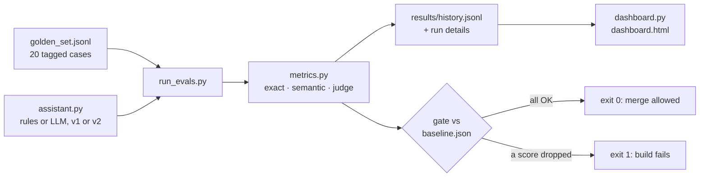

# 12 · Evals: golden sets, LLM judges and CI

**What you'll build:** an evaluation harness for the Northwind support assistant: a golden set of 20 cases, three kinds of metrics (exact, semantic, LLM-as-judge), a check that the judge agrees with humans, a regression gate that fails the build when quality drops, a GitHub Actions workflow that runs it on every pull request, and an HTML dashboard of scores over versions.
**Like you're 5:** before a school play, the teacher has a checklist of the lines that must be said right. Every rehearsal, she ticks the list and writes the score on the wall chart. If tonight's score is lower than last week's, the show doesn't go on until it's fixed.
**Time:** ~3 h · **Builds on:** [11 · RAG that works](../11-rag-that-works-hybrid-search-reranking-citations) and [Journey 7.5 · Evaluate your RAG](../../../ai-engineer-journey/level-7-real-world-ai-apps/05-evaluate-your-rag-and-chatbot) · **Needs:** nothing for the baseline, the tests and the dashboard (an ~80 MB embedding model downloads once); an Anthropic API key or Ollama to evaluate the LLM version; a GitHub account for the CI part

## Why this matters
"It looks good when I try it" is how AI projects fail at customers. Every prompt tweak, model upgrade or new document can quietly break something that used to work. Evals turn quality into numbers you can compare across versions, show to the customer, and enforce automatically. In FDE interviews and engagements, "how do you know it works, and how do you know it still works next month?" is the question, and this lesson is the answer.

## What you'll learn
- **Golden set**: a fixed list of real-looking inputs with the right answers, tagged by type, including edge cases and questions that should get "I don't know".
- **Three metric families**: **exact** (labels must match), **semantic** (meaning is close, by embedding similarity), **LLM-as-judge** (a strong model grades against a written rubric).
- **Judge calibration**: measuring how often the judge agrees with human labels before you trust it.
- **Regression gate**: comparing every run with a committed baseline and failing when a score drops.
- **CI and dashboards**: running evals in GitHub Actions on each pull request and charting scores over versions.

## Before you start
1. Switch on your virtual environment, then:
   ```bash
   cd part-3-production-llm-engineering/12-evals-golden-sets-llm-judges-and-ci
   pip install -r requirements.txt
   ```
   - `chromadb` and `numpy`: the same local embedding model as lesson 11, for semantic similarity.
   - `anthropic`, `pydantic`, `httpx`, `pytest`: as before.
2. Model choice as in lesson 10. The baseline runs need no model at all.

## Run it
1. Evaluate the free rules baseline (version v2) and compare with `baseline.json`:
   ```bash
   python run_evals.py
   ```
2. Evaluate the older v1 rules and watch the gate fail:
   ```bash
   python run_evals.py --system rules --version v1
   echo $?
   ```
3. Check the stand-in judge against human labels:
   ```bash
   python run_evals.py --check-judge --offline
   ```
4. Build the dashboard and open `results/dashboard.html` in your browser:
   ```bash
   python dashboard.py
   ```
5. Run the harness's own tests:
   ```bash
   pytest -v
   ```
6. With a key: check the real judge, then evaluate the LLM assistant v1 and v2 with the judge, then rebuild the dashboard:
   ```bash
   python run_evals.py --check-judge
   python run_evals.py --system llm --version v1 --judge --no-gate
   python run_evals.py --system llm --version v2 --judge --no-gate
   python dashboard.py
   ```
7. When an LLM run is good, freeze it as the LLM baseline: `python run_evals.py --system llm --version v2 --judge --update-baseline --baseline baseline_llm.json`.

**Command, piece by piece:** `echo $?`

| Piece | Meaning |
|---|---|
| `echo` | print something |
| `$?` | the **exit code** of the previous command: `0` = success, anything else = failure. CI systems stop the build when a step's exit code is not 0. (PowerShell: `$LASTEXITCODE`) |

**Command, piece by piece:** `python run_evals.py --system llm --version v2 --judge --no-gate`

| Piece | Meaning |
|---|---|
| `--system llm` | evaluate the Claude/Ollama assistant instead of the keyword rules |
| `--version v2` | use the v2 prompts in `assistant.py` |
| `--judge` | also grade each answer with an LLM judge (one extra model call per answer case) |
| `--no-gate` | report the scores but never exit with an error |

### What you should see
`python run_evals.py` (real output):
```
System rules v2: 20/20 cases fully passed in 7.3 s, cost $0.0
  triage_category  1.000
  triage_priority  1.000
  answer_facts     1.000
  answer_semantic  0.908
  idk_correct      1.000

Regression gate vs baseline (rules v2):
  triage_category  baseline 1.000  now 1.000  ✅
  triage_priority  baseline 1.000  now 1.000  ✅
  answer_facts     baseline 1.000  now 1.000  ✅
  answer_semantic  baseline 0.908  now 0.908  ✅
  idk_correct      baseline 1.000  now 1.000  ✅

✅ No regressions.
```
`python run_evals.py --system rules --version v1` (real output, shortened):
```
System rules v1: 9/20 cases fully passed in 14.9 s, cost $0.0
  triage_category  0.700
  ...
Failed cases:
  tri-01  [late, repeat] got: {"category": "late_delivery", "priority": "normal"}
  tri-04  [lost] got: {"category": "other", "priority": "normal"}
  ...
  ans-03  [claims, money] got: "I don't know. Please contact Northwind support."
  ...
Regression gate vs baseline (rules v2):
  triage_category  baseline 1.000  now 0.700  ❌ REGRESSION
  triage_priority  baseline 1.000  now 0.700  ❌ REGRESSION
  answer_facts     baseline 1.000  now 0.250  ❌ REGRESSION
  answer_semantic  baseline 0.908  now 0.342  ❌ REGRESSION
  idk_correct      baseline 1.000  now 0.400  ❌ REGRESSION

❌ Quality dropped on: triage_category, triage_priority, answer_facts, answer_semantic, idk_correct. Failing the build.
```
and `echo $?` prints `1`. `python run_evals.py --check-judge --offline` (real output):
```
(offline: the judge is a fact-matching stand-in, not a real model)
Judge vs human labels on 8 examples: agreement 88%, false passes 0, false fails 1
```
`pytest -v` ends with `8 passed`.

What to look at: the rules v2 baseline scores a perfect 1.0. That is a warning sign, not a victory: its rules were written while looking at these 20 cases. A golden set you tuned against is no longer a fair test; keep adding new real cases (from production logs, lesson 15) that nobody has tuned on. Also notice the tags in "Failed cases": they show *which kind* of case broke (`lost`, `money`, ...), which is where you look first.

The dashboard shows one coloured line per metric across runs (#1 rules v2, #2 rules v1, then your LLM runs), with a table underneath. With a key, a typical picture (example; your numbers will differ) is LLM v1 scoring well on triage but low on `answer_facts` and `idk_correct` (it answers from general knowledge and invents policies), and v2 close to 1.0 on both.

## How it works


1. **The system under test (`assistant.py`).** Two jobs: `triage()` returns a category and priority; `answer()` returns a short reply. Two kinds: `system="rules"` (keyword rules, `CATEGORY_RULES`, `FAQ`) and `system="llm"` (prompts `TRIAGE_PROMPTS` and `ANSWER_PROMPTS`). A cheap non-AI baseline is professional practice: if the LLM can't beat 30 lines of rules, you shouldn't ship it.

2. **The golden set (`golden_set.jsonl`).** One JSON object per line ("JSON Lines"):

   | Key | Meaning |
   |---|---|
   | `id` | a stable name, so you can talk about "ans-03" in a pull request |
   | `type` | `triage` or `answer`: decides which metrics apply |
   | `input` | exactly what a user would send |
   | `expected` / `reference` | the right labels / a good model answer |
   | `must_mention`, `must_not_mention` | facts that must appear (`£50`) or must not (`£100`) |
   | `unanswerable` | `true` when the right reply is "I don't know" |
   | `tags` | the slice this case belongs to (`money`, `edge-case`...), so failures can be grouped |

   Good golden sets cover every category, the tricky rules (late *and* damaged, `tri-09`), unanswerable questions, and grow from real failures. 20 cases is a start; 100–300 is common at a customer.

3. **Exact metrics (`metrics.exact`, `fact_recall`, `has_forbidden`, `says_idk`).** Strict, free and never flaky. Use them wherever the answer has a fixed form: labels, IDs, numbers, prices, "did it refuse".

4. **Semantic similarity (`metrics.semantic_similarity`).** Turns the answer and the reference into embeddings and takes the cosine (0 to 1). It notices that "we declare it lost after 10 working days without a scan" means the same as the reference even with different words. It is also fooled by fluent wrong answers: measured with this model, "We declare it lost after 10 working days without a tracking scan." scores 0.801 against the reference, the WRONG "...after 12 working days..." scores 0.793, and an unhelpful "Please contact support about your parcel." scores 0.407. So never use it alone. That's why its tolerance in `baseline.json` is looser (`0.10`).

5. **LLM-as-judge (`metrics.judge`, `JUDGE_SYSTEM`, `Verdict`).** A strong model reads the question, the reference and the answer, writes a short `critique` first, then a `passed` true/false. Practical rules from teams who do this daily: give the judge a specific written **rubric**, ask for **pass/fail** rather than 1–10 scores (easier to agree on), make it explain before deciding, use a strong model (`JUDGE_MODEL`), and treat the graded answer as data.

6. **Calibrating the judge (`judge_agreement`, `judge_calibration.jsonl`).** Eight answers that a human already labelled pass/fail. `--check-judge` measures **agreement** and splits mistakes into **false passes** (judge approves a bad answer: dangerous) and **false fails** (judge rejects a good one: annoying). The offline stand-in got 1 false fail: "we pay up to £50" is correct but doesn't mention the £2,500 option, and the stand-in insists on every number. Fix the rubric or the judge until agreement is high, then trust its scores.

7. **Saving results.** Every run writes `results/run-<time>-<system>-<version>.json` (every case, what came back, every score) and appends one summary line to `results/history.jsonl` with the time, git commit, system, version, model, scores, cost and duration. That file is the memory of your project's quality.

8. **The regression gate (`gate`, `baseline.json`).** `baseline.json` holds the accepted scores and a `tolerance` per metric. A metric fails if `now < baseline - tolerance` (small wiggle room, because LLM runs vary a little). Any failure → `sys.exit(1)`. `--update-baseline` raises the bar deliberately, in a reviewed commit. Keep separate baselines for separate systems (`--baseline baseline_llm.json`).

9. **The dashboard (`dashboard.py`).** Reads `history.jsonl` and writes one self-contained HTML page: an SVG line chart (`<polyline>` per metric, 0 at the bottom, 1 at the top) and a table. No libraries, works offline, can be attached to a CI run or emailed to the customer.

10. **CI (`ci/evals.yml`).** GitHub only runs workflows stored in `.github/workflows/` at the root of a repository, so copy the file there. Then every pull request touching this folder runs the tests, the free baseline gate and, if you added an `ANTHROPIC_API_KEY` secret (repo Settings → Secrets and variables → Actions), the LLM evals with their own gate. The YAML, piece by piece:

    | YAML key | Meaning |
    |---|---|
    | `name: evals` | the name shown in the Actions tab |
    | `on.pull_request.paths` | run only for pull requests that change files under this path |
    | `on.workflow_dispatch` | also allow a manual "Run workflow" button |
    | `permissions: contents: read` | the job's token can only read code (least privilege) |
    | `env.LESSON` | a variable holding the lesson's folder path, reused below |
    | `jobs.evals` | one job called `evals` |
    | `runs-on: ubuntu-latest` | run it on a fresh Linux machine GitHub provides |
    | `timeout-minutes: 20` | kill it if it hangs |
    | `defaults.run.working-directory` | every `run:` step starts in the lesson folder |
    | `${{ secrets.ANTHROPIC_API_KEY }}` | the secret's value; empty if it doesn't exist (and on pull requests from forks) |
    | `steps` | the list of things to do, in order |
    | `uses: actions/checkout@v4` | a ready-made step that downloads your code; `@v4` pins the version |
    | `uses: actions/setup-python@v5` + `with:` | install Python 3.12 and cache pip downloads |
    | `run: pytest -q` | a shell command; if it exits non-zero, the job fails |
    | `if: env.ANTHROPIC_API_KEY != ''` | skip this step when there is no key |
    | `if: always()` | run even if an earlier step failed (so you still get the dashboard) |
    | `actions/upload-artifact@v4` | save `results/` as a downloadable zip on the run's page |

    The workflow file was checked with `actionlint` (a linter for GitHub Actions) and reported no problems.

## If something goes wrong
- **`❌ Quality dropped on: ...` but you didn't change anything** → LLM outputs vary between runs. Look at the failed cases first: is the model wrong, or is the golden label debatable? Fix the label, the prompt, or (with a reason in the commit) the tolerance. Running each case 2–3 times and averaging also reduces noise.
- **`No baseline_llm.json yet, so nothing to compare with`** → expected until you create it with `--update-baseline --baseline baseline_llm.json` after a run you're happy with.
- **The evals are slow** → the embedding model is loading; add `--no-semantic` while iterating, and keep the full run for CI.
- **In GitHub Actions the LLM step is skipped** → the secret is missing, or the pull request comes from a fork (GitHub hides secrets from forks on purpose).
- **`--check-judge` shows false passes** → don't use that judge for gating yet. Make the rubric more specific (name the facts that matter), add the confusing example to `judge_calibration.jsonl`, and re-check.

## Try this
1. **Easy:** add a triage case for a billing ticket with a legal threat ("we'll take you to court over invoice INV-77"), expected `billing`/`urgent`. Run `python run_evals.py`. What happens and why?
   <details><summary>Hint</summary>Rules v2 checks categories in order and priority by keywords: "court" isn't in the urgent pattern, so it fails and the gate fails. Either improve the rule (add `court` to the urgent pattern) or accept the new lower score with `--update-baseline`. That decision, made in a reviewed pull request, is exactly what evals are for.</details>
2. **Medium:** add a per-tag report: after "Failed cases", print the pass rate for each tag (e.g. `money 1/2`).
   <details><summary>Solution</summary>

   ```python
   from collections import defaultdict
   by_tag = defaultdict(lambda: [0, 0])
   for r in result["rows"]:
       for tag in r["tags"]:
           by_tag[tag][0] += r["passed"]
           by_tag[tag][1] += 1
   print("By tag:", ", ".join(f"{t} {p}/{n}" for t, (p, n) in sorted(by_tag.items())))
   ```
   Put it in `main()` after the failed-cases loop. Slices like these show where to invest: one weak tag is easier to fix than a vague overall score.</details>
3. **Harder:** add a fourth labelled example to `judge_calibration.jsonl` where the answer has the right number but a wrong condition (for example "Saturday delivery costs £9.50 on every service"). Does the stand-in judge get it right? Does the real judge (`--check-judge` with a key)?
   <details><summary>Hint</summary>The stand-in only compares numbers, so it will PASS this wrong answer: a false pass. A real LLM judge reading the rubric ("every fact ... conditions") should fail it. This is exactly why fact-matching alone isn't enough, and why you measure judges before trusting them.</details>

## Check yourself
1. Why keep a non-AI baseline in the eval runs?
2. Your semantic score went from 0.91 to 0.89 but `answer_facts` dropped from 1.0 to 0.75. Which do you worry about, and why?
3. What is a "false pass" for a judge and why is it worse than a false fail?
4. Why does the regression gate need a tolerance, and why is it different per metric?

<details><summary>Answers</summary>

1. It's the bar the AI must beat to be worth its cost, and it proves the harness works with no API key (the CI always has something to run).
2. `answer_facts`: three-quarters of the required facts are still there, so a quarter are now missing or wrong. A small semantic change is normal wording variation.
3. The judge approves a bad answer, so a broken version could pass the gate and reach customers. A false fail only wastes some time investigating.
4. LLM outputs vary a little between runs, so a strict "must be equal" gate would fail randomly. Exact metrics are stable (small tolerance); semantic similarity moves with wording (bigger tolerance).
</details>

## Learn more (optional)
**Read the official docs**
- Anthropic: define success criteria and build evaluations: https://platform.claude.com/docs/en/test-and-evaluate/develop-tests
- Structured outputs (used by the judge): https://platform.claude.com/docs/en/build-with-claude/structured-outputs
- GitHub Actions documentation (see "Workflow syntax" and "Using secrets in GitHub Actions"): https://docs.github.com/en/actions
- actionlint (workflow linter): https://github.com/rhysd/actionlint

**Watch**
- Hamel Husain on LLM evals: https://www.youtube.com/results?search_query=hamel+husain+llm+evals
- LLM-as-a-judge explained: https://www.youtube.com/results?search_query=llm+as+a+judge+evaluation
- GitHub Actions full course (freeCodeCamp / TechWorld with Nana): https://www.youtube.com/results?search_query=github+actions+tutorial+techworld+with+nana

## Next
→ [13 · Guardrails and prompt injection defense](../13-guardrails-and-prompt-injection-defense)
