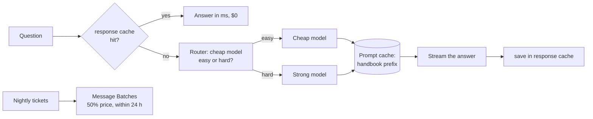

# 14 · Cost and latency: caching, routing, batching

**What you'll build:** a cost-and-speed toolkit for a Northwind policy assistant: a monthly cost calculator, prompt caching on a 1,500-token handbook, a SQLite response cache, a cheap-model router, a half-price nightly batch job, and a benchmark that measures what each lever saves, plus time-to-first-token with streaming.
**Like you're 5:** a café saves money four ways: it pre-makes the sauce once in the morning (prompt caching), keeps a few popular sandwiches ready (response cache), lets the junior cook make toast while the chef does the hard dishes (routing), and bakes tomorrow's bread overnight when the oven is cheap (batching). And it brings the soup to the table spoon by spoon instead of making you wait for the whole pot (streaming).
**Time:** ~2.5 h · **Builds on:** [13 · Guardrails](../13-guardrails-and-prompt-injection-defense) and the prompt structure of [10](../10-prompt-engineering-patterns-that-hold-up) · **Needs:** nothing for the calculator, the simulated benchmark and the tests; an Anthropic API key for real measurements and for submitting a batch

## Why this matters
A pilot that costs $40 a day becomes a $1,200-a-month line item the customer's finance team will question, and a reply that takes 9 seconds makes support agents stop using the tool. FDEs are expected to know the token math, predict the bill before launch, and cut it without losing quality. The levers in this lesson routinely cut costs by 3–10x on real workloads, and they're easy to explain to a customer's CFO.

## What you'll learn
- **Token math**: how input, output and cached tokens turn into dollars, and how to project a monthly bill.
- **Prompt caching**: marking the big unchanging part of the prompt so repeat requests pay ~5% for it and start faster.
- **Response caching**: answering repeated questions from a database without calling the model at all.
- **Model routing and batching**: a cheap model for easy jobs, the strong model for hard ones; half-price batches for work that can wait.
- **Streaming and measurement**: time-to-first-token versus total time, mean versus p95 latency.

## Before you start
1. Switch on your virtual environment, then:
   ```bash
   cd part-3-production-llm-engineering/14-cost-and-latency-caching-routing-batching
   pip install -r requirements.txt
   ```
   Same packages as lesson 10. The response cache uses `sqlite3`, which is built into Python.
2. Optional: an Anthropic API key for real numbers. `CHEAP_MODEL` (default `claude-haiku-5-5`) and `CLAUDE_MODEL` (default `claude-opus-5-5`) choose the two models.

## Run it
1. Project the monthly bill (free):
   ```bash
   python cost_tools.py
   ```
2. Benchmark the four setups and streaming with a simulated model (free, ~50 s because it waits like a real API):
   ```bash
   python benchmark.py --simulate
   ```
3. Build tomorrow night's batch and compare its cost (free):
   ```bash
   python batch_job.py
   ```
4. Run the tests:
   ```bash
   pytest -v
   ```
5. With a key: exact token count, the real benchmark, and a real batch:
   ```bash
   python cost_tools.py --exact
   python benchmark.py
   python batch_job.py --submit
   python batch_job.py --collect msgbatch_...      # use the id printed by --submit
   ```

**Command, piece by piece:** `python batch_job.py --collect msgbatch_...`

| Piece | Meaning |
|---|---|
| `batch_job.py` | the nightly job script |
| `--collect` | "check this batch and download its results if it has finished" |
| `msgbatch_...` | the batch id the API gave you when you submitted (copy it from the `--submit` output) |

### What you should see
`python cost_tools.py` (real output):
```
Handbook system prompt ≈ 1494 tokens (estimate: characters / 4)
Each request ≈ 1514 input + 80 output tokens; 5,000 requests/day for 30 days

Opus, no caching               $ 1,148.40 / month
Opus, 90% prompt-cache hits    $   404.39 / month
  + 25% response-cache hits    $   303.29 / month
Haiku, 90% prompt-cache hits   $    11.12 / month
Opus as a nightly batch        $   574.20 / month
```
`python benchmark.py --simulate` (real run of the code; the model, its token counts and its waiting times are **simulated**, following the assumptions written in `SimulatedClaude`):
```
Strong model: claude-opus-5-5   cheap model: claude-haiku-5-5   handbook ≈ 1494 tokens   12 questions

setup                    total $ $ / 1000 q  mean s  p95 s  $/month at 5,000 q/day
1 strong model only       0.0871       7.26    1.21   1.60       1,088
2 + prompt caching        0.0261       2.18    0.98   1.45         326
3 + response cache        0.0152       1.27    0.78   1.47         190
4 + routing               0.0084       0.70    0.74   1.70         105

Who answered in setup 4: 6 cheap, 3 strong, 3 from the response cache

Streaming (one hard question):
  time to first token 0.50 s, full answer 1.63 s -> the user starts reading 1.13 s sooner
```
`python batch_job.py` (real output, start):
```
Built 200 requests -> batch_requests.jsonl (model claude-haiku-5-5)
Estimated tokens: 7,529 in, 12,000 out
One call at a time: $0.0068   as a batch: $0.0034   (results within 24 h, usually < 1 h)
```
`pytest -v` ends with `7 passed`.

What to look at: prompt caching alone cut the cost by about 70% because the handbook is 99% of every request. The response cache answered 3 of 12 questions for free, including `whats the CUT-OFF time for express` (a differently written repeat). Routing halved the cost again, but look at **p95**: it went *up* (1.70 s), because hard questions now wait for the router first. Every lever has a trade-off; measure, then decide. With a real key, your numbers will differ (real latency depends on the model, load and region): that is exactly why you run `python benchmark.py` on the customer's real questions before promising anything.

## How it works


1. **Token math (`estimate_tokens`, `count_tokens`, `llm.cost_usd`, `monthly_cost`).** Models read and write **tokens** (word pieces; in English about 4 characters each). You pay per million tokens, and output costs 5x input (`llm.PRICES`: Opus $4 in / $20 out, Haiku $0.10 / $0.50). Cached input costs much less to read ($0.20 for Opus) but 1.25x to write the first time. `estimate_tokens` is the quick planning rule; `count_tokens` asks the API for the exact number (free, needs a key). `monthly_cost` multiplies it all out: requests × 30 days × (hits × cheap price + misses × full price), minus response-cache hits, halved for batches.

2. **Prompt caching (`answer` with `cache=True`).** `SYSTEM` is the whole handbook, the same bytes every time. `llm.chat(..., cache=True)` adds `"cache_control": {"type": "ephemeral"}` to it, which tells the API "keep the processed version of everything up to here for 5 minutes". The next request with the *identical* prefix reads it from the cache: cheaper and faster to start. Rules that make or break it: the cached part must come first and never change (no dates, IDs or the question in it, which is why lesson 10 tested the system prompt is static); it must be long enough (at least 512 tokens on current models; shorter prompts silently don't cache); check `reply.cache_read_tokens` to confirm hits.

3. **Response cache (`ResponseCache`, `normalise`).** A SQLite table `cache(key, answer, created)`. The key is a SHA-256 hash of the model, a hash of the system prompt, and the **normalised** question (lower case, no punctuation, single spaces). Changing the model or the prompt therefore automatically ignores old answers. `ttl_seconds` makes answers expire, so a policy change can't be hidden by old cached answers for long. Only cache answers that don't depend on the user (policies yes; "where is MY parcel" no). The SQL, piece by piece:

   | SQL | Meaning |
   |---|---|
   | `CREATE TABLE IF NOT EXISTS cache (...)` | make the table the first time; do nothing if it already exists |
   | `key TEXT PRIMARY KEY` | a text column whose values must be unique; used for fast lookups |
   | `SELECT answer, created FROM cache WHERE key = ?` | fetch the row for this key; `?` is filled in safely by Python (never paste values into SQL yourself) |
   | `INSERT OR REPLACE INTO cache VALUES (?, ?, ?)` | add the row, or overwrite it if the key already exists |

4. **Routing (`route`, `Difficulty`).** The cheap model reads the question and answers one word, `easy` or `hard`, through a schema. That costs a tiny fraction of a cent. Easy goes to `CHEAP_MODEL`, hard to `MODEL`. Check the router with an eval (lesson 12): a router that sends hard questions to the cheap model saves money by giving wrong answers. Also try the simpler option first: the strong model with `effort="low"` is often enough for easy questions, and one model keeps one prompt cache.

5. **Batching (`batch_requests`, `batch_job.py`).** Work that doesn't need an answer *now* (nightly summaries, re-scoring a golden set, back-filling tags) can go through the **Message Batches API**: up to 100,000 requests in one go, at 50% of the price, finished within 24 hours (usually within an hour). Each request has a `custom_id` because results come back in any order. `--submit` calls `client.messages.batches.create(requests=...)`; `--collect` calls `retrieve()` to check `processing_status`, and `results()` when it is `ended`.

6. **Streaming (`llm.stream`).** Without streaming, the user stares at a spinner until the last word is written. With streaming, words appear as they are produced. Total time is the same; **time to first token (TTFT)** is what people feel. `benchmark.py` measures both.

7. **Measuring (`benchmark.py`).** `run_setup` sends the same 12 questions through each setup and records cost and seconds per question. **Mean** is the average; **p95** is the time 95% of requests beat, which is what your slowest users feel. `SimulatedClaude` lets you run it all free: it counts tokens like the API (including cache reads and writes within 5 minutes) and waits according to stated assumptions. Its numbers are illustrations; real ones come from the real run.

## If something goes wrong
- **`cache_read_tokens` stays 0 with a real key** → the prefix changed (a timestamp or ID in the system prompt, a different model, a different tool list), it's under the minimum length, or more than 5 minutes passed. Print `reply.cache_write_tokens` too: if it's 0, the marker wasn't applied at all.
- **The response cache returns an outdated answer** → you changed the policy text but not the system prompt hash input, or the TTL is long. Delete `response_cache.db` (it's recreated) or lower `ttl_seconds`.
- **`python batch_job.py --collect ...` says `in_progress` for a long time** → that's normal; batches can take up to 24 hours. Run it again later.
- **`benchmark.py --simulate` is slow** → it really waits, like the API would (~50 s total). Lower the numbers in `SimulatedClaude.SPEED` if you're in a hurry; it doesn't change the costs.
- **Real benchmark shows routing made things slower AND not cheaper** → your questions may all be "hard", or the strong model at low effort is already cheap enough. That's a valid finding: remove the router.

## Try this
1. **Easy:** in `cost_tools.py`, change the projection to 20,000 requests a day and answers of 200 tokens. Which lever saves the most dollars now?
   <details><summary>Hint</summary>Longer answers make output tokens (5x the price) a bigger share, so prompt caching saves a smaller *percentage*, while the cheap model and batching (which discount output too) save more. Edit `monthly_cost(5000, ...)` in the `__main__` block and `answer_tokens = 80`.</details>
2. **Medium:** add a "semantic" response cache: if no exact hit, compare the question's embedding (lesson 11's `Embedder`) with cached questions and reuse an answer when cosine similarity is above 0.95.
   <details><summary>Hint</summary>Store the question text and its vector (as JSON) in a second table. Be careful: "Is Saturday delivery available?" and "Is Saturday collection available?" are very similar sentences with different answers. Test the threshold on such near-misses before using it, and log every semantic hit so a person can audit them.</details>
3. **Harder:** make `route()` free for obvious cases: if the question is shorter than 60 characters and starts with "how much", "what's the", "which form" or "do", go straight to the cheap model without calling the router. Measure the change in `benchmark.py --simulate`.
   <details><summary>Solution</summary>

   ```python
   EASY_START = ("how much", "what's the", "whats the", "which form", "do ")
   def route(question):
       if len(question) < 60 and question.lower().startswith(EASY_START):
           return llm.CHEAP_MODEL, llm.Reply(text="", model=llm.CHEAP_MODEL)   # no call, $0
       ...  # the existing code
   ```
   `llm.Reply(...)` with zero tokens has `cost_usd == 0`, so `run_setup` keeps working. Setup 4 should get a bit cheaper and its mean latency lower (fewer router calls).</details>

## Check yourself
1. Why does prompt caching need the question to come *after* the handbook, never inside it?
2. What's the difference between prompt caching and response caching?
3. Routing lowered the cost but raised p95 latency. Why, and how could you fix it?
4. Which of these suit the Batches API: live chat replies, re-scoring 3,000 golden-set answers, a nightly report?

<details><summary>Answers</summary>

1. Caching works on an identical *prefix*. If anything changing (the question, a date) sits inside or before the cached part, every request has a different prefix and nothing is ever reused.
2. Prompt caching still calls the model but reuses its processing of the unchanged start of the prompt (cheaper, faster). Response caching skips the model entirely and returns a saved answer for a repeated question (free, milliseconds), so it only suits answers that are the same for everyone.
3. Hard questions now make two calls in a row (router, then strong model). Fixes: skip the router for obvious cases (exercise 3), run the router in parallel with a cache lookup, or use one model at lower effort instead.
4. Re-scoring the golden set and the nightly report: nobody waits for them. Live chat needs an answer in seconds, so it can't wait up to 24 hours.
</details>

## Learn more (optional)
**Read the official docs**
- Pricing: https://platform.claude.com/docs/en/about-claude/pricing
- Prompt caching: https://platform.claude.com/docs/en/build-with-claude/prompt-caching
- Message Batches (batch processing): https://platform.claude.com/docs/en/build-with-claude/batch-processing
- Token counting: https://platform.claude.com/docs/en/build-with-claude/token-counting
- Streaming: https://platform.claude.com/docs/en/build-with-claude/streaming
- Effort parameter: https://platform.claude.com/docs/en/build-with-claude/effort
- Python `sqlite3`: https://docs.python.org/3/library/sqlite3.html

**Watch**
- Prompt caching explained: https://www.youtube.com/results?search_query=claude+prompt+caching+explained
- LLM cost optimisation in production: https://www.youtube.com/results?search_query=llm+cost+optimization+caching+routing+production
- Tokens explained (Andrej Karpathy, "Let's build the GPT Tokenizer"): https://www.youtube.com/watch?v=zduSFxRajkE

## Next
→ [15 · Tracing and monitoring LLM apps](../15-tracing-and-monitoring-llm-apps)
