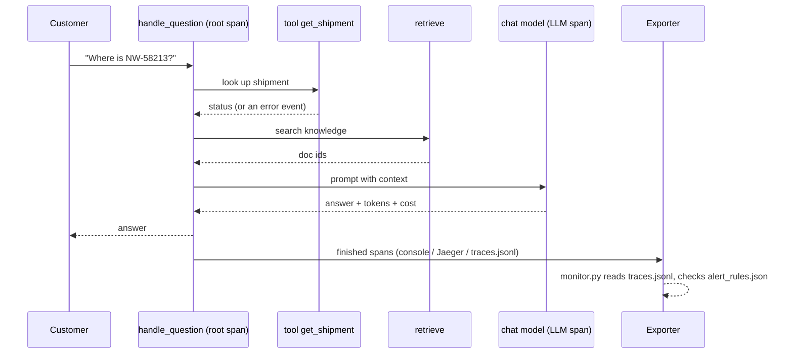

# 15 · Tracing and monitoring LLM apps

**What you'll build:** a Northwind assistant where every question produces an OpenTelemetry **trace**: one span for the whole request and child spans for the tool call, the retrieval and the LLM call (with model, tokens and cost). You'll view traces in the terminal and in a local Jaeger, log safely (no customer data unless you switch it on, and then redacted), and run a monitor that raises alerts when errors, latency, "I don't know" answers or cost go over a limit.
**Like you're 5:** a parcel's tracking page shows every stop: picked up, Leeds hub, out for delivery. A trace is a tracking page for one question travelling through your app, so when something is late you can see exactly where it waited.
**Time:** ~2.5 h · **Builds on:** [14 · Cost and latency](../14-cost-and-latency-caching-routing-batching), and the observability resources in the [Cloud and DevOps for AI guide](../../../cloud-and-devops-for-ai) · **Needs:** nothing for `--offline`; Docker for the Jaeger part; an Anthropic API key or Ollama for real model calls

## Why this matters
After launch, the customer calls: "the assistant was slow this morning" or "it gave a wrong answer to a pharmacy". Without traces you're guessing. With them, you open the slow request and see that retrieval took 20 ms and the model 9 seconds, or that the tool returned "not found". Monitoring then tells you about problems before the customer does. Being able to say "here is the trace" is a big part of earning trust as an FDE, and every serious LLM platform (Langfuse, LangSmith, Datadog, Honeycomb, Grafana) speaks OpenTelemetry.

## What you'll learn
- **Traces and spans**: a trace is one request's whole journey; a span is one timed step inside it, with attributes and events.
- **OpenTelemetry**: the open standard and Python SDK for creating spans and sending them to any backend through an **exporter**.
- **GenAI span attributes**: recording the model, token usage, finish reason and cost on each LLM span.
- **Logging prompts safely**: fingerprints by default, redacted text only when switched on, never secrets.
- **Alerts**: turning spans into health numbers (error rate, p95 latency, "I don't know" rate, cost) and rules that page someone.

## Before you start
1. Switch on your virtual environment, then:
   ```bash
   cd part-3-production-llm-engineering/15-tracing-and-monitoring-llm-apps
   pip install -r requirements.txt
   ```
   - `opentelemetry-sdk`: creates spans and passes them to exporters.
   - `opentelemetry-exporter-otlp-proto-grpc`: sends spans over **OTLP** (the OpenTelemetry protocol) to Jaeger or any other backend.
   - `anthropic`, `pydantic`, `httpx`, `pytest`: as before (`httpx` also posts alerts to a webhook).
2. For Jaeger: Docker installed and running (see the Docker resources in the [Cloud and DevOps for AI guide](../../../cloud-and-devops-for-ai)).

## Run it
1. One question, spans printed in the terminal:
   ```bash
   python app.py "Where is NW-58213?" --offline
   ```
2. Start Jaeger (a trace viewer) in Docker:
   ```bash
   docker run -d --name jaeger -p 16686:16686 -p 4317:4317 jaegertracing/jaeger:2.11.0
   ```
3. Send two traces to it, one with a missing shipment:
   ```bash
   python app.py "Where is NW-58213?" --offline --exporter jaeger
   python app.py "Where is NW-99999?" --offline --exporter jaeger
   ```
4. Open http://localhost:16686, choose service **northwind-assistant**, click **Find Traces**, and open one.
5. Simulate a normal busy hour, then check health:
   ```bash
   python app.py --simulate 60 --offline --exporter file
   python monitor.py
   ```
6. Simulate an incident (provider errors and slow replies; takes ~80 s), then check again:
   ```bash
   python app.py --simulate 60 --offline --exporter file --incident
   python monitor.py
   echo $?
   ```
7. See what content logging looks like (redacted):
   ```bash
   LOG_CONTENT=1 python app.py "Hi, I'm jo@shop.example. How much is Saturday delivery?" --offline --exporter none
   ```
8. Run the tests, then stop Jaeger:
   ```bash
   pytest -v
   docker rm -f jaeger
   ```

**Command, piece by piece:** `docker run -d --name jaeger -p 16686:16686 -p 4317:4317 jaegertracing/jaeger:2.11.0`

| Piece | Meaning |
|---|---|
| `docker run` | create and start a container from an image |
| `-d` | detached: run in the background and give the terminal back |
| `--name jaeger` | call the container "jaeger" so you can stop it by name |
| `-p 16686:16686` | connect port 16686 on your computer to port 16686 in the container (the web page) |
| `-p 4317:4317` | the same for port 4317, where Jaeger receives spans over OTLP/gRPC |
| `jaegertracing/jaeger:2.11.0` | the image: Jaeger version 2, all-in-one (collector, storage in memory, web UI). The exact version tag keeps it reproducible |

**Command, piece by piece:** `LOG_CONTENT=1 python app.py "..." --offline --exporter none`

| Piece | Meaning |
|---|---|
| `LOG_CONTENT=1` | set an environment variable for this one command only (no `export`) |
| `--exporter none` | create spans but send them nowhere (so only the log line prints) |

(PowerShell: `$env:LOG_CONTENT="1"; python app.py ...`, then `Remove-Item Env:LOG_CONTENT`.)

**Command, piece by piece:** `docker rm -f jaeger`

| Piece | Meaning |
|---|---|
| `docker rm` | remove a container |
| `-f` | force: stop it first if it's running |
| `jaeger` | the container's name; its traces are kept in memory, so they disappear with it |

### What you should see
`python app.py "Where is NW-58213?" --offline` prints four spans as JSON, then a log line and the answer. The LLM span (real output, shortened):
```
{
    "name": "chat claude-opus-5-5",
    "kind": "SpanKind.CLIENT",
    "parent_id": "0x429c14192790208a",
    "attributes": {
        "gen_ai.operation.name": "chat",
        "gen_ai.system": "anthropic",
        "gen_ai.request.model": "claude-opus-5-5",
        "gen_ai.prompt.sha": "750b4996a34b",
        "gen_ai.prompt.chars": 111,
        "gen_ai.usage.input_tokens": 69,
        "gen_ai.usage.output_tokens": 17,
        "gen_ai.usage.cache_read_input_tokens": 0,
        "gen_ai.response.finish_reasons": ["end_turn"],
        "app.cost_usd": 0.000616
...
{"time": "2026-10-23T00:00:19", "level": "INFO", "event": "answered", "trace_id": "2a4b6f6da147a2eea0299794ff49236d", "user": "c6c289e49e", "idk": false, "ms": 1390, "cost_usd": 0.000616, "question.sha": "827cbb6647d3", "question.chars": 18}
ANSWER: Shipment NW-58213: delayed at Leeds hub, re-delivery booked for Friday
```
(With `--offline` the "model" is a stand-in, so the model name is just the configured default and the token counts are estimates.)

In Jaeger, the two traces look like this (real data, read back from Jaeger's API while writing this lesson):
```
trace b69428df...  4 spans                       <- "Where is NW-99999?"
    handle_question      1598.4 ms   log: event "tool error"
    tool get_shipment     175.7 ms   log: exception (LookupError: unknown shipment NW-99999)
    retrieve                0.2 ms   log: "no documents matched"
    chat claude-opus-5-5 1421.8 ms
trace b5f883e2...  4 spans                       <- "Where is NW-58213?"
    handle_question      1456.0 ms
    ...
```
On the web page each trace is a timeline: the root bar on top, children below it, so you see at a glance that the model call is almost all of the time.

`python monitor.py` after the normal hour (real output):
```
Health of northwind-assistant
  requests                     60
  error_rate                   0.000
  p50_latency_ms               150.200
  p95_latency_ms               239.900
  idk_rate                     0.117
  empty_retrieval_rate         0.350
  tool_errors                  6
  cost_per_1000_requests_usd   0.581
  tokens_per_request           85.917

✅ All alert rules OK
```
After the incident (real output, last lines; the file now holds both hours, 120 requests):
```
[PAGE] error_rate = 0.117 (limit > 0.05): more than 5% of questions fail; check the provider status page and the error events in Jaeger
[WARN] p95_latency_ms = 3,756.8 (limit > 3000): the slowest 5% take over 3 s; look at the longest traces to see which span is slow
```
and `echo $?` prints `2`. The `LOG_CONTENT=1` run logs `"question": "Hi, I'm [EMAIL]. How much is Saturday delivery?"`. `pytest -v` ends with `6 passed`.

What to look at: `p50` hardly moved during the incident (most requests were fine) while `p95` jumped: averages hide the users who suffer. `empty_retrieval_rate` is 35% even when healthy, because shipment questions are answered by the tool, not the documents; know your normal before you set limits.

## How it works


1. **Setting up tracing (`telemetry.setup`).** A `TracerProvider` is the factory for spans; its `Resource` names the service (`northwind-assistant`, what you pick in Jaeger). Each exporter is attached through a **span processor**: `SimpleSpanProcessor` sends each span immediately (fine for the console and the file), `BatchSpanProcessor` sends groups in the background (what you use in production, so tracing never slows requests). `trace.set_tracer_provider(provider)` makes it global, and must happen before the first span. `provider.shutdown()` at the end flushes spans still waiting in the batch.

2. **Creating spans (`app.py`).** `with tracer.start_as_current_span("retrieve") as span:` starts a timer, and because it is "current", any span started inside it becomes its child. That's how `tool get_shipment`, `retrieve` and `chat ...` all hang under `handle_question` and share one **trace id**. `kind=SpanKind.SERVER` marks the request coming in; `SpanKind.CLIENT` marks calls going out (the model, a tool's API).

3. **Attributes and events.** `span.set_attribute(key, value)` adds facts you can search and group by: `retrieval.doc_ids`, `tool.shipment_id`, `app.answer.idk`. `span.add_event("no documents matched")` marks a moment. In `traced_chat`, the attribute names follow the OpenTelemetry **GenAI semantic conventions** (`gen_ai.request.model`, `gen_ai.usage.input_tokens`, ...), so tools that understand them can chart tokens per model without extra setup. `app.cost_usd` is our own addition.

4. **Errors.** A tool error we handle is recorded as an event and the request continues. A failure we can't handle (the model provider is overloaded) goes to `span.record_exception(e)` (stores the type, message and stack trace) and `span.set_status(Status(StatusCode.ERROR, ...))`, which is what `error_rate` counts. If an exception escapes a span, OpenTelemetry records it automatically too: that's the exception you saw on `tool get_shipment` in Jaeger.

5. **Logs that join traces (`safe_log.py`).** `log()` writes one JSON object per line to stderr, including the `trace_id`, so from a log line you can jump to the trace and back. By default prompts and questions are never stored: `content_fields` gives a **fingerprint** (first 12 characters of a SHA-256 hash: the same text always gives the same fingerprint, but you can't turn it back into text) and the length. `LOG_CONTENT=1` adds the text after `redact()` replaces emails, card numbers, UK phone numbers, postcodes and API keys, cut to 300 characters. The user id is hashed too. Decide content logging *with the customer*: their data protection officer will ask.

6. **A trace file and a monitor (`JsonlSpanExporter`, `monitor.py`).** Our own small exporter appends each span as a JSON line to `traces.jsonl`. `monitor.health()` turns spans into numbers: requests, `error_rate`, `p50`/`p95` latency of the root span, `idk_rate`, `empty_retrieval_rate`, handled tool errors, cost per 1,000 requests and tokens per request. In production the same numbers come from your backend (Grafana, Datadog...), but the logic is identical.

7. **Alert rules (`alert_rules.json`, `check`, `notify`).** Each rule:

   | Key | Meaning |
   |---|---|
   | `metric` | which health number to watch |
   | `op`, `threshold` | fire when the number is `>` (or `<`) this limit |
   | `severity` | `page` = wake someone up; `warn` = look at it today |
   | `action` | what the person receiving it should do first: an alert without a next step is just noise |

   `check` ignores windows with fewer than 10 requests (too little data to judge). `notify` posts firing alerts to `ALERT_WEBHOOK_URL` (Slack and Teams both accept a JSON post to an "incoming webhook" URL). The exit code `2` lets a scheduler (cron; see the [Linux from Zero guide](../../../linux-from-zero)) or a CI job react.

8. **Real model calls.** Without `--offline`, the same spans wrap real Claude or Ollama calls, and the token numbers are real. Recent versions of the Anthropic SDK can also emit their own OpenTelemetry spans (a beta feature); they nest under yours when you call the SDK inside your span. See "Learn more".

## If something goes wrong
- **Jaeger shows no `northwind-assistant` service** → the app finished before spans were sent, or Jaeger isn't listening. Check `docker ps` shows the container, port `4317` is published, and that the app ran with `--exporter jaeger` (it calls `provider.shutdown()` to flush). Wait a few seconds and refresh.
- **`docker: Error response from daemon: Conflict. The container name "/jaeger" is already in use`** → it's already running (good), or an old stopped one exists: `docker rm -f jaeger` and run again.
- **`port is already allocated`** → something else uses 16686 or 4317. Map different outside ports, e.g. `-p 16687:16686 -p 4319:4317`, then change `endpoint="localhost:4317"` in `telemetry.py` to the new port.
- **`monitor.py` says no requests** → it reads `traces.jsonl`, which only the `file` exporter writes: add `--exporter file` (or `--exporter jaeger,file` for both).
- **Alerts fire right after a deploy, then stop** → cold starts and cache warm-up. Use a time window (`--minutes 15`) and require a minimum number of requests, as `check` does.

## Try this
1. **Easy:** add an attribute `app.question.has_shipment_id` (true/false) to the root span, then find in Jaeger only the traces where it is true.
   <details><summary>Hint</summary>In `handle()`: `span.set_attribute("app.question.has_shipment_id", bool(re.search(r"NW-\d{5}", question)))`. In Jaeger's search form, type `app.question.has_shipment_id=true` in the **Tags** box.</details>
2. **Medium:** add an alert rule that fires when `tool_errors` is more than 10% of requests.
   <details><summary>Solution</summary>`tool_errors` is a count, so first add a rate to `health()`: `"tool_error_rate": sum("tool error" in s["events"] for s in roots) / len(roots)`. Then add `{"metric": "tool_error_rate", "op": ">", "threshold": 0.10, "severity": "warn", "action": "many unknown shipment IDs: check the shipment API or for typos in a new client integration"}` to `alert_rules.json`. The normal simulation has 6 of 60 = 0.10, which is not *more* than 0.10, so it stays quiet; the incident run doubles it.</details>
3. **Harder:** add a span for a "guardrail check" step (from lesson 13) that runs `check_output` on the answer, records how many problems it found as an attribute, and sets the span status to ERROR if it had to withhold the answer.
   <details><summary>Hint</summary>Copy `guards.py` from lesson 13 into this folder, then wrap the call in `with tracer.start_as_current_span("guardrail check_output") as g:` inside `handle()`, after `traced_chat`. Use `g.set_attribute("guardrail.problems", len(problems))`. Then add `"guardrail_block_rate"` to `health()` and a rule for it: a sudden rise often means someone is attacking.</details>

## Check yourself
1. What's the difference between a trace and a span, and how does a child span know its parent?
2. Why do we store a fingerprint of the prompt instead of the prompt itself by default?
3. Why alert on p95 latency rather than average latency?
4. Why is `BatchSpanProcessor` used for Jaeger but `SimpleSpanProcessor` for the console?

<details><summary>Answers</summary>

1. A trace is one request's full journey; a span is one timed step in it. A span started while another span is "current" (inside its `with` block) becomes its child, and shares its trace id.
2. Prompts contain customer data. A fingerprint still lets you count repeats and match logs to traces, without storing the text. Content logging is a deliberate, agreed decision, and even then it's redacted.
3. The average hides slow requests: a few 9-second answers barely move it. p95 says what the slowest 1 in 20 users experience, which is what they complain about.
4. Sending each span over the network immediately would add delay to every request; batching sends them in the background. For printing while you learn, immediate output is simpler and easier to follow.
</details>

## Learn more (optional)
**Read the official docs**
- OpenTelemetry for Python: https://opentelemetry.io/docs/languages/python/
- OpenTelemetry GenAI semantic conventions: https://opentelemetry.io/docs/specs/semconv/gen-ai/
- Jaeger documentation: https://www.jaegertracing.io/docs/
- Anthropic: OpenTelemetry for the Claude API and SDKs: https://platform.claude.com/docs/en/manage-claude/opentelemetry
- Docker `run` reference: https://docs.docker.com/reference/cli/docker/container/run/
- Python `logging`: https://docs.python.org/3/library/logging.html

**Watch**
- OpenTelemetry explained: https://www.youtube.com/results?search_query=opentelemetry+explained+traces+spans
- Jaeger distributed tracing tutorial: https://www.youtube.com/results?search_query=jaeger+distributed+tracing+tutorial
- LLM observability: https://www.youtube.com/results?search_query=llm+observability+tracing+langfuse+opentelemetry

## Next
→ [16 · Designing good tools and MCP servers for customer systems](../../part-4-agents-at-work/16-designing-good-tools-and-mcp-servers-for-customer-systems) (Part 4 starts here; see the [Part 4 README](../../part-4-agents-at-work/README.md))
