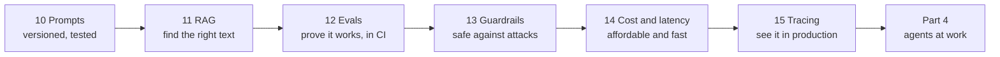

# Part 3 · Production LLM engineering

The pilot works on your laptop. Now it has to work every day, for thousands of real questions, at a price the customer accepts, without leaking data or being tricked, and with proof that it still works after every change. This part turns "a prompt that works" into an LLM feature you can put in front of **Northwind Logistics'** customers and defend in front of its security, finance and operations teams.

| # | Lesson | What you'll have | Time |
|---|--------|------------------|------|
| 10 | [Prompt engineering patterns that hold up](10-prompt-engineering-patterns-that-hold-up) | a versioned, fingerprint-locked triage prompt with XML-tagged context, examples, a JSON schema, post-checks and prompt tests | 2 h |
| 11 | [RAG that works: hybrid search, reranking, citations](11-rag-that-works-hybrid-search-reranking-citations) | BM25 + embeddings fused with RRF, optional reranking, checked citations, three "I don't know" gates, and measured hit rates | 3 h |
| 12 | [Evals: golden sets, LLM judges and CI](12-evals-golden-sets-llm-judges-and-ci) | a golden set, exact/semantic/judge metrics, judge calibration, a regression gate, a GitHub Actions workflow and a score dashboard | 3 h |
| 13 | [Guardrails and prompt injection defense](13-guardrails-and-prompt-injection-defense) | five defence layers, a red-team suite run against a worst-case model, and proof of which layer stops which attack | 2.5 h |
| 14 | [Cost and latency: caching, routing, batching](14-cost-and-latency-caching-routing-batching) | a monthly cost calculator, prompt and response caching, a model router, a half-price batch job and a benchmark | 2.5 h |
| 15 | [Tracing and monitoring LLM apps](15-tracing-and-monitoring-llm-apps) | OpenTelemetry spans for tools, retrieval and LLM calls, Jaeger, safe logging, and alert rules | 2.5 h |

**Total: about 15–16 hours** (two to three weeks at 1 hour a day).

## How the lessons connect


## Set up for this part
1. Follow **Set up once** in the [course README](../README.md#set-up-once) (one virtual environment for the course).
2. In each lesson folder, install that lesson's packages:
   ```bash
   pip install -r requirements.txt
   ```
   | Lesson | Packages |
   |--------|----------|
   | 10, 13, 14 | `anthropic`, `pydantic`, `httpx`, `pytest` |
   | 11, 12 | the above + `numpy`, `chromadb` (for its small local embedding model, ~80 MB downloaded once) |
   | 15 | the above (without `numpy`/`chromadb`) + `opentelemetry-sdk`, `opentelemetry-exporter-otlp-proto-grpc`; Docker for the optional Jaeger viewer |
3. **The model.** Every lesson in Parts 3 and 4 has the same small helper, `llm.py`, and three ways to run:
   - **`--offline` (free, no key):** a stand-in replaces the model (keyword rules, templates or scripts). Every script has this flag, so you can run every lesson end to end today. The stand-ins are clearly labelled; they show the plumbing, not AI quality.
   - **Claude:** `export ANTHROPIC_API_KEY=sk-ant-...` (see [Get your API key](../../ai-from-zero/part-4-chatbots/README.md#get-your-api-key-once-about-10-minutes)). Default model `claude-opus-5-5`; `CLAUDE_MODEL` changes it, and `CHEAP_MODEL` (default `claude-haiku-5-5`) is used for simple jobs like routing and reranking.
   - **A local open model:** install Ollama, `ollama pull qwen3:8b`, then `export LLM_PROVIDER=ollama` (`OLLAMA_MODEL` picks another model). `llm.py` talks to Ollama's OpenAI-compatible API at `http://localhost:11434/v1`.
4. Every lesson has tests (`pytest -v`) that use a fake model (`fake_llm.py`), so they are free, offline and fast.

**What `llm.py` gives you** (read it once in lesson 10): `llm.chat(messages, system=..., tools=..., schema=..., effort=..., cache=...)` returns a `Reply` with `.text`, `.parsed` (a filled-in Pydantic object when you pass `schema`), `.tool_calls`, token counts, `.cost_usd` and `.seconds`; `llm.stream(...)` yields the answer piece by piece. One message format works for both Claude and Ollama.

## After this part you can
- Write prompts as versioned, tested code: structured system prompts, tagged untrusted input, examples, schemas and post-checks.
- Build retrieval that finds codes and paraphrases alike, cites its sources and says "I don't know".
- Prove quality with golden sets and calibrated LLM judges, and block regressions in CI.
- Defend an LLM app against prompt injection with layers that work even when the model is fooled.
- Predict and cut the monthly bill and the latency with caching, routing, batching and streaming.
- Trace every request, log safely, and get alerted before the customer notices a problem.

## Next
→ [Part 4 · Agents at work](../part-4-agents-at-work)
