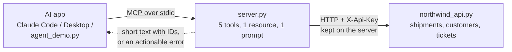

# 16 · Designing good tools and MCP servers for customer systems

**What you'll build:** an MCP server called `northwind` that wraps Northwind's shipment, customer and ticket API in five well-designed tools (clear names, tight schemas, short answers with IDs, pagination, errors that say what to do next, safety hints, an idempotent write), plus a linter that scores tool designs, a raw MCP client, and an agent that answers "which of our parcels are delayed, and why?" through the server.
**Like you're 5:** a toy box with labelled drawers ("red Lego", "wheels", "people") is easy to tidy and easy to find things in. One giant bag of everything isn't. Good tools are labelled drawers for an AI.
**Time:** ~3 h · **Builds on:** [15 · Tracing](../../part-3-production-llm-engineering/15-tracing-and-monitoring-llm-apps), [07 · Connecting to company systems](../../part-2-enterprise-data-and-integration/07-connecting-to-company-systems-rest-webhooks-oauth) and [Journey 8.6 · Build your own MCP server](../../../ai-engineer-journey/level-8-multi-agent-systems/06-build-your-own-mcp-server) · **Needs:** nothing for the server, linter, client and offline agent; an Anthropic API key or Ollama for the real agent

## Why this matters
At a customer, the most valuable thing you often build is not a chatbot but the **tools** that connect AI to their systems: CRM, ticketing, ERP, shipment tracking. Built once as an MCP server, those tools work in Claude Code, Claude Desktop, the customer's own agents and the next project too. Agents fail far more often because of badly designed tools (vague names, giant outputs, confusing errors, one do-anything endpoint) than because of the model. Designing tools for a model, not for a programmer, is a core FDE skill.

## What you'll learn
- **Tool design for models**: specific verb_noun tools, descriptions that say when to use them, enums and patterns instead of free text.
- **Context-friendly results**: short text with IDs, a `detail` switch for more, and pagination with "call again with page=2".
- **Actionable errors**: messages that tell the model the next step, without leaking secrets or stack traces.
- **Safe writes**: tool annotations (read-only, idempotent) and idempotency keys so a retry never duplicates an action.
- **MCP servers over a company API**: the server holds the API key, the model never sees it, and any MCP app can plug in.

## Before you start
1. Switch on your virtual environment, then:
   ```bash
   cd part-4-agents-at-work/16-designing-good-tools-and-mcp-servers-for-customer-systems
   pip install -r requirements.txt
   ```
   - `mcp`: the official MCP Python SDK, version 2 (`MCPServer`; older tutorials call it `FastMCP`).
   - `fastapi`, `uvicorn[standard]`: the mock Northwind API (`northwind_api.py`).
   - `httpx`: the HTTP client the MCP server uses to call that API.
   - `anthropic`, `pydantic`, `pytest`: model calls, schemas and tests (as in Part 3).
2. No key needed for steps 1–5 below.

## Run it
1. Score some badly designed tools against ours:
   ```bash
   python tool_lint.py
   ```
2. Talk to the MCP server like an AI app does (it starts `server.py` for you):
   ```bash
   python client_demo.py
   ```
3. Let an agent use the server (offline: a scripted stand-in picks the tools; the server and data are real):
   ```bash
   python agent_demo.py --offline
   ```
4. Run the tests:
   ```bash
   pytest -v
   ```
5. Optional, the realistic setup: run the API as its own web service in a second terminal, then point the server at it:
   ```bash
   uvicorn northwind_api:app --port 8200
   ```
   In the first terminal:
   ```bash
   export NORTHWIND_API_URL=http://localhost:8200
   python client_demo.py
   ```
   Open http://localhost:8200/docs to see the API itself. Stop it with Ctrl+C.
6. With a key (or Ollama): the real agent:
   ```bash
   python agent_demo.py "Which Kestrel Pharmacy shipments are delayed, and why?"
   ```
7. Plug the server into Claude Code (full paths to your venv's Python and to `server.py`):
   ```bash
   claude mcp add northwind -- /FULL/PATH/TO/venv/bin/python /FULL/PATH/TO/16-designing-good-tools-and-mcp-servers-for-customer-systems/server.py
   ```
   or into Claude Desktop (Settings → Developer → Edit Config), then restart it:
   ```json
   {
     "mcpServers": {
       "northwind": {
         "command": "/FULL/PATH/TO/venv/bin/python",
         "args": ["/FULL/PATH/TO/16-designing-good-tools-and-mcp-servers-for-customer-systems/server.py"],
         "env": {"NORTHWIND_API_URL": "inprocess", "NORTHWIND_API_KEY": "dev-key-change-me"}
       }
     }
   }
   ```
   Then ask: *"Use northwind to find Kestrel Pharmacy's delayed shipments and explain each one."* Or pick the ready-made prompt `investigate_late_shipments`.

**Command, piece by piece:** `uvicorn northwind_api:app --port 8200`

| Piece | Meaning |
|---|---|
| `uvicorn` | a web server that runs Python web apps (FastAPI apps are "ASGI" apps) |
| `northwind_api:app` | "in the file `northwind_api.py`, use the object named `app`" |
| `--port 8200` | listen on port 8200 (http://localhost:8200) |

**Command, piece by piece:** `claude mcp add northwind -- /FULL/PATH/.../python /FULL/PATH/.../server.py`

| Piece | Meaning |
|---|---|
| `claude mcp add` | register an MCP server with Claude Code |
| `northwind` | the name Claude Code shows for it |
| `--` | "everything after this is the command to start the server", not options for `claude` |
| `.../venv/bin/python .../server.py` | the command Claude Code runs; it then talks to the server over stdin/stdout |

**The Claude Desktop config, piece by piece**

| JSON key | Meaning |
|---|---|
| `mcpServers` | the list of servers Claude Desktop starts |
| `"northwind"` | the name of this server |
| `command`, `args` | the program and its arguments (the same as the command line above) |
| `env` | environment variables given only to this server: where the API is and the server's API key. The model never sees them |

### What you should see
`python tool_lint.py` (real output, shortened):
```
== bad_tools.py ==
❌ api_call             0/10
     - name should start with a verb (get, list, find, search, create...)
     - description too short: say what it does, when to use it, and what it returns
     - 'method' is a do-anything parameter: offer specific tools instead
     - 'path' is a do-anything parameter: offer specific tools instead
     - 'body' is a do-anything parameter: offer specific tools instead
     ...
❌ getData              2/10
     - name should be snake_case verb_noun, like get_shipment
     ...
❌ shipments            0/10
     - parameter 'status' looks like a fixed choice: list the allowed values (enum)
     ...
== server.py (MCP) ==
✅ find_customers       10/10
✅ list_shipments       10/10
✅ get_shipment         10/10
✅ search_tickets       10/10
✅ add_ticket_note      10/10
```
`python client_demo.py` (real output, shortened):
```
TOOLS the server offers:
  - find_customers(query)  [read-only]
  - list_shipments(customer_id, status?, page?)  [read-only]
  - get_shipment(shipment_id, detail?)  [read-only]
  - search_tickets(customer_id, status?)  [read-only]
  - add_ticket_note(ticket_id, note, idempotency_key)  [WRITES]

→ find_customers({'query': 'kestrel'})
      C-104  Kestrel Pharmacy  (gold tier, kestrel-pharmacy.example)
      C-522  Kestrel Garden Centre  (bronze tier, kestrel-garden.example)

→ list_shipments({'customer_id': 'C-104', 'status': 'delayed'})
      NW-58445  delayed    Express  promised 2026-10-02
      page 1 of 1 (1 shipments)

→ get_shipment({'shipment_id': 'NW-58445', 'detail': 'full'})
      NW-58445: delayed (Express), customer C-104, promised 2026-10-02, hub Birmingham
        2026-09-30  collected
        2026-10-01  arrived at Birmingham hub
        2026-10-02  delayed at Birmingham hub: vehicle fault

❌ get_shipment({'shipment_id': 'NW-1234'})
      Error executing tool get_shipment: 1 validation error for get_shipmentArguments
      shipment_id
        String should match pattern '^NW-\d{5}$' ...

❌ list_shipments({'customer_id': 'C-999'})
      Error executing tool list_shipments: customer C-999 not found. Use find_customers to get a valid customer ID.

→ add_ticket_note({... 'idempotency_key': 'demo-note-9001'})
      Added note #1 to ticket 9001.

→ add_ticket_note({... 'idempotency_key': 'demo-note-9001'})
      Added note #1 to ticket 9001 (this was a retry: no duplicate created).
```
`python agent_demo.py --offline` (real output):
```
(offline: a scripted stand-in chooses the tools; the MCP server and its data are real)
QUESTION: Which Kestrel Pharmacy shipments are delayed, and why?
  step 1: 🔧 find_customers({'query': 'kestrel'}) -> C-104  Kestrel Pharmacy  (gold tier, kestrel-pharmacy.example)
  step 2: 🔧 list_shipments({'customer_id': 'C-104', 'status': 'delayed'}) -> NW-58445  delayed    Express  promised 2026-10-02
  step 3: 🔧 get_shipment({'shipment_id': 'NW-58445', 'detail': 'full'}) -> NW-58445: delayed (Express), customer C-104, promised 2026-10-02, hub Birmingham
ANSWER: 1 delayed shipment(s): NW-58445: delayed at Birmingham hub: vehicle fault
```
`pytest -v` ends with `9 passed`. The same `client_demo.py` output appears when the server talks to the API over real HTTP (step 5); that was checked too.

What to look at: the "Kestrel" search returns TWO customers, so a model must pick or ask, which is why `find_customers` shows the full name and tier. Both errors tell the model exactly what to do next. And the retried note was not added twice.

## How it works


1. **The customer system (`northwind_api.py`).** A small FastAPI app standing in for Northwind's real systems: `GET /customers?q=`, `GET /shipments?customer_id=&status=&page=`, `GET /shipments/{id}`, `GET /tickets`, `POST /tickets/{id}/notes`. Every call needs an `X-Api-Key` header. Notes accept an `Idempotency-Key` header: the same key twice returns the first result instead of adding a second note (lesson 07 explained the idea; here the tool uses it).

2. **One server, one HTTP client (`api()`, `call()`).** The server creates one `httpx.Client` with the API key in its headers. `NORTHWIND_API_URL=inprocess` (the default) runs the API inside the same process through FastAPI's `TestClient`, so you don't need two terminals while learning. `call()` turns every failure into a short instruction for the model: 404 → "not found, here's how to find the right ID"; 401/403 → "configuration problem, don't retry, tell an administrator" (and never echoes the key); network error → "try once more, then report the system is down". Raising `ToolError` sends that message back as an error result. Any *other* exception is hidden by the MCP SDK as "Error executing tool ...": safe by default, no stack traces leaked.

3. **Five tools, designed for a model.** Each is a Python function with `@mcp.tool()`. The SDK turns the function name, docstring and type hints into the tool definition the model reads:
   - **Names** are verb_noun and specific: `find_customers`, `list_shipments`, `get_shipment`, `search_tickets`, `add_ticket_note`. Not `api_call` or `getData`.
   - **Descriptions** (the docstrings) say what it does, *when* to use it, and how it relates to the others ("Use this FIRST when the user names a company...").
   - **Parameters** use `Annotated[type, Field(description=..., pattern=..., ge=...)]`. `Literal["any", "in_transit", ...]` becomes an `enum`: the model can only choose real values. `pattern=r"^NW-\d{5}$"` rejects bad IDs before any API call.
   - **Results** are short lines of text that always include the IDs the next call needs. `get_shipment(detail="summary")` is one line; `detail="full"` gives the tracking history only when needed. `list_shipments` returns 5 per page and says "call again with page=2". Big raw JSON dumps waste the model's context and money.

4. **Safety hints and safe writes.** `ToolAnnotations(read_only_hint=True)` tells apps these tools don't change anything (many apps then allow them without asking). `add_ticket_note` is marked `read_only_hint=False, destructive_hint=False, idempotent_hint=True` and **requires** an `idempotency_key`, so if the model (or the network) retries, nothing is duplicated. There is deliberately no tool to close tickets, refund or delete: offer only what the use case needs (least privilege again, as in lesson 13).

5. **A resource and a prompt.** `@mcp.resource("northwind://guide")` is read-only context an app can load (how IDs and statuses work). `@mcp.prompt()` `investigate_late_shipments` is a ready-made task a user can pick from a menu in Claude Desktop or Claude Code.

6. **The linter (`tool_lint.py`).** `lint()` encodes the checklist above as rules (naming, description length and "when to use", do-anything parameters like `method`/`path`/`body`, parameter descriptions, enums for fixed choices, a `required` list, an idempotency hint on write tools, no more than ~20 tools). `server_tools()` asks the MCP server for its tools through a real MCP `Client`, exactly as an app would see them. Run it in CI to keep tool quality from slipping.

7. **Clients and the agent (`client_demo.py`, `agent_demo.py`).** `Client(StdioServerParameters(command=..., args=[server.py]))` starts the server as a child process and speaks MCP over its stdin/stdout. `agent_demo.py` converts the MCP tool list into the model's tool format (`to_model_tools`: name, description, schema unchanged), then runs the agent loop: model → tool calls → `client.call_tool()` → results back to the model, up to `max_steps`. The `--offline` stand-in is a script that reads the real tool results to choose the next call.

## If something goes wrong
- **`python server.py` prints nothing and "hangs"** → correct: it waits for an MCP app on stdin. Use `client_demo.py`, or press Ctrl+C.
- **Claude Desktop doesn't show the tools** → the path to Python must be your *venv's* Python (it has `mcp` installed), paths must be absolute, the JSON must be valid (no trailing commas), and you must restart the app. Its MCP logs (Settings → Developer) show the server's error.
- **Every call says "access to the Northwind API was refused"** → the server's `NORTHWIND_API_KEY` doesn't match the API's. Both default to `dev-key-change-me`; if you set one, set the other.
- **"The Northwind API is not reachable"** → you set `NORTHWIND_API_URL=http://localhost:8200` but `uvicorn` isn't running (step 5), or uses another port. `unset NORTHWIND_API_URL` to go back to in-process mode.
- **`Address already in use` when starting uvicorn** → port 8200 is taken: use `--port 8201` and the same port in `NORTHWIND_API_URL`.

## Try this
1. **Easy:** add a `get_customer(customer_id)` tool that returns name, tier and email domain. Run `python tool_lint.py`: does it score 10/10 first time?
   <details><summary>Hint</summary>Copy the shape of `get_shipment`: an `Annotated[str, Field(description="Customer ID like C-104", pattern=r"^C-\d{3}$")]` parameter, `ToolAnnotations(read_only_hint=True)`, and a docstring with "Use this when...". The API has no `/customers/{id}` route yet, so add one to `northwind_api.py` first (or filter `CUSTOMERS` through `/customers`).</details>
2. **Medium:** make `list_shipments` accept `promised_after: str | None` (a date like `2026-10-01`) so the model can ask for "last month only". Validate the format with a pattern and add a test.
   <details><summary>Solution</summary>Tool parameter: `promised_after: Annotated[str | None, Field(description="Only shipments promised on/after this date, YYYY-MM-DD", pattern=r"^\d{4}-\d{2}-\d{2}$")] = None`, pass it to the API as a query parameter, and in the API add `promised_after: str | None = None` and `and (not promised_after or s["promised"] >= promised_after)` to the filter (ISO dates compare correctly as text). Test: `call("list_shipments", {"customer_id": "C-104", "promised_after": "2026-10-15"})` returns only later shipments, and `"15/10/2026"` is rejected.</details>
3. **Harder:** add a `close_ticket(ticket_id, resolution, idempotency_key)` tool, marked as a write tool, but make the server refuse it unless an environment variable `NORTHWIND_ALLOW_WRITES=1` is set, with an error that tells the model to ask the user to have it enabled.
   <details><summary>Hint</summary>Check `os.getenv("NORTHWIND_ALLOW_WRITES") == "1"` at the top of the tool and `raise ToolError("Closing tickets is disabled on this server. Ask the user to ...")`. Better still: only *register* the tool when writes are enabled (`if ALLOW_WRITES: mcp.add_tool(close_ticket)`), so the model never even sees it. Compare the two approaches with `client_demo.py`.</details>

## Check yourself
1. Why is one `api_call(method, path, body)` tool worse than five specific tools, even though it can do more?
2. Why do tool results include IDs and a "call again with page=2" hint instead of all the data?
3. What does `idempotency_key` protect against, and who chooses its value?
4. Where does the API key live, and why must the model never see it?

<details><summary>Answers</summary>

1. The model has to guess URLs and JSON shapes (so it makes more mistakes), and it can do anything the API allows, including things nobody intended. Specific tools are easier to choose, validate and permission.
2. The model's context is limited and costs money. Short results with IDs let it decide what to look at next; pagination keeps big lists manageable without silently cutting them off.
3. Duplicate actions when a call is retried (by the model, the app or the network). The model chooses one unique key per intended note and reuses it on retries; the API returns the first result for a repeated key.
4. In the MCP server's environment (`NORTHWIND_API_KEY`), sent only in HTTP headers to the API. Anything the model sees can end up in an answer, a log or an attacker's hands through prompt injection (lesson 13).
</details>

## Learn more (optional)
**Read the official docs**
- Model Context Protocol: https://modelcontextprotocol.io
- MCP Python SDK: https://github.com/modelcontextprotocol/python-sdk
- Anthropic: tool use overview: https://platform.claude.com/docs/en/agents-and-tools/tool-use/overview
- Anthropic engineering: Writing effective tools for agents: https://www.anthropic.com/engineering/writing-tools-for-agents
- FastAPI: https://fastapi.tiangolo.com
- HTTPX: https://www.python-httpx.org

**Watch**
- MCP explained: https://www.youtube.com/results?search_query=model+context+protocol+explained
- Build an MCP server in Python: https://www.youtube.com/results?search_query=build+mcp+server+python
- Designing tools for AI agents: https://www.youtube.com/results?search_query=designing+tools+for+ai+agents

## Next
→ [17 · Head agent and specialist team](../17-head-agent-and-specialist-team)
