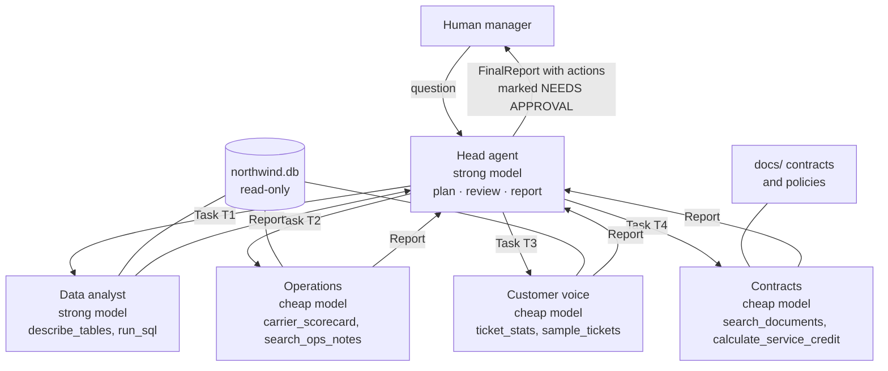
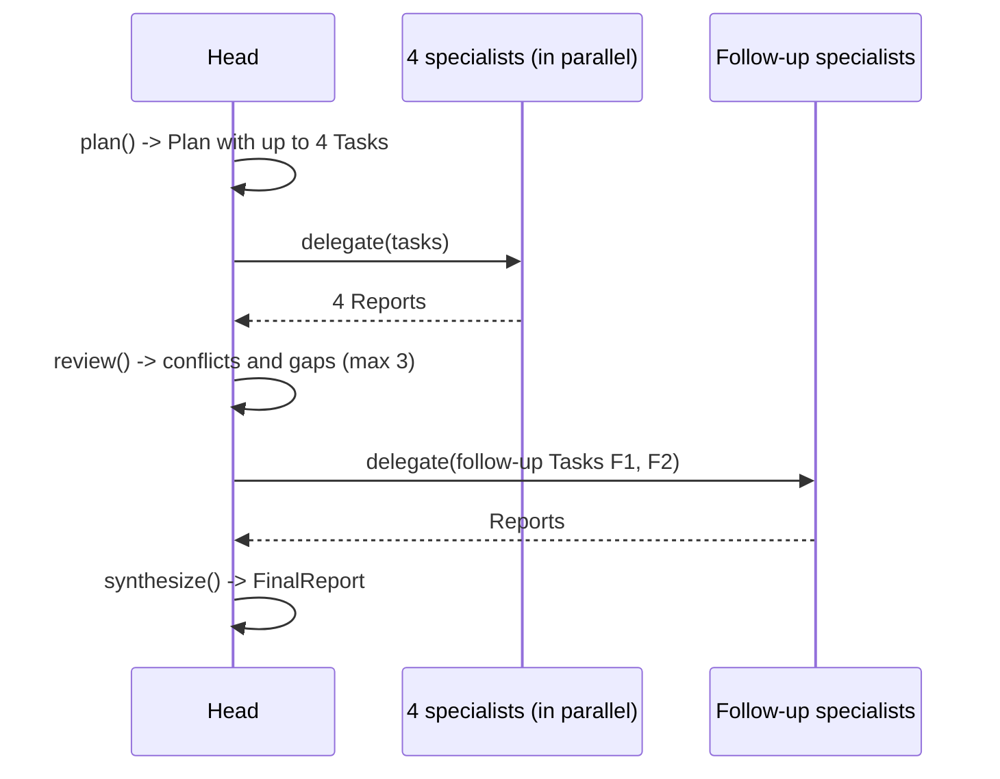

# 17 · Head agent and specialist team

**What you'll build:** a hierarchical multi-agent system for Northwind Logistics. A **head agent** receives the question *"Why did on-time delivery drop in September and what should we do?"*, writes a plan, hands one task each to **four specialist agents** (data analyst, operations, customer voice, contracts) that each have their own tools, prompt and model, runs them in parallel, spots where their reports disagree or leave a gap, sends follow-up questions, and writes one decision-ready report for a human, with every money-spending action marked for approval. Budgets and step limits keep the whole team under control.
**Like you're 5:** a head chef gets an order for a big dinner. She doesn't cook everything herself: the pastry cook makes dessert, the grill cook does the meat, the sauce cook does sauces. She tastes what comes back, sends a dish back when two don't go together, and only then sends the meal out. And she has a shopping budget.
**Time:** ~4 h · **Builds on:** [16 · Tools and MCP servers](../16-designing-good-tools-and-mcp-servers-for-customer-systems), [Journey 8.3 · Research team](../../../ai-engineer-journey/level-8-multi-agent-systems/03-research-team-planner-researchers-writer) and [8.8 · Incident response team](../../../ai-engineer-journey/level-8-multi-agent-systems/08-capstone-ai-incident-response-team) · **Needs:** nothing for `--offline` and the tests; an Anthropic API key or Ollama for real agents

## Why this matters
Real customer questions cross departments: "why did deliveries get worse?" needs numbers (data team), events (operations), customer impact (support) and money (contracts). One agent with twenty tools gets confused and fills its context with everything. A head agent with specialists mirrors how the customer's own organisation works: each specialist has a small, clear job, its own tools and permissions, and can use a cheaper model; the head only sees short reports. This "orchestrator and workers" pattern is behind most serious agent products, and the capstones in Part 6 are built on it.

## What you'll learn
- **Hierarchical multi-agent design**: one head that plans, delegates, reviews and reports; specialists that each own one domain.
- **Message formats**: typed `Task`, `Report`, `Plan`, `Review` and `FinalReport` messages (Pydantic), so agents exchange data, not chatty text.
- **Specialisation**: per-agent prompts, tool sets (least privilege) and models (strong where it matters, cheap elsewhere).
- **Conflict resolution with data**: when two specialists blame different causes, the head asks a follow-up that settles it with numbers.
- **Budgets and limits**: a shared dollar and call budget, step limits per specialist, one review round, and human approval for consequential actions.

## Before you start
1. Switch on your virtual environment, then:
   ```bash
   cd part-4-agents-at-work/17-head-agent-and-specialist-team
   pip install -r requirements.txt
   ```
   Same packages as Part 3 (`anthropic`, `pydantic`, `httpx`, `pytest`). The data lives in SQLite, built into Python.
2. Model choice as in Part 3: `--offline` (free), Claude (`ANTHROPIC_API_KEY`; the head and data analyst use `CLAUDE_MODEL`, the other three `CHEAP_MODEL`), or Ollama (`LLM_PROVIDER=ollama`: every agent uses your local model; pick one that handles tool calls well, such as `qwen3:8b` or larger).

## Run it
1. Create the data (two months of shipments, operations notes and tickets):
   ```bash
   python make_data.py
   ```
2. Run the whole team offline (scripted stand-ins; real tools, data and numbers):
   ```bash
   python team.py --offline
   ```
3. Read the saved report:
   ```bash
   cat report.md
   ```
4. Run the tests:
   ```bash
   pytest -v
   ```
5. With a key: the real team, with a budget, then a different question:
   ```bash
   python team.py --max-usd 1.00
   python team.py "Why did late-delivery complaints rise in September, and which customers should we call first?" --max-usd 0.50
   ```

**Command, piece by piece:** `python team.py "Why did ...?" --max-usd 0.50`

| Piece | Meaning |
|---|---|
| `team.py` | the head agent and its specialists |
| `"Why did ...?"` | the question for the head (in quotes: one argument). Without it, the September question is used |
| `--max-usd 0.50` | the whole team may spend at most $0.50; when it's used up, agents stop and report what they have |
| `--max-calls` | (not shown) the same idea counted in model calls; default 60 |

### What you should see
`python make_data.py` (real output):
```
2026-08: 840 shipments, 96.7% on time
2026-09: 880 shipments, 85.9% on time
Wrote northwind.db
```
`python team.py --offline` (real output, a few long lines shortened). The specialists work at the same time, so their lines interleave:
```
(offline: every agent's 'thinking' is scripted in offline_brain.py; tool calls, data and numbers are real)

[head          ] 🎯 Why did on-time delivery drop in September 2026 compared with August, and what should we do?
[head          ] 🗂  T1 -> data_analyst: How did on-time % change from August to September, overall and per carrier?
[head          ] 🗂  T2 -> operations: What happened at our hubs and carriers in September?
[head          ] 🗂  T3 -> customer_voice: How did late-delivery complaints change and what do customers say?
[head          ] 🗂  T4 -> contracts: What do the carrier contracts and our compensation policy say about this?
[data_analyst  ] 🔧 describe_tables({}) -> shipments(id, customer_id, region, hub, carrier, service 'Express'|'St
[operations    ] 🔧 carrier_scorecard({"month": "2026-08"}) -> [{"carrier": "CoastExpress", "hub": "Bristol", ...
[operations    ] 🔧 carrier_scorecard({"month": "2026-09"}) -> [{"carrier": "SwiftHaul", "hub": "Leeds", "shipments": 187, ...
[customer_voice] 🔧 ticket_stats({"month": "2026-08"}) -> [{"category": "late_delivery", "tickets": 11}]
[operations    ] 🔧 search_ops_notes({"month": "2026-09"}) -> [{"date": "2026-09-02", "carrier": null, "hub": "Leeds", ...
[operations    ] 📋 report: complete, 4 findings
[contracts     ] 🔧 search_documents({"query": "SwiftHaul service level credits recovery plan"}) -> [{"doc": "swifthaul-contract.md", ...
...
[data_analyst  ] 📋 report: complete, 3 findings
[head          ] ⚖️  conflict on 'main cause' (data_analyst, operations) -> ask data_analyst
[head          ] ⚖️  gap on 'service credit amount' (contracts, data_analyst) -> ask contracts
[contracts     ] 🔧 calculate_service_credit({"on_time_percent": 54.0, "invoice_gbp": 48000}) -> {"points_below_95": 41, "credit_rate": 0.25, "credit_gbp": 12000.0}
[contracts     ] 📋 report: complete, 1 findings
[data_analyst  ] 🔧 run_sql({"query": "SELECT CASE WHEN collected_date <= '2026-09-07' THEN 'week ) -> [{"period": "week 1 (1-7 Sep)", "late": 40, "late_hub_dispatch": 34, ...
[data_analyst  ] 📋 report: complete, 3 findings

# Operations review: Why did on-time delivery drop in September 2026 compared with August, and what should we do?

On-time delivery fell from 96.7% in August to 85.9% in September because of two separate incidents: the Leeds hub's warehouse-system cutover delayed dispatches in the first week, and from 8 September a driver shortage at SwiftHaul cut its on-time rate to 54.0%. SwiftHaul is the larger and still-running problem; the hub issue is over but showed a planning gap.

## Root causes

| Cause | Share of late shipments | Confidence | Evidence |
|---|---|---|---|
| SwiftHaul driver shortage (North region, from 8 Sep) | about 51% (63 of 124 late shipments) | high | analyst split query; ops notes 9/16/29 Sep; tickets naming SwiftHaul |
| Leeds hub WMS cutover (1-7 Sep) | about 27% (34 of 124 late shipments) | high | late dispatches in scorecard; ops notes 2-8 Sep; analyst split query |
| Normal background lateness | about 22% (27 of 124 late shipments) | medium | analyst split query; similar to August |

## Recommended actions

1. **[NEEDS YOUR APPROVAL]** Claim SwiftHaul's September service credit of £12,000 in writing before 30 October (owner: Carrier manager; ...)
2. **[NEEDS YOUR APPROVAL]** Formally request SwiftHaul's recovery plan (due within 10 working days under the contract) (...)
3. **[NEEDS YOUR APPROVAL]** Move about 30% of North volume to Parcelink until SwiftHaul is above 90% for 4 weeks (...)
4. **[NEEDS YOUR APPROVAL]** Send the proactive apology and refund Express surcharges for late September parcels (...)
5. Add rollback criteria, extra first-week staff and customer notice to future hub system cutovers (owner: Leeds hub manager; ...)

## Disagreements we resolved

- Analyst (SwiftHaul) vs operations (Leeds hub): both were right for different weeks. The split shows 34 late hub dispatches in 1-7 Sep and 63 SwiftHaul transit delays, almost all after 8 Sep.
...
Cost by agent:
  head           claude-opus-5-5      3 calls  $0.0038
  data_analyst   claude-opus-5-5      8 calls  $0.0102
  operations     claude-haiku-5-5     4 calls  $0.0001
  customer_voice claude-haiku-5-5     4 calls  $0.0001
  contracts      claude-haiku-5-5     7 calls  $0.0002
Saved report.md
```
In offline mode the wording of plans and reports comes from scripts, and the costs use the stand-in's fake token counts. But every tool call ran against `northwind.db`, and every number in the report (96.7%, 54.0%, 63 of 124, £12,000) was computed from those real tool results. `pytest -v` ends with `7 passed`.

With a real model, the team chooses its own queries and wording, so expect a different but similar report (example; not a guaranteed result): models usually find SwiftHaul quickly from the per-carrier numbers; whether the Leeds cutover is found depends on whether someone looks at dispatch dates or the operations notes, which is exactly why the head's review step exists. A real run typically costs a few cents to tens of cents, depending on the models.

## How it works

The order of work:


1. **The data (`make_data.py`).** Two months of fictional shipments (40 a day), with `collected_date`, `dispatched_date` (when the hub sent it out), `promised_date`, `delivered_date` and `on_time`, plus `ops_notes` and `tickets`. Two problems are hidden in September: the Leeds hub's new warehouse system delayed dispatches from 1 to 7 September, and a SwiftHaul driver shortage made its deliveries late from 8 September. A fixed random seed makes the data the same on every computer.

2. **Tools per specialist (`tools.py`).** `TOOLSETS` gives each specialist only its own tools. All are read-only: `_db()` opens SQLite with `mode=ro`, and `run_sql` refuses anything that isn't one `SELECT`/`WITH` and returns at most 50 rows. Money maths is a tool (`calculate_service_credit`), not something the model works out in its head. Least privilege applies inside the team too: the customer-voice agent can't run SQL, and nobody can write.

3. **Message formats (`team.py`, section 1).** Agents talk in typed messages, not free text. The head sends a `Task`; a specialist answers with a `Report`; the head's own decisions are a `Plan`, a `Review` (with `FollowUp`s) and a `FinalReport`. Example `Task`, exactly what the data analyst receives as its first message:
   ```json
   {
    "task_id": "T1",
    "specialist": "data_analyst",
    "question": "How did on-time % change from August to September, overall and per carrier?",
    "context": "Compare September 2026 with August 2026."
   }
   ```
   and the shape of a `Report` coming back (from the offline run):
   ```json
   {
    "status": "complete",
    "summary": "On-time fell from 96.7% to 85.9%. SwiftHaul collapsed from 96.0% to 54.0%; ...",
    "findings": [{"claim": "SwiftHaul: 96.0% -> 54.0%.", "evidence": "run_sql: on-time by carrier and month", "confidence": "high"}],
    "recommendations": ["Focus on SwiftHaul's North region lanes."],
    "open_questions": ["Is any of the drop caused by hubs rather than carriers?"]
   }
   ```
   Every finding must say where its evidence came from. Structured messages are easy to validate, log, test and show in a UI; `llm.chat(..., schema=Report)` guarantees the shape.

4. **A specialist (`Specialist.run`).** Its own system prompt (`SPECIALIST_PROMPTS` + `SHARED_RULES`), its own tools and its own `model`. It runs the familiar tool loop for at most `max_steps` rounds; if it hits the limit its report is marked `partial`. Then one more call with `schema=Report` turns its notes into the report. Errors inside a tool are returned to the model as `ERROR: ...` so it can correct itself.

5. **The head (`Head`).** `plan()` asks for a `Plan` (at most one task per specialist). `delegate()` runs the specialists at the same time with a `ThreadPoolExecutor` (4 workers): the slowest specialist sets the pace, not the sum of all four. `review()` reads all reports and returns follow-ups of two kinds: **conflict** (the analyst blamed SwiftHaul, operations blamed the Leeds hub) and **gap** (contracts needs SwiftHaul's on-time % to compute the credit, which only the analyst had). Each follow-up becomes a new `Task` (`F1`, `F2`) for the one specialist who can settle it *with data*. `synthesize()` writes the `FinalReport` from all reports. The head never queries data itself: it only manages.

6. **Conflict resolution, the important part.** The head doesn't pick a side or average the opinions. It asks for a measurement that can separate the explanations: late shipments split by week and by cause (`dispatched_date > collected_date` means the hub was late; otherwise it was the carrier). The answer showed both were right at different times: 34 hub-caused (mostly week 1) and 63 SwiftHaul-caused (after 8 September). The final report records the disagreement and how it was resolved, which is what a manager needs to trust it.

7. **Budgets and limits (`Budget`, `ask`).** Every model call in the team goes through `ask()`: `budget.check()` first (stop if the dollars or calls are used up), then `budget.charge()` afterwards (per agent, thread-safe with a lock). When the budget runs out, a specialist returns a `partial` report that says so, instead of crashing. Specialists may only spend the budget minus a **reserve** (`reserve_calls`, `reserve_share`), so the head always has enough left to review and write its report. Other limits: `max_steps` per specialist, at most 4 tasks, one review round with at most 3 follow-ups. With these, the worst case is known before you start.

8. **The human stays in charge (`Action.needs_human_approval`, `to_markdown`).** Anything that spends money, changes a contract or contacts customers is marked **[NEEDS YOUR APPROVAL]**. The team only recommends; lesson 18 builds the approval queue that actually executes approved actions safely.

9. **The offline brain (`offline_brain.py`).** For `--offline` and the tests, each role follows a fixed script of tool calls and writes its report from the real tool results; the scripted head reads the numbers the specialists found. It shows the orchestration without a model; it is not a model.

## If something goes wrong
- **`FileNotFoundError: northwind.db is missing`** → run `python make_data.py` first (in this folder).
- **`⛔ ... team budget used up`** → raise `--max-usd` / `--max-calls`, or use cheaper models. Partial reports are expected behaviour, not a crash: the head still writes a report and lists what's missing.
- **A specialist's report says `partial` with few findings** → it hit `max_steps` (default 6). Look at its tool calls in the log: is it repeating the same failing SQL? Improve its prompt or tool descriptions before raising the limit.
- **With Ollama: `ValidationError` on `Plan` or `Report`** → small local models struggle with long structured outputs. Use a larger model for the head (`OLLAMA_MODEL=qwen3:14b`) or reduce the fields in the schemas.
- **The real head invents numbers not in any report** → tighten `HEAD_SYSTEM` ("use only numbers that appear in the reports") and add an eval that checks every number in the final report appears in some specialist report (lesson 19 does this kind of check).

## Try this
1. **Easy:** run `python team.py --offline --max-calls 10`. What happens to the specialists and the final report?
   <details><summary>Hint</summary>The specialists hit the limit part-way (`⛔ ... team budget used up`) and return `partial` reports, but the head still finishes: `Budget` keeps `reserve_calls` (3 calls) and `reserve_share` (15% of the dollars) for the head's plan, review and final report, and specialists check the budget with `reserve=True`. With too little data, the (scripted) head reports "no reliable answer yet" instead of guessing numbers. Try `--max-calls 2`: now even the head's reserve is too small and `team.py` stops with a clear message.</details>
2. **Medium:** add a fifth specialist, `finance`, with one tool `cost_of_lateness(month)` that returns the number of late Express parcels × £4.50 (the surcharge refunds). Add it to `TOOLSETS`, `SPECIALIST_PROMPTS`, the `SpecialistName` type, `Head.team` and `HEAD_SYSTEM`.
   <details><summary>Hint</summary>SQL: `SELECT COUNT(*) FROM shipments WHERE service = 'Express' AND on_time = 0 AND collected_date LIKE ?`. The offline brain doesn't know the new role, so test it with a real model, or add a script entry for `("finance", "T")` and a branch in `_specialist_report`. Remember to raise `plan.tasks[:4]` to 5.</details>
3. **Harder:** add a "challenge" step: before `synthesize()`, send the draft root causes to the data analyst with the question "Is any of this contradicted by the data?" and include its answer in the final report.
   <details><summary>Hint</summary>It's another follow-up `Task` with a new id (`C1`), run through `self.delegate([...])`. Keep it within the budget and the one-extra-round rule. This "red team your own conclusion" step catches confident but wrong summaries, which are the most expensive mistakes in a report to management.</details>

## Check yourself
1. Why does each specialist have its own small tool set instead of all agents sharing all tools?
2. The analyst and operations blamed different causes. Why is "ask for a split by week and cause" better than letting the head decide who sounds more convincing?
3. What stops this team from running forever or spending too much?
4. Why does the data analyst get the strong model while the other three get the cheap one?

<details><summary>Answers</summary>

1. Fewer tools means better tool choices and shorter prompts, each agent can only touch what its job needs (least privilege), and each can be tested and improved on its own.
2. A data question can prove which explanation is right (or that both are, at different times). Choosing by tone rewards confident wording, not truth, and the manager couldn't check it.
3. The shared `Budget` (dollars and calls, checked before every call), `max_steps` per specialist, at most 4 tasks, and a single review round with at most 3 follow-ups.
4. Writing correct SQL over a schema and interpreting the numbers is the hardest, most error-prone job here; the others mostly call simple tools and summarise. Spending where mistakes are costly and saving elsewhere is the usual pattern (measure it with evals, as in lesson 19).
</details>

## Learn more (optional)
**Read the official docs**
- Anthropic engineering: Building effective agents (orchestrator-workers): https://www.anthropic.com/engineering/building-effective-agents
- Anthropic engineering: How we built our multi-agent research system: https://www.anthropic.com/engineering/multi-agent-research-system
- Anthropic: tool use overview: https://platform.claude.com/docs/en/agents-and-tools/tool-use/overview
- Structured outputs: https://platform.claude.com/docs/en/build-with-claude/structured-outputs
- Python `concurrent.futures` (thread pools): https://docs.python.org/3/library/concurrent.futures.html
- SQLite read-only URIs: https://www.sqlite.org/uri.html

**Watch**
- Multi-agent systems explained: https://www.youtube.com/results?search_query=multi+agent+systems+orchestrator+workers+llm
- Anthropic on building effective agents: https://www.youtube.com/results?search_query=anthropic+building+effective+agents
- Supervisor / hierarchical agent patterns: https://www.youtube.com/results?search_query=hierarchical+agents+supervisor+pattern

## Next
→ [18 · Long-running workflows, retries and human approval](../18-long-running-workflows-retries-and-human-approval)
