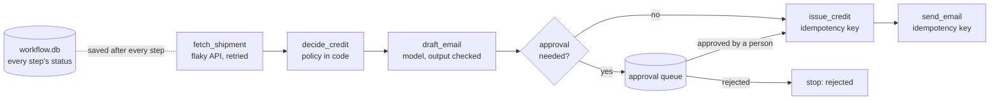
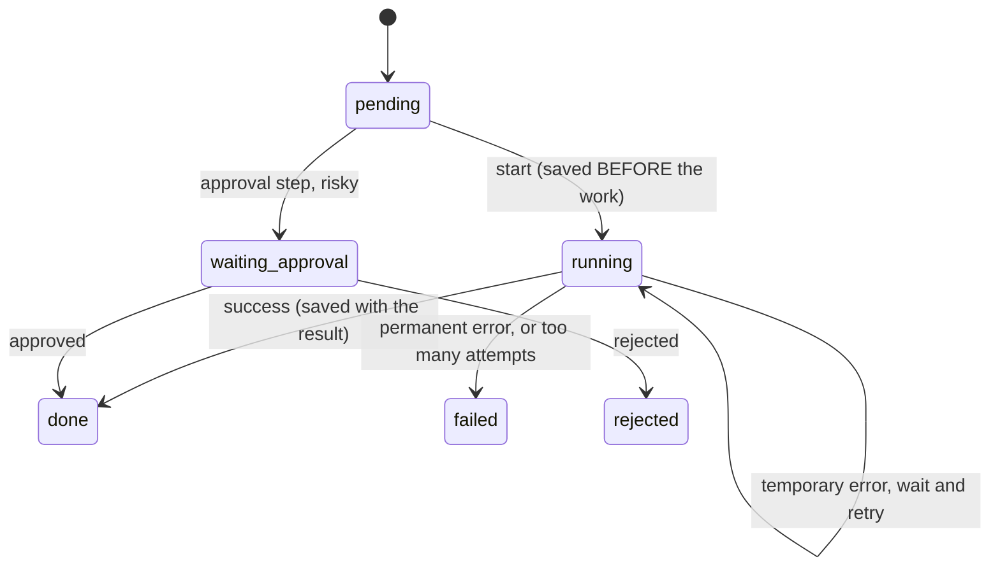

# 18 · Long-running workflows, retries and human approval

**What you'll build:** a "late-delivery compensation" workflow for Northwind that, for each late shipment, fetches it from a flaky API, works out the credit by policy, has a model draft the apology email, waits for a person to approve larger credits, issues the credit and sends the email. Every step is saved in SQLite, so you can crash it on purpose (even in the middle of paying a credit), resume it, and see that nothing is lost and nothing is done twice.
**Like you're 5:** building a big Lego castle over a week. You keep the instructions open at the page you reached, so after dinner you carry on from that page instead of starting again. If a piece is missing you look again a few times, and for the special golden piece you ask a grown-up first.
**Time:** ~3 h · **Builds on:** [17 · Head agent and specialist team](../17-head-agent-and-specialist-team) (its report recommended these refunds), [Journey 8.7 · Human-in-the-loop agent](../../../ai-engineer-journey/level-8-multi-agent-systems/07-human-in-the-loop-file-organizer-agent) · **Needs:** nothing for `--offline` and the tests; an Anthropic API key or Ollama to draft emails with a real model

## Why this matters
Real business processes don't finish in one function call: they take minutes to days, call unreliable systems, and need people to sign off. A script that crashes at item 47 of 200 and starts again from item 1 will email customers twice and pay credits twice, which is exactly the kind of mistake that ends a customer's trust in AI. Durable state, safe retries, approval queues and idempotency are what make an AI workflow something an operations team can actually run. The same ideas power Temporal, AWS Step Functions and agent frameworks' checkpoints; here you build them small enough to understand.

## What you'll learn
- **Durable state**: saving every step's status and result in a database, so a run can stop and continue at any time.
- **Retries with backoff**: trying temporary failures again with growing, randomised waits, and never retrying permanent ones.
- **Resumability**: restarting after a crash from exactly where the work stopped, including a step that was interrupted half-way.
- **Human approval queue**: parking risky steps until a named person approves or rejects them, with an audit trail.
- **Idempotency**: idempotency keys that make repeating a side effect (a credit, an email) harmless.

## Before you start
1. Switch on your virtual environment, then:
   ```bash
   cd part-4-agents-at-work/18-long-running-workflows-retries-and-human-approval
   pip install -r requirements.txt
   ```
   Same packages as Part 3. The workflow state uses `sqlite3`, built into Python.
2. Model choice as before. Only the `draft_email` step uses a model (the cheap one); `--offline` uses a template instead.

## Run it
1. Start a run, and make it "crash" after 7 finished steps:
   ```bash
   python workflow.py start --run-id demo --offline --crash-after 7
   ```
2. See where everything stands:
   ```bash
   python workflow.py status demo
   ```
3. Resume, and this time crash *inside* the credit step, right after the credit was paid but before it was saved:
   ```bash
   python workflow.py resume demo --offline --crash-in issue_credit
   ```
4. Resume normally:
   ```bash
   python workflow.py resume demo --offline
   ```
5. Be the human approver:
   ```bash
   python approvals.py list
   python approvals.py approve 1 --by alice
   ```
6. Resume once more, then check the status and the external systems (no duplicate credits):
   ```bash
   python workflow.py resume demo --offline
   python workflow.py status demo
   python services.py
   ```
7. Run the tests:
   ```bash
   pytest -v
   ```
8. To start again from nothing, delete the two databases (they are recreated): `rm workflow.db services.db` (PowerShell: `Remove-Item workflow.db, services.db`).

**Command, piece by piece:** `python workflow.py resume demo --offline --crash-in issue_credit`

| Piece | Meaning |
|---|---|
| `workflow.py` | the workflow engine |
| `resume` | the command: continue an existing run (others: `start`, `status`) |
| `demo` | the run's id (you chose it with `--run-id demo` at start) |
| `--offline` | draft emails from a template instead of a model |
| `--crash-in issue_credit` | pretend the computer dies inside that step, after the credit was paid, before the result was saved |

**Command, piece by piece:** `python approvals.py approve 1 --by alice`

| Piece | Meaning |
|---|---|
| `approvals.py` | the approval queue tool for people |
| `approve` | the decision (or `reject`, or `list`) |
| `1` | the approval request number shown by `list` |
| `--by alice` | who decided: stored with the time for the audit trail. `--note "..."` adds a reason |

### What you should see
Step 1 (real output):
```
Started run demo with 6 late shipments
[NW-61204] fetch_shipment ✓ attempt 1
[NW-61204] decide_credit  ✓ attempt 1
[NW-61204] draft_email    ✓ attempt 1
[NW-61204] issue_credit   ✓ attempt 1
[NW-61204] send_email     ✓ attempt 1
[NW-61377] fetch_shipment ! 503 Service Unavailable (shipments API); retry in 0.13s
[NW-61377] fetch_shipment ✓ attempt 2
[NW-61377] decide_credit  ✓ attempt 1
💥 simulated crash after 7 completed steps. The process died here. Run: python workflow.py resume demo
```
Step 2 (real output):
```
Run demo   fetch_shipme  decide_credi  draft_email   approval      issue_credit  send_email
NW-61204   ✓ 1           ✓ 1           ✓ 1           ✓             ✓ 1           ✓ 1
NW-61377   ✓ 2           ✓ 1           ·             ·             ·             ·
NW-61502   ·             ·             ·             ·             ·             ·
...
Summary: {"complete": 1, "waiting_approval": 0, "failed": 0, "rejected": 0, "in_progress": 5}
```
Steps 3 and 4 (real output, shortened):
```
[NW-61377] draft_email    ✓ attempt 1
💥 simulated crash inside issue_credit, after the side effect, before saving. The process died here. ...

[NW-61377] issue_credit: was interrupted last time, running it again
[NW-61377] issue_credit   ✓ attempt 2 (replayed: no duplicate)
[NW-61377] send_email     ✓ attempt 1
[NW-61502] fetch_shipment ✓ attempt 1
[NW-61502] decide_credit  ✓ attempt 1
[NW-61502] draft_email    ✓ attempt 1
[NW-61502] approval  … waiting for a person (approval #1: Credit £19.50 to Harbour Fresh Foods (Express surcharge refund (£4.50); £15 goodwill credit for a gold customer))
...
[NW-69999] fetch_shipment ✗ 404 shipment NW-69999 not found (permanent: not retried)
Summary: {"complete": 4, "waiting_approval": 1, "failed": 1, "rejected": 0, "in_progress": 0}
Waiting for people: python approvals.py list
```
Steps 5 and 6 (real output):
```
#1   pending   demo     NW-61502  Credit £19.50 to Harbour Fresh Foods (Express surcharge refund (£4.50); £15 goodwill credit for a gold customer)
#1 approved by alice. Now run: python workflow.py resume <run id>
[NW-61502] approval  ✓ approved by alice
[NW-61502] issue_credit   ✓ attempt 1
[NW-61502] send_email     ✓ attempt 1
Summary: {"complete": 5, "waiting_approval": 0, "failed": 1, "rejected": 0, "in_progress": 0}
...
Credits issued (4):
  £  4.50  Kestrel Pharmacy         key=demo:NW-61204:credit
  £  8.40  Brightside Tiles         key=demo:NW-61377:credit
  £  4.50  Kestrel Garden Centre    key=demo:NW-61789:credit
  £ 19.50  Harbour Fresh Foods      key=demo:NW-61502:credit
Emails sent (5):
  orders@kestrel-pharmacy.example    'Sorry about your late delivery NW-61204'
  ...
{"duplicate_credits": 0}
```
`pytest -v` ends with `8 passed`.

What to look at: Brightside Tiles' credit step ran twice (attempt 2 after the crash) yet was paid once, thanks to its idempotency key. Pennine Outdoor Gear got an email but no credit (a Standard parcel only one day late gets nothing under the policy), so it has 5 emails but 4 credits. `NW-69999` failed immediately with a 404 and waits for a person to investigate, instead of being retried pointlessly.

## How it works

Each step of each item moves through these states:


1. **Durable state (`Store`).** Three SQLite tables in `workflow.db`: `runs` (which items belong to a run), `steps` (one row per run, item and step, with `status`, `attempts`, `result` as JSON, the last `error`) and `approvals`. Every status change is written and committed immediately (`with self.db:` is one transaction). The SQL, piece by piece:

   | SQL | Meaning |
   |---|---|
   | `PRIMARY KEY (run_id, item, step)` | at most ONE row per step of each item of each run |
   | `INSERT ... ON CONFLICT (run_id, item, step) DO UPDATE SET status=excluded.status, ...` | an **upsert**: add the row, or if it exists, update it with the new values (`excluded` = the values we just tried to insert) |
   | `id INTEGER PRIMARY KEY AUTOINCREMENT` | approval requests get numbers 1, 2, 3... that are never reused |
   | `UPDATE approvals SET status=? ... WHERE id=? AND status='pending'` | decide a request only if it's still pending, so it can't be decided twice |

2. **The engine (`advance`).** For each item, it walks `STEPS` in order. A step already `done` is skipped and its saved result reused (that's resuming: `fetch_shipment` is not called again for finished items). `failed` or `rejected` ends that item. Otherwise it saves `running` *before* doing the work, runs the step, then saves `done` with the result. Each run of `advance` pushes every item as far as it can and then returns: there is no long-lived process to babysit. In production, a scheduler (cron, a queue worker, a Kubernetes CronJob) simply calls `resume` every few minutes.

3. **Crashes on purpose.** `--crash-after 7` raises `Crash` after 7 steps; `main()` then calls `os._exit(1)`, which kills Python instantly without any clean-up, like a power cut. `--crash-in issue_credit` is the nasty case: the credit is already paid, but the step is still saved as `running`. On resume the engine sees `running`, prints "was interrupted last time", and runs it again.

4. **Idempotency (`services.issue_credit`, `services.send_email`).** Running a paid-but-unsaved step again would pay twice, unless the receiving system recognises the repeat. Each call carries an **idempotency key** built from things that never change for that action: `demo:NW-61377:credit`. The billing service stores keys; a key it has seen returns the first result with `replayed: True` and pays nothing. Rule of thumb: **save before and after, and make every side effect idempotent**, because you can never make "do it" and "write down that you did it" happen at exactly the same instant.

5. **Retries with backoff (`TransientError`, `PermanentError`).** The shipments API fails 30% of the time (`--fail-rate`). A `TransientError` (503, timeout) is retried up to `MAX_ATTEMPTS` (4) with waits of `BASE_DELAY × 2^(attempt-1)` (0.2 s, 0.4 s, 0.8 s...), each multiplied by a random 0.5–1.5 (**jitter**, so a thousand workers don't all retry at the same moment). A `PermanentError` (404, invalid input) is never retried: waiting can't fix it, and a person should look.

6. **Checking the model's work (`draft_email`, `Draft`).** The model only writes the email; the amount comes from `decide_credit` (policy in code, exact and testable). The `Draft` schema fixes the shape, and the code checks that the body contains the exact amount (e.g. `£19.50`). If not, it raises `TransientError`, so the normal retry logic asks again. Treat model output like any untrusted input.

7. **The approval queue (`approval` step, `approvals.py`).** `decide_credit` sets `needs_approval` for credits above `APPROVAL_LIMIT_GBP` (£10) or any goodwill credit. The engine then creates a row in `approvals`, marks the step `waiting_approval`, and moves on to other items: one item waiting doesn't block the rest. A person runs `approvals.py` (in real life: a button in Slack, Teams or an admin page that updates the same table). The next `resume` sees the decision: approved continues to `issue_credit`; rejected stops that item. Who decided and when is stored for the audit.

## If something goes wrong
- **`No run called 'demo'`** → you haven't started it in this folder, or you deleted `workflow.db`. Run `python workflow.py start --run-id demo --offline`.
- **`sqlite3.IntegrityError: UNIQUE constraint failed: runs.run_id`** → a run with that id already exists. Use `resume`, choose another `--run-id`, or delete `workflow.db` to start fresh.
- **An item stays `waiting_approval` after you approved it** → the workflow only notices decisions when it runs. Run `python workflow.py resume demo`.
- **`Request #1 doesn't exist or was already decided`** → check `python approvals.py list`; decisions can't be changed (that's deliberate, for the audit trail).
- **With a real model, `draft_email` keeps failing with "does not mention the exact amount"** → the model writes "4.50 pounds" or "£4.5". Tell it in the system prompt to copy the amount exactly as given, or use a stronger model; after 4 attempts the step fails and waits for a person rather than sending a wrong email.

## Try this
1. **Easy:** reject the approval instead (`python approvals.py reject 1 --by bob --note "Already credited by phone"`) on a fresh run. What do `status` and `services.py` show for Harbour Fresh Foods?
   <details><summary>Hint</summary>The approval cell shows `⊘` and the item counts as `rejected`. No credit and no email for Harbour Fresh: the rejection stops the item before any side effect, which is why the approval step comes *before* `issue_credit` and `send_email`.</details>
2. **Medium:** make the approval limit depend on the customer tier: gold customers' credits up to £25 need no approval (but goodwill always does). Add a test.
   <details><summary>Solution</summary>In `decide_credit`: `limit = 25.0 if ship["tier"] == "gold" else APPROVAL_LIMIT_GBP` and `"needs_approval": amount > limit or goodwill`. Test: Kestrel Pharmacy (gold, Express, 1 day late) gets £4.50 with `needs_approval` False; Harbour Fresh (gold, 3 days late) still needs approval because of the goodwill credit.</details>
3. **Harder:** add a `--worker` mode that resumes every run that isn't finished, every 5 seconds, until all are complete or waiting for a person, so you don't have to type `resume`.
   <details><summary>Hint</summary>`SELECT run_id FROM runs`, then call `advance()` for each, `time.sleep(5)`, and stop when no run has `in_progress` items. Make sure two workers can't process the same run at once: the simplest guard is a `locks` table with `INSERT` of the run id (the primary key fails for the second worker) and a `DELETE` when done. Real systems use database row locks or a queue for this.</details>

## Check yourself
1. Why does the engine save `running` *before* calling a step, not only `done` after?
2. The workflow crashed after the billing system paid a credit but before `done` was saved. What stops a double payment on resume?
3. Why is a 404 not retried but a 503 is?
4. Why does an item waiting for approval not stop the other items?

<details><summary>Answers</summary>

1. So that after a crash the engine knows the step *may* have started and must be re-run carefully (with its idempotency key), and so you can see interrupted steps in `status`.
2. The idempotency key `run:item:credit`. The billing service has already stored it, so the repeated call returns the first result (`replayed`) instead of paying again.
3. A 503 means "temporarily unavailable": the same request may work a moment later. A 404 means the thing doesn't exist: retrying wastes time and hides a real problem a person should see.
4. Approvals can take hours or days. Each item's progress is saved separately, so the engine parks that one item and keeps working on the others; the next resume picks up the decision.
</details>

## Learn more (optional)
**Read the official docs**
- SQLite UPSERT (`ON CONFLICT ... DO UPDATE`): https://www.sqlite.org/lang_upsert.html
- Python `sqlite3`: https://docs.python.org/3/library/sqlite3.html
- Stripe: idempotent requests (a classic explanation): https://docs.stripe.com/api/idempotent_requests
- AWS Builders' Library: Timeouts, retries and backoff with jitter: https://aws.amazon.com/builders-library/timeouts-retries-and-backoff-with-jitter/
- Temporal documentation (durable execution): https://docs.temporal.io
- Anthropic engineering: Building effective agents (workflows vs agents): https://www.anthropic.com/engineering/building-effective-agents

**Watch**
- Idempotency explained: https://www.youtube.com/results?search_query=idempotency+api+explained
- Exponential backoff and jitter: https://www.youtube.com/results?search_query=exponential+backoff+jitter+explained
- Durable execution / Temporal intro: https://www.youtube.com/results?search_query=temporal+durable+execution+explained
- Human-in-the-loop AI agents: https://www.youtube.com/results?search_query=human+in+the+loop+ai+agents+approval

## Next
→ [19 · Agent evals and safety limits](../19-agent-evals-and-safety-limits)
