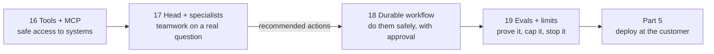

# Part 4 · Agents at work

In Part 3 the AI answered questions. In this part it **acts** on the customer's systems: it looks things up through well-designed tools, works as a team of specialists under a head agent, runs multi-day processes that survive crashes and wait for human approval, and is evaluated and limited so it can be trusted with real money and real customers. Everything uses **Northwind Logistics'** shipments, tickets, contracts and credits.

| # | Lesson | What you'll have | Time |
|---|--------|------------------|------|
| 16 | [Designing good tools and MCP servers for customer systems](16-designing-good-tools-and-mcp-servers-for-customer-systems) | an MCP server with five model-friendly tools over a Northwind API, a tool linter, a raw MCP client and an agent that uses the server | 3 h |
| 17 | [Head agent and specialist team](17-head-agent-and-specialist-team) | a head agent that plans, delegates to 4 specialists (own tools, prompts, models), resolves conflicts with data and reports to a human, within a budget | 4 h |
| 18 | [Long-running workflows, retries and human approval](18-long-running-workflows-retries-and-human-approval) | a durable SQLite workflow that retries, resumes after crashes, waits for approvals and never pays twice | 3 h |
| 19 | [Agent evals and safety limits](19-agent-evals-and-safety-limits) | trajectory evals, tool-call accuracy, forbidden-action checks, step/cost/money caps, a loop detector, a kill switch and a CI gate | 3 h |

**Total: about 13 hours** (two weeks at 1 hour a day).

## How the lessons connect


## Set up for this part
1. Follow **Set up once** in the [course README](../README.md#set-up-once).
2. In each lesson folder, install that lesson's packages:
   ```bash
   pip install -r requirements.txt
   ```
   | Lesson | Packages |
   |--------|----------|
   | 16 | `mcp` (version 2), `fastapi`, `uvicorn[standard]`, `httpx`, `anthropic`, `pydantic`, `pytest` |
   | 17, 18, 19 | `anthropic`, `pydantic`, `httpx`, `pytest` (the data lives in SQLite, built into Python) |
3. **The model:** the same `llm.py` and the same three choices as in [Part 3](../part-3-production-llm-engineering/README.md#set-up-for-this-part): `--offline` stand-ins (free), Claude (`ANTHROPIC_API_KEY`; `CLAUDE_MODEL` for strong roles, `CHEAP_MODEL` for cheap ones), or Ollama (`LLM_PROVIDER=ollama`; agents need a model that handles tool calls well, such as `qwen3:8b` or larger).
4. In `--offline` mode the agents' decisions are **scripted** (clearly labelled), but every tool call, database query, MCP message, retry, approval and limit is real code doing real work. Use it to learn the machinery for free; use a real model to see real agent behaviour.

## After this part you can
- Design tools a model uses well (names, schemas, short results, actionable errors, idempotent writes) and ship them as an MCP server any AI app can plug into.
- Build a hierarchical multi-agent system with typed messages, per-agent tools and models, parallel work, conflict resolution and a shared budget.
- Run long business processes durably: saved state, retries with backoff, crash-safe resume, idempotency keys and a human approval queue with an audit trail.
- Evaluate agents by their trajectories and enforce hard limits (steps, cost, money, loops, kill switch) that no prompt can override.

## Next
→ [Part 5 · Deploying at the customer](../part-5-deploying-at-the-customer)
