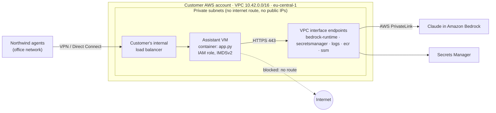

# 20 · Deploy into a customer cloud (VPC)

**What you'll build:** the deployment kit for running an AI service *inside the customer's own cloud account*: a small assistant service that can use Claude through the Claude API, **Amazon Bedrock** or **Google Vertex AI** (or a local model) by changing one variable; an annotated **Terraform** setup for a private AWS network with private endpoints, an IAM role instead of keys, and a secret; a hardened Docker Compose file; a `preflight.py` that checks the network, secrets and health before go-live; and a deployment checklist.
**Like you're 5:** the customer's cloud is a castle with walls. You don't build your shop outside and ask them to visit; you build a little room *inside* the castle, with no windows to the outside, a special tunnel straight to the library (the AI model), and a badge (the role) that only opens the doors you need.
**Time:** ~3 h · **Builds on:** [19 · Agent evals and safety limits](../../part-4-agents-at-work/19-agent-evals-and-safety-limits), and the cloud, Terraform and Docker material in [Cloud and DevOps for AI](../../../cloud-and-devops-for-ai) · **Needs:** nothing extra to run the code and tests; Docker for compose; Terraform for the infrastructure part (an AWS account only if you really apply it)

## Why this matters
Enterprise customers rarely let their data leave their cloud account. Banks, insurers, hospitals and governments ask: "Can it run in *our* AWS (or GCP, or Azure), in *our* region, with *our* network rules?" The forward-deployed engineer is the person who makes that happen: picking a model access path the security team accepts (Claude in Bedrock or Vertex AI, or an open model), wiring private networking, roles and secrets, and proving it with checks instead of promises. Most delays in real deployments are not about AI at all: they are firewall rules, missing permissions and secrets in the wrong place. This lesson is about those.

## What you'll learn
- **VPC and private subnets**: your own fenced network inside the cloud; "private" means no route to the internet and no public IP.
- **Private endpoints (PrivateLink, Private Service Connect, Private Endpoint)**: a private door from your network straight to a cloud service, such as the model API, so traffic never crosses the internet.
- **Roles instead of keys**: the machine wears an IAM role (AWS) or service account (GCP) that gets short-lived credentials automatically; nothing secret sits on disk.
- **Secrets as files**: API keys come from a secret manager or a mounted file, never from the image, Git or logs.
- **Preflight and checklist**: automate the checks that break go-lives (DNS goes to a private IP, the internet is blocked, health endpoints answer).

## Before you start
1. From the course root:
   ```bash
   cd part-5-deploying-at-the-customer/20-deploy-into-a-customer-cloud-vpc
   python -m venv .venv && source .venv/bin/activate      # Windows: .venv\Scripts\activate
   pip install -r requirements.txt
   ```
   `anthropic` (has `Anthropic`, `AnthropicBedrockMantle` and `AnthropicVertex` clients), `fastapi` + `uvicorn` (the service), `httpx` (health checks, Ollama), `pydantic`, `pytest`. For real Vertex AI calls also run `pip install "anthropic[vertex]"` (adds Google's auth library).
2. Optional: Terraform 1.6 or newer (https://developer.hashicorp.com/terraform/install). No cloud account is needed to read, format and validate the files.
3. No API key needed: everything runs with `LLM_PROVIDER=fake`.

## Run it
1. Tests:
   ```bash
   pytest -q
   ```
2. Start the service in FAKE mode and ask it something:
   ```bash
   LLM_PROVIDER=fake uvicorn app:app --port 8000
   ```
   In a second terminal:
   ```bash
   curl -s localhost:8000/ready
   curl -s -X POST localhost:8000/ask -H 'content-type: application/json' -d '{"question":"Where is shipment NW-1234567?"}'
   ```
3. Run the preflight checks against it:
   ```bash
   LLM_PROVIDER=fake APP_URL=http://localhost:8000 python preflight.py
   ```
4. Now pretend you are inside a locked-down VPC that uses Bedrock, and see what fails on your laptop:
   ```bash
   LLM_PROVIDER=bedrock AWS_REGION=eu-central-1 PRIVATE_ONLY=1 EXPECT_NO_INTERNET=1 python preflight.py
   ```
5. The hardened compose deployment (what runs on the customer's VM):
   ```bash
   cp secrets/anthropic_api_key.example secrets/anthropic_api_key
   docker compose up -d --build
   docker compose exec assistant python preflight.py
   docker compose down
   ```
6. The infrastructure (read `terraform/main.tf` first; it is commented line by line):
   ```bash
   cd terraform
   terraform init
   terraform fmt -check
   terraform validate
   terraform plan          # needs AWS credentials for a real account; never "apply" in someone else's account without a change ticket
   ```

| Command, piece by piece | Meaning |
|---|---|
| `curl -s localhost:8000/ready` | `curl` = make an HTTP request from the terminal; `-s` = silent (no progress bar) |
| `curl -X POST URL -H 'content-type: application/json' -d '{...}'` | `-X POST` = use the POST method; `-H` = add a header; `-d` = the request body |
| `PRIVATE_ONLY=1 EXPECT_NO_INTERNET=1 python preflight.py` | two variables only for this run: "the model endpoint must be private", "the internet must be blocked" |
| `cp A B` | copy file A to B |
| `docker compose exec assistant python preflight.py` | run `python preflight.py` inside the running `assistant` container |
| `terraform init` | download the provider plugins (here: AWS) into `.terraform/` |
| `terraform fmt -check` | check the files are in the standard format; `-check` = report only, don't change |
| `terraform validate` | check syntax and references without contacting the cloud |
| `terraform plan` | compare the code with what exists and print what *would* change; changes nothing |
| `terraform apply` | actually create or change the resources (asks for "yes" first) |

### What you should see
`pytest -q`:
```
........                                                                 [100%]
8 passed in 2.44s
```
`curl` (FAKE mode):
```
{"ready":true,"provider":"fake","model":"","region":null}
{"answer":"(FAKE) I would look up the shipment and answer: Where is shipment NW-1234567?","provider":"fake"}
```
Preflight inside the compose container (real output; note the read-only filesystem and the secret mounted as a file):
```
✅ PASS  config: required variables       provider=fake
➖ SKIP  secret: API key                  fake no key needed
➖ SKIP  dns: model endpoint              fake provider
➖ SKIP  egress: internet                 1.1.1.1:443 reachable (not enforced)
✅ PASS  app: /healthz                    200 {"ok":true}
✅ PASS  app: /ready                      200 {"ready":true,"provider":"fake","model":"","region":"eu-central-1"}

6 checks, 0 failed
```
Step 4 on a laptop (real output): exactly the two problems a security team would find:
```
✅ PASS  config: required variables       provider=bedrock
➖ SKIP  secret: API key                  bedrock uses the machine's IAM role
❌ FAIL  dns: model endpoint is private   bedrock-mantle.eu-central-1.api.aws -> ['18.153.205.201', '18.199.125.196', '3.120.4.60'] (public: traffic would leave the VPC)
❌ FAIL  egress: internet blocked         1.1.1.1:443 REACHABLE

5 checks, 2 failed
```
`terraform validate` prints `Success! The configuration is valid.` We also ran `terraform plan` offline with dummy credentials to check the whole file set; it ends with `Plan: 23 to add, 0 to change, 0 to destroy.` (on a real account the numbers are the same, plus real IDs). That plan run caught a bug the validator missed: AWS rejects apostrophes in security-group descriptions.

## How it works



1. **`providers.py`: one switch, five brains.** `get_brain()` reads `LLM_PROVIDER`. `anthropic` builds `anthropic.Anthropic(api_key=...)` with the key from `read_secret()`. `bedrock` builds `anthropic.AnthropicBedrockMantle(aws_region=...)`: no API key, because the SDK signs requests with the credentials of the machine's **IAM role**; the model id has an `anthropic.` prefix (`anthropic.claude-opus-5-5`), and `BEDROCK_BASE_URL` can point the client at a private endpoint DNS name. `vertex` builds `anthropic.AnthropicVertex(project_id, region)`, which uses Google's Application Default Credentials (the VM's service account) and the plain model id `claude-opus-5-5`. `ollama` talks to an OpenAI-compatible server on the customer's own hardware (lesson 21). `Brain.ask()` calls `messages.create` the same way for all three Claude paths: that is the point, the code doesn't change, only the door does.
2. **`read_secret()`: files first.** It looks for `/run/secrets/<name>` (where Docker and Kubernetes mount secrets) before the environment variable. Files don't appear in `docker inspect`, in process listings or in crash reports that dump the environment.
3. **`app.py`: alive vs ready.** `/healthz` only says "the process runs" (used to restart it). `/ready` says "it can do its job": the provider was created and secrets exist; it returns 503 otherwise, so a load balancer sends no traffic to a misconfigured copy. The log line records the provider and the question *length*, never the text.
4. **`preflight.py`: checks you would otherwise do by hand.** It checks required variables per provider, whether the secret exists (it prints only its length and first characters), resolves the model endpoint with `socket.getaddrinfo` and, with `PRIVATE_ONLY=1`, fails if any address is public (`ipaddress.ip_address(ip).is_private`). With `EXPECT_NO_INTERNET=1` it fails if a TCP connection to `1.1.1.1:443` succeeds. With `APP_URL` it calls `/healthz` and `/ready`. The exit code is 1 on any failure, so it can gate a pipeline.
5. **`compose.yaml`: a hardened single-VM deployment.** The port is bound to `127.0.0.1` (only the internal load balancer on that machine reaches it), the key comes in through `secrets:` as a file, the container's filesystem is `read_only` (with a small `tmpfs` for `/tmp`), `no-new-privileges` stops privilege escalation, and log files are capped so they can't fill the disk.
6. **`terraform/`: the private network, as code.** Read `main.tf` top to bottom; every block has a comment. `variables.tf` holds the choices you agree with the customer (region, address range, which endpoints, which model ARNs); `outputs.tf` prints what the customer's network team needs.

| Terraform block, piece by piece | Meaning |
|---|---|
| `terraform { required_providers { aws = { source, version = "~> 5.0" } } }` | which plugin and which versions (`~> 5.0` = any 5.x) |
| `provider "aws" { region = var.region; default_tags {...} }` | settings for every AWS resource; `var.region` = a value from `variables.tf` |
| `resource "aws_vpc" "main" { cidr_block = ... }` | create a thing: type `aws_vpc`, local name `main`; refer to it as `aws_vpc.main.id` |
| `count = length(var.azs)` / `count.index` | make one copy per list item; `count.index` = 0, 1, ... |
| `cidrsubnet(var.vpc_cidr, 8, count.index)` | carve `10.42.0.0/16` into `10.42.0.0/24`, `10.42.1.0/24`, ... |
| `aws_route_table` with no `route` | no default route = no way to the internet |
| `aws_security_group` `ingress` / `egress` | a firewall on the VM: what may come in (port 8000 from the corporate range) and go out (443 inside the VPC) |
| `aws_vpc_endpoint` `for_each = toset(var.interface_endpoints)` | one private endpoint per service in the list; `each.value` = the current name |
| `private_dns_enabled = true` | the normal service hostname now resolves to the endpoint's private IPs |
| `data "aws_iam_policy_document"` | build a permissions document in code (read, not created) |
| `aws_iam_role` + `aws_iam_role_policy` + `aws_iam_instance_profile` | the "badge" the VM wears and exactly which doors it opens |
| `metadata_options { http_tokens = "required" }` | IMDSv2: protects the role's temporary credentials from a common attack |
| `user_data = <<-EOT ... EOT` | a script the VM runs on first boot (here: install Docker, log in to ECR, start the container) |
| `output "app_private_ip"` | print a value after `apply` (or with `terraform output`) |

| `compose.yaml` key | Meaning |
|---|---|
| `ports: - "127.0.0.1:8000:8000"` | publish the port only on this machine's loopback address |
| `secrets: - anthropic_api_key` + top-level `secrets: file:` | mount that file read-only at `/run/secrets/anthropic_api_key` |
| `read_only: true` + `tmpfs: - /tmp` | the container can't write anywhere except an in-memory `/tmp` |
| `security_opt: - no-new-privileges:true` | processes can never gain more privileges |
| `logging: options: max-size / max-file` | rotate logs: at most 5 files of 10 MB |

**The same design on other clouds**

| Idea | AWS | Google Cloud | Azure |
|---|---|---|---|
| Private network | VPC + private subnets | VPC + subnets | Virtual Network (VNet) |
| Private door to a service | VPC interface endpoint (PrivateLink) | Private Service Connect / Private Google Access | Private Endpoint (Private Link) |
| Claude inside the account | Amazon Bedrock (`AnthropicBedrockMantle`, model `anthropic.claude-opus-5-5`) | Vertex AI (`AnthropicVertex`, model `claude-opus-5-5`) | Microsoft Foundry (`AnthropicFoundry`) |
| Machine identity | IAM role + instance profile | Service account | Managed identity |
| Secrets | Secrets Manager | Secret Manager | Key Vault |
| Shell without SSH | SSM Session Manager | IAP TCP forwarding | Azure Bastion |

Two honest notes for real projects: Bedrock exposes more than one API endpoint (the classic `bedrock-runtime` InvokeModel API and the Messages-API endpoint used by `AnthropicBedrockMantle`), and each private-endpoint service has its own name; check the Bedrock documentation for the exact service name and region support before you promise "fully private". And always check that the model you need is enabled in the customer's chosen region.

## If something goes wrong
- **`/ready` returns 503 `No ANTHROPIC_API_KEY secret`** → the secret file isn't mounted. Check `docker compose exec assistant ls -l /run/secrets` and the `secrets:` block; on Kubernetes check the Secret and the volume mount.
- **Bedrock: `AccessDeniedException`** → the role may not call that model: the ARN in `bedrock_model_arns` doesn't match, or model access isn't enabled for the account in that region. **`UnrecognizedClientException` / no credentials** → the instance profile isn't attached, or IMDSv2 hop limit blocks containers: set `http_put_response_hop_limit = 2` in `metadata_options` when the app runs in a container.
- **Timeouts to the model from a private subnet** → DNS still resolves to public IPs (private DNS not enabled on the endpoint, or the VPC lacks DNS support) or the endpoint's security group doesn't allow 443 from the app. `PRIVATE_ONLY=1 python preflight.py` tells you which.
- **`terraform init` fails to download providers** → the customer's network blocks the Terraform registry. Use their internal mirror or a provider mirror folder (`terraform providers mirror` on a connected machine, then `terraform init -plugin-dir=...`).
- **Vertex: `google.auth.exceptions.DefaultCredentialsError`** → install `anthropic[vertex]` and make sure the VM/pod has a service account (or run `gcloud auth application-default login` on your laptop).

## Try this
1. **Make `/ready` stricter.** Add a check that the model really answers (a tiny "ping" question), but only when `READY_DEEP=1`, so a load balancer doesn't spend money every 5 seconds.
   <details><summary>Solution</summary>

   In `ready()`, after `b = brain()`:
   ```python
   if os.getenv("READY_DEEP") == "1":
       try:
           b.ask("Reply with the word OK.")
       except Exception as e:
           raise HTTPException(503, f"model not reachable: {type(e).__name__}")
   ```
   Add a test with `LLM_PROVIDER=fake` and `READY_DEEP=1`. Explain in the runbook that deep checks are for humans and pipelines, not for load balancers.
   </details>
2. **Lock Terraform down further.** Add a VPC endpoint *policy* so the Bedrock endpoint can only be used by your role.
   <details><summary>Hint</summary>

   `aws_vpc_endpoint` has a `policy` argument (a JSON document, build it with another `data "aws_iam_policy_document"`): allow `bedrock:InvokeModel*` for `principals { type = "AWS", identifiers = [aws_iam_role.app.arn] }`. Because the endpoints use `for_each`, either create a separate resource just for `bedrock-runtime`, or use `policy = each.value == "bedrock-runtime" ? data.aws_iam_policy_document.endpoint.json : null`. Then `terraform fmt` and `terraform validate`.
   </details>
3. **The Google version.** Write the Vertex AI column as a plan: what resources (VPC, subnet, Private Service Connect or Private Google Access, service account with `roles/aiplatform.user`, Secret Manager) and which environment variables the app needs.
   <details><summary>Hint</summary>

   The app side is already done: `LLM_PROVIDER=vertex GCP_PROJECT=... GCP_REGION=europe-west1`. Infrastructure: `google_compute_network` + `google_compute_subnetwork` with `private_ip_google_access = true`, a `google_service_account` bound to `roles/aiplatform.user`, the VM created with that service account and no external IP, and a firewall rule for the load balancer range. Check model availability per region in the Vertex AI Model Garden. Then add a `preflight.py` expectation: `europe-west1-aiplatform.googleapis.com` should resolve to Google's private-access range.
   </details>

## Check yourself
1. Why is an IAM role better than putting an AWS access key in an environment variable?
2. What does `private_dns_enabled = true` change for the application code?
3. The security team asks "can this server reach the internet?". How do you answer with evidence instead of opinion?
4. Why separate `/healthz` and `/ready`?

<details><summary>Answers</summary>

1. A role gives short-lived credentials that rotate automatically and only exist inside that machine; there is no long-lived secret to leak, copy or forget to rotate, and permissions are attached to the role in one reviewable place.
2. Nothing, which is the point: the standard hostname (for example `bedrock-runtime.eu-central-1.amazonaws.com`) now resolves to private IPs inside the VPC, so the same SDK and code go through the private endpoint.
3. Show the route table (no default route), the security group egress rule (443 to the VPC range only), and the output of `EXPECT_NO_INTERNET=1 python preflight.py` run on the server (a failed connection to a public address), attached to the go-live ticket.
4. Different questions, different reactions. A failed liveness check means "restart me"; a failed readiness check means "don't send me traffic yet" (for example a missing secret). Mixing them causes restart loops for configuration problems that a restart can't fix.
</details>

## Learn more (optional)
- Deployment checklist for this lesson: [deployment-checklist.md](deployment-checklist.md)
- AWS Well-Architected security pillar: https://docs.aws.amazon.com/wellarchitected/latest/security-pillar/welcome.html

**Read the official docs**
- Claude on Amazon Bedrock: https://platform.claude.com/docs/en/build-with-claude/claude-on-amazon-bedrock
- Claude on Vertex AI: https://platform.claude.com/docs/en/build-with-claude/claude-on-vertex-ai
- AWS PrivateLink and VPC endpoints: https://docs.aws.amazon.com/vpc/latest/privatelink/what-is-privatelink.html
- Amazon VPC: https://docs.aws.amazon.com/vpc/latest/userguide/what-is-amazon-vpc.html
- IAM roles for EC2: https://docs.aws.amazon.com/AWSEC2/latest/UserGuide/iam-roles-for-amazon-ec2.html
- Terraform language: https://developer.hashicorp.com/terraform/language
- Terraform AWS provider: https://registry.terraform.io/providers/hashicorp/aws/latest/docs
- Google Cloud Private Service Connect: https://cloud.google.com/vpc/docs/private-service-connect
- Docker Compose secrets: https://docs.docker.com/compose/how-tos/use-secrets/

**Watch**
- AWS VPC explained: https://www.youtube.com/results?search_query=aws+vpc+explained+private+subnet
- AWS PrivateLink / VPC endpoints: https://www.youtube.com/results?search_query=aws+privatelink+vpc+endpoint+tutorial
- Terraform course (freeCodeCamp, TechWorld with Nana): https://www.youtube.com/results?search_query=terraform+full+course
- Amazon Bedrock with Claude: https://www.youtube.com/results?search_query=amazon+bedrock+claude+tutorial

## Next
→ [21 · Air-gapped on-prem with open models](../21-air-gapped-on-prem-with-open-models)
