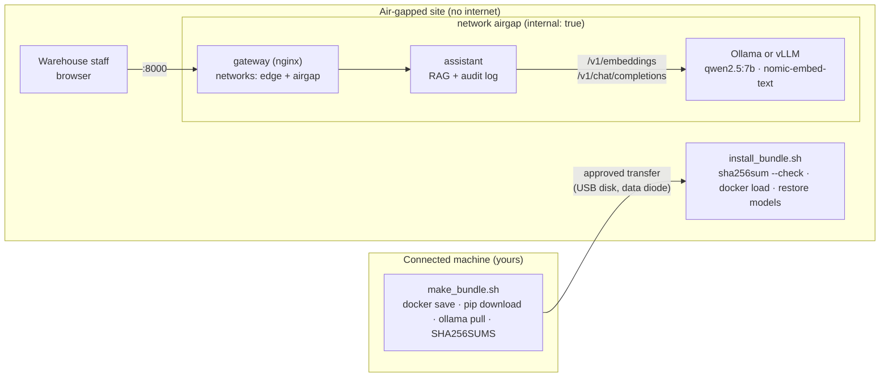

# 21 · Air-gapped on-prem with open models

**What you'll build:** an AI assistant for Northwind's warehouse staff that runs on a site with **no internet at all**: open models served locally (Ollama, or vLLM on a GPU), local embeddings, an audit log, a Docker network that physically has no way out, a script that *proves* there is no way out, and an **offline install bundle** (container images saved with `docker save`, Python wheels, model files, checksums) that you carry in on a disk and install with one command.
**Like you're 5:** some buildings have no door to the street at all. To bring a toy inside, you pack everything into one box at home (the toy, its batteries, the instructions), seal it with a sticker that shows if anyone opened it, carry it in, check the sticker, and unpack. Inside, the toy only talks to things in the same room.
**Time:** ~3 h · **Builds on:** [20 · Deploy into a customer cloud](../20-deploy-into-a-customer-cloud-vpc), [Open-source and on-device AI](../../../open-source-and-on-device-ai) (local models, embeddings, vLLM) · **Needs:** Docker; nothing else for FAKE mode. For real local models: 8 GB RAM for a 7B model on CPU (16 GB is comfortable), or an NVIDIA GPU for vLLM

## Why this matters
Defence, utilities, hospitals, factories, customs-bonded warehouses and many government sites run **air-gapped** or "OT" networks: no internet, often by law. Cloud AI is impossible there; open models running on local servers are the only option, and everything (software, models, updates) must arrive through an approved transfer process. Forward-deployed engineers do these installs on site, and the ones who come prepared with a verified bundle and a proof of isolation are the ones customers invite back.

## What you'll learn
- **Air gap**: a network with no connection to the internet; anything you need must be brought in, checked and installed offline.
- **Offline bundle**: `docker save` turns images into files, `pip download` collects wheels, model weights are packed as files, and `SHA256SUMS` proves nothing was changed on the way.
- **Local model serving**: Ollama (simple, CPU or GPU) or vLLM (fast, GPU), both speaking the OpenAI-compatible API, so the app code is the same.
- **Isolation you can prove**: a Docker network with `internal: true`, and `verify_no_egress.py` output attached to the security sign-off.
- **Audit log**: who asked what, which sources were used, when: a common on-prem requirement.

## Before you start
1. Docker (Docker Desktop on Windows/Mac). For the Python parts:
   ```bash
   cd part-5-deploying-at-the-customer/21-air-gapped-on-prem-with-open-models
   python -m venv .venv && source .venv/bin/activate
   pip install -r requirements.txt
   ```
   `fastapi` + `uvicorn` (the app), `httpx` (talks to the model server), `pydantic`, `pytest`.
2. No API key, ever: this lesson never calls a cloud model.
3. For real local models (optional): the bundle downloads `qwen2.5:7b` (~4.7 GB, chat) and `nomic-embed-text` (~270 MB, embeddings) on the connected machine.

## Run it
1. Tests:
   ```bash
   pytest -q
   ```
2. Start the stack in FAKE mode (no model server) and open http://localhost:8000:
   ```bash
   docker compose up -d --build
   ```
3. Prove the assistant cannot reach the internet:
   ```bash
   docker compose exec assistant python verify_no_egress.py
   ```
4. Look at the audit log after asking a question on the page:
   ```bash
   docker compose exec assistant tail -n 3 /data/audit.jsonl
   ```
5. Stop: `docker compose down` (add `-v` to also delete the audit volume).
6. Now the real procedure. On a machine **with** internet, build the bundle:
   ```bash
   ./bundle/make_bundle.sh                    # app + gateway images, wheels, files, checksums (~80 MB)
   WITH_OLLAMA=1 ./bundle/make_bundle.sh      # + Ollama image and the two models (several GB)
   ```
7. Copy `offline-bundle/` to the air-gapped host (approved USB disk, data diode, whatever the site's process is). There:
   ```bash
   cd offline-bundle
   ./install_bundle.sh
   docker compose -p offline-bundle exec assistant python verify_no_egress.py
   ```
8. GPU site that wants more speed: use the `vllm` profile (see the comments at the top of `compose.yaml`); copy the model weights into the `hf-cache` volume from the bundle the same way.

| Command, piece by piece | Meaning |
|---|---|
| `docker compose exec assistant python verify_no_egress.py` | run the script inside the running `assistant` container, so it tests *that* container's network |
| `tail -n 3 FILE` | show the last 3 lines of a file |
| `docker compose down -v` | stop and remove containers and networks; `-v` = also remove the named volumes |
| `./bundle/make_bundle.sh` | `./` = run the script in this folder (it must be executable: `chmod +x`) |
| `WITH_OLLAMA=1 ./bundle/make_bundle.sh` | set a variable for this one run; the script checks it with `${WITH_OLLAMA:-0}` |
| `docker save -o images/app.tar IMAGE` | write an image (all its layers) into one `.tar` file |
| `docker load -i images/app.tar` | read it back into Docker on the other machine |
| `pip download -r requirements.txt -d wheels --only-binary=:all: --platform manylinux2014_x86_64 --python-version 3.12` | fetch the package files (wheels) for a *Linux x86-64, Python 3.12* target, even from a Mac or Windows machine |
| `pip install --no-index --find-links wheels -r requirements.txt` | on the air-gapped side: install only from the `wheels` folder, never from the internet |
| `find . -type f -print0 \| sort -z \| xargs -0 sha256sum > SHA256SUMS` | list every file (`-print0`/`-0` = safe with spaces), sorted, and write a checksum per file |
| `sha256sum --check --quiet SHA256SUMS` | recompute every checksum and fail if any file changed |
| `set -euo pipefail` | bash safety: stop on errors (`-e`), on unset variables (`-u`), and on a failure anywhere in a pipe |

### What you should see
`pytest -q`:
```
.....                                                                    [100%]
5 passed in 0.50s
```
Real output from our test of the full procedure (bundle made on a connected machine, the app image deleted, then installed from the bundle with FAKE mode):
```
1/5 build the app image
2/5 save container images to .tar files
3/5 download Python wheels (for running without Docker, or rebuilding inside the site)
4/5 download the models into a volume and pack it
5/5 copy the deployment files and write checksums
83M	offline-bundle
Bundle ready in offline-bundle
```
Asking through the gateway, then the isolation proof from inside the assistant container:
```
{"answer":"(FAKE, extractive) If the temperature logger shows an alarm, do not unload into general storage. Move the pallet to quarantine bay Q2, photograph the logger display, and call the shift lead. The customer decides whether the goods are released or destroyed. [cold-chain#logger-alarm-on-arrival]","sources":[{"id":"cold-chain#logger-alarm-on-arrival","score":0.572},...]}

✅ internet 1.1.1.1:443   blocked (OSError)
✅ internet 8.8.8.8:53    blocked (OSError)
✅ internet pypi.org:443   no DNS
✅ internet huggingface.co:443   no DNS
✅ internet ollama.com:443   no DNS

ISOLATED: no internet access
```
The audit log line and the tamper test (we appended one character to `requirements.txt` in the bundle):
```
{"ts": "2026-10-28T10:33:31", "user": "sam", "question": "The logger alarm is on when the pallet arrives. What do I do?", "sources": ["cold-chain#logger-alarm-on-arrival", "dangerous-goods#leaking-package", "cold-chain#temperature-limits"], "answer_chars": 293, "seconds": 0.0, "model": "fake"}
./requirements.txt: FAILED
sha256sum: WARNING: 1 computed checksum did NOT match
```
With a real model the answer is written by `qwen2.5:7b` and cites the `[id]` it used (example, wording varies): *"Don't unload it into general storage. Move it to quarantine bay Q2, take a photo of the logger display and call your shift lead [cold-chain#logger-alarm-on-arrival]."*

## How it works



1. **`assistant.py`: RAG with nothing but local parts.** `chunks()` splits each procedure in `knowledge/` at `## ` headings into chunks with ids like `cold-chain#logger-alarm-on-arrival`. `embed()` sends texts to `{MODEL_URL}/embeddings` (Ollama and vLLM both serve this OpenAI-compatible route); in FAKE mode `fake_embed()` uses the **hashing trick** (each word adds 1 to a slot picked by its hash) so search still works offline and deterministically. `Index.search()` ranks chunks by **cosine similarity** (how much two vectors point the same way). `answer()` sends the top 3 chunks to `{MODEL_URL}/chat/completions` with "answer only from these, cite the [id]". `httpx.Client(trust_env=False)` makes sure the app never picks up a proxy setting and tries to go out.
2. **`/ready` checks the models, not just the server.** It calls `{MODEL_URL}/models` and returns 503 if the chat or embedding model isn't loaded: the most common on-site mistake ("we installed Ollama but forgot to restore the models").
3. **`audit()`** appends one JSON line per question: time, user, question, sources, answer length, seconds, model. It goes to the `audit` volume, so it survives upgrades. Agree with the customer how long to keep it and who may read it (it contains questions).
4. **`compose.yaml`: isolation by design.** The `airgap` network has `internal: true`: Docker gives it no route outside the host, so the assistant and the model server cannot reach the internet even if the host could. Only the `gateway` (a tiny nginx with `gateway/nginx.conf`) is also on the `edge` network, to publish port 8000 to the site's users; it only forwards requests in. On a real air-gapped site the host has no internet either: this is defence in depth. The assistant runs `read_only` with a `tmpfs` for `/tmp`. The `ollama` and `vllm` services start only with `--profile ollama` / `--profile vllm`; `HF_HUB_OFFLINE=1` stops vLLM from trying to download weights.
5. **`verify_no_egress.py`** tries TCP connections to public addresses and names (`1.1.1.1:443`, `8.8.8.8:53`, `pypi.org`, `huggingface.co`, `ollama.com`) and, in real mode, checks that the internal model server *is* reachable. "no DNS" or "blocked" is good; any "REACHABLE" makes it exit with 1.
6. **`bundle/make_bundle.sh`** (connected side): builds the app image, `docker save`s it and the gateway image (pulling only what is missing), downloads wheels for the target platform with `pip download`, optionally starts a temporary Ollama container to `ollama pull` the models and tars its volume, copies the deployment files, and writes `SHA256SUMS`. **`bundle/install_bundle.sh`** (air-gapped side): verifies every checksum first (a changed file stops everything), `docker load`s the images, untars the models into the `ollama-models` volume using an image that is already loaded (there is no internet to pull a helper image), and starts the stack.

| `compose.yaml` key | Meaning |
|---|---|
| `networks: airgap: internal: true` | a Docker network with no route to the outside world |
| `networks: [airgap, edge]` (gateway) | this container joins both networks: the bridge between users and the isolated part |
| `profiles: ["ollama"]` / `["vllm"]` | optional services, started only with `--profile ...` |
| `deploy.resources.reservations.devices` | give the container the NVIDIA GPU(s) (needs the NVIDIA Container Toolkit) |
| `environment: HF_HUB_OFFLINE: "1"` | Hugging Face libraries must never try the network |
| `volumes: - ollama-models:/root/.ollama` | where Ollama keeps models; filled from the bundle |
| `"${GATEWAY_PORT:-8000}:8000"` | the published port, changeable without editing the file (the checksums stay valid) |

| `gateway/nginx.conf` line | Meaning |
|---|---|
| `listen 8000;` | accept connections on port 8000 |
| `proxy_pass http://assistant:8000;` | forward every request to the assistant service by its compose name |
| `proxy_read_timeout 300s;` | wait up to 5 minutes for an answer (CPU models are slow) |

**Choosing the model server**

| | Ollama | vLLM |
|---|---|---|
| Hardware | CPU or GPU, laptops to servers | NVIDIA (or AMD) GPU servers |
| Strength | simplest setup, quantised GGUF models, small RAM | highest throughput for many users at once |
| Offline models | copy the `~/.ollama` models folder (or volume) | copy Hugging Face weights into the cache; `HF_HUB_OFFLINE=1` |
| API | OpenAI-compatible at `:11434/v1` | OpenAI-compatible at `:8000/v1` |

## If something goes wrong
- **`/ready` says `models not loaded: ['qwen2.5:7b']`** → the models weren't restored. On the site: check the bundle has `models/ollama-models.tgz`, rerun step 3 of `install_bundle.sh`, then `docker compose -p offline-bundle exec ollama ollama list`.
- **`sha256sum: WARNING: 1 computed checksum did NOT match`** → a file changed or the copy was incomplete. Don't install: copy it again from the source and compare `SHA256SUMS` with the one you emailed separately.
- **`docker load` works but the container fails with `exec format error`** → the bundle was built for a different CPU (e.g. an ARM Mac image for an x86 server). Build with `docker build --platform linux/amd64` and `pip download --platform manylinux2014_x86_64`.
- **Answers take a minute or more** → a 7B model on an old CPU. Try a smaller model (`qwen2.5:3b`), add RAM, or move to a GPU with vLLM. Tell users in training that the first answer after a restart is slower (the model loads into memory).
- **`verify_no_egress.py` shows REACHABLE** → the container is on a non-internal network or the compose file was changed. `docker network inspect <project>_airgap` must show `"Internal": true`.

## Try this
1. **Add a procedure.** Write `knowledge/fire-alarm.md` with two `## ` sections and ask about it. Does search find it in FAKE mode?
   <details><summary>Hint</summary>

   Rebuild (`docker compose up -d --build`) because the knowledge folder is copied into the image. FAKE search only matches shared words, so ask with words that appear in your text; a real embedding model also matches synonyms ("evacuate" vs "leave the building"). For a real site, put `knowledge/` on a volume instead so the warehouse team can update procedures without a rebuild, and keep the bundle + checksum process for code only.
   </details>
2. **Make the audit log tamper-evident.** Each line should include a hash of the previous line, so deleting or editing a line is detectable.
   <details><summary>Solution</summary>

   In `audit()`, read the last line (if any), compute `prev = hashlib.sha256(last_line.encode()).hexdigest()`, add `"prev": prev` to the entry, then write it. Add a small `verify_audit.py` that walks the file and checks every `prev`. This is the idea behind hash chains; real sites often also ship logs to a write-once store.
   </details>
3. **Measure the speed of your local model.** With Ollama running, time 5 questions and report tokens per second and seconds per answer, then write one paragraph for the customer: "on your hardware, expect X s per answer for Y users".
   <details><summary>Hint</summary>

   Ollama's native `/api/generate` response includes `eval_count` and `eval_duration` (nanoseconds): tokens per second = `eval_count / eval_duration * 1e9`. The `seconds` field in the audit log already gives end-to-end time. The open-source course has a full benchmark lesson in [Open-source and on-device AI](../../../open-source-and-on-device-ai).
   </details>

## Check yourself
1. Why does `install_bundle.sh` check the checksums *before* loading anything?
2. The gateway is on two networks. Why doesn't that give the assistant a way to the internet?
3. Why does the restore step use the app image instead of `alpine` to untar the models?
4. Why serve both Ollama and vLLM through the same OpenAI-compatible API?

<details><summary>Answers</summary>

1. A corrupted or tampered file must never be executed or loaded; checking first means a bad bundle stops the install before anything changes on the site. Send the `SHA256SUMS` file (or its hash) by a separate channel so an attacker can't change both.
2. Containers only get routes for the networks they are on. The assistant is only on `airgap`, which is `internal: true` (no route out). The gateway only forwards incoming requests to the assistant; it doesn't route the assistant's traffic.
3. On an air-gapped host there is no internet to pull `alpine`; only images that came in the bundle exist. Using an image you already loaded keeps the install fully offline.
4. The app stays the same: switching from Ollama on a CPU pilot to vLLM on a GPU server is a change of `MODEL_URL` and model names, not code. It also lets you test with any OpenAI-compatible stub.
</details>

## Learn more (optional)
- NIST guide to air-gapped / isolated systems is part of SP 800-82 (industrial control systems security): https://csrc.nist.gov/pubs/sp/800/82/r3/final

**Read the official docs**
- `docker save`: https://docs.docker.com/reference/cli/docker/image/save/ and `docker load`: https://docs.docker.com/reference/cli/docker/image/load/
- Compose networks (`internal`): https://docs.docker.com/reference/compose-file/networks/
- Ollama docs (Docker, FAQ: where models are stored, `OLLAMA_MODELS`): https://docs.ollama.com and https://github.com/ollama/ollama
- Ollama OpenAI compatibility (`/v1/chat/completions`, `/v1/embeddings`): https://docs.ollama.com/api/openai-compatibility
- vLLM: https://docs.vllm.ai
- `pip download`: https://pip.pypa.io/en/stable/cli/pip_download/
- `sha256sum`: https://man7.org/linux/man-pages/man1/sha256sum.1.html

**Watch**
- Ollama local LLMs (Matt Williams, Sam Witteveen): https://www.youtube.com/results?search_query=ollama+local+llm+tutorial
- vLLM serving explained: https://www.youtube.com/results?search_query=vllm+tutorial+serving
- Docker networking (TechWorld with Nana, NetworkChuck): https://www.youtube.com/results?search_query=docker+networking+tutorial
- Air-gapped networks explained: https://www.youtube.com/results?search_query=air+gapped+network+explained

## Next
→ [22 · Runbooks, handover and training the customer](../22-runbooks-handover-and-training-the-customer)
