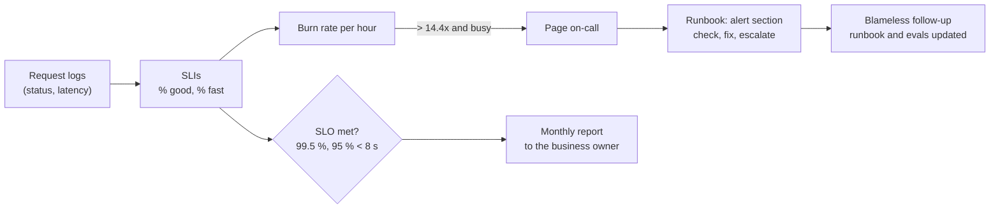

# 22 · Runbooks, handover and training the customer

**What you'll build:** the "leave it in good hands" kit for an AI system you deployed: a runbook template and a filled runbook for Northwind's reply assistant, an SLO calculator that turns raw request logs into availability, latency, error budget and "would this have paged someone?", a handover checklist, and a 75-minute training session plan for the people who will use it.
**Like you're 5:** you built a sandcastle for a friend. Before you go home you show them how to fix the wall when a wave hits (runbook), how to tell if it is still OK (SLOs), you give them your bucket and spade (handover), and you teach their little brother not to jump on it (training).
**Time:** ~2.5 h · **Builds on:** [20 · Deploy into a customer cloud](../20-deploy-into-a-customer-cloud-vpc), [21 · Air-gapped on-prem](../21-air-gapped-on-prem-with-open-models), [15 · Tracing and monitoring LLM apps](../../part-3-production-llm-engineering/15-tracing-and-monitoring-llm-apps) · **Needs:** Python only

## Why this matters
A forward-deployed engineer is successful when the customer can run the system **without them**. Projects fail after a great demo because nobody knows what to do when the model provider throttles at 10 am, nobody owns the API key rotation, and users were never told when not to trust the AI. Runbooks, SLOs, a deliberate handover and real training are what turn a pilot into a product the customer keeps paying for. They are also what interviewers mean by "operational maturity".

## What you'll learn
- **Runbook**: step-by-step instructions for operating and fixing a system, written for a tired stranger at 3 am.
- **SLI, SLO and error budget**: what you measure (SLI), the target (SLO), and how much failure the target allows (error budget). Spend the budget on releases, not on surprises.
- **Burn-rate alerts**: page a human only when the budget is being spent fast, not for every single error.
- **On-call basics**: who answers, how fast, when to escalate, and blameless follow-ups.
- **Handover and training**: the customer does every task once while you watch, and users learn what the AI does and does not do.

## Before you start
- From the course root: `cd part-5-deploying-at-the-customer/22-runbooks-handover-and-training-the-customer`
- Python 3.10+ only. For the tests: `pip install pytest` (no other packages needed).
- No API key needed.

## Run it
1. Create 30 days of (fictional) request logs:
   ```bash
   python make_sample_log.py
   ```
2. Produce the SLO report:
   ```bash
   python slo_report.py requests.jsonl
   ```
3. Same logs, a looser target. Watch the verdict change:
   ```bash
   python slo_report.py requests.jsonl --availability 99.0
   ```
4. Tests:
   ```bash
   pytest -q
   ```
5. Read, in this order: `templates/runbook-template.md`, `examples/runbook-northwind-reply-assistant.md`, `templates/handover-checklist.md`, `templates/training-session-plan.md`.

| Command, piece by piece | Meaning |
|---|---|
| `python slo_report.py requests.jsonl` | `requests.jsonl` = the log file to read (JSON Lines: one JSON object per line) |
| `--availability 99.0` | an option with a value: the availability SLO in percent (default 99.5) |
| `--latency-ms 8000 --latency-target 95` | "95 % of requests must take under 8,000 ms" |

### What you should see
Real output of step 2:
```
Requests: 28,104 over 30 days
[MISSED] Availability 99.274 %  (SLO 99.5 %)
         Error budget: 141 failed requests allowed, 145 % used
[MET   ] Under 8 s: 98.67 %  (SLO 95.0 %)  p50 2.0 s, p95 4.7 s
Worst days (date, 5xx, slow, requests):
   2026-09-18    156   153   1151
   2026-09-25      3   199   1163
   2026-09-23      4     2   1102
Hours that would have paged on-call (2):
   2026-09-18T10:00 burn rate 150x
   2026-09-18T11:00 burn rate 140x
```
Step 3 (only the first lines change):
```
Requests: 28,104 over 30 days
[MET   ] Availability 99.274 %  (SLO 99.0 %)
         Error budget: 281 failed requests allowed, 73 % used
```
What to look at: one 2-hour provider outage on 18 September used more than the whole month's error budget (145 %), while the other 29 days were fine. The slow prompt change on 25 September shows up as 199 slow requests, but the latency SLO is still met over the month: monthly numbers hide bad days, so always look at the worst days too. Only the outage hours would have paged someone; scattered single errors at night would not. And the same data can "meet" or "miss": the SLO is a business decision you agree with the customer, not a law of nature.

## How it works



1. **`make_sample_log.py`** writes one JSON object per request for 30 days with `random.Random(7)` (same file every time): busy office hours, quiet nights, about 2 s per answer (`lognormvariate`, a realistic "mostly fast, some slow" shape), a few random 500s, a 2-hour provider outage on day 18 and a slow prompt change on day 25.
2. **`slo_report.py`, the SLIs.** `report()` counts a request as *bad* if its status is 500 or more (a 404 is the caller's mistake, not an outage) and *slow* if it took more than `latency_ms`. Availability = good / total. The **error budget** is `total × (1 − SLO)`: at 99.5 % and 28,104 requests, 141 requests may fail. `budget_used_pct` shows how much of it was spent.
3. **Percentiles.** `percentile()` sorts the latencies and picks the value below which p % of requests fall. p50 is the typical user; p95 is the unlucky one in twenty. Averages hide slow tails, so SLOs use percentiles or "share under X seconds".
4. **Burn rate.** For each hour: error rate ÷ budget rate. A burn rate of 1 spends the budget exactly in 30 days; 14.4 would spend it in about 2 days, worth waking someone (this threshold comes from Google's SRE workbook). Hours with fewer than 20 requests are ignored, so 1 error out of 3 at night doesn't page anyone.
5. **The documents.** The runbook template has the sections every runbook needs (what it does, SLOs, contacts and escalation, health checks, one section per alert with *means / impact / check first / fix / escalate if*, routine tasks, known limits, change log). The filled Northwind example shows what "specific" looks like: real commands, real names, real limits. The handover checklist makes the customer *do* every task once. The training plan is minute by minute, with hands-on practice and, importantly, a part on "when not to trust it".

**On-call basics (one page)**
- **Before:** a rota (who is on call when), access tested, the runbook linked from every alert, a quiet way to hand over the pager.
- **During an incident:** 1) acknowledge the page, 2) assess impact (who is affected?), 3) communicate early in the agreed channel ("we're looking at it"), 4) mitigate first (roll back, switch to manual, switch to a local model), fix later, 5) escalate by the time limit in the runbook, not when you feel desperate.
- **After:** a **blameless** postmortem within a few days: what happened, timeline, why our safeguards didn't catch it, actions with owners. Update the runbook and add the case to the eval set.
- **AI-specific alerts worth having:** provider throttling (429), cost per day above a threshold, a sudden drop in "drafts used without edits", spikes in refusals or guardrail blocks.

**Writing a runbook step: bad vs good**

| Bad | Good |
|---|---|
| "Check the logs." | "`docker logs --tail 100 <container>`. Look for the first line containing `ERROR` after the deploy time." |
| "Restart if needed." | "If `/ready` returns 503 for more than 3 minutes: `docker restart <container>`, wait 30 s, check `/ready` again." |
| "Contact the team." | "Not fixed in 30 minutes: call Tomasz (IT), number in the IT wiki phone list." |

## If something goes wrong
- **`FileNotFoundError: requests.jsonl`** → run `python make_sample_log.py` first (it creates the file next to the script).
- **`json.decoder.JSONDecodeError` on your own logs** → the file must have exactly one JSON object per line. Export from your log system as JSON Lines, not a JSON array.
- **Availability is 100 % but users complain** → you might be measuring the wrong thing (health checks instead of real requests), or the failures are "200 OK with a useless answer". Add a quality SLI from user feedback (e.g. "drafts sent without edits").
- **The report pages for quiet hours** → your traffic is lower than ours; lower the `n >= 20` minimum in `report()` with care, or use longer windows (6 h).
- **Nobody reads the runbook** → link the exact section from each alert message, and run a 30-minute "game day" where someone follows it on a test system.

## Try this
1. **Your own SLO.** Change the latency SLO to "99 % under 5 s" and explain the result in two sentences for Priya.
   <details><summary>Hint</summary>

   `python slo_report.py requests.jsonl --latency-ms 5000 --latency-target 99`. Look at "Under 5 s" and the p95. Explain in business words: "On a normal day 1 in 20 drafts takes more than X s; on 25 September a prompt change made many drafts slow for 6 hours."
   </details>
2. **A runbook section for a new alert.** Write the "CostSpike" alert section (daily model spend more than 2x the 7-day average) in the Northwind runbook.
   <details><summary>Solution</summary>

   ```markdown
   ### CostSpike (model spend today > 2x the 7-day average)
   - **Means:** we are sending many more or much longer requests than usual.
   - **Impact:** budget; no user impact yet.
   - **Check first:** requests per hour (dashboard), average input tokens per request, any deploy or prompt change today, one user or integration sending in a loop (logs grouped by user id).
   - **Fix:** a loop or bug → roll back or block that client; a prompt change that added context → roll back; real growth → tell Priya and Dana, update the budget alarm.
   - **Escalate if:** spend is over 5x, or the cause is unknown after 1 hour → Tomasz.
   ```
   </details>
3. **Two-window burn rate.** Real alerting uses a long and a short window together (page only if *both* the last hour and the last 5 minutes burn fast), so alerts stop quickly after recovery. Add this to `report()`.
   <details><summary>Hint</summary>

   Build `by_5min` like `by_hour` (round the timestamp down to 5 minutes). For each 5-minute bucket, also compute the burn rate of the 12 buckets ending there (the last hour). Page when both are above 14.4. Add a test with an error burst that ends: the page should stop in the first quiet 5-minute bucket.
   </details>

## Check yourself
1. What is the difference between an SLI, an SLO and an SLA?
2. Why is "average latency" a poor SLI for an AI assistant?
3. One outage used 145 % of the error budget. What should the team do differently next month?
4. Why should the customer, not you, perform each handover task once?

<details><summary>Answers</summary>

1. SLI = the measurement (share of requests without a 5xx). SLO = the internal target for it (99.5 % over 30 days). SLA = a contract with consequences (credits, penalties) if a promised level isn't met; SLAs are usually looser than SLOs so you have a safety margin.
2. LLM latency has a long tail: most answers take 2 s, some take 20 s. The average looks fine while 1 in 20 users waits a long time. Percentiles (p95) or "share under 8 s" describe what users feel.
3. With the budget spent, they should slow down risky changes (only fixes, no big prompt or model changes), and invest in what would have reduced the outage: a fallback (another region, a local model, or a clear "manual mode" message), faster detection (the burn-rate alert), and a provider support plan. That is how error budgets turn reliability into decisions.
4. Doing it once proves the instructions are complete and that they have the access; watching is not the same as doing. It also builds their confidence and makes them owners instead of people who call you every time.
</details>

## Learn more (optional)
- Google SRE book, "Service Level Objectives": https://sre.google/sre-book/service-level-objectives/
- Google SRE workbook, "Alerting on SLOs" (burn rates): https://sre.google/workbook/alerting-on-slos/
- Google SRE book, "Postmortem culture": https://sre.google/sre-book/postmortem-culture/
- Atlassian incident management handbook: https://www.atlassian.com/incident-management

**Read the official docs**
- Prometheus alerting rules (how burn-rate alerts are written in practice): https://prometheus.io/docs/prometheus/latest/configuration/alerting_rules/
- OpenTelemetry (the signals behind SLIs): https://opentelemetry.io/docs/
- Python `json` and `argparse`: https://docs.python.org/3/library/json.html, https://docs.python.org/3/library/argparse.html

**Watch**
- SLIs, SLOs and SLAs explained: https://www.youtube.com/results?search_query=sli+slo+sla+explained
- Writing runbooks: https://www.youtube.com/results?search_query=how+to+write+a+runbook+sre
- Blameless postmortems: https://www.youtube.com/results?search_query=blameless+postmortem
- Training users on AI tools / change management: https://www.youtube.com/results?search_query=change+management+ai+adoption+training

## Next
→ [Part 6 · Impact capstones](../../part-6-impact-capstones/README.md), starting with [23 · Disaster-relief command center](../../part-6-impact-capstones/23-capstone-disaster-relief-command-center)
