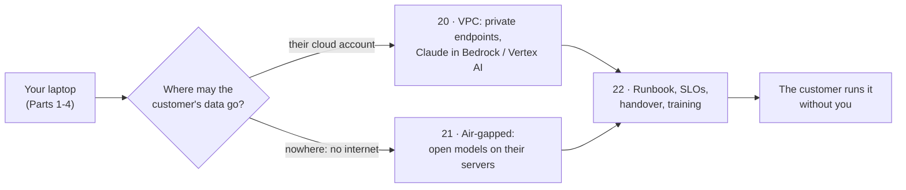

# Part 5 · Deploying at the customer

Your agents work on your laptop. Now they have to work **inside the customer's world**: in their cloud account with their network rules, on a site with no internet at all, and with their people running it after you leave.

| # | Lesson | What you'll build | Time |
|---|---|---|---|
| 20 | [Deploy into a customer cloud (VPC)](20-deploy-into-a-customer-cloud-vpc) | one service that uses Claude via the Claude API, Amazon Bedrock or Vertex AI (or a local model); annotated Terraform for a private VPC with private endpoints, an IAM role and a secret; hardened compose; `preflight.py`; a deployment checklist | ~3 h |
| 21 | [Air-gapped on-prem with open models](21-air-gapped-on-prem-with-open-models) | an offline RAG assistant on Ollama or vLLM with local embeddings and an audit log; an `internal` Docker network; a no-egress proof; an offline install bundle (`docker save`, wheels, models, checksums) | ~3 h |
| 22 | [Runbooks, handover and training the customer](22-runbooks-handover-and-training-the-customer) | a runbook template and a filled example, an SLO and error-budget calculator with burn-rate paging, on-call basics, a handover checklist, a training session plan | ~2.5 h |

## Setup for this part
- Python 3.10+ and a virtual environment per lesson: `pip install -r requirements.txt` in lessons 20 and 21; lesson 22 needs only `pytest`.
- Docker (Docker Desktop on Windows/Mac) for the compose steps in 20 and 21.
- Optional: Terraform 1.6+ (lesson 20) to validate and plan the infrastructure. An AWS account only if you really want to apply it (it creates billable resources; destroy them afterwards with `terraform destroy`).
- Optional: Ollama for real local models in lesson 21 (`qwen2.5:7b` ~4.7 GB, `nomic-embed-text` ~270 MB).
- No API key is needed for any lesson in this part: everything has a FAKE mode.
- Background for networks, Terraform, Docker and Kubernetes: [Cloud and DevOps for AI](../../cloud-and-devops-for-ai). For local models and vLLM: [Open-source and on-device AI](../../open-source-and-on-device-ai).

## What you can do after this part
- Explain and draw a private deployment: VPC, private subnets, private endpoints, IAM roles, secrets, and how users reach the app.
- Choose and wire the model access path a customer's security team accepts: Claude API, Claude in Amazon Bedrock, Claude on Vertex AI, or open models on their own hardware.
- Prove a deployment is correct with automated checks (DNS is private, internet is blocked, health and readiness pass) and a checklist.
- Install an AI system on a site with no internet, from a verified offline bundle.
- Hand a system over with a runbook, SLOs, alerts that page only when it matters, and users who know when to trust it.

## Next
→ [Part 6 · Impact capstones](../part-6-impact-capstones/README.md)
