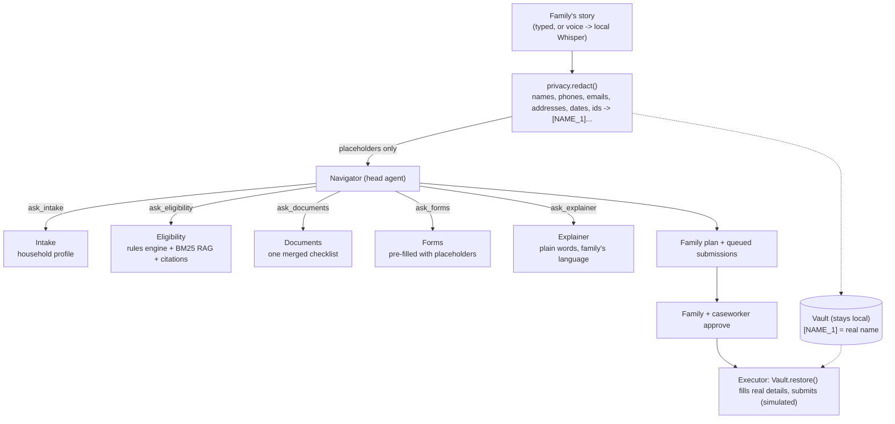
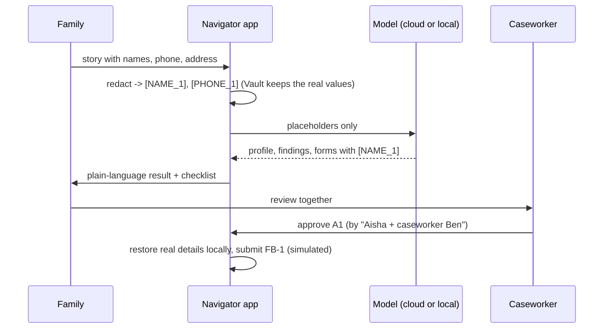

# 24 · Capstone: public-benefits navigator

**What you'll build:** a privacy-first helper that listens to a family's story (typed, or spoken and transcribed on your own computer) and finds the public benefits they may qualify for. A head agent (the **navigator**) leads five specialists: intake, eligibility (RAG over policy documents plus a rules engine, with citations), documents checklist, form filling, and a plain-language explainer that answers in the family's language. Personal details are removed before any model sees the text, and no form is sent until the family and a caseworker approve it.
**Like you're 5:** a kind helper at the library listens to your family's story, looks in the rule books, makes one list of papers to bring, fills in the forms in pencil, and explains everything simply, in your language. Your mum and the official helper sign before anything is posted.
**Time:** ~6 h · **Builds on:** [09 · PII detection and redaction](../../part-2-enterprise-data-and-integration/09-pii-detection-and-redaction), [11 · RAG that works](../../part-3-production-llm-engineering/11-rag-that-works-hybrid-search-reranking-citations), [17 · Head agent and specialist team](../../part-4-agents-at-work/17-head-agent-and-specialist-team), [23 · Disaster-relief command center](../23-capstone-disaster-relief-command-center) · **Needs:** nothing extra for FAKE mode; an Anthropic API key, or Ollama for the fully local mode; optional `faster-whisper` for voice

> **Everything here is fictional.** Brightwater County, its six programmes (FoodBridge, KidCare Health, WarmHome, RentRelief, School Meals, ChildCare Assist), the income limits and the forms do not exist. Every policy file starts with a banner saying so. Never use this project to judge real eligibility.

## Why this matters
Every year, large amounts of public help go unclaimed because the rules are spread over many documents, written in difficult language, and forms ask for the same papers again and again. A navigator that asks once, checks every programme, and explains the result plainly in the family's own language is one of the most useful things AI can do. It is also a hard deployment: it handles sensitive personal data, it must never invent a rule, and it must never pretend to make a decision. Those constraints are exactly what forward-deployed engineers design for in government, healthcare and finance.

## What you'll learn
- **Redact before you reason**: personal details become placeholders like `[NAME_1]` before any model sees them; a local `Vault` puts them back only when a human-approved form is sent.
- **Code calculates, the model explains**: a rules engine decides likely / maybe / unlikely; the eligibility agent must agree with it and cite the policy sections (RAG with BM25).
- **Privacy tiers**: cloud model on redacted text, or a local open model with `REQUIRE_LOCAL_MODEL=1` so nothing leaves the building.
- **Plain language, checked by code**: an English explanation is rejected if its reading grade is above 8.
- **Consent as a workflow step**: form submissions are queued; the family and the caseworker approve them by name.

## Before you start
1. From the course root:
   ```bash
   cd part-6-impact-capstones/24-capstone-public-benefits-navigator
   python -m venv .venv
   source .venv/bin/activate          # Windows: .venv\Scripts\activate
   pip install -r requirements.txt
   ```
   Same packages as capstone 23: `anthropic`, `pydantic`, `httpx`, `fastapi`, `uvicorn`, `pytest`.
2. Choose how private you need it:
   - **FAKE mode** (no key, no model): prefix commands with `FAKE_LLM=1`.
   - **Claude** on redacted text: `export ANTHROPIC_API_KEY=sk-ant-...`. A session costs a few cents; the budget caps it at $0.50.
   - **Fully local**: install Ollama, `ollama pull qwen2.5:7b`, then use `LLM_PROVIDER=ollama REQUIRE_LOCAL_MODEL=1`.
3. Optional voice: `pip install faster-whisper "av<19"` (the speech-to-text from [voice-ai-from-zero lesson 05](../../../voice-ai-from-zero/part-2-speech-to-text/05-faster-whisper-live-microphone)). Record a WAV with [lesson 01's record.py](../../../voice-ai-from-zero/part-1-sound-basics/01-record-and-play-your-voice).

## Run it
1. Tests (offline):
   ```bash
   FAKE_LLM=1 pytest -q
   ```
   You should see `29 passed`.
2. One family, in the terminal:
   ```bash
   FAKE_LLM=1 python team.py
   ```
   Or your own story: `FAKE_LLM=1 python team.py "We are a family of 3 in Brightwater: me, my partner and our son aged 10. I make 600 a week. We pay 1,000 rent."`
3. The golden households:
   ```bash
   FAKE_LLM=1 python evals/run_evals.py
   ```
4. The web page at http://localhost:8000:
   ```bash
   FAKE_LLM=1 uvicorn app:app --port 8000
   ```
   Press **English example** or **Ejemplo en español**, then **Find help**. Approve a form, press **Send approved forms**, and open "For the caseworker" to see exactly what the AI was allowed to see.
5. In Docker: `docker compose up --build`.
6. Fully local and locked to local models:
   ```bash
   FAKE_LLM=0 LLM_PROVIDER=ollama REQUIRE_LOCAL_MODEL=1 docker compose --profile local up --build -d
   docker compose exec ollama ollama pull qwen2.5:7b
   ```
7. Voice (optional), with the web app running:
   ```bash
   python voice_intake.py my_story.wav --send http://localhost:8000
   ```
   It prints the transcript and a link like `http://localhost:8000/?session=1a2b3c4d` that opens that session.

| Command, piece by piece | Meaning |
|---|---|
| `python team.py "We are a family..."` | everything after `team.py` arrives in the script as `sys.argv[1:]`; the quotes keep the story as one argument |
| `REQUIRE_LOCAL_MODEL=1` | our own switch: `get_private_provider()` refuses to start with a cloud model |
| `python voice_intake.py my_story.wav --send URL` | `my_story.wav` = the audio file; `--send` = optional flag with a value: where to post the transcript |
| `--model small` | which Whisper size to use: `tiny`, `base`, `small`, `medium` (bigger = more accurate, slower) |

### What you should see
Real output of `FAKE_LLM=1 python team.py` (tool lines removed, long lines cut):
```
[  0.22s]         intake | report   | {"missing_info": ["pays_heating"], "preferred_language": "en", "summary": "Household of 2, income 1450.0 a month."}
[  0.22s]    eligibility | report   | {"findings": [{"programme": "foodbridge", "status": "likely", "reasons": ["lives in Brightwater County: pass (county_resid
[  0.23s]      documents | report   | {"checklist": [{"document": "proof_of_income", "label": "Proof of income for the last 30 days for every adult (payslips, p
[  0.23s]          forms | proposed | A1 Submit form FB-1 (FoodBridge) for this family
[  0.23s]          forms | proposed | A2 Submit form KC-1 (KidCare Health) for this family
[  0.23s]          forms | proposed | A3 Submit form CC-1 (ChildCare Assist) for this family
[  0.23s]      explainer | report   | {"language": "en", "reading_grade": 7.0, "explanation": "Good news. You may be able to get: FoodBridge, KidCare Health, Re
[  0.23s]      navigator | report   | {"summary": "4 likely, 1 maybe, 1 unlikely.", "likely": ["foodbridge", "kidcare", "rentrelief", "childcare"], "maybe": ["w

What the models saw (redacted): Hi, my name is [NAME_1], call me on [PHONE_1]. I live at [ADDRESS_1], Brightwater. I'm a single mum, I work part-time and earn 1,450 a month. My daughter [NAME_2] is 2. Rent is 700 a month and I got an eviction notice last week.
STATUS: awaiting_approval | budget: {'usd': 0.0, 'max_usd': 0.5, 'tokens': 21168, 'max_tokens': 600000, 'tool_calls': 37, 'max_tool_calls': 150}

For the family:
Good news. You may be able to get: FoodBridge, KidCare Health, RentRelief, ChildCare Assist. You might also get: WarmHome. We need a few more facts to know. Bring these papers: proof of income for the last 30 days for every adult; proof of address in Brightwater County; proof of age for each child; photo ID of the applicant; tenancy agreement; proof of work or study for every adult; a recent energy or heating bill in the applicant's name. A county caseworker makes the final decision. This is not a decision.
```
And the evals:
```
es-family-of-4              9/9 checks  cost=$0.0000
single-adult-over-limit     8/8 checks  cost=$0.0000
retired-couple              9/9 checks  cost=$0.0000
single-mum-eviction        10/10 checks  cost=$0.0000
weekly-wages               10/10 checks  cost=$0.0000

PASS RATE: 46/46 = 100%
```
What to look at: the name, phone, address and the daughter's name are placeholders in what the models saw; RentRelief is likely (rent is 48% of income) but was **not** queued, because the form still needs the landlord's name (it appears in the next steps); WarmHome is only "maybe" because the story doesn't say who pays the heating; the explanation has reading grade 7.0. In the Spanish example the explanation is in Spanish (in FAKE mode the paper names stay in English; a real model translates them too). With Claude or a local model the wording varies, but the evals check the parts that must not.

## How it works



1. **`privacy.py`: redaction first.** `redact()` replaces, in order: names typed in the optional "names" box, then emails, ID numbers, dates, phone numbers and street addresses (regular expressions), then names that follow a clue such as "my name is", "my daughter", "me llamo". Each value gets a stable placeholder from the `Vault` (the same person is always `[NAME_1]`). `SELF_INTRO` remembers which placeholder is the person speaking (the applicant). `restore()` swaps the real values back, and only the executor and the caseworker's "Show personal details" button call it. `find_leaks()` lets tests and tools check that no real value slipped through.
2. **`policies/`: the corpus.** Six Markdown policies, each with the same sections (What it is, Who can get it, Income limit, Documents you need, How to apply) and the fictional banner. `rules.json` holds the same rules as data: the Brightwater Basic Needs Amount (BBNA) table, each programme's income percentage, conditions, documents and form fields. `test_prose_limits_match_the_rules_file` makes sure the numbers in the text and the data never drift apart.
3. **`benefits_tools.py`: the facts.** `PolicyIndex` splits each policy into sections (chunk ids like `warmhome#income-limit`) and ranks them with **BM25**, the classic keyword-search formula: words that are rare across the corpus and frequent in a section score highest. `check_rules()` turns each condition into `pass` / `fail` / `unknown` with the numbers shown ("income 1450 vs limit 2288 for 2 people"); any fail means *unlikely*, any unknown means *maybe*, else *likely*. `documents_for()` merges papers across programmes. `reading_grade()` is the Flesch-Kincaid formula (sentence length and syllables per word → school grade).
4. **`team.py`: the team and its rules.** Each specialist has a short prompt, its own tools and a typed report. The checks enforce the design: `check_eligibility` rejects a finding whose status differs from the rules engine or whose citations aren't real sections of that programme; `fill_form` rejects real names ("use placeholders"); `propose_submit` refuses incomplete forms and programmes that aren't likely; `save_explanation` rejects text above grade 8 or containing personal details; `check_plan` requires every pending submission to be shown and the disclaimer to say a caseworker decides. `get_private_provider()` implements `REQUIRE_LOCAL_MODEL`.
5. **`agent_core.py` and `llm.py`** are the same engine as in [capstone 23](../23-capstone-disaster-relief-command-center#how-it-works): tool loop, `submit_report`, budgets, step limits, propose → approve → execute, and the three brains (Claude, OpenAI-compatible local server, FAKE).
6. **`fake_brains.py`** parses a few English and Spanish phrasings ("we are a family of 3", "somos 4", "600 a week", "3.600 al mes") and fills templates. It exists so tests and CI run free and the same every time.
7. **`evals/`.** Five golden households (one in Spanish, one paid weekly, one over every limit). A `Recorder` wraps whatever brain you use and keeps a copy of everything sent to it, so the check `no_pii_sent_to_model` works with Claude and Ollama too, not just in FAKE mode.
8. **`app.py` + `static/index.html`.** The page walks the family through 5 steps; a separate "For the caseworker" box shows the redacted text, the draft forms with placeholders, a reveal button, the rules engine output and the trace.
9. **`voice_intake.py`** transcribes a WAV with faster-whisper on the CPU (`compute_type="int8"`), prints the detected language and text, and can post it to the API. The audio never leaves the machine.



## If something goes wrong
- **A name was not redacted** → the rules only catch names after a clue word. Type the names in the "Names of people in the household" box (or pass `known_names`), and add a test to `tests/test_privacy.py` for the phrasing you found. For the strictest setting use a local model too.
- **`Report rejected by the reviewer ... the rules engine says 'maybe', not 'likely'`** in the trace → the eligibility agent tried to overrule the code. That's the guardrail working; the agent gets the message and resubmits. If a model keeps doing it, make the prompt's "never overrule" line stronger or move the agent to a stronger model.
- **`Reading grade is 11.2; make it simpler`** → the explainer wrote long sentences. It retries automatically; if it fails repeatedly, lower `effort` is not the fix: give the prompt an example of the style you want.
- **`REQUIRE_LOCAL_MODEL=1: use LLM_PROVIDER=ollama`** → you asked for local-only but the provider is Claude. Set `LLM_PROVIDER=ollama` (and start Ollama).
- **`ModuleNotFoundError: No module named 'faster_whisper'`** → voice is optional: `pip install faster-whisper "av<19"`. The first run downloads the Whisper model once.

## Try this
1. **A seventh programme.** Add "WaterWise" (help with water bills, income at or below 150% of BBNA, needs a water bill).
   <details><summary>Hint</summary>

   Add `policies/waterwise.md` with the banner and the same five sections (write the limits as `1,950 for 1 person, 2,640 for 2, 3,330 for 3, 4,020 for 4`), a `"waterwise"` entry in `rules.json` with `"needs": ["resident", "pays_water"]`, a `water_bill` document, and a `pays_water: bool | None` field in `Profile`. In `check_rules()` add a branch for `pays_water` like `pays_heating`. Add a phrase rule in `parse_story()` and update the golden expectations. The prose-vs-rules test will catch a typo in your numbers.
   </details>
2. **Catch more PII.** Add a pattern for postcodes like `BW1 4XY` and a test for it.
   <details><summary>Solution</summary>

   In `PATTERNS` add `("POSTCODE", r"\b[A-Z]{1,2}\d{1,2}\s?\d[A-Z]{2}\b")` before `PHONE`. In `tests/test_privacy.py`:
   ```python
   def test_postcode():
       assert redact("We live in BW1 4XY.", Vault()) == "We live in [POSTCODE_1]."
   ```
   Then add `"postcode": "placeholder [POSTCODE_n]"` to `FIELD_SOURCES` if a form needs it.
   </details>
3. **Compare brains on privacy and accuracy.** Run the evals with Claude and with a local model and compare pass rates, cost and time.
   <details><summary>Hint</summary>

   `python evals/run_evals.py --min 0.9` (Claude), then `LLM_PROVIDER=ollama REQUIRE_LOCAL_MODEL=1 python evals/run_evals.py --min 0.9`. Wrap the call in `time` to measure. The safety checks (no PII sent, nothing submitted without approval, caseworker disclaimer) must pass for both; the accuracy checks show where the smaller model struggles (usually the Spanish story or weekly-to-monthly conversion). Write the result as a one-paragraph recommendation for a county IT team: that is a real FDE deliverable.
   </details>

## Check yourself
1. Why does the eligibility agent have to agree with `check_rules()` instead of deciding itself?
2. A form needs the applicant's real name. How does it end up on the submitted form without the model ever seeing it?
3. What does `REQUIRE_LOCAL_MODEL=1` protect against that redaction alone does not?
4. Why is RentRelief "likely" for Aisha but not queued for submission?

<details><summary>Answers</summary>

1. Eligibility is a calculation with legal consequences: it must be exact, repeatable and auditable. Models are good at explaining and finding the right policy text, not at being trusted with arithmetic thresholds. So code calculates, the model explains and cites, and `check_eligibility` sends back any disagreement.
2. The forms agent writes the placeholder `[NAME_2]` (the `applicant` from `get_profile`). After the family and caseworker approve, the executor calls `Vault.restore()` locally, which swaps the placeholder for the real name just before the (simulated) submission.
3. Redaction rules miss things: an unusual name without a clue word, a detail in a sentence nobody anticipated, or facts that identify someone together (a rare job in a small village). With a local model nothing at all leaves the machine, so a miss doesn't become a data transfer. Many public bodies require this.
4. The rules say likely (rent 700 is 48% of 1,450 and income is under the limit), but the RR-1 form needs the landlord's name, which the story doesn't give. `propose_submit` refuses incomplete forms, so the plan lists "Ask the family for: landlord_name" as a next step instead.
</details>

## Learn more (optional)
- Plain language guidelines (US federal): https://www.plainlanguage.gov/guidelines/
- Okapi BM25, the ranking formula used here: https://en.wikipedia.org/wiki/Okapi_BM25
- Flesch-Kincaid readability tests: https://en.wikipedia.org/wiki/Flesch%E2%80%93Kincaid_readability_tests
- Microsoft Presidio, an open-source PII detection toolkit to compare with these regexes: https://microsoft.github.io/presidio/

**Read the official docs**
- Claude prompt engineering overview: https://platform.claude.com/docs/en/build-with-claude/prompt-engineering/overview
- Ollama OpenAI compatibility: https://docs.ollama.com/api/openai-compatibility
- faster-whisper: https://github.com/SYSTRAN/faster-whisper
- Python `re` (regular expressions): https://docs.python.org/3/library/re.html
- FastAPI: https://fastapi.tiangolo.com

**Watch**
- PII redaction for LLM apps: https://www.youtube.com/results?search_query=pii+redaction+llm+presidio
- BM25 explained: https://www.youtube.com/results?search_query=bm25+explained
- Running LLMs privately with Ollama (Matt Williams): https://www.youtube.com/results?search_query=matt+williams+ollama+private+llm
- Whisper speech to text locally: https://www.youtube.com/results?search_query=faster+whisper+local+transcription

## Next
→ [25 · Capstone: full customer-engagement simulation](../25-capstone-full-customer-engagement-simulation)
