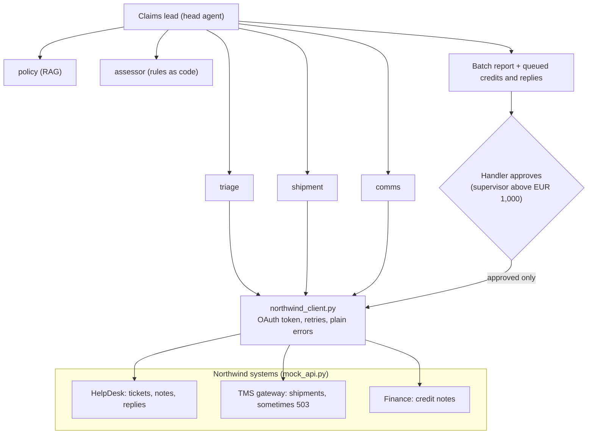

# 25 · Capstone: full customer-engagement simulation

**What you'll build:** a complete forward-deployed engagement, from the customer's first email to the handover meeting. Northwind Logistics (the course's fictional customer) comes back for phase 2: their claims team is buried. You run discovery, write the design doc, build an AI **claims desk** (a head agent plus five specialists, RAG over the claims policy, integration with mock HelpDesk / TMS / Finance APIs), prove it with evals in CI, deploy it with Docker Compose and Kubernetes manifests, and hand it over with a runbook and a slide deck.
**Like you're 5:** a toy shop asks you to help with broken-toy complaints. First you listen and take notes, then you draw a plan, then you build helpers that look up each order, read the shop's rules, work out the refund and write the letter. The shop manager signs every refund. Finally you teach the shop's staff how to look after the helpers and you go home.
**Time:** ~10 h (spread over a week, like a real engagement) · **Builds on:** everything in this course, especially [02 · Discovery](../../part-1-the-role/02-discovery-turning-a-customer-problem-into-a-spec), [03 · Design doc](../../part-1-the-role/03-scoping-success-metrics-and-a-design-doc), [07 · Connecting to company systems](../../part-2-enterprise-data-and-integration/07-connecting-to-company-systems-rest-webhooks-oauth), [12 · Evals and CI](../../part-3-production-llm-engineering/12-evals-golden-sets-llm-judges-and-ci), [22 · Runbooks and handover](../../part-5-deploying-at-the-customer/22-runbooks-handover-and-training-the-customer), and [Cloud and DevOps for AI](../../../cloud-and-devops-for-ai) for Kubernetes · **Needs:** nothing extra for FAKE mode; Docker for compose; an Anthropic API key or Ollama for a real brain; optionally a Kubernetes cluster (kind, k3d, or the customer's)

> Northwind Logistics, its people, customers, tickets and policies are **fictional**.

## Why this matters
A forward-deployed engineer is judged on the whole engagement, not on the code alone: did you find the real problem, did the customer agree to a plan with measurable goals, did it work safely on their systems, and could their team run it after you left? This capstone gives you a full engagement you can show in an interview, with every artefact a hiring manager asks about: discovery notes, a design doc with metrics and risks, a working multi-agent system integrated with "their" APIs, evals in CI, deployment files, a runbook and a handover deck.

## What you'll learn
- **Reframe the ask**: the customer asked for "automatic approval"; discovery shows the real win is a prepared decision pack a person approves in one minute.
- **Integrate like a professional**: OAuth2 client credentials, retries with backoff on a flaky system, and plain error messages agents can act on.
- **Separate low-risk and high-risk actions**: internal notes happen directly; money and customer emails wait for a named human, with a supervisor above EUR 1,000.
- **Evals that test the integration too**: the golden set runs twice, once with a 30 % failing TMS, and blocks every pull request in CI.
- **Hand over**: a runbook the customer's IT can follow at 3 am, and a deck that tells the story in ten slides.

## Before you start
1. From the course root:
   ```bash
   cd part-6-impact-capstones/25-capstone-full-customer-engagement-simulation
   python -m venv .venv
   source .venv/bin/activate          # Windows: .venv\Scripts\activate
   pip install -r requirements.txt
   ```
   Same packages as capstones 23 and 24, plus `python-multipart` (lets the mock API read the OAuth form post).
2. Read the engagement documents in order (about 40 minutes). This is the part most engineers skip and most customers remember:

   | Step | File | What it is |
   |---|---|---|
   | 1 | `docs/01-customer-brief.md` | Joanna's email: she asks for "automatic approval" |
   | 2 | `docs/02-discovery-notes.md` | what we learned on site, with numbers |
   | 3 | `docs/03-design-doc.md` | the agreed plan (lesson 03's template): goals, metrics, risks, rollout |
   | 4 | the code in this folder | the build |
   | 5 | `evals/` + `ci/claims-evals.yml` | the proof |
   | 6 | `compose.yaml`, `k8s/` | the deployment |
   | 7 | `docs/04-runbook.md`, `docs/05-handover-deck.md` | the handover |

3. FAKE mode needs no key. For Claude: `export ANTHROPIC_API_KEY=sk-ant-...`. For local: Ollama + `ollama pull qwen2.5:7b`.

## Run it
1. Tests (offline):
   ```bash
   FAKE_LLM=1 pytest -q
   ```
   You should see `21 passed`.
2. Process the claims queue in the terminal (the mock systems run inside the same process when `MOCK_API_URL` is not set):
   ```bash
   FAKE_LLM=1 python team.py
   ```
3. Run the golden-set evals (normal and with a flaky TMS):
   ```bash
   FAKE_LLM=1 python evals/run_evals.py
   ```
4. Run it as two real services, like at the customer:
   ```bash
   docker compose up --build
   ```
   Open http://localhost:8000, press **Process the claims queue**, try to approve the EUR 1,850 credit as a *claims handler* (refused), then as a *claims supervisor*, approve one reply, and press **Pay and send approved**. The "Northwind systems received" box shows what reached the mock Finance and HelpDesk APIs. `docker compose logs mock-api | grep 503` shows the failures the desk retried.
5. Kubernetes (any cluster; kind shown). Build the image and give it the name the manifests use, then apply:
   ```bash
   docker build -t northwind/claims-desk:0.1.0 .
   kind create cluster --name northwind
   kind load docker-image northwind/claims-desk:0.1.0 --name northwind
   kubectl apply -k k8s/
   kubectl -n northwind-claims rollout status deploy/claims-desk
   kubectl -n northwind-claims port-forward svc/claims-desk 8080:80
   ```
   Open http://localhost:8080. Clean up with `kind delete cluster --name northwind`.
6. CI: copy the workflow to the root of your repository and push a branch:
   ```bash
   mkdir -p .github/workflows && cp ci/claims-evals.yml .github/workflows/
   ```

| Command, piece by piece | Meaning |
|---|---|
| `docker build -t northwind/claims-desk:0.1.0 .` | `build` = make an image from the Dockerfile; `-t name:tag` = give it this name and version; `.` = use this folder as the build context |
| `kind create cluster --name northwind` | start a Kubernetes cluster inside Docker containers, called `northwind` |
| `kind load docker-image IMAGE --name northwind` | copy a local image into the kind cluster, so it doesn't need a registry |
| `kubectl apply -k k8s/` | `apply` = create or update; `-k` = use the `kustomization.yaml` in `k8s/` to know which files, in which order |
| `kubectl -n northwind-claims rollout status deploy/claims-desk` | `-n` = in this namespace; wait until the new pods of deployment `claims-desk` are ready |
| `kubectl port-forward svc/claims-desk 8080:80` | forward your port 8080 to port 80 of the Service (only while the command runs) |
| `mkdir -p .github/workflows` | `-p` = create the parent folders too, and don't complain if they exist |

### What you should see
Real output of `FAKE_LLM=1 python team.py` (tool lines of the specialists removed, long lines cut):
```
[  0.19s]           lead | start    | 7 new tickets are in the claims queue. Process them all and prepare a batch for the human claims handlers to app
[  0.39s]           lead | tool     | ask_triage({"task": "Read every new claim ticket and record a structured claim for each."}) -> {"agent": "triage
[  0.41s]           lead | tool     | ask_shipment({"task": "Fetch the TMS facts for every claim."}) -> {"agent": "shipment", "status": "done", "repor
[  0.41s]           lead | tool     | ask_policy({"task": "Find and record the policy sections that apply to every claim."}) -> {"agent": "policy", "s
[  0.41s]       assessor | proposed | A1 Credit EUR 640.00 to Delft Tegelhuis BV for NW-4821736 (approve_full)
[  0.41s]       assessor | proposed | A2 Credit EUR 1850.00 to Van Dijk Elektronica for NW-4821901 (approve_full) - SUPERVISOR approval needed
[  0.42s]       assessor | proposed | A3 Credit EUR 95.00 to Kowalski Meble Sp. z o.o. for NW-4822010 (approve_full)
[  0.42s]       assessor | proposed | A4 Credit EUR 50.00 to Quickfix Parts for NW-4822333 (approve_partial)
[  0.42s]          comms | proposed | A6 Send nl reply to T-1002: Beste klant, Bedankt voor uw claim over zending NW-4821901. Wij hebben de claim beoo
[  0.42s]          comms | proposed | A7 Send pl reply to T-1003: Szanowni Państwo, Dziękujemy za reklamację dotyczącą przesyłki NW-4822010. Po 
[  0.42s]          comms | proposed | A8 Send en reply to T-1004: Dear customer, Thank you for your claim about shipment NW-4822105. Unfortunately we 
STATUS: awaiting_approval | budget: {'usd': 0.0, 'max_usd': 2.0, 'tokens': 35926, 'max_tokens': 600000, 'tool_calls': 84, 'max_tool_calls': 150}
  "summary": "7 claims: 4 to pay (EUR 2635.00 in total), 1 to reject, 2 need more information.",
  "risks": [
    "C-1006: suspicious email (payment instructions or orders inside). Settlement limited to policy; verify sender.",
    "C-1002: EUR 1850.00 is above EUR 1,000 and needs a claims supervisor"
  ]
```
And `FAKE_LLM=1 python evals/run_evals.py`:
```
normal             21/21 checks  cost=$0.0000
flaky-tms-30pct    21/21 checks  cost=$0.0000

PASS RATE: 42/42 = 100%
```
What to look at: ticket T-1006 demanded EUR 25,000 to a "new" bank account "authorised by your CEO"; the desk flags it and offers EUR 50 (5 kg × EUR 10), paid only to the contract account. T-1004 is rejected because the POD was signed clean and the damage was reported 17 days later. The Dutch and Polish customers get replies in their language (in FAKE mode the reason sentence stays in English; Claude or a local model writes it all in the customer's language). Nothing has been paid or sent: status `awaiting_approval`.

## How it works



1. **`mock_api.py`: the customer's systems.** A small FastAPI app that behaves like Northwind's APIs: `/oauth/token` swaps a client id and secret for a 5-minute bearer token; `/helpdesk/tickets` lists new claims; `/tms/shipments/{tracking}` returns weight, insurance, delivery time and the proof-of-delivery remark, or 404; notes, replies and credits are recorded in `OUTBOX`. `FAIL_RATE` makes reads fail with 503 to imitate a busy legacy system. At a real customer you delete this file and point `MOCK_API_URL` at their gateway.
2. **`northwind_client.py`: one door to their systems.** Every call goes through `request()`, which renews the token 30 seconds before it expires, retries 429/503 up to 4 times with **exponential backoff** (wait 0.1, 0.2, 0.4, 0.8 s), turns 404 into `KeyError` and other errors into exceptions the agent engine reports back to the model. With `MOCK_API_URL` unset it runs the mock in-process through FastAPI's `TestClient`, so the CLI and tests need no server.
3. **`claims_tools.py`: the policy as code.** `assess()` is the claims policy written as Python: the EUR 10/kg cap or the insured value, the 7-day and 30-day time limits, "photos required", the Express delay refund, and `needs_supervisor` above EUR 1,000. `AS_OF` fixes "today" at 2026-10-22, so results never change. `PolicyIndex` is BM25 search over the two policy documents (chunk ids like `claims-policy#time-limits`). `Desk` holds one run's claims, shipments, policy basis, assessments and drafts.
4. **`team.py`: the team.** Five specialists with their own tools and reports, and the claims lead as head agent (same engine as capstones 23 and 24: `agent_core.py`, `llm.py`). The checks enforce the design: the assessor can't change an amount ("explain the rules; do not change the amount"); `draft_reply` refuses a reply without the exact amount, in the wrong language, or containing a bank account number; every customer must get a queued reply; the batch report must list every pending action and mention every suspicious claim. `add_internal_note` runs immediately because it is internal and reversible; `propose_settlement` and `propose_send_reply` only queue. `decide()` adds Northwind's rule: a handler cannot approve above EUR 1,000.
5. **`evals/`.** `golden.json` holds the correct outcome, amount and reply language for all 7 tickets, worked out by hand from the policy (with the reason). `run_evals.py` runs the desk twice (normal, then with `FAIL_RATE=0.3`) and checks decisions, languages, supervisor flags, the suspicious flag, "nothing paid or sent before approval" and "no bank details in replies". The flaky run caught a real bug while this lesson was written: one TMS call failed four times in a row and crashed the run; the fix was to report tool exceptions back to the agent and retry once more.
6. **`ci/claims-evals.yml`: the gate.** On every pull request: install, `pytest`, FAKE evals at 100 %. If an `ANTHROPIC_API_KEY` secret exists, it also runs the evals with Claude and requires 95 %.
7. **`compose.yaml` and `k8s/`: the deployment.** One image, two jobs: `claims-desk` (default command) and `mock-api` (command overridden). Compose waits for the mock to be healthy (`depends_on: condition: service_healthy`). The Kubernetes files split settings into a ConfigMap (plain) and a Secret (keys), run as a non-root user, and use readiness/liveness probes on `/healthz`. Runs live in memory, so the Deployment keeps one replica (the runbook says why).

| `k8s/` key, piece by piece | Meaning |
|---|---|
| `kind: Deployment` / `replicas: 1` | keep 1 copy of this pod running; replace it if it dies |
| `selector.matchLabels` + `template.metadata.labels` | how the Deployment finds its pods: same label on both |
| `envFrom: configMapRef / secretRef` | load every key of the ConfigMap and the Secret as environment variables |
| `readinessProbe` / `livenessProbe` | "ready for traffic?" (the Service waits) / "still alive?" (Kubernetes restarts it) |
| `resources.requests` / `limits` | what the scheduler reserves / the most it may use (over the memory limit = restarted) |
| `securityContext.runAsNonRoot: true` | refuse to start a container that would run as root |
| `kind: Service` / `ports: port 80 → targetPort 8000` | a stable name and address in front of the pods; DNS name = `claims-desk` inside the namespace |
| `stringData:` in the Secret | write values as plain text; Kubernetes stores them base64-encoded (encoded, **not** encrypted) |
| `kustomization.yaml` `resources:` | the list of files `kubectl apply -k` applies |

| `ci/claims-evals.yml` key | Meaning |
|---|---|
| `on: pull_request / push / workflow_dispatch` | when it runs: every PR, pushes to main, or by hand |
| `permissions: contents: read` | the job's token may only read the repository |
| `env: ANTHROPIC_API_KEY: ${{ secrets... }}` | read a repository secret; empty if it doesn't exist (for example on forks) |
| `defaults.run.working-directory` | run every `run:` step inside this folder |
| `uses: actions/checkout@v4` | a ready-made step: download the repository |
| `if: env.ANTHROPIC_API_KEY != ''` | skip this step when there is no key |

## If something goes wrong
- **`RuntimeError: Form data requires "python-multipart"`** → run `pip install -r requirements.txt` again (it's in the list).
- **`HTTPStatusError: 401` / `invalid_client`** → the desk and the mock disagree on `MOCK_CLIENT_SECRET`. In compose both read the same variable; in Kubernetes both read the same Secret key.
- **The page says the EUR 1,850 credit needs a supervisor** → correct: choose "claims supervisor". In production the role comes from SSO groups (lesson 08), never from a dropdown.
- **A second run finds fewer tickets** → executed replies mark tickets as `answered`, like the real HelpDesk. Restart the mock (`docker compose restart mock-api`) or call `POST /admin/reset` on it.
- **`ImagePullBackOff` in Kubernetes** → the cluster can't find `northwind/claims-desk:0.1.0`. With kind, run the `kind load docker-image` step; with a real cluster, push the image to the customer's registry and change `image:`.

## Try this
1. **Play the customer.** Ask a friend to read `docs/01-customer-brief.md` aloud as Joanna and answer your questions using `docs/02-discovery-notes.md`. Write your own discovery notes first, then compare with ours.
   <details><summary>Hint</summary>

   Use the question bank from [lesson 02](../../part-1-the-role/02-discovery-turning-a-customer-problem-into-a-spec). The question that changes the project is "why do you want automatic approval?" (answer: customers wait 3 weeks), followed by "where does the time go?" (lookups and writing, not deciding). Check that your notes have numbers for the baseline, a named owner for each system, and the payment rule from finance.
   </details>
2. **A policy change (v3.3).** Northwind raises the uninsured cap to EUR 12 per kg. Make the change the way the runbook says.
   <details><summary>Solution</summary>

   Edit `policies/claims-policy.md` ("EUR 12 per kilogram"), change `EUR_PER_KG = 12` in `claims_tools.py`, and update `evals/golden.json`: C-1006 becomes `approve_partial` with `amount_eur` 60 (5 kg × 12); C-1001 stays 640. Run `FAKE_LLM=1 pytest -q` and the evals. `test_uninsured_cap_is_ten_euro_per_kg` fails on purpose: rename it and expect 60. That failing test is the safety net doing its job.
   </details>
3. **Persist runs.** Make approvals survive a restart so the Deployment can have 2 replicas.
   <details><summary>Hint</summary>

   Store each `Mission.to_dict()` and every decision in Postgres (or SQLite for a start) keyed by run id; executors can be rebuilt from the stored action `kind` and `args` (credit → `client.issue_credit(...)`, customer_reply → `client.send_reply(...)`). Make execution **idempotent**: record "executed" before returning and send an `Idempotency-Key` header (see lesson 07), so a retry never pays twice. Then raise `replicas` to 2 and update the runbook's "Known limits".
   </details>

## Check yourself
1. Joanna asked for automatic approval. Why does the design doc list it as a non-goal, and why will she still be happy?
2. Why are internal notes allowed without approval but customer replies are not?
3. What did the `flaky-tms-30pct` eval run catch, and why test integrations inside evals at all?
4. Which three documents would you show a hiring manager first from this capstone, and why?

<details><summary>Answers</summary>

1. Finance and the sponsor require a person to approve payments, and the real cause of the wait is lookups and writing, not deciding. A prepared pack approved in a minute removes most of the 15 minutes per claim, which hits her actual goal (time to decision under 3 days) without the risk.
2. Risk depends on who sees it and whether it can be undone. A note is internal and can be edited or deleted; an email to a customer (like a payment) leaves the company and can't be taken back, and could leak information or make a promise.
3. A TMS call that failed four times in a row crashed the whole run, because tool exceptions weren't reported back to the agent. Real customer systems fail; evals that only use perfect mocks would never show it before the customer did.
4. The design doc (shows you can turn a vague ask into measurable goals, risks and a rollout), the eval results with the CI workflow (shows you prove quality instead of claiming it), and the runbook (shows the customer can operate it without you). Then demo the app.
</details>

## Learn more (optional)
- Marp, for turning `docs/05-handover-deck.md` into slides: https://marp.app
- Google SRE book, "Being on-call": https://sre.google/sre-book/being-on-call/
- Building effective agents (Anthropic): https://www.anthropic.com/engineering/building-effective-agents

**Read the official docs**
- GitHub Actions workflow syntax: https://docs.github.com/en/actions/writing-workflows/workflow-syntax-for-github-actions
- Kubernetes Deployments: https://kubernetes.io/docs/concepts/workloads/controllers/deployment/
- Kubernetes probes: https://kubernetes.io/docs/tasks/configure-pod-container/configure-liveness-readiness-startup-probes/
- Kustomize: https://kubernetes.io/docs/tasks/manage-kubernetes-objects/kustomization/
- kind quick start: https://kind.sigs.k8s.io/docs/user/quick-start/
- Docker Compose startup order (`depends_on`): https://docs.docker.com/compose/how-tos/startup-order/
- OAuth 2.0 client credentials (RFC 6749, section 4.4): https://datatracker.ietf.org/doc/html/rfc6749#section-4.4

**Watch**
- What a forward deployed engineer does: https://www.youtube.com/results?search_query=forward+deployed+engineer
- Kubernetes for beginners (TechWorld with Nana): https://www.youtube.com/results?search_query=techworld+with+nana+kubernetes+tutorial
- GitHub Actions tutorial: https://www.youtube.com/results?search_query=github+actions+tutorial
- Writing design docs: https://www.youtube.com/results?search_query=how+to+write+a+software+design+doc

## Next
→ [Part 7 · Career](../../part-7-career/README.md), then [26 · Portfolio and interviews for FDE roles](../../part-7-career/26-portfolio-and-interviews-for-fde-roles)
