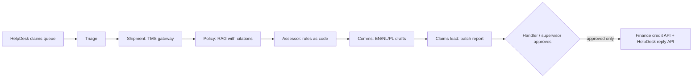

# Design doc: Northwind AI claims desk (phase 2 pilot)

**Customer:** Northwind Logistics · **Author:** FDE team · **Status:** approved · **Last updated:** 2026-12-15

## Summary
Claims wait 19 working days because handlers spend 15 minutes per claim on lookups and writing, and only 2 minutes deciding. We will build an AI claims desk that prepares a complete decision pack for every new claim (structured claim, TMS facts, policy sections, the amount computed by the policy rules, and a reply draft in the customer's language) for a handler to approve. No money moves and no email is sent without a named human; amounts above EUR 1,000 need a supervisor. Success: median time to decision under 3 days within 8 weeks of the pilot start (2027-01-11).

## Background and problem
See `02-discovery-notes.md`. 600 claims a month, 8 handlers, 10 % reopened because rules were misapplied, one fraud attempt a month.

## Goals
1. Median time to decision from 19 working days to under 3.
2. Handling time per claim from 15 minutes to under 4.
3. Reopened claims from 10 % to under 3 %.

## Non-goals
- Automatic approval or payment without a person (explicitly rejected by finance and the sponsor).
- Fraud investigation (we flag suspicious emails; the fraud team investigates).
- Changing the claims policy, or claims above EUR 25,000 (they go to the legal team).
- Phone claims (phase 3).

## Success metrics
| Metric | Type | Baseline | Target | How we measure |
|--------|------|----------|--------|----------------|
| Median time to decision | primary | 19 working days | < 3 working days | HelpDesk report, weekly |
| Handling time per claim | supporting | 15 min | < 4 min | timing study, 20 claims, week 4 |
| Reopened claims | guardrail | 10 % | < 3 % | HelpDesk "reopened" flag, monthly |
| Payments without correct approval | guardrail | n/a | 0 | audit log of approvals vs credit notes |
| Golden-set eval pass rate | quality | n/a | 100 % FAKE, ≥ 95 % Claude | CI on every change |

## Users and use cases
- **Claims handler**: opens the claims desk page, presses "Process the claims queue", reviews each decision pack, approves or rejects credits and replies, then presses "Pay and send approved".
- **Claims supervisor**: approves credits above EUR 1,000 (the page refuses a handler).
- **Customer**: receives a reply in their language within days, with the exact amount or what is missing.

## Proposed solution
A head agent (claims lead) delegates to five specialists, each with its own tools and the cheaper model:

Key decisions: amounts and time limits are computed by code (`claims_tools.assess`), never by the model; agents can only *queue* credits and replies; internal notes are low-risk and allowed directly; payment details are never read from emails.

## Data and integrations
| System | How | Owner | Freshness |
|---|---|---|---|
| HelpDesk | REST, OAuth2 client credentials | Priya (admin) | live |
| TMS gateway | REST, read-only, retries on 503 | Tomasz | live (replica, 5 min lag) |
| Finance credits | REST, write | finance IT | live |
| Policies | Markdown in the repo, versioned | Joanna | on change (see runbook) |

## Security, privacy and compliance
EU region only (Claude via an EU data-residency option, or a local model on Northwind's servers; decision recorded in the security review). SSO for the page; the approver's role comes from SSO groups (handler / supervisor). Every proposal, approval and execution is logged with a name. Prompt injection: email text is data; suspicious emails are flagged by code; amounts are capped by code; payments go only to contract accounts.

## Evaluation plan
Golden set: the 7 representative tickets in `evals/golden.json` (all outcomes, 3 languages, a fraud attempt, an unknown tracking number), checked by code, run in CI on every change and twice (normal and with 30 % TMS failures). Pilot week 1: handlers rate 50 decision packs (correct / needs edit / wrong); target ≥ 90 % correct before scaling.

## Rollout plan
1. 2027-01-11 Pilot: 2 handlers, English claims only. Gate: 50 packs rated, 0 wrong amounts.
2. 2027-01-25 Add Dutch and Polish, all 8 handlers. Gate: native-speaker review of 20 replies per language.
3. 2027-02-22 Go/no-go for production with the metrics above; handover to Tomasz's team (runbook, training).

## Risks
| Risk | Likelihood | Impact | Mitigation | Owner |
|------|------------|--------|------------|-------|
| Policy changes not reflected in code | medium | high | policy owner + test in CI that prose and rules match; runbook step | Joanna |
| TMS gateway down at peak | medium | medium | retries with backoff; desk shows "need info" instead of guessing | Tomasz |
| Handlers approve without reading | medium | high | per-claim summary, sampling audit of 5 % | Joanna |
| Prompt injection in emails | high | high | code caps amounts, flags, contract-only accounts, human approval | FDE team |

## Open questions
- Which LLM hosting does legal accept for production? (Marek, 2027-01-08)
- Should "need info" replies be sent automatically? Current answer: no. (Joanna, after the pilot)

## Alternatives considered
- **Do nothing / hire 3 handlers**: EUR 150k a year and 3 months of training; the backlog would still grow at peaks.
- **One big agent**: simpler, but harder to test, more expensive (every step on the big model) and mixes duties (deciding and paying).
- **Rules engine only, no AI**: handles the maths, but not reading free-text emails in three languages or writing replies.

## Sign-off
Joanna Wiśniewska (sponsor) · Dana Okafor (budget) · Marek Nowak (security) · finance controller (payments).
