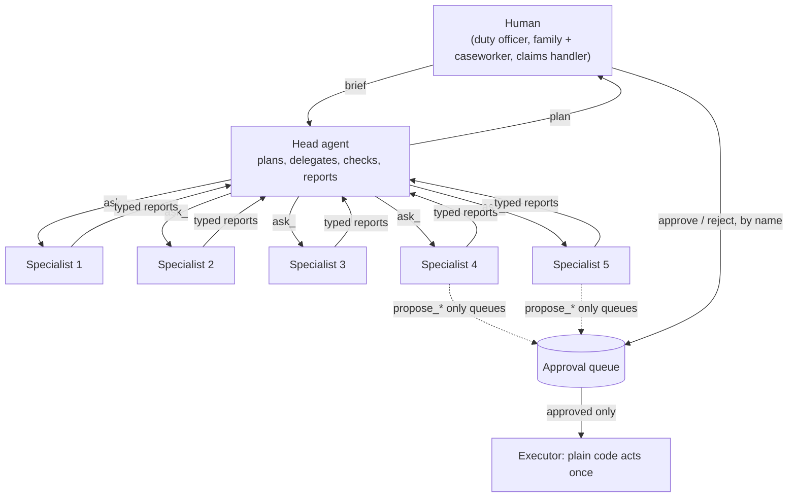

# Part 6 · Impact capstones

Three complete projects where a **head agent** leads **five specialist agents**, each doing a different job, for something genuinely useful: coordinating flood relief, helping families find public benefits, and a full customer engagement for Northwind's claims team. Every capstone has human approval for consequential actions, budgets and step limits, a golden-set eval, a web page, Docker Compose, a FAKE mode that runs without any key, and a fully local mode on open models.

| # | Capstone | Head agent → specialists | Time |
|---|---|---|---|
| 23 | [Disaster-relief command center](23-capstone-disaster-relief-command-center) | coordinator → intake, geo, needs, logistics, comms | ~6 h |
| 24 | [Public-benefits navigator](24-capstone-public-benefits-navigator) | navigator → intake (text or voice), eligibility (RAG + rules), documents, forms, plain-language explainer | ~6 h |
| 25 | [Full customer-engagement simulation](25-capstone-full-customer-engagement-simulation) | claims lead → triage, shipment (API), policy (RAG), assessor, comms; plus discovery, design doc, CI, compose, Kubernetes, runbook, handover deck | ~10 h |

## The shared engine (same two files in every capstone)
Each capstone folder is self-contained, so it has its own copy of:
- **`llm.py`**: one interface to three brains. `FAKE_LLM=1` (rule-based stand-ins, free), `LLM_PROVIDER=anthropic` (Claude: `CLAUDE_MODEL`, default `claude-opus-5-5`, for the head; `SPECIALIST_MODEL`, default `claude-haiku-5-5`, for specialists), or `LLM_PROVIDER=ollama` (any OpenAI-compatible server at `OLLAMA_BASE_URL`, default `http://localhost:11434/v1`; works with Ollama, vLLM and llama.cpp's server).
- **`agent_core.py`**: `Tool`, `Agent` (tool loop + `submit_report` + code checks + step limit), `Mission` (shared case file, approval queue, trace), `Budget` (dollars, tokens, tool calls for the whole team) and `run_mission()` (specialists become `ask_<name>` tools of the head).

Read it once in [capstone 23's How it works](23-capstone-disaster-relief-command-center#how-it-works); capstones 24 and 25 only explain what is new.

## Setup for this part
- Python 3.10+ and, per capstone: `pip install -r requirements.txt` inside a virtual environment.
- Docker (Docker Desktop on Windows/Mac) for the compose steps.
- Optional: an Anthropic API key, or [Ollama](https://ollama.com/download) with `ollama pull qwen2.5:7b` (~4.7 GB) for fully local runs. A computer with 16 GB of RAM runs the 7B model comfortably; with 8 GB use a smaller model such as `qwen2.5:3b` and expect more retries.
- Optional for 24: `pip install faster-whisper "av<19"` for voice intake. Optional for 25: kind and kubectl (see [Cloud and DevOps for AI](../../cloud-and-devops-for-ai)).

## What you can do after this part
- Design a multi-agent system where each agent has one job, its own tools and the right-sized model.
- Make agents safe to deploy: code-checked reports, budgets, step limits, prompt-injection layers, and approval gates for anything that spends money, sends messages or changes records.
- Handle sensitive data: redact before the model, restore locally, and offer a local-model option.
- Prove it works with golden-set evals that run in CI for free, and on real models before release.
- Run a full engagement: discovery → design doc → build → evals → deploy → runbook → handover.

## Next
→ [Part 7 · Career](../part-7-career/README.md)
