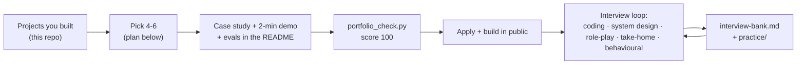

# 26 · Portfolio and interviews for FDE roles

**What you'll build:** your job-hunting kit: a portfolio plan that turns the projects in this repository into 4-6 strong case studies, a one-page case-study template (with a filled example), a `portfolio_check.py` script that scores a project folder the way a hiring manager skims it, three FDE-style coding problems with tests and solutions, and an interview bank with model answers for every loop: coding, LLM system design, customer role-play, take-home and behavioural.
**Like you're 5:** you've built lots of Lego models. Now you pick your best ones, put each on a little stand with a card saying what it does and how you built it, and practise telling the story when visitors come to look.
**Time:** ~4 h to set up, then 30-60 min a day of practice while you apply · **Builds on:** all of this course, especially the [Part 6 capstones](../../part-6-impact-capstones/README.md) · **Needs:** Python only (`pytest` for the practice tests)

## Why this matters
Forward-deployed engineering roles get many applicants who "know LLMs". What gets interviews is *evidence*: projects that solve a real-looking problem end to end, with evals, safety and deployment, explained clearly. What gets offers is showing, live, that you can clarify a messy problem, design a safe system, write solid code under pressure and stay calm with an unhappy customer. This lesson turns the work you've already done into that evidence and gives you a practice routine for each interview type.

## What you'll learn
- **Portfolio over certificates**: 4-6 projects, each with a one-page case study, a 2-minute demo and visible evals beat a long list of courses.
- **Case study structure**: problem → what you built → decisions and trade-offs → how you know it works → safety and operations → next steps → what you learned.
- **The FDE interview loop**: coding with messy data and flaky systems, LLM system design, customer role-play, a take-home, behavioural questions.
- **Answer patterns**: clarify before solving; numbers and trade-offs; acknowledge → ask → summarise → propose with customers; STAR for stories.

## Before you start
- From the course root: `cd part-7-career/26-portfolio-and-interviews-for-fde-roles`
- `pip install pytest` (the only package used).
- A GitHub account for publishing your portfolio (https://github.com/signup).
- No API key needed.

## Run it
1. Score a project folder (try the disaster-relief capstone, then one of your own):
   ```bash
   python portfolio_check.py ../../part-6-impact-capstones/23-capstone-disaster-relief-command-center
   python portfolio_check.py ../../../ai-from-zero/part-1-apis
   ```
2. Run the tests of the checker and of the practice solutions:
   ```bash
   pytest -q tests
   cd practice && pytest -q && cd ..
   ```
3. Do the practice problems in `practice/problems.md` with a 30-minute timer *before* opening `practice/solutions.py`.
4. Work through `interview-bank.md` out loud, one section per day.
5. Write your first case study from `templates/case-study-template.md` (compare with `examples/case-study-disaster-relief.md`).

| Command, piece by piece | Meaning |
|---|---|
| `python portfolio_check.py FOLDER` | score that folder; `../../` = two folders up |
| `--min 80` | exit with code 1 if the score is below 80 (use it in your own CI) |
| `cd practice && pytest -q && cd ..` | `&&` = run the next command only if the previous one succeeded |

### What you should see
Real output of step 1:
```
Portfolio check: 23-capstone-disaster-relief-command-center
  ✅ 15 pts  says what problem it solves, for whom
  ✅ 10 pts  shows how to run it in a few commands
  ✅ 10 pts  has a diagram of how it works
  ✅ 10 pts  shows real output, a screenshot or a demo link
  ✅ 15 pts  has automated tests
  ✅ 15 pts  measures quality (evals, metrics, results)
  ✅ 10 pts  explains trade-offs or design decisions
  ✅  5 pts  can be deployed (Dockerfile / compose / manifests)
  ✅  5 pts  pins its dependencies
  ✅  5 pts  keeps secrets out of the code (no API keys committed)
Score: 100/100
```
The second command scores a beginner part of the course much lower (25/100 in our run: it is a set of lessons, not a portfolio project). That's the point: a lesson folder is not yet a portfolio piece; your fork of it, with a case study and evals, is. Step 2 prints `3 passed` twice.

## How it works



1. **`portfolio_check.py`** reads a project's README and folder and runs ten checks, each a small function in the `CHECKS` list: a problem statement, run commands in a code block, a diagram (mermaid or image), real output or a demo, test files, evals or metrics, trade-offs, a Dockerfile or compose file, pinned dependencies, and no committed API keys (regular expressions for `sk-ant-...` and AWS key ids). The score is the sum of points. It can't judge quality, only whether a reviewer finds the basics in two minutes, which is exactly how most portfolios are first read.
2. **`templates/case-study-template.md`** is one page with the sections hiring managers look for; the most important one is *Key decisions and trade-offs*. **`examples/case-study-disaster-relief.md`** fills it for capstone 23, honestly labelled as a course project with fictional data.
3. **`practice/`**: three problems that match real FDE coding rounds: merging messy customer records (normalisation + union-find for "A matches B, B matches C"), fetching every page from a flaky API (retries with exponential backoff, no retry on auth errors, loop detection) and chunking documents for RAG (structure first, size limits, overlap). `test_solutions.py` is the grader.
4. **`interview-bank.md`**: 10 questions with model answers across all five loops, a fixed 8-step structure for LLM system design, and a pattern for customer conversations.

### Your portfolio plan (from this repository)
Pick **one** project per row you've completed; aim for 4-6 in total. Fork or copy each into its own public GitHub repository, rename it to what it does, and add a case study.

| Show this | Project in this repo | What it proves to an FDE hiring manager |
|---|---|---|
| Full engagement | [25 · Northwind claims desk](../../part-6-impact-capstones/25-capstone-full-customer-engagement-simulation) | discovery → design doc → multi-agent build → integration → evals in CI → compose + Kubernetes → runbook and handover |
| Agents for impact | [23 · Disaster relief](../../part-6-impact-capstones/23-capstone-disaster-relief-command-center) or [24 · Benefits navigator](../../part-6-impact-capstones/24-capstone-public-benefits-navigator) | head agent + specialists, human approval, budgets, prompt-injection defence, PII redaction |
| Private / offline AI | [On-prem stack (lesson 21)](../../part-5-deploying-at-the-customer/21-air-gapped-on-prem-with-open-models) or [offline clinic assistant](../../../open-source-and-on-device-ai/part-4-serving-and-tuning/16-capstone-offline-assistant-for-a-clinic-with-no-internet) | open models, local embeddings, isolation you can prove, offline install |
| Production app | [AI app capstone (Journey 7.6)](../../../ai-engineer-journey/level-7-real-world-ai-apps/06-capstone-deploy-a-full-ai-app) or [incident-response team (Journey 8.8)](../../../ai-engineer-journey/level-8-multi-agent-systems/08-capstone-ai-incident-response-team) | APIs, auth, deployment, evaluation, observability |
| Deep understanding | [Train your own tiny ChatGPT (LLM from scratch, 22)](../../../llm-from-scratch/part-4-from-base-model-to-assistant/22-capstone-train-your-own-tiny-chatgpt) | you know how LLMs work inside: tokenizer, transformer, pretraining, SFT, DPO, evaluation. Rare and memorable in FDE interviews |
| Voice | [Private meeting assistant (Voice AI, 22)](../../../voice-ai-from-zero/part-5-advanced/22-capstone-private-meeting-assistant) | local speech-to-text, diarisation, summaries: popular with customers |
| Classic ML | [Churn predictor pipeline (Journey 3.6)](../../../ai-engineer-journey/level-3-classic-ml/06-churn-predictor-end-to-end-pipeline) | not everything needs an LLM: features, metrics, an API |

Supporting evidence (not portfolio pieces, but worth a line on your CV): the [Linux](../../../linux-from-zero) and [Cloud and DevOps](../../../cloud-and-devops-for-ai) resource guides you worked through, and the [AWS AI Practitioner](../../../aws-ai-practitioner) certification if you took it.

**A 4-week plan**
- **Week 1:** choose 4 projects; one public repository each; READMEs score 100 with `portfolio_check.py`.
- **Week 2:** one case study per project; record a 2-minute demo for each (screen recording, show the problem, the UI, one approval, the eval result).
- **Week 3:** a personal page (GitHub profile README is enough) linking the case studies; one write-up shared publicly ("what I learned building a claims desk with 6 agents"). Start applying.
- **Week 4 and on:** daily practice: one practice problem or one system-design question out loud; one customer role-play a week with a friend; keep shipping small improvements and write about them.

## If something goes wrong
- **`Not a folder: ...`** → the path is relative to where you are; run the command from this lesson's folder, or pass an absolute path.
- **Your project scores low on "measures quality"** → add an evals section: a small golden set, the pass rate, and what still fails. Even 20 hand-written cases with code checks count.
- **"keeps secrets out of the code" fails** → remove the key, **rotate it** (it's compromised once committed, even if you delete the line later), and use environment variables or a secrets file in `.gitignore`.
- **You freeze in system design** → use the 8-step structure from `interview-bank.md` out loud even if it feels mechanical; interviewers reward structure.
- **You don't have "real" experience** → frame capstones honestly ("a course capstone with fictional data") and talk about your decisions and what you'd change. Honesty plus depth beats inflated claims.

## Try this
1. **Score and fix one of your projects.** Run `portfolio_check.py` on a project you built in another course and get it to 100.
   <details><summary>Hint</summary>

   The quickest wins are usually a mermaid diagram, a "What you should see" block with real output, and a short "Trade-offs" section with three bullets. For "measures quality", add a tiny eval script and paste its output.
   </details>
2. **Add an 11th check.** Make the checker award points for a demo video link (YouTube, Loom or a `.mp4`/`.gif` in the repo).
   <details><summary>Solution</summary>

   Add to `CHECKS` (and lower another item by 5 points so the total stays 100):
   ```python
   (5, "links a short demo video", lambda r, f: re.search(r"youtube\.com|youtu\.be|loom\.com|\.mp4|\.gif", r, re.I)),
   ```
   Then add a test in `tests/test_portfolio_check.py` with a README that contains a YouTube link.
   </details>
3. **Mock interview.** Ask a friend to play the VP in question Q6 of `interview-bank.md`, and to interrupt you twice. Record it, watch it back, and write down three things to improve.
   <details><summary>Hint</summary>

   Listen for: did you acknowledge before explaining? Did you ask at least two questions? Did you end with a concrete next step, an owner and a time? Did you blame anyone (the model, the agent, the customer)? Repeat with Q7 and Q8.
   </details>

## Check yourself
1. Why are "decisions and trade-offs" the most important part of a case study?
2. In a system-design interview, what should you do in the first five minutes?
3. A customer is angry about a wrong AI answer. What are the four steps of a good response?
4. Why include failure numbers in your portfolio, not only successes?

<details><summary>Answers</summary>

1. Anyone can follow a tutorial; trade-offs show judgement: you saw options, chose for a reason, and know the cost. That is the daily work of an FDE at a customer.
2. Clarify: users, volume, data sources, constraints (privacy, latency, budget), and the success metric. Then state your assumptions and draw the simplest design that works.
3. Acknowledge the impact, ask questions to get the facts, summarise what you heard, and propose a concrete next step with an owner and a time (plus a prevention step).
4. Honest failure rates show you measured, understand the limits, and know what to fix next. Customers trust engineers who tell them where the system breaks; so do interviewers.
</details>

## Learn more (optional)
- Anthropic engineering blog (agents, evals, context engineering): https://www.anthropic.com/engineering
- The STAR method for behavioural answers: https://en.wikipedia.org/wiki/Situation,_task,_action,_result
- GitHub profile README: https://docs.github.com/en/account-and-profile/setting-up-and-managing-your-github-profile/customizing-your-profile/managing-your-profile-readme

**Read the official docs**
- Claude docs (build with Claude, evals, agents): https://platform.claude.com/docs
- GitHub Pages, for a simple portfolio site: https://docs.github.com/en/pages
- pytest: https://docs.pytest.org

**Watch**
- What forward deployed engineers do: https://www.youtube.com/results?search_query=forward+deployed+engineer+day+in+the+life
- LLM system design interviews: https://www.youtube.com/results?search_query=llm+system+design+interview
- System design basics (ByteByteGo): https://www.youtube.com/results?search_query=bytebytego+system+design
- Andrej Karpathy, "Intro to Large Language Models" (great to understand and explain LLMs in interviews): https://www.youtube.com/watch?v=zjkBMFhNj_g
- Deep Dive into LLMs like ChatGPT (Karpathy): https://www.youtube.com/watch?v=7xTGNNLPyMI

## Next
🎉 **You've finished the Forward Deployed AI Engineer course**, and with it the whole path in this repository: from your first Python file to multi-agent systems running safely inside a customer's network.

What to do now:
1. **Celebrate.** Seriously. Then pick your 4 portfolio projects today.
2. **Build in public.** Share one case study or lesson learned a week (LinkedIn, a blog, GitHub). Small, honest, specific posts get noticed by FDE hiring managers.
3. **Apply.** Look for titles like *Forward Deployed Engineer*, *Forward Deployed AI Engineer*, *Solutions Engineer (AI)*, *Applied AI Engineer*, *Customer Engineer*. Tailor one line of your application to each company's customers.
4. **Keep going deeper.** If you haven't yet, do [LLM from scratch](../../../llm-from-scratch) (22 lessons, Karpathy-style): understanding the model inside makes you a much stronger FDE. Then go back to the [course README](../../README.md) or the [repository README](../../../README.md) for anything you skipped.
