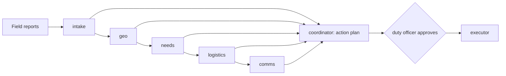

# Case study: AI command center for flood relief (capstone)

**Role:** sole engineer, from design to deployment (a course capstone with fictional data; framed honestly as a portfolio project)
**Stack:** Python, FastAPI, Pydantic, Claude (Opus head, Haiku specialists) or open models via Ollama, Docker Compose · **Links:** repo folder `forward-deployed-ai-engineer/part-6-impact-capstones/23-...` · 2-minute demo video · eval output in the README

## The problem
After a flood, coordinators receive dozens of reports in different formats and languages (SMS, a shelter spreadsheet, a drone survey, emails, radio logs), with duplicates and gaps, while trucks, a boat and supplies are limited. Turning that into a safe, prioritised plan takes hours that the people waiting don't have.

## What I built
A head agent (coordinator) leads five specialists: intake (reads 5 formats, two languages), geo (gazetteer matching, duplicate merging, truck/boat routing), needs (transparent priority score), logistics (stock- and capacity-checked dispatches) and comms (160-character alerts in the residents' language, partner requests). Specialists can only *propose* consequential actions; a duty officer approves each one in a web page, then plain code executes it.

## Key decisions and trade-offs
- **Code calculates, the model judges:** priority scores, routes, stock and capacity are computed in Python; the model reads messy reports and explains. Cost: less "magic", but every number is reproducible and auditable.
- **Propose → approve → execute:** no agent can send a truck or an alert. Cost: a human step in an emergency; mitigated by one-sentence summaries and approving in one click.
- **Cheap specialists, strong head:** specialists on Haiku, the coordinator on Opus: about 40× cheaper per specialist token, with quality where planning happens.

## How I know it works
A golden set of 4 scenarios (normal, bridge washed out, a prompt-injection SMS, low stock) with 42 code-checked expectations runs in CI for free in FAKE mode (100 %). Safety checks on every scenario: nothing executed before approval, stock and capacity respected, alerts ≤ 160 characters with no phone numbers, every pending action shown to the human.

## Safety, privacy, and operations
Three layers against prompt injection (prompt rule, code flag, suspicious reports never scored); hard budgets on dollars, tokens and tool calls; a full trace of every agent step in the UI; runs fully offline on open models when needed.

## What I would do next
Multi-stop routes for vehicles; persisting missions in Postgres so approvals survive restarts; a field-tested gazetteer import from OpenStreetMap.

## What I learned
My first version let the logistics agent forget needs it couldn't cover; the plan looked complete but silently dropped them. I added a check that every need is either covered or listed as unmet with a next step, and now that rule protects every future model and prompt change.
