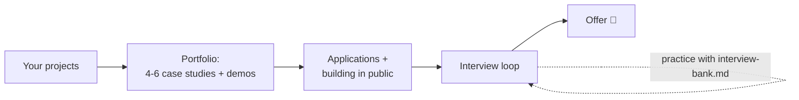

# Part 7 · Career

You can now discover a customer's real problem, build safe multi-agent systems, deploy them inside a customer's cloud or an air-gapped site, and hand them over. This part turns that into a job.

| # | Lesson | What you'll build | Time |
|---|---|---|---|
| 26 | [Portfolio and interviews for FDE roles](26-portfolio-and-interviews-for-fde-roles) | a portfolio plan from this repository's projects, a case-study template and example, a portfolio-readiness checker, 3 coding practice problems with tests, and an interview bank with model answers (coding, LLM system design, customer role-play, take-home, behavioural) | ~4 h + daily practice |

## Setup for this part
- Python 3.10+ and `pip install pytest`.
- A GitHub account for your public portfolio.
- No API key needed.

## What you can do after this part
- Present 4-6 projects as one-page case studies with demos, evals and trade-offs.
- Answer LLM system-design questions with a clear structure.
- Handle customer role-plays calmly: acknowledge, ask, summarise, propose.
- Solve FDE-style coding problems (messy data, flaky APIs, chunking) with tests, under time pressure.

## Next
This is the last part of the course. Finish [lesson 26](26-portfolio-and-interviews-for-fde-roles), then follow its "Next" section: celebrate, build in public, and apply.
